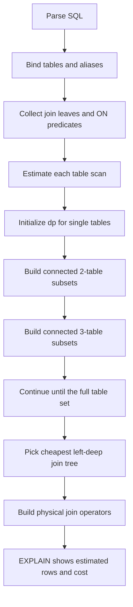

# Teaching CamusDB to choose better query plans

This post explains how CamusDB chooses the order in which it joins tables,
and why that choice has a large effect on query time. You will see how the
search works, how table statistics improve it, and how to enable it and
inspect its result with `EXPLAIN`.

The query optimizer is the part of a database that decides how to run a SQL
query. A query can use different operations, for example a table scan or an
index lookup, and a hash join or a merge join. All the options give a correct
result, and some are much faster than others. The optimizer chooses a plan
before the engine executes the query.

<!-- truncate -->

SQL is declarative. A query says which result the user wants, and gives no
order in which to read the tables.

```camussql
SELECT u.email, p.title, c.body
FROM users u
JOIN posts p ON p.user_id = u.id
JOIN comments c ON c.post_id = p.id
WHERE u.active = true;
```
The database decides the order.

## Join order decides how much data a query reads

Assume that `users` has many rows, but only a few are active. `posts` has many
rows for each user, and `comments` has many rows for each post.

If CamusDB starts with all comments, then joins posts, then joins users, it
reads a lot of data before it finds that most rows do not match
`u.active = true`.

If it starts with the active users, it reduces the data much earlier. Both
orders give the same result, and the second order does much less work. So the
optimizer has to estimate the cost of each order.

## The number of join orders grows fast

With two tables, there are only a few orders. With six or seven tables, the
number of possible orders grows very quickly.

An optimizer could estimate the cost of all the orders and pick the
cheapest. That works for tiny cases, but then the optimizer itself
becomes too slow.

CamusDB uses dynamic programming for eligible inner joins when cost-based
join ordering is enabled. Dynamic programming solves a large problem from the
saved answers to smaller ones. This approach comes from System R, an early
relational database.

The optimizer solves smaller problems first.

- The best plan for `users`.
- The best plan for `posts`.
- The best plan for `comments`.
- The best plan for `users JOIN posts`.
- The best plan for `posts JOIN comments`.

It remembers the best answer for each small set of tables and reuses it to
build the answer for a larger set.

## The optimizer fills a table of partial plans

First, the optimizer estimates the best way to read each table. One table can
use an index, and another a full scan.

Then it looks at pairs of tables that can be joined. For each pair, it compares
the join algorithms and estimates the size of the result.

- Whether an indexed nested loop can join the pair.
- Whether a hash join is cheaper.
- Whether both sides can arrive ordered, which makes a merge join possible.
- How many rows will probably come out.
- How expensive the intermediate result is.

Then it does the same for groups of three tables, and then for larger groups. Each
step builds on the best smaller plans it already found. At the end, it has a
plan for the full query.

These are estimates, because the optimizer does not know the exact row
counts.

## The memo table and the recurrence

The optimizer stores its results in a memo table. Each entry maps a set of tables to the
cheapest plan that the optimizer knows for that set.

```text
dp[set of tables] = cheapest known left-deep plan for exactly that set
```
"Left-deep" is explained in the next section. For a query with three tables,
the optimizer first creates one entry for each single table.

```text
dp[{users}]
dp[{posts}]
dp[{comments}]
```
Each entry stores a partial plan, its estimated cost, and the estimated
number of rows that it produces.

Then CamusDB builds larger entries from smaller ones.

```text
dp[{users, posts}]
dp[{posts, comments}]
dp[{users, comments}]
dp[{users, posts, comments}]
```
In the recurrence, the best plan for a set is the cheapest way to join one of
its tables to the best plan for the others.

```text
best(S) =
  min over each table R in S:
    best(S - R) joined with R
```
CamusDB only considers a join when a predicate connects the existing left
side and the new right table. That prevents a cross product, which is a join
of all the rows of one side with all the rows of the other side.

For each possible extension, the optimizer compares the join algorithms.

- If the right table has an index on the join key, an indexed nested-loop
  join can be cheap.
- If repeated index probes look expensive, a hash join can be cheaper.
- If both sides can arrive ordered by the join key, a merge join can be a
  good option.

In simplified form, the cost of a candidate is the cost of the best left plan
plus the cost of the join with the next table.

```text
candidate_cost =
  cost(best_left_plan)
  + cost(join best_left_plan with next_table)
```
If the new candidate is cheaper than the current `dp[S]`, it replaces it.


The real implementation has more details than this diagram shows.

## The search covers left-deep plans only

In a left-deep plan, the left side grows one table at a time, and each step
adds one new table on the right.

```text
(((users JOIN posts) JOIN comments) JOIN reactions)
```

In a bushy plan, both sides of a join can be joined subtrees.

```text
(users JOIN posts) JOIN (comments JOIN reactions)
```
Bushy plans can be useful, but they make the search space larger. For now,
CamusDB searches left-deep plans only.

The search also covers a limited set of join shapes.

- It is used for eligible inner joins.
- It works with `JOIN ... ON` predicates that can be safely reordered.
- It is capped for very wide joins, which bounds the planning time.
- Unsupported shapes fall back to the heuristic join order.

## Statistics from ANALYZE improve the estimates

CamusDB can use table statistics, index counts, histograms, min/max values,
and distinct-value counts that `ANALYZE` collects. The optimizer estimates row
counts from these values.

- The number of rows in a table.
- The fraction of the rows that pass a filter.
- Whether an index is likely to return a small number of rows.
- The number of rows that a join can produce.

```camussql
ANALYZE TABLE users;
ANALYZE TABLE posts;
ANALYZE TABLE comments;
```
You can inspect the result with `EXPLAIN`.

```camussql
EXPLAIN
SELECT u.email, p.title, c.body
FROM users u
JOIN posts p ON p.user_id = u.id
JOIN comments c ON c.post_id = p.id
WHERE u.active = true;
```
`EXPLAIN` shows the selected physical plan with its estimated rows and cost.
You can see whether CamusDB picked a hash join, a merge join, an indexed
nested loop join, or a fallback nested loop join.

## Constraints on the optimizer

The real engine adds constraints to this simple model.

- It must preserve SQL semantics.
- It must respect join predicates.
- It must not reorder joins when that changes the result.
- It must know which indexes are available.
- It must estimate row counts from imperfect statistics.
- It must choose between different join algorithms.
- It must produce a plan quickly.

You write SQL and create useful indexes. Run `ANALYZE` when the data
changes.

## The cost-based optimizer is opt-in

The cost-based optimizer is behind two configuration flags.

```yaml
cost_based_access_path_enabled: true
cost_based_join_order_enabled: true
```
The rule-based planner remains stable and predictable. Enable the cost-based
planner when you want CamusDB to compare more plans and use statistics.
