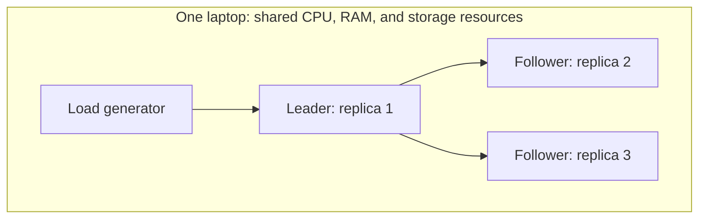

# From 400 to 10,000 operations per second in CamusDB


If you're investigating database throughput, our experience offers a practical
place to look: the work repeated around every query and commit. Here's what
we removed, how we measured the gains, and what the resulting benchmark can
tell you about CamusDB.

Many months ago, when we first started measuring database throughput in
cluster mode, we discovered it could only handle around 400 ops/sec. After a
long journey of benchmarking, investigating bottlenecks, and optimizing the
system, we've reached 10K ops/sec.

On October 12, a three-node cluster sustained **10,284 durable operations 
per second for 45 minutes**, completing 27.8 million operations after a two-minute
warm-up. Every measured minute stayed above 9,700 ops/sec.

All three nodes ran on **one laptop**, alongside the load generator and
metrics collector. And the storage was memory-backed. Both details matter
when interpreting the number.

<!-- truncate -->

## What counts as an operation?

We used [Caraxes](/blog/a-dragon-to-attack-our-own-database), our database
testing tool, to run a bank ledger with 2,000 accounts. Half the operations
read one account by its primary key. The other half transferred money:
subtract from one account, add to another, and commit both changes together.

The read operation executes this parameterized query. `@id` is the account's
primary key; the client consumes all four returned columns and checks that
the requested account came back before counting the read as complete.

```camussql
SELECT id, balance, version, payload
FROM workload_accounts WHERE id = @id;
```

A transfer moves one unit between two distinct accounts. The sequential
client visits them in ascending row-index order, reading and updating each
in turn. Here is the sequence, with parameter names expanded to distinguish
the two accounts:

```camussql
BEGIN;

/* account 1 */
SELECT balance, version FROM workload_accounts WHERE id = @low_id;
UPDATE workload_accounts
SET balance = @low_balance, version = version + 1 WHERE id = @low_id;

/* account 2 */
SELECT balance, version FROM workload_accounts WHERE id = @high_id;
UPDATE workload_accounts
SET balance = @high_balance, version = version + 1 WHERE id = @high_id;

COMMIT;
```

The client calculates each new balance from the value it read: subtract one
from the sender and add one to the recipient. Either account can be the
sender. Each update must match exactly one row, and incrementing `version`
lets the verifier account for row changes afterward. The driver starts and
commits the transaction through its API; `BEGIN` and `COMMIT` show those
boundaries here.

**One committed transfer counts as one operation**, including both reads,
both updates, and the commit. The result was approximately 5,140 standalone
reads and 5,145 committed transfers per second.

Transfers selected accounts across the whole table, so concurrent transactions
could modify the same rows. Conflicting work was retried. The run used
read-committed isolation and 256 concurrent workers over 64 connections; each
worker waited for its operation to finish before starting another.

Afterward, Caraxes reconciled the ledger. The total balance was unchanged,
and no transaction had an indeterminate outcome: none left the client unsure
whether it committed.

## Three replicas, one hardware budget

The host was an Intel Core i7-13620H laptop with 10 cores, 16 hardware threads,
and 31 GiB of RAM, running Debian 12 and Docker.

The table had one replication group: a leader that ordered writes and two
followers that maintained their own copies.



Every write goes through consensus: nodes agree on the ordered changes before
those changes reach database storage. Some reads also require consensus
coordination. Each write is stored three times, once per node. All that work
competes for the same machine's resources.

The laptop's consumer NVMe drive changed its write behavior after
roughly 30 GB of sustained writes. 

## Where the gains came from

**Send requests directly to the leader.** Initially, the client could contact
any node, which might forward the request. Teaching it which node led the
data range removed that extra hop and produced a **1.97× improvement**.
Before optimizing the work inside a request, we shortened its route.

**Reduce the cost of agreement.** CamusDB uses Raft, a protocol for keeping
replicas in agreement. Improvements to replication and follower queues
reduced a replication round from about 2.31 ms to 1.56 ms, adding 8–9% in
throughput. Briefly collecting writes into batches also helped several
requests share replication work. Measuring the actual wait and wake-up time
was essential; the configured delay alone did not describe the cost.

**Write fewer log entries.** Replicas record changes in a log so they can
apply them in order. A change in [Kahuna](https://kahunakv.github.io/), the transactional storage layer
under CamusDB, reduced the log entries per transfer from six to four.
That removed work from the replication path for every committed transfer.

**Schedule less work.** Some storage reads could use a published snapshot of
the latest state without entering a queue for the key. More targeted
notifications also reduced scheduling overhead. Together, these changes
cut thread-pool work items from 65 to 33 per client operation. A thread pool
runs queued pieces of work; making it schedule fewer pieces left more CPU
time for the operations themselves.

**Avoid repeating primary-key lookups.** A primary-key lookup first finds the
row's internal identifier. Caching that identifier let later requests skip
the index read. This reduced underlying storage reads per operation by
**47%** and CPU time per operation by **8%**. The cache recorded 76.85 million
hits, no misses after warm-up, and no stale identifiers during the run.

Increasing concurrency from 128 to 256 workers then added another 8% in
throughput. Latency roughly doubled, while CPU cost per operation stayed
unchanged. More concurrency helped use the capacity we had freed, with a
clear cost to individual requests.

## Measure the ideas that don't help, too

Several plausible changes failed to improve the result. Setting the .NET
thread-pool minimum to 64, 128, or 1,024 made no measurable difference.
Client TLS showed no measurable CPU cost at the leader. Sending transaction
requests through a pipelined client at 128 workers did not help either.

Those measurements narrowed the investigation. We could stop tuning those
settings and focus on costs that moved throughput or CPU time per operation.

## What this result means for your workload

The final run's median read latency was **3.6 ms**, with 99% completing within
18 ms. Median transfer latency was **36 ms**, with 99% within 157 ms.
Throughput needs those latency numbers beside it, especially when increasing
concurrency makes individual operations slower.

The leader was the bottleneck, consuming about 8.5 CPU cores; each follower
used roughly 1.53. Three separate machines would provide a different resource
budget and add network latency between replicas. This run cannot predict
that deployment's throughput.

The 2,000-row working set also fits comfortably in memory. It stresses
transaction processing and contention, without measuring large-table scans
or a database larger than RAM. Client traffic used cleartext gRPC; traffic
between Raft peers retained certificate protection.

Correctness was checked beyond the throughput run. The same stack passed two
two-hour fault tests involving killed leaders, paused processes, and severely
throttled disks. Balances remained correct, replicas did not diverge, and
no transactions remained unresolved across the tested restarts. The separate
NVMe fault tests measured **3,230–5,485 ops/sec** under their conditions.

The frozen campaign baseline was 407.86 ops/sec with the same workload shape
and 32 workers. The final result is 25.2× higher, combining software changes
with increased concurrency. It is a milestone for this workload and setup.

If you're profiling your own system, count the forwarding hops, log entries,
queued tasks, and lookups behind each operation. Those repeated costs gave
us concrete changes to make—and correctness checks told us whether the
faster system still did the right work.

## Conclusion

Running three nodes on a single machine with commodity hardware is far from ideal and certainly not a recommended practice, since the shared hardware becomes a single point of failure for all three nodes. However, it demonstrates that even under these challenging conditions, the database can deliver performance that is more than adequate for the vast majority of transactional applications.
