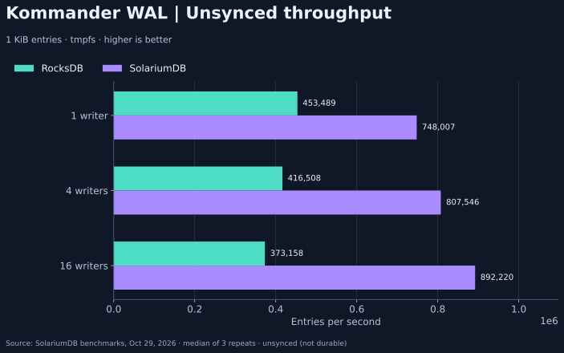
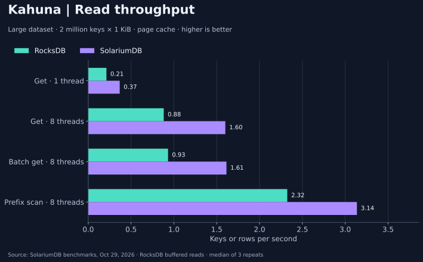
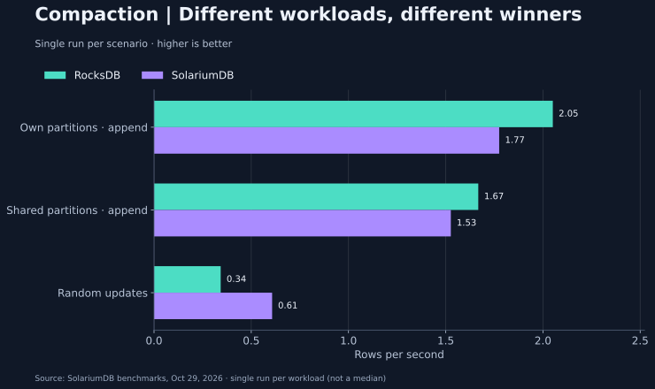
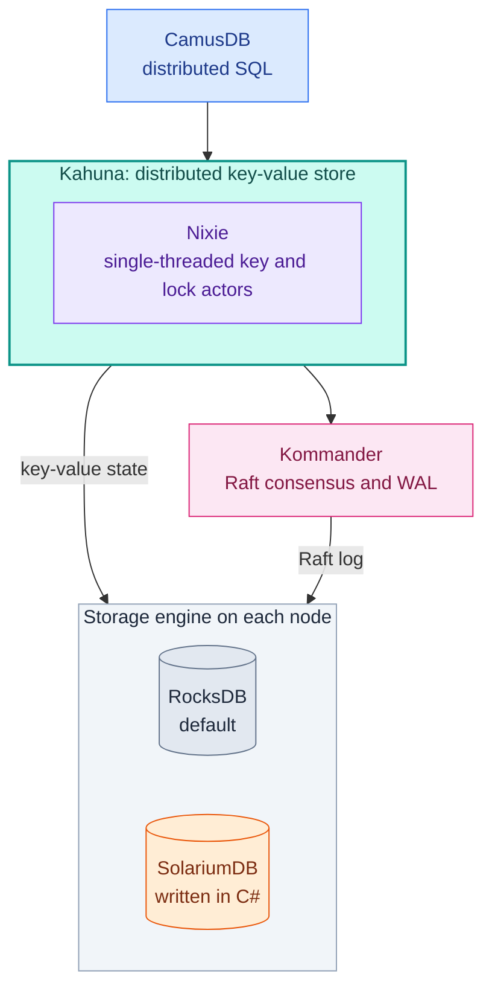

# Introducing SolariumDB: Taking Control of the Storage Layer in .NET

This post introduces [SolariumDB](https://solariumdb.github.io/), an embedded
key-value storage engine written entirely in C#. You will see why we built
it, how it compares with RocksDB in our first benchmarks, and where it fits
in the CamusDB stack. The default storage engine of CamusDB is RocksDB, as
before.

With SolariumDB, you can debug the storage engine of your database with the
same tools you use for your .NET applications. It brings us one step closer
to a database built entirely in .NET, from the SQL layer down to the code
that writes data to disk.

<!-- truncate -->

## RocksDB is hard to inspect from .NET

SolariumDB is different from [CamusDB](https://camusdb.github.io/). It is a
storage engine: the layer that persists data and recovers it after a failure.
It is also an embedded library, which means that another program loads it and
no separate server exists.

SolariumDB follows the architecture of [RocksDB](https://rocksdb.org/), a
Log-Structured Merge Tree (LSM-tree). It has four parts.

- **Write-ahead log (WAL):** a file that records each write before it is
  applied, for recovery after a crash.
- **Memtable:** the newest writes, held sorted in memory.
- **SSTables:** immutable sorted files on disk, written when a memtable is
  full and organized in levels.
- **Compaction:** a background task that merges SSTables and removes old
  data.

RocksDB is a mature and reliable storage engine. It is the default backend
for CamusDB, and we have no plans to change that soon.

However, RocksDB is native code. We can profile our C# code, but to follow an
operation into the storage engine we need a different set of tools. We also
have limited control over its internal I/O behavior unless we modify RocksDB
itself.

## Five advantages of a storage engine in C#

- **End-to-end debugging and profiling.** We can follow an operation from the
  application down to the storage layer with .NET tools.
- **Direct control over I/O.** All file operations go through an
  abstraction we control. That lets us experiment with `io_uring`, an
  asynchronous I/O interface of Linux, and with other I/O strategies.
- **Workload-specific optimizations.** We can tune storage behavior for the
  applications that use it, in addition to general-purpose defaults.
- **Better observability.** We can expose internal metrics such as write
  stalls and pending compactions.
- **No native dependencies.** The storage engine ships as .NET assemblies. It
  needs no separate native binary for each platform.

SolariumDB was first designed around the Raft log of
[Kommander](https://kahunakv.github.io/kommander.github.io/), and it also
serves as a storage backend for Kahuna.

One example of a workload-specific optimization: Raft logs are mostly
append-only and periodically discard old entries. SolariumDB can move
SSTables that do not overlap between levels and leave their contents
unchanged, which reduces disk I/O.

## Benchmark results against RocksDB

In our October 29 benchmarks, SolariumDB achieved up to **2.8 times RocksDB's
throughput in unsynced Kommander WAL workloads**. Unsynced means that a write
returns before the data is forced to the disk. Synced writes generally
performed similarly, because the storage device limited both engines.

In Kahuna's larger dataset, served from the operating system's page cache,
SolariumDB achieved approximately **1.8 times the read throughput** of
RocksDB configured to use buffered reads with eight reader threads.

These results come from specific workloads on a single machine. We do not
claim that SolariumDB is faster in general.

Some areas need work.

- Garbage collection can affect tail latency (the slowest operations) under
  heavy load.
- Some compaction workloads need better tuning.
- The `io_uring` implementation does not outperform the default I/O path in
  all scenarios.

The results show that **a storage engine written in C# can have competitive
performance.**

The complete methodology and results are in our
[benchmarks](https://github.com/solariumdb/solariumdb/blob/main/docs/benchmarks.md).

## CamusDB supports several storage engines

CamusDB was designed to support multiple storage backends, as MySQL does,
where you select a storage engine for your requirements. Some workloads need
write throughput, others need efficient range scans, and others need
predictable latency under heavy concurrency.

Interchangeable storage engines let us explore those tradeoffs and leave the
rest of the database unchanged.

Other databases took this approach. CockroachDB replaced RocksDB with Pebble,
a storage engine written in Go, partly to gain more control over its
implementation and optimization. SolariumDB has a similar motivation within
the .NET ecosystem.

## The five projects under CamusDB

Each project came from a specific need during the work on CamusDB. Each one
can be used independently, and together they make a distributed database.

- [CamusDB](https://camusdb.github.io/): Distributed SQL database
- [Kahuna](https://kahunakv.github.io/): Distributed key-value store, node scaling, backups, etc.
- [Kommander](https://kahunakv.github.io/kommander.github.io/): Raft, WAL, leader election and balancing, consensus, etc.
- [Nixie](https://kahunakv.github.io/nixie.github.io/): High-performance actor model
- [Solarium](https://solariumdb.github.io/): Embedded key-value store, handling the low-level disk I/O

In CamusDB, Kahuna stores its key-value state in the storage engine, and
Kommander stores the Raft log there.

CamusDB turns SQL into key-value operations on Kahuna. In Kahuna, Nixie actors handle concurrency: each key and lock belongs to one single-threaded actor. This means that Kahuna avoids sharing mutable state between threads. Kahuna replicates its writes through Kommander. On each node, a storage engine writes both the key-value state and the Raft log to disk. Today that engine is RocksDB by default, and SolariumDB is the alternative.

## RocksDB stays the default

SolariumDB is still young and has not yet proven itself in production.

**RocksDB will remain CamusDB's default storage engine** while we continue to
test, benchmark, and harden SolariumDB for durability, recovery, and
predictable behavior. Our goal is to mature SolariumDB into a strong
alternative.
