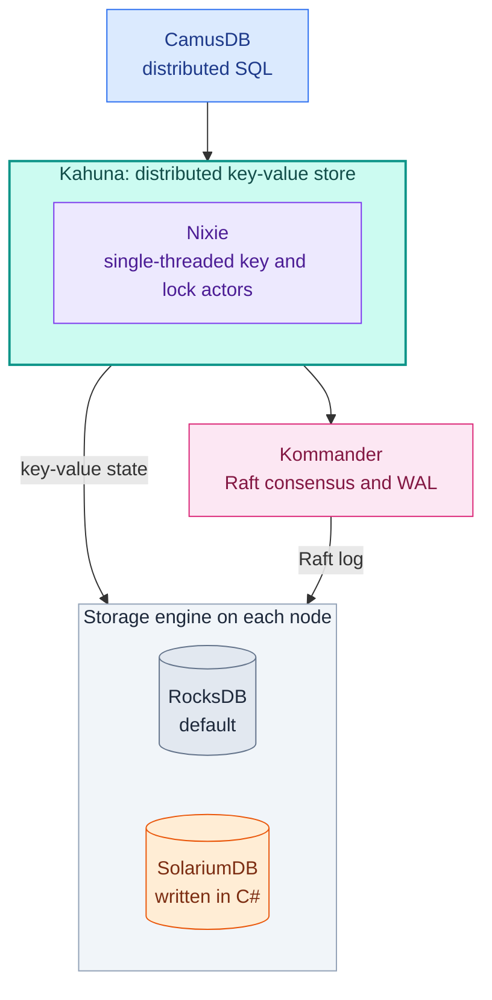

# Introducing SolariumDB: Taking Control of the Storage Layer in .NET

What if you could debug your database's storage engine with the same tools you use to debug your .NET applications? Or optimize how it writes to disk for your specific workload?

That's the motivation behind [SolariumDB](https://solariumdb.github.io/), an embedded key-value database written entirely in C#.

SolariumDB brings us one step closer to building a database entirely in .NET, from the SQL layer down to the code responsible for organizing files and writing data to disk.

<!-- truncate -->

## Why Build Another Storage Engine?

SolariumDB is different from [CamusDB](https://camusdb.github.io/). It isn't a distributed SQL database or a standalone database server. It operates at a much lower level: the storage engine.

This is the layer responsible for persisting data, organizing files, managing memory, and recovering after failures.

SolariumDB follows the architecture of [RocksDB](https://rocksdb.org/), using a Log-Structured Merge Tree (LSM-tree) with write-ahead logs, memtables, SSTables, and background compaction.

RocksDB is an incredibly mature and reliable storage engine. It's the default backend for CamusDB, and we have no plans to change that anytime soon.

However, from a .NET application's perspective, RocksDB can feel like a black box.

When investigating a performance problem, we can profile our C# code, but following an operation into the native storage engine requires a different set of tools.

We also have limited control over its internal I/O behavior without modifying RocksDB itself.

SolariumDB changes that.

## Owning the Entire Stack

By implementing the storage engine in C#, we gain several important advantages:

- **End-to-end debugging and profiling.** We can follow an operation from the application down to the storage layer using .NET tools.
- **Direct control over I/O.** Every file operation goes through an abstraction we control, allowing us to experiment with Linux `io_uring` and different I/O strategies.
- **Workload-specific optimizations.** We can optimize storage behavior around the applications using it rather than relying exclusively on general-purpose defaults.
- **Better observability.** We can expose internal metrics such as write stalls, pending compactions, memtable usage, and file activity.
- **No native dependencies.** The storage engine can be distributed as .NET assemblies without maintaining separate native binaries for different platforms.

These benefits aren't purely theoretical.

SolariumDB was initially designed around the Raft log of [Kommander](https://kahunakv.github.io/kommander.github.io/) and also serves as a storage backend for Kahuna.

For example, Raft logs are mostly append-only and periodically discard old entries. SolariumDB can move non-overlapping SSTables between levels without rewriting their contents, reducing unnecessary disk I/O.

This is the kind of optimization that becomes easier when we control the storage engine.

## What About Performance?

One of my biggest questions was whether a storage engine written in C# could compete with RocksDB.

The early results have been encouraging.

In our October 29 benchmarks, SolariumDB achieved up to **2.8 times RocksDB's throughput in unsynced Kommander WAL workloads**, while synced writes generally performed similarly because both engines were limited by the storage device.

In Kahuna's larger, page-cached dataset, SolariumDB also achieved approximately **1.8 times the read throughput** of RocksDB configured to use buffered reads with eight reader threads.

These results come from specific workloads on a single machine, not a claim that SolariumDB is universally faster.

There are still areas to improve. Garbage collection can affect tail latency under heavy load, some compaction workloads need better tuning, and the `io_uring` implementation doesn't outperform the default I/O path in every scenario.

But the results demonstrate something important: **writing a storage engine in C# doesn't automatically mean sacrificing competitive performance.**

The complete methodology and results are available in our [benchmarks](https://github.com/solariumdb/solariumdb/blob/main/docs/benchmarks.md).

## Different Workloads, Different Storage Engines

CamusDB was designed to support multiple storage backends, following a philosophy similar to MySQL, where different storage engines can be selected for different requirements.

Some workloads prioritize write throughput, others need efficient range scans, and others require predictable latency under heavy concurrency.

Having interchangeable storage engines gives us the flexibility to explore those tradeoffs without rebuilding the entire database.

We're not the first to take this approach.

CockroachDB eventually replaced RocksDB with Pebble, a storage engine written in Go, partly to gain greater control over its implementation and optimization.

SolariumDB follows a similar motivation within the .NET ecosystem.

## Why So Many Projects?

People sometimes ask me, why do you build so many separate projects instead of just calling everything CamusDB?

And they're right, it can be a bit confusing. But the truth is that each project has emerged organically from a specific need while building CamusDB. Each has its own identity and can be used to solve specific problems, but they're all pieces of the same puzzle: building a distributed database.

- [CamusDB](https://camusdb.github.io/): Distributed SQL database
- [Kahuna](https://kahunakv.github.io/): Distributed key-value store, node scaling, backups, etc.
- [Kommander](https://kahunakv.github.io/kommander.github.io/): Raft, WAL, leader election and balancing, consensus, etc.
- [Nixie](https://kahunakv.github.io/nixie.github.io/): High-performance actor model
- [Solarium](https://solariumdb.github.io/): Embedded key-value store, handling the low-level disk I/O

A developer can use any of these projects independently without needing to use the others.

Here's how they fit together inside CamusDB:

CamusDB turns SQL into key-value operations on Kahuna. Inside Kahuna, Nixie actors handle concurrency: each key and lock belongs to one single-threaded actor, so Kahuna avoids sharing mutable state between threads. Kahuna replicates its writes through Kommander. On each node, a storage engine writes both the key-value state and the Raft log to disk. Today that engine is RocksDB by default, and SolariumDB is the alternative.

## What's Next?

SolariumDB is still young, and there's a significant difference between producing promising benchmarks and operating a reliable storage engine in production.

**RocksDB will remain CamusDB's default storage engine** while we continue testing, benchmarking, and hardening SolariumDB.

Durability, recovery, and predictable behavior are non-negotiable. A faster database isn't useful if it cannot reliably preserve your data.

Our goal is to mature SolariumDB into a strong alternative while gaining deeper visibility and control over the entire database stack.

Building a storage engine from scratch is a substantial investment, especially when excellent alternatives already exist.

But sometimes the motivation isn't to replace something because it's broken.

It's to gain the freedom to understand, modify, and optimize every layer of the system.
