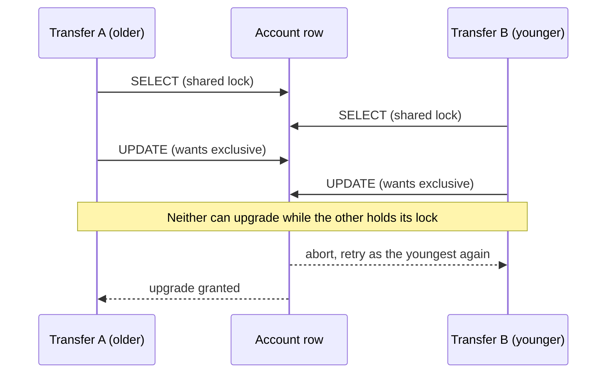
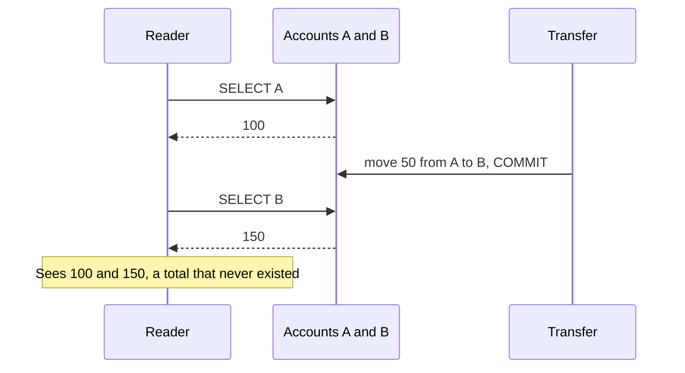
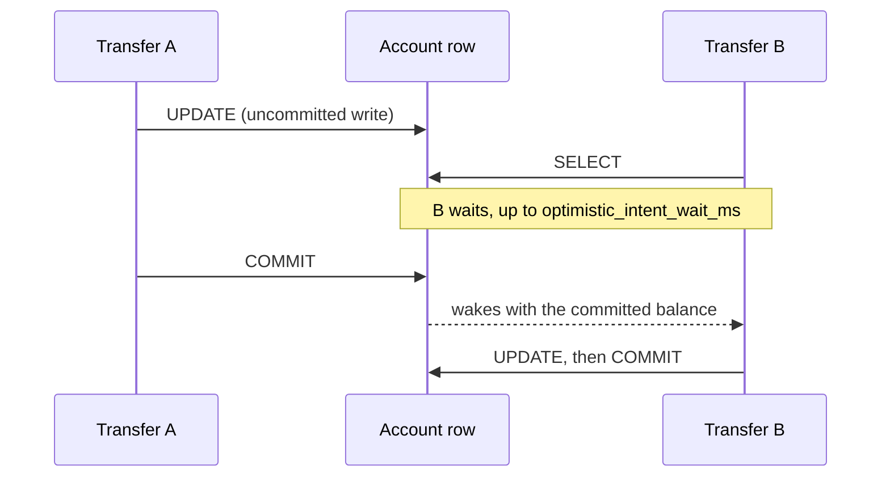

# CamusDB and CockroachDB on the same host: a serializable bank benchmark


This post compares serializable transactions on three-node CamusDB and
CockroachDB clusters, on one bank workload where transactions often collide.
You will see where the old CamusDB default was slower, which row lock
caused it, and the three changes that replaced the lock. If you are
evaluating CamusDB for transactional workloads, the tables and the open
issues show what to expect today.

<!-- truncate -->

In a distributed database, writes and strongly consistent reads require
coordination across multiple nodes, which limits throughput. Every write must
be synchronously replicated to other nodes, wait for a majority to persist
and acknowledge it, and only then return a confirmation to the client.

Reads face similar challenges. The system needs to verify that the node
serving the results is still the leader to avoid inconsistencies. On top of
that, network latency, buffers, and queues can all become bottlenecks as the
workload increases.

These challenges aren't unique to CamusDB. Other strongly consistent
distributed databases, such as Spanner and CockroachDB, have had to solve
similar problems. Traditional single-node databases like PostgreSQL and MySQL
don't face these same challenges. They make different architectural
tradeoffs, favoring single-node performance over some of the guarantees and
capabilities of distributed systems.

Throughout CamusDB's development, the goal has been to improve performance
without weakening strong consistency.

To understand how CamusDB performs against established databases, I decided
to benchmark it against CockroachDB (a distributed SQL database written in
Go). This felt like a more apples-to-apples comparison. Comparing it with
PostgreSQL or MySQL wouldn't be entirely fair, since they're designed to
solve similar problems but take fundamentally different architectural
approaches.

## Results in brief

Both databases ran on one 16-core laptop, three nodes each, at the
Serializable isolation level. Serializable is the strictest level: the result
is the same as if the transactions ran one at a time.

- CockroachDB v26.3.5 completed **7,389 operations per second**.
- CamusDB with its single-row read locks, the default when the comparison
  began, completed **6,857**, and gave up on 0.3% of transfers.
- CamusDB without those locks, the default now, completed **12,618**, with no
  failed transfer.

CamusDB locked every row it read, although its storage layer already
validates those reads at commit. It took three changes to replace the lock.
The lock-free form is now the CamusDB default, and a setting restores the
locks. The default changed on the day of the last measurement, and it is not
in a release yet. The
[changes for applications and the open issues](#changes-for-applications-and-open-issues)
are below.

Before it became the default, the lock-free form passed three full runs of
our nightly consistency checks and three 2-hour fault soaks.

Read CockroachDB's numbers with care. Running three nodes on the same machine
is probably far from ideal. Its settings might not be properly tuned for
maximum performance (probably ignorance on my end), or its defaults might be
optimized for different types of workloads. This post focuses on CamusDB with
the row locks and on the lock-free form.

This is one workload on one host. The [limits](#limits-of-the-comparison)
are listed below.

## Workload and setup

The workload is the bank test from the
[10K ops/sec post](/blog/from-400-to-10k-ops): a table of 2,000 accounts.
Half of the operations are single-row balance reads. The other half are
transfers between two accounts:

```camussql
BEGIN;

SELECT balance, version FROM workload_accounts WHERE id = @low_id;
UPDATE workload_accounts
SET balance = @low_balance, version = version + 1 WHERE id = @low_id;

SELECT balance, version FROM workload_accounts WHERE id = @high_id;
UPDATE workload_accounts
SET balance = @high_balance, version = version + 1 WHERE id = @high_id;

COMMIT;
```

256 concurrent workers on 2,000 rows make transfers collide often. When the
database rejects a transfer because of a conflict, the client retries it, up
to ten attempts.

After each run, a reconciliation checks that the sum of balances is unchanged
and that each row's version matches the committed transfers.

The host is a laptop with an Intel Core i7-13620H (16 logical cores) and
31 GiB of memory. It runs the three nodes and the load generator. Each node
keeps a full copy of the table (replication factor 3), and one node, the
leader, orders the writes. Each node's container is limited to 8,192 MiB,
with data on a 6,144 MiB memory-backed file system (tmpfs). Each run has a
6-minute warm-up and a 10-minute measured window.

| | CamusDB | CockroachDB |
| --- | --- | --- |
| Version | Development build on Kahuna.Core 1.16.7 to 1.16.9, .NET 10 | v26.3.5 |
| Isolation | Serializable, optimistic locking | Serializable (default) |
| Layout | 1 partition, one leader | 16 ranges after load splitting, leases spread over 3 nodes |
| Client | CamusDB .NET client 0.18.1, 256 workers over 64 logical connections | Npgsql 9.0.4, 256 connections |
| Memory settings | Defaults for the limit | `--cache=.25 --max-sql-memory=.25` |

Some terms in the table:

- **Optimistic locking:** a transaction works without waiting for other
  transactions. The database checks for conflicts and rejects the loser.
- **Partition and range:** a slice of a table with its own leader. CamusDB
  calls it a partition and CockroachDB calls it a range.
- **Load splitting:** CockroachDB divides a busy range into smaller ranges,
  and different nodes can lead them.

## Results

| | CamusDB, with read locks (the old default) | CamusDB, without them (the new default) | CockroachDB |
| --- | --- | --- | --- |
| Operations per second | 6,857 | 12,618 | 7,389 |
| Retries per transfer | 0.412 | 0.110 | 0.079 |
| Transfers that gave up after 10 attempts | 6,203 (0.3%) | 0 | 0 |
| Read p50 / p95 / p99 (ms) | 0.75 / 5.3 / 14.0 | 1.7 / 7.4 / 18.4 | 7.2 / 38.2 / 62.2 |
| Transfer p50 / p95 / p99 (ms) | 58.1 / 136.2 / 241.9 | 32.1 / 65.5 / 97.3 | 49.0 / 135.0 / 216.7 |
| Cluster CPU per operation (ms) | 1.38 | 0.87 | 1.98 |
| Peak memory per node (GiB) | 4.5 to 4.7 | 6.9 | 3.4 to 3.8 |
| Reconciliation | Pass | Pass | Pass |

p50, p95, and p99 are the latencies that 50%, 95%, and 99% of operations
stayed under.

A second run of CamusDB with the locks gave 6,828 operations per second.
CockroachDB with load splitting disabled reached 8,132.

- **CockroachDB was CPU-bound on this host.** Its nodes used 14.6 of the 16
  cores, and the load generator used the same machine.
- **CamusDB uses more memory.** In the faster configuration, its nodes peak
  near twice CockroachDB's figure.
- **CockroachDB retries less.** It retried one transfer in thirteen. The
  faster CamusDB configuration retried one in nine.

## Row locks slowed the old default

Under Serializable, CamusDB took a shared lock on every row that a read-write
transaction read. Many transactions can hold a shared lock on one row. To
write the row, a transaction must upgrade to an exclusive lock, which only
one transaction can hold. CamusDB took these locks with optimistic locking
too. On this workload they had three costs.

**A slower commit.** A transaction on one partition can commit in one phase.
A transaction that holds a row lock must use the two-phase commit, which adds
a prepare round. 3,317,003 of 3,317,020 commits took the two-phase path, at
26.0 ms on the server against 13.8 ms.

**Upgrade conflicts.** Two transfers that read the same row both hold a
shared lock, and neither can upgrade while the other holds it. The younger
one aborts. A retried transfer is always the youngest, so it tends to lose
again. 6,203 transfers lost ten times in a row.



**Polling.** A transaction that waits for a lock sleeps 1, 2, 4, and up to
50 ms, and asks again. One run recorded 3.0 million sleeps.

## Three changes that replaced the lock

Kahuna, the key/value storage layer under CamusDB, records every read of an
optimistic transaction with the row revision it saw, or the fact that the key
was missing. At commit, it rejects the transaction if any of those reads is
out of date. A key that is read and then written goes through the same check.

So the lock on a single row adds nothing to what gets committed. But the lock
also did two other jobs, and each one needed its own replacement.

### 1. Reads are validated at commit

A read of a single row takes no lock. The setting
`serializable_optimistic_point_locks: true` restores the lock.

Scans keep their range locks. A row inserted into a scanned range is a new
key, and a check of the keys the scan saw cannot find it.

### 2. A read floor keeps the rows of one transaction consistent

Without the lock, a transaction could read two rows from two different
moments. For example, two accounts hold 100 each:



The database refused the reader's commit, but the application had the two
values first.

Each transaction now has a floor: a moment at which every row it read still
held the value it read. A read of a new row has two paths:

- If the row is unchanged since the floor, the read is served at once. On the
  bank workload, 82% of second-row reads take this path.
- If the row changed, the database checks the earlier rows again. It refuses
  the read if one of them changed.

The floor costs about 3% of throughput.

### 3. A younger writer gives way to an older reader

With locks, the younger of two conflicting transactions is refused at its
first statement, and the older one proceeds.

Without locks, a younger transaction could stage its write. The older
transaction that had read the row was then refused at commit, after it did
all its work. On workloads with a few very hot keys, that cost a third to a
half of the committed transactions.

A write or a delete now gives way at once to an older transaction that read
the row and is still running. That restores the order the lock gave.

## Results on workloads with hot keys

The bank workload picks rows uniformly. To test a few constantly contended
keys, we used the workloads of Elle. Elle is the checker of the Jepsen
project: it reads a history of operations and searches for consistency
anomalies. Its workloads pick keys from a skewed distribution.

- **List-append:** transactions append to lists and read them.
- **Read-write register:** transactions read and write single values.
- **Predicate reads:** transactions read rows that match a condition.
- **Explicit, pipelined, and autocommit:** three ways in which a client sends
  a transaction.

The table shows committed transactions in 60 seconds at Serializable with
optimistic locking, on the same host, in back-to-back runs.

| Workload | Locks on | Without the locks, before change 3 | Without the locks, all three changes |
| --- | ---: | ---: | ---: |
| List-append, explicit, 1 node | 56,060 | 36,794 | 66,620 |
| List-append, pipelined, 1 node | 56,492 | Not measured | 64,283 |
| List-append, autocommit, 1 node | 140,826 | Not measured | 189,796 |
| Read-write register, explicit, 1 node | 35,831 | Not measured | 35,122 |
| Read-write register, pipelined, 1 node | 36,296 | Not measured | 35,853 |
| Read-write register, autocommit, 1 node | 83,428 | Not measured | 81,820 |
| List-append, explicit, 3 nodes | 41,358 | Not measured | 46,765 |
| Read-write register, explicit, 3 nodes | 27,626 | Not measured | 25,988 |
| Predicate reads, explicit, 1 node | 13,606 | Not measured | 14,529 |
| Predicate reads, pipelined, 1 node | 13,491 | Not measured | 13,665 |
| Predicate reads, autocommit, 1 node | 135,497 | Not measured | 135,042 |
| Predicate reads, explicit, 3 nodes | 10,962 | Not measured | 10,675 |

With all three changes, the lock-free form is 13% to 35% ahead of the locks
on list-append. It is level on read-write register and on predicate reads.
The read-write register cell on three nodes is 6% behind, and one run of each
cannot separate that from noise.

Elle judged every history in this table serializable.

## Tests of the lock-free form

**Elle.** The nightly matrix runs list-append, read-write register, and
predicate-read histories on one node and on three, at every isolation level,
locking mode, and wire mode. A cell fails on any anomaly that its isolation
level forbids. With the lock-free form as the default, the matrix passed in
full three times: with the first two changes, then with all three, then with
deletes included. A second nightly job of 18 fault and placement scenarios
also passed all three times.

**Anomaly tests.** Ten interleavings in which a commit of both transactions
breaks serializability, each run with the locks on and off:

- Write skew: two transactions read the same rows, and each writes a
  different row based on what it read.
- A lost update: two transactions read a row, and both write it.
- A decision on a row that another transaction then changed.
- A decision on a missing row that another transaction then inserted.
- A phantom: a row that another transaction inserts into a scanned table.
- A row read through a join.
- Rows read by an `IN` list.
- Rows that an inverted-index read examined and dropped.
- A large value.
- A row that one transaction read and a younger transaction deleted.

At most one transaction commits in each. One more test checks that a reader
never receives the 100-and-150 mix.

**Fault soaks.** A fault soak is a long run in which the test harness injects
failures. Three soaks ran 2 hours each on durable storage with 14 faults: six
leader kills (two of them for 2 and 4 minutes), pauses, and slow-disk
windows. One soak ran after each change.

| | Change 1 only | Changes 1 and 2 | All three changes |
| --- | --- | --- | --- |
| Verdict | Pass | Pass | Pass |
| Reconciliation | Exact | Exact | Exact |
| Operations per second | 5,148 | 5,041 | 4,925 |
| Leader failover after a kill | 3 to 4 s | 2 to 4 s | 1 to 3 s |
| Nodes that died on their own | 0 | 0 | 0 |
| Peak memory per node | 2.4 to 2.6 GiB of 4 GiB | 2.4 to 2.6 GiB of 4 GiB | 2.4 to 2.6 GiB of 4 GiB |
| Transfers that ran out of attempts | 293 of 19 million | 399 of 18 million | 416 of 18 million |

The three soaks ran on different days on a drive whose speed varies, so the
throughput figures are not a trend. The transfers that ran out of attempts
come from the [read wait](#reads-wait-for-an-uncommitted-write) described
below.

**The full test suite.** We ran it with the new default before the commit. It
found one defect: the lock-free form also changed Read Committed
transactions, and refused younger writers that the old form accepted. The
lock-free form now applies to Serializable transactions only.

## Changes for applications and open issues

- **A conflict is reported at a different moment.** A reader no longer blocks
  a writer. A conflict that the lock refused at the writer's statement can
  now be refused at the reader's next read, or at the reader's commit. After
  each refusal, the application can retry the transaction from the start.
- **Readers on another node.** A write gives way only to an older reader
  whose session runs on the node that leads the row. We tried to count
  readers on other nodes, and it showed no gain on three nodes.
- **Transfers run out of attempts during a stall.** See the read wait below.
  33 of the 399 in the second soak were a read that kept answering "retry".
  The third soak had none, so they look tied to the moments of that run's
  faults. They are not traced.
- **Reconciliation proves less than serializability.** It proves balances and
  versions for the bank workload. Elle is the serializability evidence.
- **Memory.** The lock-free runs peak at 6.9 GiB of an 8 GiB limit in ten
  minutes.

## Client streams, read waits, and Read Committed

### More client streams

The CamusDB client sent all 64 logical connections over two network streams.
A raise of the default to eight streams (client 0.18.1) cut read p50 from
2.87 ms to 1.71 ms.

### Reads wait for an uncommitted write

A writer that lost a race used to poll the winner's uncommitted row. With
Kahuna.Core 1.16.7, a read waits behind the uncommitted write and wakes when
that write commits or aborts.



The setting `optimistic_intent_wait_ms` (default 100) limits the wait.
Measured at Read Committed, retries per transfer fell from 0.362 to 0.108.

The wait has one known cost. A retry now takes about 105 ms, so ten attempts
are spent in about a second. When a server stalls for longer, the transfers
queued behind the stalled writer give up: about 300 of 19 million in each
fault soak, against 12 before. The remedy is not chosen.

### Two changes that did not help

- A pause of the client after its write gave way removed wasted attempts, but
  committed 4% to 21% fewer transactions. A refused attempt is cheap, and an
  immediate retry gets in sooner.
- A count of readers on other nodes changed nothing measurable.

### Read Committed results

Read Committed is a weaker isolation level that permits anomalies which
Serializable forbids. On the bank workload, CamusDB at Read Committed with
optimistic locking completes 12,870 operations per second. CockroachDB at
Read Committed with `SELECT ... FOR UPDATE` completes 5,412. The two
configurations do different things, so the Serializable results are the
comparison.

## Limits of the comparison

- **The default is new.** The lock-free form became the default on the day
  of the last measurement. It is not in a release yet.
- **One host.** Nodes and the load generator share 16 cores, which penalizes
  the system that uses more CPU. The 10-minute runs have no network latency
  and no durable disk.
- **One workload, small data.** 2,000 hot rows on one partition favor a
  single-leader layout. CockroachDB is built to spread ranges over many
  nodes, and this test gives it little to spread.
- **Different clients.** Npgsql with 256 connections, against a client that
  shares a few network streams.
- **Defaults, lightly tuned.** CockroachDB ran at defaults apart from the
  memory flags. An expert could likely tune both databases further.
- **Single runs.** Same-build noise on the bank workload is about 0.5% for
  CamusDB. The CockroachDB run was not repeated. The 60-second Elle cells
  vary by a few percent between runs.

## Planned work on the setting and the comparison

- Choose the remedy for transfers that run out of attempts during a stall.
- Repeat the comparison on separate machines with durable disks.
