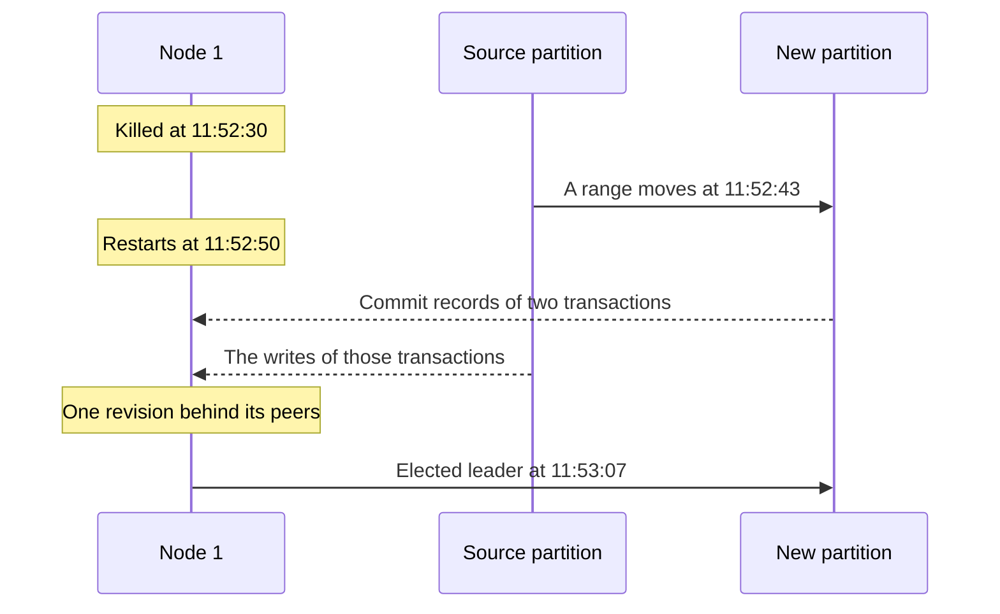

# What the dragon found, part four: backups, schema changes and branches under load


This post lists the defects that Caraxes found in CamusDB in the five weeks
since part three, with the fix for each one. In that period, the tool gained
five faults and five workloads.

The most serious defects returned wrong data. Two transactions read one row
through a join, and both overwrote it. Six rows lost one acknowledged write
after a range split. A database branch read 3,400 of its 3,600 rows. A query
through a new index returned rows that didn't match its filter. Incremental
backups were also refused under load.

If you are evaluating CamusDB, this post shows how routine maintenance
behaves while a cluster is busy and nodes fail.

[Part one](/blog/a-dragon-to-attack-our-own-database) introduced Caraxes, the
tool that attacks a real CamusDB cluster in Docker.
[Part two](/blog/what-the-dragon-found) and
[part three](/blog/what-the-dragon-found-part-three) listed what it found in
its first two months.

<!-- truncate -->

## Commits and releases in five weeks

CamusDB uses two lower layers. Kahuna is the replicated key-value store under
the SQL engine. Kommander is the Raft implementation under Kahuna, and Raft is
the protocol with which nodes agree on the order of writes.
[SolariumDB](/blog/introducing-solariumdb) is a storage engine in C# that a
node can use in place of RocksDB.

| Repository | Commits since 2026-10-14 | Versions consumed by CamusDB |
|---|---|---|
| CamusDB | 262 | |
| Kahuna | 151 | from 1.11.10 to 1.18.0 |
| Kommander | 58 | from 1.10.9 to 1.15.0 |
| SolariumDB | 23 | from 0.1.3 to 0.2.1 |
| Caraxes | 62 | |
| .NET client | 44 | |

Caraxes now has 739 scenario files, up from 332 in part three.

## Terms in this post

| Term | Meaning |
|---|---|
| Partition | A part of the data that is replicated on several nodes. |
| Leader | The replica of a partition that coordinates its writes. |
| Snapshot install | A full copy of a partition, sent from the leader to a replica that is too far behind to catch up from the log. |
| Ledger check | The bank workload moves money between accounts. After a test, the sum of the balances must be unchanged, and each row must be at the version that its acknowledged writes account for. |
| Soak | A long test. |
| Arm | One of two or more tests that differ in one setting. |
| Elle | An open tool that checks a history of transactions for isolation anomalies. |

## Incremental backups were refused under load

The `backup` fault takes a full or an incremental
[backup](/docs/backup-and-restore) on one node while the bank workload is
active. After the workload, a verify stage restores the backup chain and
starts a second cluster from the restored data. The ledger of each restored
node must be equal to the live ledger.

The comparison includes the sum of all row versions. A transfer conserves the
sum of the balances. This means that a restore that lost the last ten minutes
of writes would conserve it too. The version sum increases with each
transfer, and a lost tail changes it.

On Kahuna 1.11.9, each incremental backup was refused. The backup used the
wrong log position as the start of the retained log. The retention floor that
protects the log for the next incremental also didn't engage on a busy node.
Full backups passed.

Kahuna 1.12 fixed both defects, and the second soak on the fix passed.

| Measure | Result |
|---|---|
| Backups under load | 11 in 45 minutes: one full and ten incrementals, all at the first attempt |
| Full backup | 4.7 seconds |
| Incremental backup | 41 to 83 seconds |
| Restore | 12 links, 9,623,338 log entries replayed in 653 seconds |
| Ledger on the three restored nodes | 2,000 rows, balance sum 2,993,071,553, version sum 10,807,982: equal to the live ledger |

The 12 links of the chain are the 11 backups and one closing incremental that
is taken after the workload.

The cost to the workload is measured for the full backup. In the first soak,
the full backup took 6.7 seconds, and throughput fell from 9,014 to 3,412
operations per second in its window. The cost of an incremental isn't graded
yet. The host's NVMe changed to its slow regime after the full backup, as
part three described, and the harness marks a throughput window as
inadmissible when the device changes. In those windows, the workload measured
53 to 95 percent of its earlier rate.

## A replacement node needed four attempts to join from a backup

The `add-node` fault replaces a lost node. One node is killed at minute 30
and doesn't come back. At minute 36, a new node is
[seeded from the backup chain](/docs/backup-and-restore#seed-a-joining-node-from-a-backup)
of a live node, and it joins the cluster under load. A node is a voter when
it counts toward the Raft majority.

| Attempt | Result | Cause |
|---|---|---|
| n1 | The new node exited 60 seconds after its start. | The time limit for a join was a constant of 60 seconds. Kommander now extends the limit while the node makes progress. |
| n2 | The workload ended before the new node started. | The harness copied the full backup catalog, 17 GB, to the new node. It now copies the links of one chain. |
| n3 | After 15 minutes, the node had 2.5 million of 22.5 million log entries. | The restored data wasn't used as the start position, and the leader sent the log from entry 1. |
| n4 | Pass: ready in 140 seconds, a voter in 329 seconds. | Kahuna 1.12.2 certifies the restored position. |

In the fourth attempt, the new node started at the restored position, 580,000
entries behind the leader. After the workload, it read the live ledger
exactly.

In these soaks, an incremental backup that was taken after a membership
change was also published, and the engine then refused to resolve its chain.
Kahuna 1.12.2 takes a full backup at that point.

## Online schema changes failed on a busy table

The `sql` fault sends one statement to a node while the workload is active.
The first scenario changes the schema of the table that takes all the
transfers.

```yml
nemesis:
  events:
    - { at: 20s, fault: sql, target: camus1, duration: 5s, sql: "CREATE INDEX acct_balance ON workload_accounts (balance) INCLUDE (version)" }
    - { at: 50s, fault: sql, target: camus2, duration: 5s, sql: "ALTER TABLE workload_accounts ADD COLUMN tier INT64 NOT NULL DEFAULT (7)" }
    # ... a new table, a bulk insert, a foreign key and a bulk delete ...
```

After the workload, the index must contain exactly the rows of the primary
key with the same values, on all nodes. The new column must be 7 in each row.

The ledger check passed in each test that completed, which means that no
transfer was lost. The schema changes had six defects, and all six are fixed.

| Statement | Defect on October 20 | Result after the fix |
|---|---|---|
| `CREATE INDEX` | The statement could not complete on a table under constant writes. A batch of the index build that lost a conflict with a transfer was not retried, and eleven attempts failed in 40 seconds. | The statement completes at the first attempt. A build of 20,000 rows takes about 40 seconds. |
| `CREATE INDEX` | After the first fix, 3 to 21 rows had a second index entry at an old balance. A query with a filter on the old balance returned the row with its current balance. | The index is equal to the primary key on the three nodes. |
| `ADD COLUMN` | Transfers that didn't name the new column got `CADB0301`, a `NOT NULL` violation. With an identity column, 7,993 transfers got it in 23 seconds, 51 percent of the writes. | No transfer gets the error. |
| `ADD COLUMN` | A transaction that was open across the schema change failed with `CADB0099`, a code that clients don't retry. | The transaction gets the retryable `CADB0502`. |
| `ADD COLUMN` | When one batch of the column fill lost a conflict eight times, the column was removed. | The fill completes, and a new schema leader resumes it. |
| Any DDL | All the DDL of a database waited behind an index build. A `CREATE TABLE` waited 87 seconds. | `CREATE TABLE` answers in 0.2 seconds during a build. |

Two more scenarios kill the three nodes one by one during the statement. The
node that drives the schema change dies, and the next leader of the schema
partition must resume the work.

**An index build that wasn't resumed.** A node that had just restarted won
the leadership of the schema partition and didn't resume the build. The index
wasn't published, and reads through it failed until the end of the test. In
the four tests after the fix, all interrupted builds were published. One
build needed four resumes across five leader changes.

**Three nodes that exited at startup.** The first node to restart had no
majority. It waited 10 seconds for a leader and exited. The other two nodes
then did the same, and the cluster didn't come back. Since Kahuna 1.13.2, a
node that starts waits for a leader. A new scenario kills all three nodes
within 4 seconds, and the cluster must serve again with an exact ledger.

During the 40-second index build, the bank measured 52 percent of its earlier
rate. For more information, see
[Distributed schema changes](/docs/distributed-schema).

## A snapshot count was short after a leader change

The `tokens` workload tests deletes. Each write deletes one token row and
inserts its successor in one transaction. This means that the table has the
same number of rows at each committed state. A probe counts the rows in a
read-only snapshot during the test.

In the first fault test, two counts returned 490 and 491 of 500 rows while no
fault was active. In that second, an election moved the leader of the
partition, and 13 transactions in flight were aborted. The snapshot hid rows
whose deletes didn't commit. The final table was equal to the journal of the
workload, which means that the tokens were intact and the snapshot read was
wrong.

A scenario that removed the leader at intervals of 25 seconds didn't
reproduce the defect, and its 834 counts were exact. The short count then
appeared in a range split test (2,998 of 3,000 rows), in an index build test
(19,999 of 20,000 rows), and after a leader handover (499 of 500 rows, in 3
of 694 probes).

Kahuna 1.13.1 reads a row from its history when a pending write blocks the
current value. Kahuna 1.13.3 records the pending writes of a range before it
reads each page of a scan. On 1.13.3, three tests made 1,879 probes across 74
elections, and no count was short.

## Range splits lost acknowledged writes twice

[Key-range sharding](/docs/key-range-sharding) splits a table into ranges of
keys, and a range can move to a new partition as it grows. The feature is
opt-in.

**October 27.** The bank scenario with a cascade of splits failed its ledger
check on Kahuna 1.14.3. During a split, a transfer could commit on an old
value of a row that had moved. Kahuna 1.14.5 was the first fix, and both
ten-minute tests on it failed. Kahuna 1.14.6 passed two ten-minute tests with
26 and 22 range moves and an exact ledger.

On 1.14.3, the ledger check caught this race in one test of two. The pass
rule for these scenarios now also requires that the node logs don't contain
the error line of the race.

**November 8.** The nightly split scenario failed. Six rows ended one commit
below their acknowledged count.



The range moved to a new partition while one node was down for 20 seconds.
That node restarted and caught up the logs of the two partitions in the wrong
order. It applied the commit records of two transactions from the new
partition before it applied their writes from the source partition. It then
treated those writes as pending, and 39 later commits on those keys failed on
that node. The node was one revision behind its peers, became the leader of
the new partition 17 seconds after its restart, and served the old rows.

Earlier nights had the same faults and passed, with the range moves at other
moments.

Kahuna 1.16.3 fixed it on the same day. A node that catches up the two logs
in either order now ends at the state of its peers. The new `split` fault
starts the range move at second 76, while a node is down from second 70 to
second 90. This scenario is now part of the nightly job, and it fails when
the scheduled split doesn't commit.

## Serializable reads through a join took no range lock

Until November, the Elle scenarios appended to lists. On November 2 we added
a register shape, which reads and writes single values, and a predicate
shape, which reads a filter with `COUNT(*)`. Both shapes are tested with no
fault. A matrix tests them at each isolation level and locking mode, on one
node and on three.

In the first tests, the arms that read by primary key, by index and by
predicate passed. The arms that read through a join failed at the
Serializable level. Their read reaches each register row through a reference
row.

```camussql
SELECT r.v
FROM elle_rw_i64_ref j
JOIN elle_rw_i64 r ON r.k = j.target
WHERE j.k = @k;
```

In 60 seconds, Elle found 63 lost updates and 22 non-repeatable reads. A lost
update is two transactions that read one value and both overwrite it. In this
history, two committed transactions each read the value 12 for key 0 through
the join, and both overwrote it.

A Serializable read needs a shared range lock before it reads. The join paths
skipped that lock, which the scan of one table takes. A key that a join read
as absent was unprotected, and another transaction could insert it and
commit.

CamusDB fixed it on the same day. Each join and subquery path now takes the
lock that the single-table read takes, and 16 test cases check the locks of
each join shape. CamusDB 0.17.0 had this defect. If your Serializable
transactions read through joins, you should use a later release.

Note that the Elle join arms are not in the nightly matrix yet. Until they
are, the 16 test cases guard this fix.

## A database branch read fewer rows after an install or a split

A [database branch](/docs/database-branching) is an isolated copy of a
database that shares the data of its source. A branch reads the rows of its
parent as they were at the fork. For this, the storage layer must retain the
old revisions of rows that the parent changes later.

New test drivers fork a branch under load and change rows in the parent. They
then read the branch through a replica that was rebuilt, with control reads
before and after.

| Event | Defect |
|---|---|
| Snapshot install | The copy contained the current row of each key, and the install deleted the older revisions. On that replica, a branch read showed a row as missing when the parent had changed the row after the fork. The read returned no error. |
| Range split | The split copied one revision of each key. A replica of the new partition that didn't host the source had no older revision, and a branch read 3,400 of its 3,600 rows. |
| Large partition | The receiver didn't take a snapshot above 512 MiB and gave no reason, and the sender retried it. The export was also built in memory: a table of 900,000 rows put two of three replicas out of memory at 4 GiB per node. |

Kahuna 1.16.3 and 1.16.4 fixed these on November 8 and 9. An install and a
range move now carry the revisions that each live branch needs. When a
replica can't answer a read of old history, the read returns a retryable
error. The added revisions make the snapshot larger. With one branch on a
table of 200,000 rows, a partition snapshot grew from 237 MB to 313 MB.

On a five-node cluster with the fixes, a branch read 900,000 of 900,000 rows
through a new replica of a partition above the old limit. A partition with
100 live branches seeded a replica, and all the branch reads were correct.

## Two node deaths on Solarium in the two-hour soak

SolariumDB became a storage option at the end of October. The two-hour fault
soak from part three now has a Solarium arm and a RocksDB arm on one image.

| Solarium version | Result | Change |
|---|---|---|
| 0.1.3 | The leader died at minute 57, with 2,420 of 2,458 MiB of managed heap in use. The cache and the write buffers were objects on that heap. | Version 0.1.4 moves both to native memory. |
| 0.1.4 | A restarted node that received a snapshot install died while it deleted its old rows. | Version 0.1.5 deletes the rows of a key with one range delete. |
| 0.1.5 | In six kills, no restart needed an install. This means that the fix was not tested. | A new schedule has kills of 2 and 4 minutes, which force an install. |

That schedule found the three defects in
[How much we test CamusDB](/blog/how-much-we-test-camusdb#three-defects-the-soak-found-this-week).
The soak with long kills is now the acceptance test for each release of the
storage stack. On Kahuna 1.15.6 it passed at 7,808 operations per second.
Each leader kill failed over in 2 to 4 seconds, and the two long kills were
repaired by one install each, of 4.7 and 8.5 seconds.

## A pinned Raft log and a flipped bit

**The recovery window pinned the Raft log.** After the fix for incremental
backups, the point-in-time recovery window, one hour by default, retained the
Raft log on a busy node. The log grew about 300 MB per minute on each node.
These tests store their data in memory. One test froze the host, and in the
next test two nodes reached their memory limit at minute 11. Kahuna now
retains that log when a backup directory is configured. The verification test
passed at 10,412 operations per second, with the log flat at about 210 MB per
node.

**One flipped bit in a data file.** The `disk-corrupt` fault kills a node and
damages one of its files before the restart. With three replicas, a follower
with one flipped bit in its largest data file flagged the damage within
seconds, and the ledger of 2,000 rows reconciled exactly. A statement that
reads damaged data gets `CADB0837`. Each injection writes a record with the
hash of the file before and after the damage. A test that lacks this record
didn't inject the fault. The fault doesn't damage the files of a live node
yet.

## Two cost measurements

- **Key-range routing against hash routing.** On the bank workload with 256
  workers, key-range routing measured 0.98 of the throughput of hash routing,
  with equal CPU per operation. On a workload with three tables and three
  partitions it measured 0.69, because the first placement put two of the
  tables on one partition. With five partitions, the two modes were level.
  Kahuna now places a new key-range table on the partition that hash routing
  would use.
- **One node against three.** On one build with data in memory and no faults,
  one node with one replica ran 17,634 transactions per second on Solarium,
  and three nodes with three replicas ran 14,319. On RocksDB, the figures
  were 17,027 and 13,434. On this workload, where one leader already serves
  all the requests, three replicas cost about 20 percent of the throughput
  and about 2 ms of median commit time.

## False passes and false alarms from the test setup

- **Two green nights with 3 and 5 operations.** The Read Committed Elle
  scenario completed 3 and 5 operations on two nights, and it passed. A
  scenario can now set a minimum number of committed transactions, and a test
  below it fails as vacuous.
- **An Elle verdict of "unknown".** A change made each Read Committed
  statement read at a new snapshot. The level permits this, and it adds
  dependency cycles to the history. Elle's search timed out on groups of 138
  to 505 transactions. The scenario now limits each list to 8 appends, and
  Elle answers in 11 seconds.
- **Backups that were counted as failed.** The harness stopped a restore of 12
  links and one slow backup at its request limit of 300 seconds. A backup now
  has 20 minutes, and the restore has a separate limit.
- **A recovery rule that measured a schema change.** A new index on the
  balance column adds two index entries to each later transfer, and the bank
  settles near 70 percent of its earlier rate. The rule "regain 90 percent of
  the throughput" then measures the new schema. The schema scenarios now show
  the recovery numbers ungraded.

## Behavior of the database today

- A chain of incremental backups that is taken under load restores to the
  exact live ledger. A replacement node that is seeded from it joins a loaded
  cluster in minutes.
- `CREATE INDEX` and `ADD COLUMN` complete on a table under constant writes,
  and a new schema leader resumes an interrupted change.
- A node that restarts while the cluster has no majority waits for a leader.
- A snapshot count is exact across leader changes.
- A node that catches up a moved range in the wrong order ends at the state
  of its peers.
- A Serializable read through a join takes the range lock of a single-table
  read.
- A branch read through an installed or a moved replica is correct, or it
  returns an error.
- A follower with a damaged data file flags the damage within seconds.

