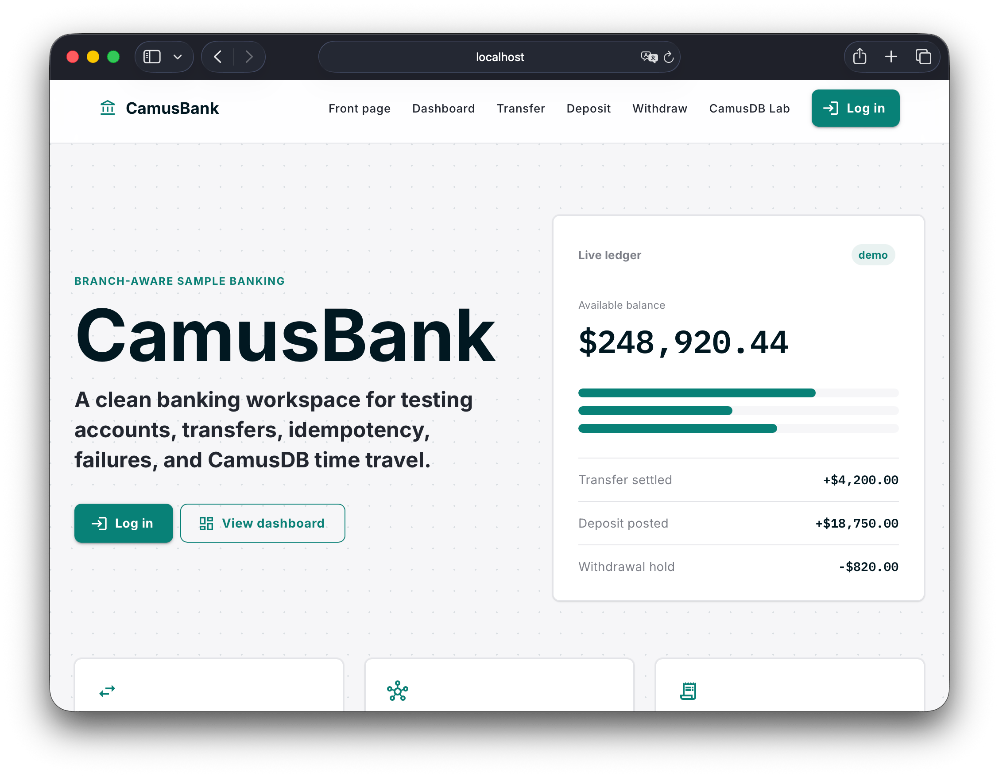
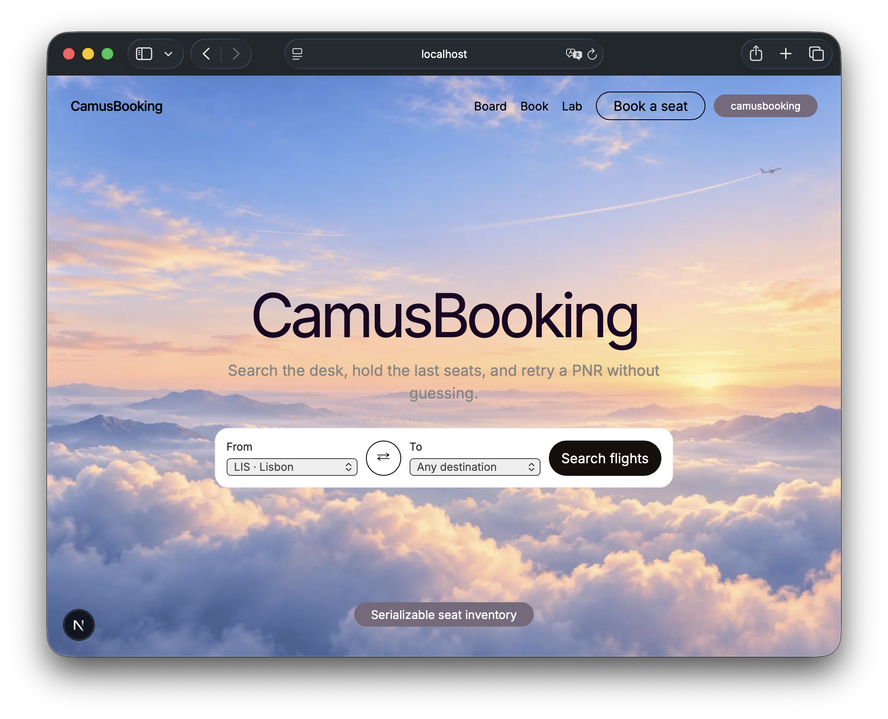

# Advanced samples

These samples are complete applications that use several CamusDB features
together. Try them after the [CamusDB tutorial](/docs/intro). Each README has
the prerequisites and the run commands.

## CamusShop

[CamusShop](https://github.com/camusdb/camusdb-ecommerce) is a robot store
built with Blazor and the [CamusDB EF Core provider](/docs/ef-core) on .NET 10.

It shows how to keep orders and stock correct under concurrent requests and
failures.

- EF Core mappings for CamusDB types, such as OID keys and `NUMERIC` money.
- EF Core migrations that create constraints and a sequence.
- Serializable retries that run the unit of work again with a clean change
  tracker.
- Stock reservation with read-check-write, or with a conditional `UPDATE`.
- A checkout transaction that changes the stock and writes the order with its
  outbox message.
- Idempotent checkout and payment APIs.
- An order state machine with optimistic concurrency.
- A transactional outbox between the services.
- A lab for flash sales and injected failures.

When the API starts, its migrations create the `camusshop` database, and it adds
demo data.

## CamusBank

[CamusBank](https://github.com/camusdb/camusdb-bank) is a small bank built with
`CamusDB.Client` and MudBlazor on .NET 10.

It shows how to move money between accounts when many transfers run at the same
time.

- Unique indexes for account numbers and transfer idempotency keys.
- Transactions that change a balance and write its ledger entry together.
- Retries and idempotency for concurrent transfers.
- A rollback demo.
- Demos of [database branching](/docs/database-branching) and
  [time-travel reads](/docs/time-travel-reads).
- A demo that [recovers a dropped table](/docs/recover-dropped-objects).
- Integration tests against a local CamusDB server.

At the first start, the API creates the `camusbank` database and adds demo
data.

## CamusBooking

[CamusBooking](https://github.com/camusdb/camusdb-booking) is a flight-booking
app built with Next.js and the
[`camusdb` TypeScript connector](/docs/typescript-connector).

It shows how to sell the last seats of a flight to concurrent buyers, with one
booking for each seat.

- One transaction that reserves a seat and writes the booking and an outbox
  message for the payment.
- Payments through an outbox relay and a fake payment gateway.
- Idempotent retries that produce one booking reference (PNR).
- A lab with concurrent bookings for the last seats of a flight.
- Failure injection that shows that the seat hold and the events roll back.
- Demos of branches and `AS OF SYSTEM TIME` reads.
- An `EXPLAIN` demo, and a demo that recovers a dropped table with `RELINK`.

At the first start, the app creates the `camusbooking` database and adds demo
data.
