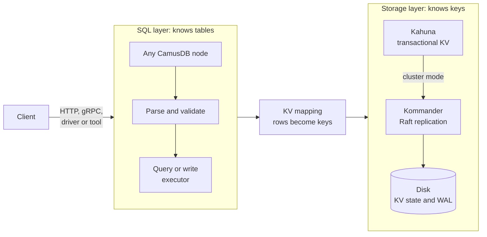

# Architecture

This page shows what happens between the SQL that you send and the disk. Read
it when you want to reason about latency or failures, or before you contribute
to CamusDB. You don't need it to use CamusDB.

In PostgreSQL or MySQL, one server parses your SQL and owns all rows on its
disk. CamusDB divides that work into two layers:

- The SQL layer plans each statement against a relational schema, and maps rows
  and indexes to key/value entries.
- A distributed transactional storage layer stores those entries. It handles
  [partitioning](/docs/concepts#partition), [consensus](/docs/concepts#raft),
  [WAL](/docs/concepts#wal) replay, and persistence.

The SQL layer doesn't know which node owns a key, and the storage layer doesn't
know what a table is. This is why the same SQL works on one node or on a cluster.

## Overview

A CamusDB process is a standalone node or one node of a cluster.

In standalone mode, the process hosts one embedded
[Kahuna](/docs/concepts#kahuna) storage node. This is the simplest setup for
development and tests.
[Storage components](#storage-components) describes Kahuna and the other
storage components.

In cluster mode, several CamusDB processes join through a configured list of
peers, and each process can serve the database API.

The storage layer divides keys across [Raft](/docs/concepts#raft) partitions. It
elects a [leader](/docs/concepts#leader) for each partition, and it replicates
writes through [Kommander](/docs/concepts#kommander). When a node receives a
request for data that another partition leader owns, the storage layer routes
the work to the node that can coordinate it.

Each SQL request follows this path:

1. The client sends SQL to any CamusDB node, through an API or a driver.
2. CamusDB parses and validates the statement.
3. The query or write executor checks the catalog and the transaction state.
4. CamusDB encodes the rows and the index entries as key/value entries.
5. [Kahuna](https://kahunakv.github.io/) coordinates the transactional key/value
   reads and writes.
6. In cluster mode,
   [Kommander](https://kahunakv.github.io/kommander.github.io/) replicates the
   partition log entries through Raft.
7. Committed entries are applied to persistent key/value storage. After a crash,
   they're replayed from the WAL.

## Layers

Each layer gives the layer above it a smaller interface:

| Layer | Purpose |
| --- | --- |
| Client interfaces | Accept SQL and row operations over REST with JSON and over gRPC. |
| Parser and validator | Check the syntax of statements, and reject invalid input. |
| Catalog | Track the schema objects and their versions. |
| Query and write execution | Plan and run reads and writes, including index maintenance. |
| Transaction coordination | Open, commit, and roll back transactions. Coordinate writes across partitions with [two-phase commit](/docs/concepts#two-phase-commit). |
| KV mapping | Encode rows, index entries, and other state as key/value entries. |
| Distributed KV storage | Run transactional key/value operations with [Kahuna](https://kahunakv.github.io/). |
| Consensus and WAL | Order the replicated partition log entries with [Kommander](https://kahunakv.github.io/kommander.github.io/), and recover committed state. |
| Persistent storage | Store the key/value state and the partition WAL on disk. |

## SQL and query layer

The SQL layer gives applications a relational model, and the layers below it
work on key/value entries. The planner and executor support the usual
relational features, for example inner and outer joins, subqueries, CTEs,
window functions, and set operations. For the supported syntax and its limits,
see [SELECT](/docs/sql-queries) and
[Joins and subqueries](/docs/joins-and-subqueries). For the planner and executor
pipeline, see [Query planning](/docs/query-planning) and
[Query planner internals](/docs/query-planner-internals).

## Catalog and schema

The catalog stores the descriptors of all schema objects. Each row records its schema version. This means that a stored row
is decoded with the schema layout that wrote it.

You create a database before you use it. Each database name maps to an internal
ID that doesn't change. Storage keys and standalone data directories use that
ID, not the name. This means that `RENAME DATABASE` updates the name and doesn't
move any data.

Schema metadata is stored in the same key/value storage layer as user data. In
cluster mode, schema changes are replicated and recovered like rows and
indexes.

Online schema changes go through several stages. A node that is behind can't
do regular work on a table until it has the committed schema. For more
information, see [Distributed schema changes](/docs/distributed-schema).

## Storage layer

CamusDB maps each relational object to a key/value key:

- Table rows are stored under a row prefix.
- Unique and non-unique index entries are stored under an index prefix.
- Schema and system metadata are stored under the metadata keys of the
  database.
- Locks and transaction state are key/value entries that the transactional
  storage layer manages.

Keys are ordered, and table and index scans read them in order. The distributed
storage layer handles the routing and the replication of the keys.

For the key layout and the value encoding, see [Storage](/docs/storage).

## Storage components

Three embedded components store the key/value entries:

| Component | Role |
| --- | --- |
| [Kahuna](https://kahunakv.github.io/) | The transactional key/value layer, embedded in each node. It provides transactions, locks, [MVCC](/docs/concepts#mvcc) reads, and ordered range scans, and tracks which partition owns each key. |
| [Kommander](https://kahunakv.github.io/kommander.github.io/) | The Raft library. It elects a leader for each partition, replicates the partition log, and gives the order that recovery replays. |
| [RocksDB](https://rocksdb.org/) | The embedded on-disk key/value engine. By default, it stores the key/value state of Kahuna and the Raft log of Kommander, as two separate databases. |

RocksDB stores keys in sorted order, which gives ordered table and index scans.
It recovers its files after a crash.

RocksDB makes the state of one node durable. Kahuna and Kommander add
replication, commits by a [majority](/docs/concepts#majority), partition
leadership, transaction coordination, and WAL replay.

Kahuna can also use SQLite or [Solarium](https://solariumdb.github.io/) for the
key/value state or the Raft WAL, and an in-memory backend for development and
tests. Solarium doesn't need the native RocksDB library. For the backend
settings, see [Storage](/docs/storage#the-rocksdb-backend) and
[Solarium configuration](/docs/configuration#solarium-storage-engine). For
lower-level details, see
[the Kahuna storage overview](https://kahunakv.github.io/docs/storage/overview/).

## Transactions

All SQL work happens in transactions. Kahuna provides the multi-version reads
and the commit coordination.

A single statement gets a transaction automatically. Clients can open
an explicit transaction for work with several statements.

When a transaction writes keys in more than one partition, it commits with
two-phase commit. This means that a write across partitions is atomic. Consensus
applies to each partition separately.

For the guarantees, see [Transactions and isolation](/docs/serializable-transactions).
For the commit flow across partitions and the timestamp model, see
[Distributed transactions and HLC](/docs/distributed-transactions).

## Replication and recovery

In cluster mode, each key belongs to a Raft partition. Each partition elects a
leader that orders its writes, and
[Kommander](https://kahunakv.github.io/kommander.github.io/) replicates them.

<ReplicaRing
  center="Partition P (Raft group)"
  client={{label: 'CamusDB node', icon: 'server'}}
  nodes={['Node 1', 'Node 2', 'Node 3']}
  title="A CamusDB node sends a write to Node 1, the leader of the Raft group for partition P. The leader orders the write and replicates it to the followers Node 2 and Node 3."
/>

The leader writes each entry to its write-ahead log when it proposes the entry.
The entry commits when a majority of the partition's replicas has persisted it.

On restart, the committed log entries are replayed into
[Kahuna](https://kahunakv.github.io/), and the key/value store catches up with
the committed history. Checkpoints mark older committed state as already
stored, which limits the replay.

For the recovery path, see [WAL and recovery](/docs/wal-recovery).

## Deployment modes

| Mode | Description |
| --- | --- |
| Standalone | One process with an embedded storage node. Best for development and tests. |
| Cluster | Several processes, with a leader for each partition and a replicated WAL. |

For startup commands, see [Cluster mode](/docs/cluster). For the settings, see
[Configuration](/docs/configuration).

## Suggested reading order

For the user-facing model, start with [SQL overview](/docs/sql) and
[SELECT](/docs/sql-queries). [Concepts](/docs/concepts) defines the distributed
terms that this page uses. For lower-level behavior, read
[Storage](/docs/storage), [WAL and recovery](/docs/wal-recovery), and
[Cluster mode](/docs/cluster).
