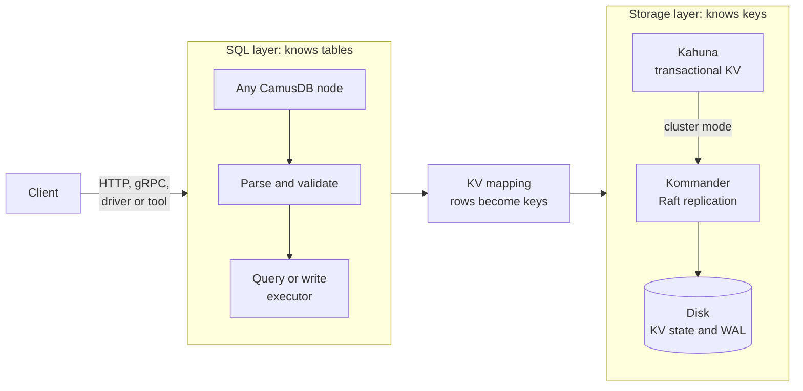

# Architecture

This page shows what happens between the SQL you send and the disk. Read it when
you want to reason about latency, failures, or capacity, or before you
contribute to CamusDB. You do not need it to use CamusDB. It gives operators,
application developers, and contributors a shared vocabulary for what happens
under the surface.

In PostgreSQL or MySQL, one server parses your SQL and owns every row on its
disk. CamusDB splits that work in two, and SQL is the contract between the
halves. The SQL layer plans each statement against a relational schema and maps
the rows and indexes into key/value entries. A distributed transactional storage
layer stores those entries and handles [partitioning](/docs/concepts#partition),
[consensus](/docs/concepts#raft), [WAL](/docs/concepts#wal) replay, and
persistence. Nothing above the KV mapping knows which node owns a key, and
nothing below it knows what a table is. That split is why the same SQL runs on
one node or on a cluster.

CamusDB is in production use, but cluster mode is still an alpha feature. Its
APIs and storage formats can change between versions.

## Overview

A CamusDB process runs either as a standalone node or as one node in a
cluster.

In standalone mode, the process hosts one local embedded
[Kahuna](/docs/concepts#kahuna) storage node. That is the simplest setup for
tutorials, local development, and single-node tests.
[Storage components](#storage-components) explains what Kahuna and the other
storage components do.

In cluster mode, several CamusDB processes join through a static peer
configuration, and each process can expose the database API.

The storage layer divides keys across [Raft](/docs/concepts#raft) partitions,
elects a [leader](/docs/concepts#leader) for each partition, and replicates
writes through [Kommander](/docs/concepts#kommander). When a process receives a
request for data that another partition leader owns, the storage layer routes
the work to the node that can coordinate it.

At a high level, every SQL request follows this path:

1. The client sends SQL to any available CamusDB node through the HTTP API,
   the gRPC API, or an official client or tool.
2. CamusDB parses and validates the statement.
3. The query or write executor checks the catalog metadata, constraints,
   indexes, and transaction state.
4. CamusDB encodes relational rows, indexes, schema metadata, locks, and
   transaction records as key/value entries.
5. [Kahuna](https://kahunakv.github.io/) coordinates the transactional KV reads
   and writes.
6. In cluster mode,
   [Kommander](https://kahunakv.github.io/kommander.github.io/) replicates the
   partition log entries through Raft consensus.
7. CamusDB materializes committed entries into persistent KV storage, and can
   replay them from the WAL during recovery.

## Layers

CamusDB is built in layers, and each layer exposes a smaller contract to the
layer above it.

| Layer | Purpose |
| --- | --- |
| Client interfaces | Accept SQL and row operations from clients and tools over REST with JSON and over gRPC. |
| Parser and validator | Normalize statements, validate their syntax, and reject invalid command input. |
| Catalog | Track databases, tables, columns, indexes, constraints, and schema versions. |
| Query and write execution | Plan reads; apply filters, joins, grouping, and subqueries; perform inserts, updates, and deletes; maintain indexes. |
| Transaction coordination | Open, commit, and roll back transactions. Coordinate writes across partitions with [two-phase commit](/docs/concepts#two-phase-commit). |
| KV mapping | Encode rows, indexes, metadata, locks, and transaction state as deterministic key/value entries. |
| Distributed KV storage | Use [Kahuna](https://kahunakv.github.io/) for transactional key/value operations. |
| Consensus and WAL | Use [Kommander](https://kahunakv.github.io/kommander.github.io/) to order replicated partition log entries and recover committed state. |
| Persistent storage | Store the materialized KV state and partition WAL data on disk. |

## SQL and query layer

The SQL layer gives applications a relational model, while the layers below it
operate on key/value entries.

The query pipeline supports:

- Projections, aliases, scalar expressions, and functions.
- `WHERE` filters, `HAVING`, ordering, `LIMIT`, and `OFFSET`.
- `COUNT`, `SUM`, `AVG`, `MIN`, and `MAX`.
- `GROUP BY` over columns or expressions.
- `JOIN`, `INNER JOIN`, and comma join syntax.
- Derived tables.
- Scalar subqueries, and `IN`, `NOT IN`, and `EXISTS` subqueries.
- Index scans and explicit index hints.

See [SELECT](/docs/sql-queries) and
[Joins And Subqueries](/docs/joins-and-subqueries) for examples,
[Functions](/docs/functions) for the scalar function reference, and
[Query Planning](/docs/query-planning) and
[Query Planner Internals](/docs/query-planner-internals) for the planner and
executor pipeline.

## Catalog and schema

The catalog stores database, table, column, index, and constraint descriptors.
Each row includes a schema version, so CamusDB decodes a stored value against
the schema layout that created it.

You register a database explicitly before you use it. Each database name
resolves to an immutable internal id, and storage keys and standalone data
directories use that id, not the display name. `RENAME DATABASE` updates the
registry binding and moves no row, index, schema, or statistics data.

CamusDB persists schema metadata through the same key/value storage layer as
user data. In cluster mode, it replicates and recovers schema changes through
the distributed storage path, so catalog state follows the same durability model
as rows and indexes.

CamusDB stages online schema changes. A lagging node can fence itself from
normal table work until it reaches the committed schema head, so the schema can
keep evolving without stale schema reads becoming normal behavior.

See [Distributed Schema Changes](/docs/distributed-schema) for the cluster DDL
model, the staged states of an online schema change, the convergence rules, and
behavior after a restart.

## Storage layer

CamusDB maps each relational object to a deterministic KV key:

- Table rows go under a row prefix.
- Unique and non-unique index entries go under an index prefix.
- Schema and system metadata go under the database's metadata keys.
- Locks and transaction state are KV entries that the transactional storage
  layer manages.

The KV mapping keeps ordered table and index scans predictable, while the
distributed storage layer handles routing, partition ownership, replication,
and recovery.

See [Storage](/docs/storage) for the key layout and value encoding details.

## Storage components

CamusDB does not build its own low-level store. It turns rows, indexes, schema
metadata, locks, and transaction state into key/value entries, and hands them to
three embedded components:

| Component | Role |
| --- | --- |
| [Kahuna](https://kahunakv.github.io/) | The transactional key/value layer, embedded in every node. It provides transactions, locks, [MVCC](/docs/concepts#mvcc) reads, and ordered range scans, and tracks which partition owns each key. |
| [Kommander](https://kahunakv.github.io/kommander.github.io/) | The Raft library. It elects a leader for each partition, replicates the partition log, and provides the order that recovery replays. |
| [RocksDB](https://rocksdb.org/) | The embedded on-disk key/value engine. By default it stores both Kahuna's materialized key/value state and Kommander's Raft log, as two separate databases. |

RocksDB keeps keys sorted, which CamusDB uses for ordered table and index scans.
Its log-structured design handles heavy write loads, and it recovers its own
files after a crash. RocksDB is a native C++ engine, created at Meta, so the
SQL, transaction, and coordination logic stays in C# while the disk work runs
close to the hardware.

RocksDB is local storage, not the distributed database. It makes one node's
state durable. Kahuna and Kommander add the rest: replication, commit by a
[majority](/docs/concepts#majority), partition leadership, transaction
coordination, and WAL replay. Together they keep commits consistent across the
cluster.

Kahuna can also use SQLite, a managed [Solarium](https://solariumdb.github.io/) backend for the KV state or
Raft WAL, and an in-memory backend for development and tests only. Solarium
avoids the native RocksDB library but places its caches inside the managed
heap; see [Solarium configuration](/docs/configuration#solarium-storage-engine).
See [Storage](/docs/storage#the-rocksdb-backend) for the backend settings, and
[Kahuna's storage overview](https://kahunakv.github.io/docs/storage/overview/)
for lower-level details.

## Transactions

CamusDB runs SQL work inside transactions, using Kahuna for multi-version
reads, locks, and commit coordination.

CamusDB can wrap a single-operation request in a transaction automatically, and
clients can use an explicit transaction handle for multi-statement work.

When a transaction touches keys owned by more than one partition, CamusDB uses
two-phase commit through the storage layer, so a write across partitions stays
atomic. Each partition still follows its own consensus rules.

See [Transactions And Isolation](/docs/serializable-transactions) for the
current user-facing guarantees, and
[Distributed Transactions And HLC](/docs/distributed-transactions) for the
cross-partition commit flow and the timestamp model.

## Replication and recovery

In cluster mode, CamusDB assigns each key to a Raft partition. Each partition
elects a leader that orders the partition's writes, and
[Kommander](https://kahunakv.github.io/kommander.github.io/) replicates them.

<ReplicaRing
  center="Partition P (Raft group)"
  client={{label: 'CamusDB node', icon: 'server'}}
  nodes={['Node 1', 'Node 2', 'Node 3']}
  title="A CamusDB node sends a write to Node 1, the leader of the Raft group for partition P. The leader orders the write and replicates it to the followers Node 2 and Node 3."
/>

The leader writes each entry to its write-ahead log when it proposes the entry.
The entry commits once a majority of the partition's replicas has persisted it.

On restart, CamusDB replays committed log entries into
[Kahuna](https://kahunakv.github.io/), so the materialized KV store catches up
with the committed history. Checkpoints bound recovery by marking older
committed state as already present in persistent KV storage.

See [WAL And Recovery](/docs/wal-recovery) for the recovery path and behavior
after a failure.

## Deployment modes

You can deploy CamusDB in two modes:

| Mode | Description |
| --- | --- |
| Standalone | One process with an embedded local storage node. Best for development, tutorials, and tests. |
| Cluster | Several processes with static peer discovery, a leader per partition, replicated WAL entries, and distributed transactional KV storage. |

See [Cluster Mode](/docs/cluster) for startup commands and
[Configuration](/docs/configuration) for the active settings.

## Terms

[Concepts](/docs/concepts) defines the distributed terms this page uses, such as
node, cluster, partition, leader, Raft, replication, and the write-ahead log.
The [Layers](#layers) table above describes the catalog and the KV mapping.

## What's next

Start with [SQL Overview](/docs/sql) and [SELECT](/docs/sql-queries) for the
user-facing model. Then read [Storage](/docs/storage),
[WAL And Recovery](/docs/wal-recovery), and [Cluster Mode](/docs/cluster) for
lower-level distributed behavior.
