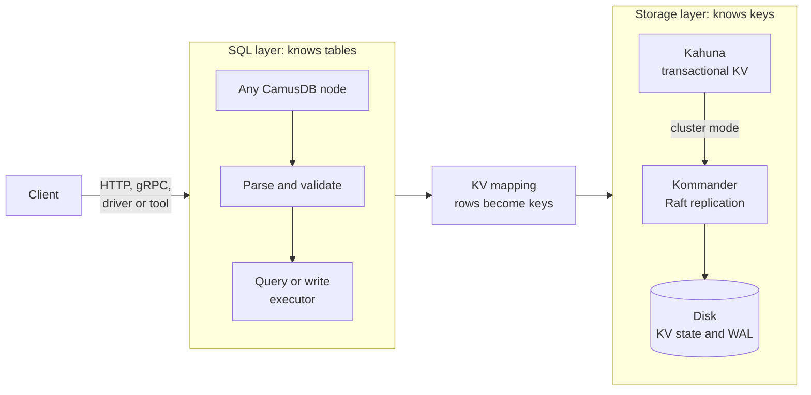

# Architecture

This page shows what happens between the SQL you send and the disk. Read it when
you want to reason about latency, failures, or capacity, or before you
contribute to CamusDB. You do not need it to use CamusDB. It gives operators,
application developers, and contributors one shared vocabulary for the work
under the surface.

In PostgreSQL or MySQL, one server parses your SQL and owns every row on its
disk. CamusDB splits that work in two, and SQL is the contract between the
halves. The SQL layer plans each statement against a relational schema and maps
the rows and indexes into key/value entries. A distributed transactional storage
layer stores those entries and handles four mechanisms: the
[partitions](/docs/concepts#partition), the [consensus](/docs/concepts#raft),
the [WAL](/docs/concepts#wal) replay, and the persistence. No layer above the
KV mapping knows which node owns a key. No layer below the KV mapping knows what
a table is. That split is why the same SQL runs on one node or on a cluster.

CamusDB is in production use. Cluster mode is nevertheless an alpha feature. The
APIs and the storage formats can change between versions.

## Overview

A CamusDB process runs as a standalone node, or as one node of a cluster.

In standalone mode, the process hosts one local embedded
[Kahuna](/docs/concepts#kahuna) storage node. That is the simplest setup
for a tutorial, for local development, and for a single-node test.
[Storage components](#storage-components) explains what Kahuna and the other
storage components do.

In cluster mode, several CamusDB processes join through a static configuration
of peers. Each process can expose the database API.

The storage layer divides the keys across [Raft](/docs/concepts#raft)
partitions. It elects a [leader](/docs/concepts#leader) for each partition. It
replicates a write through [Kommander](/docs/concepts#kommander). A process can
receive a request for data that another partition leader owns. The storage layer
then routes the work to the node that can coordinate it.

At a high level, every SQL request follows this path:

1. The client sends SQL to any available CamusDB node. It uses the HTTP API, the
   gRPC API, or an official client or tool.
2. CamusDB parses the statement. It then validates the statement.
3. The query executor or the write executor checks four things: the catalog
   metadata, the constraints, the indexes, and the state of the transaction.
4. CamusDB encodes the relational rows, the indexes, the schema metadata, the
   locks, and the transaction records as key/value entries.
5. [Kahuna](https://kahunakv.github.io/) coordinates the transactional KV reads
   and writes.
6. In cluster mode,
   [Kommander](https://kahunakv.github.io/kommander.github.io/) replicates the
   partition log entries through Raft consensus.
7. CamusDB materializes a committed entry into persistent KV storage. It can
   also replay that entry from the WAL during a recovery.

## Layers

The architecture of CamusDB has layers. Each layer exposes a smaller contract to
the layer above it.

| Layer | Purpose |
| --- | --- |
| Client interfaces | Accept SQL and row operations from a client and from a tool, through REST with JSON, and through gRPC. |
| Parser and validator | Normalize a statement, validate its syntax, and reject an invalid command input. |
| Catalog | Track the databases, the tables, the columns, the indexes, the constraints, and the schema versions. |
| Query and write execution | Plan a read. Apply the filters, the joins, the groups, and the subqueries. Perform an update, a delete, and an insert. Maintain the indexes. |
| Transaction coordination | Open, commit, and roll a transaction back. Coordinate a write across partitions with [two-phase commit](/docs/concepts#two-phase-commit). |
| KV mapping | Encode a row, an index, the metadata, a lock, and the transaction state as deterministic key/value entries. |
| Distributed KV storage | Use [Kahuna](https://kahunakv.github.io/) for transactional key/value operations. |
| Consensus and WAL | Use [Kommander](https://kahunakv.github.io/kommander.github.io/) to order the replicated partition log entries, and to recover the committed state. |
| Persistent storage | Store the materialized KV state and the partition WAL data on disk. |

## The SQL and query layer

The SQL layer gives an application a relational model. The layers below it
operate on key/value entries.

The query pipeline supports these features:

- Projections, aliases, scalar expressions, and functions.
- A `WHERE` filter, `HAVING`, an order, `LIMIT`, and `OFFSET`.
- `COUNT`, `SUM`, `AVG`, `MIN`, and `MAX`.
- `GROUP BY` over a column or over an expression.
- `JOIN`, `INNER JOIN`, and the comma syntax for a join.
- A derived table.
- A scalar subquery, and an `IN`, `NOT IN`, or `EXISTS` subquery.
- An index scan, and an explicit index hint.

See [SELECT](/docs/sql-queries) and
[Joins And Subqueries](/docs/joins-and-subqueries) for examples that a user
writes. See [Functions](/docs/functions) for the reference of the scalar
functions. See [Query Planning](/docs/query-planning) and
[Query Planner Internals](/docs/query-planner-internals) for the pipeline of the
planner and of the executor.

## Catalog and schema

The catalog stores the descriptors of a database, a table, a column, an index,
and a constraint. A row includes a schema version. CamusDB therefore decodes a
stored value against the schema layout that created it.

You register a database explicitly before you use it. Each database name
resolves to an immutable internal id. A storage key and a standalone data
directory use that id, not the display name. `RENAME DATABASE` updates the
binding in the registry. It moves no row, no index, no schema, and no statistics
data.

CamusDB persists the schema metadata through the same key/value storage layer as
the user data. In cluster mode, it replicates and recovers a schema change
through the distributed storage path. The state of the catalog therefore follows
the same durability model as the rows and the indexes.

CamusDB stages an online schema change. A node that lags can fence itself from
normal table work until it reaches the committed schema head. The schema can
therefore continue to evolve. A stale schema read never becomes normal behavior.

See [Distributed Schema Changes](/docs/distributed-schema) for four subjects:
the DDL model of a cluster, the staged states of an online schema change, the
rules of convergence, and the behavior after a restart.

## The storage layer

CamusDB maps a relational object to a deterministic KV key:

- It stores a table row under a row prefix.
- It stores a unique index entry and a non-unique index entry under an index
  prefix.
- It stores the schema metadata and the system metadata under the metadata keys
  of the database.
- It stores a lock and the transaction state as KV entries. The transactional
  storage layer manages them.

The KV mapping keeps an ordered table scan and an ordered index scan
predictable. The distributed storage layer meanwhile handles the routing, the
partition ownership, the replication, and the recovery.

See [Storage](/docs/storage) for the key layout and for the details of the value
encoding.

## Storage components

CamusDB does not build its own low-level store. It turns rows, indexes, schema
metadata, locks, and transaction state into key/value entries, and hands them to
three embedded components:

| Component | Role |
| --- | --- |
| [Kahuna](https://kahunakv.github.io/) | The transactional key/value layer, embedded in every node. It provides the transactions, the locks, [MVCC](/docs/concepts#mvcc) reads, and ordered range scans, and it tracks which partition owns each key. |
| [Kommander](https://kahunakv.github.io/kommander.github.io/) | The Raft library. It elects a leader for each partition, replicates the partition log, and gives the order that a recovery replays. |
| [RocksDB](https://rocksdb.org/) | The embedded on-disk key/value engine. By default it stores both Kahuna's materialized key/value state and Kommander's Raft log, as two separate databases. |

RocksDB keeps keys sorted, which CamusDB uses for ordered table and index scans.
Its log-structured design handles heavy write loads, and it recovers its own
files after a crash. RocksDB is a native C++ engine, created at Meta, so the
SQL, transaction, and coordination logic stays in C# while the disk work runs
close to the hardware.

RocksDB is local storage, not the distributed database. It makes the state of
one node durable. Kahuna and Kommander add the rest: replication, commit by a
[majority](/docs/concepts#majority), partition leadership, transaction
coordination, and WAL replay. Together they keep commits consistent across the
cluster.

Kahuna can also use SQLite, for a deployment that prefers SQLite files to
RocksDB directories, and an in-memory backend for development and tests only.
See [Storage](/docs/storage#the-rocksdb-backend) for the backend settings, and
[the storage overview of Kahuna](https://kahunakv.github.io/docs/storage/overview/)
for the lower-level details.

## Transactions

CamusDB runs SQL work inside a transaction. It uses Kahuna for multi-version
reads, for the locks, and for the coordination of a commit.

CamusDB can wrap a single-operation request in a transaction automatically. A
client can also use an explicit transaction handle for work of several
statements.

A transaction can touch keys that more than one partition owns. CamusDB then
uses two-phase commit, through the storage layer. A write across partitions
therefore stays atomic. Each partition also keeps its own rules of consensus.

See [Transactions And Isolation](/docs/serializable-transactions) for the
current guarantees to a user. See
[Distributed Transactions And HLC](/docs/distributed-transactions) for the
commit flow across partitions, and for the model of the timestamps.

## Replication and recovery

In cluster mode, CamusDB assigns each key to a Raft partition. Each partition
elects a leader. That leader orders the writes of its partition.
[Kommander](https://kahunakv.github.io/kommander.github.io/) then replicates
them.

<ReplicaRing
  center="Partition P (Raft group)"
  client={{label: 'CamusDB node', icon: 'server'}}
  nodes={['Node 1', 'Node 2', 'Node 3']}
  title="A CamusDB node sends a write to Node 1, the leader of the Raft group for partition P. The leader orders the write and replicates it to the followers Node 2 and Node 3."
/>

The leader writes each entry to its write-ahead log when it proposes the entry.
The entry commits once a majority of the partition's replicas has persisted it.

At a restart, CamusDB replays the committed log entries into
[Kahuna](https://kahunakv.github.io/). The materialized KV store therefore
catches up with the committed history. A checkpoint bounds the recovery. It
marks older committed state as present in the persistent KV storage already.

See [WAL And Recovery](/docs/wal-recovery) for the recovery path, and for the
behavior after a failure.

## Shape of a deployment

You can deploy CamusDB in two modes:

| Mode | Description |
| --- | --- |
| Standalone | One process, with an embedded local storage node. It is the best choice for development, for a tutorial, and for a test. |
| Cluster | Several processes, with static discovery of the peers, a leader for each partition, replicated WAL entries, and distributed transactional KV storage. |

See [Cluster Mode](/docs/cluster) for the startup commands. See
[Configuration](/docs/configuration) for the active settings.

## Terms

[Concepts](/docs/concepts) defines the distributed terms this page uses, such as
node, cluster, partition, leader, Raft, replication, and the write-ahead log.
The [Layers](#layers) table above describes the catalog and the KV mapping.

## What is next

Start with [SQL Overview](/docs/sql) and [SELECT](/docs/sql-queries) for the
model that a user sees. Then read [Storage](/docs/storage),
[WAL And Recovery](/docs/wal-recovery), and [Cluster Mode](/docs/cluster) for
the distributed behavior at the lower level.
