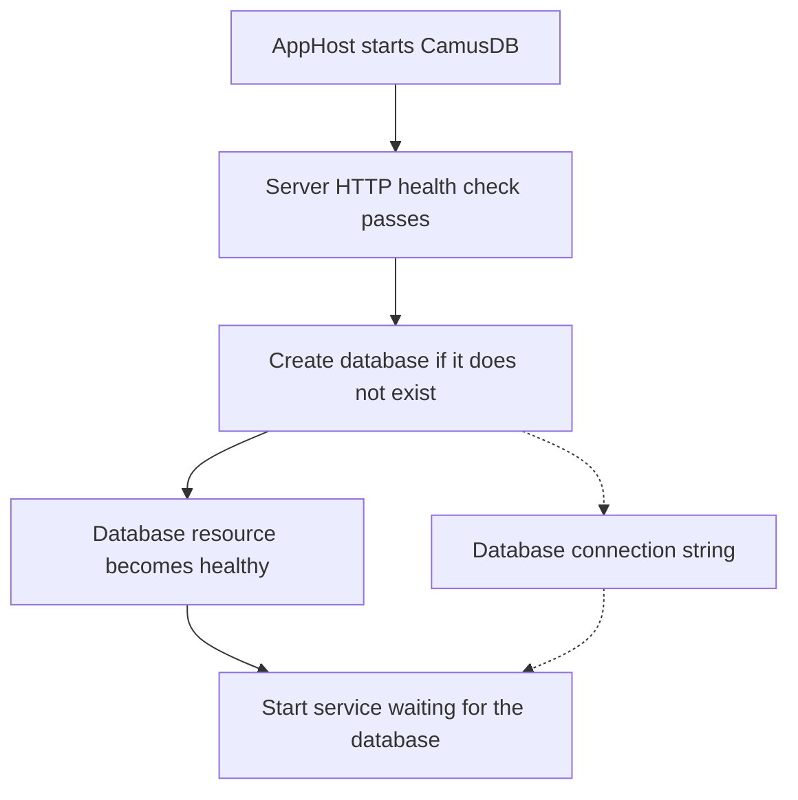

# .NET Aspire

The CamusDB [Aspire](https://aspire.dev/) integrations let you run a database alongside your services
and pass its connection details through the application model. The AppHost
starts a standalone CamusDB container and creates the databases you declare.
Service integrations register the .NET driver or EF Core context, with health
checks, tracing, and metrics.

Use these packages to give your local application a repeatable database setup
without manually coordinating ports, connection strings, and startup order.
Source, tests, and a runnable AppHost/API example are in
[camusdb-aspire](https://github.com/camusdb/camusdb-aspire).

## Choose a package

| Package | Install in | Purpose | Target frameworks |
| --- | --- | --- | --- |
| `CamusDB.Aspire.Hosting` | AppHost | Runs the container, creates databases, and supplies connection strings. | .NET 8 |
| `CamusDB.Aspire.Client` | Service | Registers ADO.NET connections, health checks, and driver telemetry. | .NET 8, 9, 10 |
| `CamusDB.Aspire.EntityFrameworkCore` | Service | Registers a pooled EF Core context with retries, health checks, and telemetry. | .NET 10 |

The repository uses Aspire 13.6.3 and CamusDB client libraries 0.16.1. Its
AppHost example needs the .NET 10 SDK and a container runtime. The hosting
package defaults to server image `docker.io/camusdb/camusdb:0.15.3`; select
another image tag when your application needs a different server version.

## Add CamusDB to the AppHost

Install in your AppHost project:

```bash
dotnet add package CamusDB.Aspire.Hosting
```

In `AppHost.cs`, declare the server and database, then reference the database
from your service:

```csharp
using Aspire.Hosting;

var builder = DistributedApplication.CreateBuilder(args);

var camus = builder.AddCamusDB("camus")
    .WithDataVolume();
var appDb = camus.AddDatabase("appdb");

builder.AddProject<Projects.ApiService>("api")
    .WithReference(appDb)
    .WaitFor(appDb);

builder.Build().Run();
```

Replace `Projects.ApiService` with the generated project type for your service.
`WithDataVolume()` keeps database files in a named volume across container
recreation. Omit it for a disposable container, or use
`WithDataBindMount(path)` to store data in a host folder.

The AppHost checks the server's HTTP `/health` endpoint, then creates each
`AddDatabase` database if it does not exist. A database resource becomes
healthy only after creation succeeds. `WaitFor(appDb)` therefore waits for the
database, while `WithReference(appDb)` supplies the service's connection string.



This creates the database, not application tables or migrations. Manage those
through your application or migration workflow.

## Register the ADO.NET client

Install in the service project:

```bash
dotnet add package CamusDB.Aspire.Client
```

Register the same connection name used by `AddDatabase`:

```csharp
using CamusDB.Client;
using Microsoft.Extensions.Hosting;

var builder = WebApplication.CreateBuilder(args);
builder.AddCamusDBClient("appdb");

var app = builder.Build();

app.MapGet("/database-status", async (CamusConnection connection) =>
{
    await connection.OpenAsync();
    await using CamusCommand command = connection.CreateCamusCommand(
        "SELECT 'ready' AS status");
    return (string?)await command.ExecuteScalarAsync();
});

app.Run();
```

The integration registers a singleton `CamusConnectionStringBuilder` that
shares endpoint health and access-token state, and a transient
`CamusConnection`. Open injected connections before running commands. See the
[.NET driver](/docs/dotnet-driver) for parameters, transactions, and readers.

### Multiple databases

Reference each database resource from the service in the AppHost, then use
keyed registrations to choose a connection explicitly:

```csharp
builder.AddKeyedCamusDBClient("orders");
builder.AddKeyedCamusDBClient("users");
```

For example, resolve the orders connection in an endpoint with
`[FromKeyedServices("orders")] CamusConnection connection`, importing
`Microsoft.Extensions.DependencyInjection` for the attribute.

## Register an EF Core context

Install in the service project:

```bash
dotnet add package CamusDB.Aspire.EntityFrameworkCore
```

Register your context instead of the ADO.NET client when the service uses EF
Core:

```csharp
using Microsoft.EntityFrameworkCore;
using Microsoft.Extensions.Hosting;

var builder = WebApplication.CreateBuilder(args);
builder.AddCamusDBDbContext<AppDbContext>("appdb");

var app = builder.Build();
app.Run();

public sealed class AppDbContext(DbContextOptions<AppDbContext> options)
    : DbContext(options)
{
}
```

The integration calls `AddDbContextPool` and `UseCamusDB`. Your context must
accept `DbContextOptions<AppDbContext>` in its constructor. Transient-failure
retries are enabled through `EnableRetryOnFailure()` by default. To customize
registration, pass `configureSettings` or `configureDbContextOptions`:

```csharp
builder.AddCamusDBDbContext<AppDbContext>("appdb",
    configureSettings: settings => settings.DisableRetry = true);
```

See the [EF Core provider](/docs/ef-core) for entity mapping, migrations, and
transaction behavior.

## Connection strings and protocols

The AppHost exposes `http` on container port 5095 and `grpc` on 5096. Host ports
are assigned dynamically unless passed as `httpPort` and `grpcPort` to
`AddCamusDB`.

Reference a **database resource**, such as `appDb`, when opening a driver
connection. A server resource's connection string has no `Database` key,
which `CamusConnection` requires.

HTTP is the default. To use gRPC, configure the server before building the
application:

```csharp
using Aspire.Hosting.ApplicationModel;

var camus = builder.AddCamusDB("camus")
    .WithProtocol(CamusDBProtocol.Grpc);
var appDb = camus.AddDatabase("appdb");
```

The generated connection string selects the gRPC endpoint, sets
`Protocol=grpc`, and includes the HTTP endpoint as `BackupEndpoint` for REST
backup administration. The gRPC endpoint uses plaintext HTTP/2.

Referenced resources also expose connection properties such as `Host`,
`Port`, `GrpcPort`, `Uri`, `GrpcUri`, and `Database` as environment variables
(for example, `APPDB_HOST`). Authentication adds `Username` and `Password`.

## Authentication and server options

Authentication is off by default. Enable it with a secret parameter:

```csharp
var password = builder.AddParameter("camus-password", secret: true);
var camus = builder.AddCamusDB("camus")
    .WithAuthentication(password: password)
    .WithDataVolume();
```

The default bootstrap user is `admin`. Calling `WithAuthentication()` without
a password parameter generates a password. The integration also generates the
access-token signing key and includes credentials in connection strings.

This authentication setup is for local development: the container serves
plaintext HTTP, starts with `--require-tls-when-auth-enabled=false`, and supplies
`AllowInsecureCredentials=true` to clients. The password must not contain a
single quote (`'`).

Bootstrap credentials apply only when the server's user catalog is empty.
Changing the password parameter does not change an existing account in a
persisted data volume; manage that account through
[SQL authentication](/docs/sql-authentication).

Standard Aspire container options let you select an image tag and set server
environment variables:

```csharp
builder.AddCamusDB("camus")
    .WithImageTag("0.15.3")
    .WithEnvironment("CAMUS_LOG_LEVEL", "Debug")
    .WithEnvironment("CAMUS_INITIAL_PARTITIONS", "8");
```

## Client configuration and observability

Both service integrations read `ConnectionStrings:{connectionName}`, normally
supplied by `WithReference`. You can also set a `ConnectionString` in their
settings sections to run a service without the AppHost.

Settings apply in this order, with later values taking precedence:

1. Shared section: `Aspire:CamusDB:Client` or
   `Aspire:CamusDB:EntityFrameworkCore`.
2. Named section: `Aspire:CamusDB:Client:{name}` for a keyed client, or
   `Aspire:CamusDB:EntityFrameworkCore:{context type name}` for EF Core.
3. `ConnectionStrings:{connectionName}` for the connection string.
4. The `configureSettings` callback.

For example, to disable tracing for the client integration:

```json
{
  "Aspire": {
    "CamusDB": {
      "Client": {
        "DisableTracing": true
      }
    }
  }
}
```

All disable flags default to `false`:

| Setting | Enabled behavior |
| --- | --- |
| `DisableHealthChecks` | Client: server ping named `CamusDB` or `CamusDB_{name}`. EF Core: `CanConnectAsync` check named after the context type. |
| `DisableTracing` | Registers the `CamusDB.Client` activity source. |
| `DisableMetrics` | Registers the `CamusDB.Client` meter; EF Core also registers `Microsoft.EntityFrameworkCore`. |
| `DisableRetry` | EF Core only: enables provider retries for transient failures. |

Configure health endpoints and OpenTelemetry exporters in your service,
usually through Aspire service defaults. Registering the integration does not
itself expose a health endpoint or configure an exporter.

## Run the sample application

The repository's `playground` directory includes an AppHost and a minimal API
with `GET /todos` and `POST /todos`:

```bash
git clone https://github.com/camusdb/camusdb-aspire.git
cd camusdb-aspire
dotnet run --project playground/CamusDB.AppHost
```

The playground accepts `Playground:Authentication`, `Playground:Grpc`, and
`Playground:Ephemeral` flags. For example:

```bash
dotnet run --project playground/CamusDB.AppHost -- --Playground:Authentication=true
```
