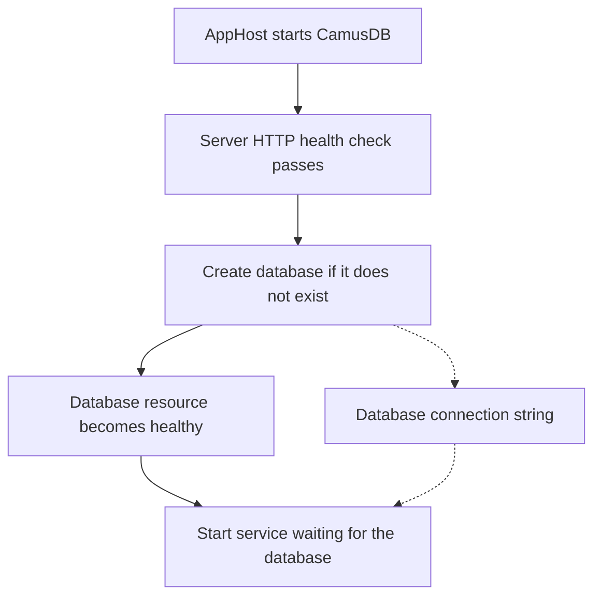

# .NET Aspire

The CamusDB [Aspire](https://aspire.dev/) integrations run a database next to
your services, and they pass its connection details through the application
model. The AppHost starts a standalone container or a local CamusDB cluster,
and it creates the databases that you declare. The service integrations
register the .NET driver or an EF Core context, with health checks and
telemetry.

With these packages, your local application gets a repeatable database setup.
You don't need to coordinate ports and startup order by hand. The source and
runnable examples are in
[camusdb-aspire](https://github.com/camusdb/camusdb-aspire).

## Choose a package

| Package | Install in | Purpose | Target frameworks |
| --- | --- | --- | --- |
| `CamusDB.Aspire.Hosting` | AppHost | Starts a standalone server or a cluster. Creates databases, and supplies connection strings. | .NET 8 |
| `CamusDB.Aspire.Client` | Service | Registers ADO.NET connections, with health checks and telemetry. | .NET 8, 9, 10 |
| `CamusDB.Aspire.EntityFrameworkCore` | Service | Registers a pooled EF Core context, with retries and health checks. | .NET 10 |

The packages (version 0.17.0) use Aspire 13.6.4 and the CamusDB client
libraries 0.17.4 or later. The AppHost examples need the .NET 10 SDK and a
container runtime. The hosting package uses the server image
`docker.io/camusdb/camusdb:0.17.0` by default. Newer server images, such as
`0.18.4`, are available. To use one, set the image tag, as shown in
[Authentication and server options](#authentication-and-server-options).

## Add CamusDB to the AppHost

Install the package in your AppHost project:

```bash
dotnet add package CamusDB.Aspire.Hosting
```

In `AppHost.cs`, declare the server and the database. Then reference the
database from your service:

```csharp
using Aspire.Hosting;

var builder = DistributedApplication.CreateBuilder(args);

var camus = builder.AddCamusDB("camus")
    .WithDataVolume();
var appDb = camus.AddDatabase("appdb");

builder.AddProject<Projects.ApiService>("api")
    .WithReference(appDb)
    .WaitFor(appDb);

builder.Build().Run();
```

Replace `Projects.ApiService` with the generated project type of your service.
With `WithDataVolume()`, the database files are in a named volume, and they
remain when the container is recreated. For a disposable container, leave it out. To store the
data in a host folder, use `WithDataBindMount(path)`.

For a standalone server, the AppHost checks the HTTP `/health` endpoint. Then
it creates each `AddDatabase` database if it doesn't exist. A database resource
becomes healthy after the database is created. This means that
`WaitFor(appDb)` waits for the database, and `WithReference(appDb)` supplies
the connection string of the service.



The AppHost creates the database only. Manage the tables and migrations through
your application or your migration workflow.

## Run a local cluster

Use `AddCamusDBCluster` to develop against replication and to try node
failures. You don't need to configure peers or export certificates. The default
is three nodes. Replace the standalone resource in your AppHost with:

```csharp
var camus = builder.AddCamusDBCluster("camus", nodes: 3)
    .WithDataVolume();
var appDb = camus.AddDatabase("appdb");

builder.AddProject<Projects.ApiService>("api")
    .WithReference(appDb)
    .WaitFor(appDb);
```

The dashboard shows a cluster resource and three node containers, from
`camus-1` to `camus-3`. Each node gets a separate data volume. With
`WithDataBindMount(path)`, each node uses a subfolder, such as `path/camus-1`.

The AppHost generates a cluster CA and node certificates on each run. Raft uses
TLS on the container network, and its port isn't published to the host. The
client HTTP and gRPC endpoints use plaintext. This means that the setup is for
local development only. When your machine stops, all the nodes stop.

### Readiness and connections

Each node checks `/v1/cluster/health`. At the first startup, all the nodes must
be healthy before the AppHost creates databases and starts the services that
wait for them. After startup, the cluster resource is healthy while a majority
of the nodes is healthy. This means that dependent services can restart while
one of three nodes is down. The health description shows the count. If there
isn't a majority, the resource is unhealthy. After all the nodes stop, the startup again
needs all the nodes.

A database connection string lists the endpoint of each node. The .NET client
rotates requests across the pool, and it skips a node that doesn't answer for
30 seconds. The request that finds the failure can fail. Endpoint rotation
doesn't send it again. Follow the
[retry rules of the driver](/docs/dotnet-driver) for your operation. With gRPC,
`BackupEndpoint` points to the HTTP endpoint of the first node.

`WithProtocol(CamusDBProtocol.Grpc)` and `WithAuthentication()` also work on
clusters. With authentication, the nodes share the token key and the node
secret, and the Raft peers use mutual TLS. The connection properties of a
cluster have endpoint lists in `Uri` and `GrpcUri`, and `Database` for a
database resource. A cluster doesn't have single-endpoint properties, such as
`Host`.

### Configure all the nodes

To apply common image or environment settings, use `ConfigureNodes`:

```csharp
builder.AddCamusDBCluster("camus", nodes: 3)
    .ConfigureNodes(node => node
        .WithImageTag("0.17.0")
        .WithEnvironment("CAMUS_INITIAL_PARTITIONS", "8"));
```

Use the same image and settings on all the nodes. The nodes use the `dev`
memory profile by default. To change it, set `CAMUS_MEMORY_PROFILE`. You should
use an odd node count: three nodes tolerate one unavailable node, and five
tolerate two. `nodes: 1` uses cluster mode, but it doesn't have redundancy. See
[Growing a one-node cluster](/docs/growing-a-one-node-cluster).

## Register the ADO.NET client

Install the package in the service project:

```bash
dotnet add package CamusDB.Aspire.Client
```

Register the same connection name as in `AddDatabase`:

```csharp
using CamusDB.Client;
using Microsoft.Extensions.Hosting;

var builder = WebApplication.CreateBuilder(args);
builder.AddCamusDBClient("appdb");

var app = builder.Build();

app.MapGet("/database-status", async (CamusConnection connection) =>
{
    await connection.OpenAsync();
    await using CamusCommand command = connection.CreateCamusCommand(
        "SELECT 'ready' AS status");
    return (string?)await command.ExecuteScalarAsync();
});

app.Run();
```

The integration registers a singleton `CamusConnectionStringBuilder`, which
shares the endpoint health and access-token state, and a transient
`CamusConnection`. Open an injected connection before you execute commands. For
the rest of the driver API, see the [.NET driver](/docs/dotnet-driver).

### Multiple databases

In the AppHost, reference each database resource from the service. Then use
keyed registrations to choose a connection:

```csharp
builder.AddKeyedCamusDBClient("orders");
builder.AddKeyedCamusDBClient("users");
```

For example, in an endpoint, resolve the orders connection with
`[FromKeyedServices("orders")] CamusConnection connection`. The attribute is in
`Microsoft.Extensions.DependencyInjection`.

## Register an EF Core context

Install the package in the service project:

```bash
dotnet add package CamusDB.Aspire.EntityFrameworkCore
```

When the service uses EF Core, register your context in place of the ADO.NET
client:

```csharp
using Microsoft.EntityFrameworkCore;
using Microsoft.Extensions.Hosting;

var builder = WebApplication.CreateBuilder(args);
builder.AddCamusDBDbContext<AppDbContext>("appdb");

var app = builder.Build();
app.Run();

public sealed class AppDbContext(DbContextOptions<AppDbContext> options)
    : DbContext(options)
{
}
```

The integration calls `AddDbContextPool` and `UseCamusDB`. Your context must
accept `DbContextOptions<AppDbContext>` in its constructor. Retries of transient
failures are on by default, through `EnableRetryOnFailure()`. To customize the
registration, pass `configureSettings` or `configureDbContextOptions`:

```csharp
builder.AddCamusDBDbContext<AppDbContext>("appdb",
    configureSettings: settings => settings.DisableRetry = true);
```

For entity mapping and migrations, see the [EF Core provider](/docs/ef-core).

## Connection strings and protocols

The AppHost exposes `http` on container port 5095 and `grpc` on 5096. The host
ports are assigned dynamically, unless you pass `httpPort` and `grpcPort` to
`AddCamusDB`.

To open a driver connection, reference a **database resource**, such as
`appDb`. The connection string of a server resource doesn't have a `Database`
key, and `CamusConnection` needs one.

HTTP is the default. To use gRPC, configure the server before you build the
application:

```csharp
using Aspire.Hosting.ApplicationModel;

var camus = builder.AddCamusDB("camus")
    .WithProtocol(CamusDBProtocol.Grpc);
var appDb = camus.AddDatabase("appdb");
```

The connection string then selects the gRPC endpoint and sets `Protocol=grpc`.
It also has the HTTP endpoint as `BackupEndpoint`, for the REST backup API. The
gRPC endpoint uses plaintext HTTP/2.

Standalone resources also expose connection properties as environment
variables, for example `Host` as `APPDB_HOST`:

| Property | Value |
| --- | --- |
| `Host`, `Port`, `GrpcPort` | The host and the HTTP and gRPC ports. |
| `Uri`, `GrpcUri` | The HTTP and gRPC endpoints. |
| `Database` | The database, for a database resource. |
| `Username`, `Password` | The credentials, with authentication. |

## Authentication and server options

Authentication is off by default. To turn it on, pass a secret parameter:

```csharp
var password = builder.AddParameter("camus-password", secret: true);
var camus = builder.AddCamusDB("camus")
    .WithAuthentication(password: password)
    .WithDataVolume();
```

The default bootstrap user is `admin`. If you call `WithAuthentication()` and
don't pass a password parameter, a password is generated. The integration also
generates the access-token key, and it adds the credentials to the connection
strings.

This authentication setup is for local development. The container serves
plaintext HTTP, and it starts with `--require-tls-when-auth-enabled=false`. The
clients get `AllowInsecureCredentials=true`. The password can't contain a
single quote (`'`).

The bootstrap credentials apply if the user catalog of the server is empty. If you change the password parameter, an existing account in a
persistent data volume doesn't change. Manage that account with
[SQL authentication](/docs/sql-authentication).

The standard Aspire container options select an image tag and set server
environment variables:

```csharp
builder.AddCamusDB("camus")
    .WithImageTag("0.17.0")
    .WithEnvironment("CAMUS_LOG_LEVEL", "Debug")
    .WithEnvironment("CAMUS_INITIAL_PARTITIONS", "8");
```

## Client configuration and observability

Both service integrations read `ConnectionStrings:{connectionName}`, which
`WithReference` normally supplies. To run a service with no AppHost, you can
also set a `ConnectionString` in their settings sections.

The settings apply in this order, and later values win:

1. The shared section: `Aspire:CamusDB:Client` or
   `Aspire:CamusDB:EntityFrameworkCore`.
2. The named section: `Aspire:CamusDB:Client:{name}` for a keyed client, or
   `Aspire:CamusDB:EntityFrameworkCore:{context type name}` for EF Core.
3. `ConnectionStrings:{connectionName}` for the connection string.
4. The `configureSettings` callback.

For example, to turn off tracing for the client integration:

```json
{
  "Aspire": {
    "CamusDB": {
      "Client": {
        "DisableTracing": true
      }
    }
  }
}
```

All the disable flags are `false` by default:

| Setting | What the feature does when it is on |
| --- | --- |
| `DisableHealthChecks` | Client: a server ping named `CamusDB` or `CamusDB_{name}`. EF Core: a `CanConnectAsync` check named after the context type. |
| `DisableTracing` | Registers the `CamusDB.Client` activity source. |
| `DisableMetrics` | Registers the `CamusDB.Client` meter. EF Core also registers `Microsoft.EntityFrameworkCore`. |
| `DisableRetry` | EF Core only: provider retries for transient failures. |

Configure the health endpoints and OpenTelemetry exporters in your service,
usually through the Aspire service defaults. The integration doesn't expose a
health endpoint or configure an exporter.

## Run the sample application

The `playground` directory of the repository has an AppHost and a minimal API
with `GET /todos` and `POST /todos`:

```bash
git clone https://github.com/camusdb/camusdb-aspire.git
cd camusdb-aspire
dotnet run --project playground/CamusDB.AppHost
```

The playground has the following options:

| Option | Effect |
| --- | --- |
| `Playground:Authentication` | Turns on authentication. |
| `Playground:Grpc` | Uses gRPC. |
| `Playground:Ephemeral` | Leaves out the data volumes. |
| `Playground:ClusterNodes` | The node count. `0`, the default, is standalone mode. Set it to `3` for a cluster. |

```bash
dotnet run --project playground/CamusDB.AppHost -- --Playground:Authentication=true
dotnet run --project playground/CamusDB.AppHost -- --Playground:ClusterNodes=3
```

### Try the three-node Notes example

The repository also has a
[cluster example](https://github.com/camusdb/camusdb-aspire/tree/main/examples/ClusterExample)
with a page that adds notes and reads the note count through each node. With
Docker and the .NET 10 SDK installed, execute this from the root of the
repository:

```bash
dotnet run --project examples/ClusterExample/ClusterExample.AppHost
```

In the Aspire dashboard, wait for the resources to be healthy, and open the
**Notes** URL of the API. Stop `camus-3`, and add a note on the reloaded page.
Two nodes are a majority. Restart the node to see it catch up. If you stop a
second node, the cluster loses its majority and becomes unhealthy.

The example stores its data in three volumes, which remain between
executions. Before you run it
again, stop the AppHost and wait for its containers to exit. Otherwise, two
containers can try to open the data of the same node.
