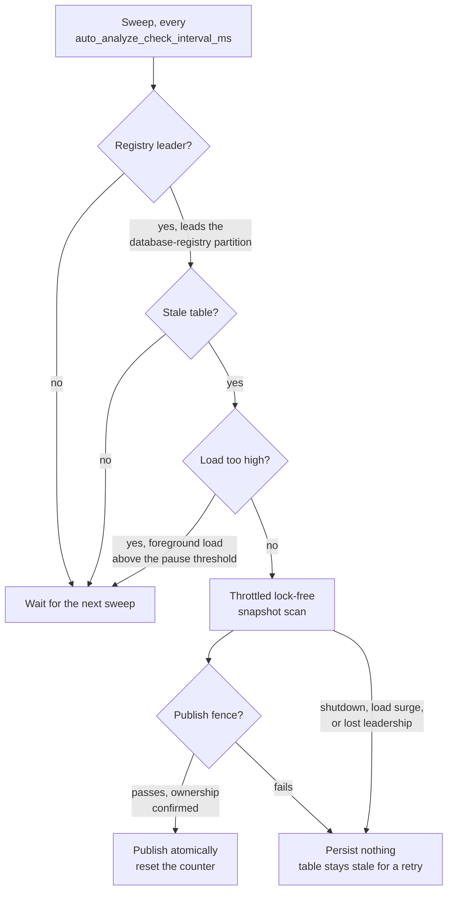

# Automatic analyze

CamusDB keeps the statistics of the optimizer fresh without your help.

The statistics tell the [query planner](/docs/query-planning) how many rows a
table has, and how the values in each column spread: the row count, the minimum
and maximum of each column, the histograms, and the number of distinct values,
or NDV. The planner uses them to select between an index and a full scan, and
to order a join. Normal writes keep the row count and the index counts current,
but the histograms and the NDV drift as rows change. Old statistics can then
make a fast query slow, for example by picking the wrong index or join order.

A background job detects when the histograms and the NDV of a table become
stale. It then runs `ANALYZE` on that table again, so you do not need to
schedule `ANALYZE` yourself.

The job's cost is bounded and throttled: it reads at most 50,000 rows per second by default, analyzes one
table at a time, and pauses when the node is under load. Its reads take no
locks, so it never blocks or aborts a query or a write.

This page describes how the job works, and how you tune it. For the way the
planner uses the statistics, see [Query Planning](/docs/query-planning). To
force a refresh, run `ANALYZE TABLE` by hand; see
[Relation to a manual ANALYZE TABLE](#relation-to-a-manual-analyze-table).

Use [`SHOW STATISTICS FOR <table>`](/docs/show-statistics) to see the current
statistics of a table. The output includes the degree of staleness, and whether
this job refreshed the table yet.

The feature is on by default, as `auto_analyze_enabled = true`. Set it to
`false` in `config.yml` to return to a manual `ANALYZE` only.

## How CamusDB detects staleness

Every committed row mutation increases a per-table counter,
`MutationsSinceAnalyze`. A mutation is an insert, an update, or a delete.
`StatisticsManager` tracks the counter. CamusDB persists it with the rest of the
statistics of the table.

A table is stale under this rule:

```
mutations_since_analyze >= auto_analyze_fraction_stale_rows * row_count + auto_analyze_min_stale_rows
```

- `auto_analyze_fraction_stale_rows` is the proportional trigger. The default
  is `0.20`, which is one fifth of the table.
- `auto_analyze_min_stale_rows` is an absolute floor. The default is `500`. The floor stops
  constant re-analysis of a small table, and of a table with light churn.
- A table with tracked data that CamusDB never analyzed is stale immediately.
- An empty table with no mutation is never stale.

A delete also counts as churn. A table that CamusDB rewrites completely
therefore still passes the threshold, even when the row count stays the same.

## How a background ANALYZE runs

The background collector produces the same statistics as a manual `ANALYZE`. It
adds three hard guarantees. They stop the job from disruption of a busy node.

### 1. Bounded, constant peak memory

A manual `ANALYZE` reads at most `stats_analyze_sample_rows` rows (default
`100,000`; `0` reads every row). It takes the first rows in storage order and
counts exactly within that sample, holding every distinct value in memory. Its
memory therefore grows with the sample size.

The background path samples instead. It uses sketches of a fixed size. The peak
memory is therefore a function of the sample size. It is not a function of the
table size.

- CamusDB builds a histogram from a bounded reservoir sample, with Algorithm R
  of Vitter. The sample holds at most `auto_analyze_histogram_sample_rows`
  values per column. The default is `10,000`. CamusDB also keeps up to
  `stats_top_values` of the most common sampled values with their sample counts.
  The planner uses those frequencies for skewed equalities and joins.
- Both forms of `ANALYZE` collect the columns in the same order: the leading
  column of each index first, then the other columns of the table in the order
  of their declaration, up to `stats_analyze_max_columns` columns in all. The
  default is `32`. The indexed columns are never cut by that cap. A column of
  the type `BOOL`, `BYTES` or an array gets no statistics, because no filter
  estimate reads them. The peak memory of a background scan is therefore one
  reservoir and one sketch for each analyzed column.
- CamusDB estimates the NDV with a small HyperLogLog sketch. The sketch needs
  about 2 KB per column at the default precision. It does not hold an exact set
  of the distinct values.
- The row count and the count of index entries stay exact. They are running
  integers, and they need constant memory.

Both sketches use a deterministic hash with a fixed seed. One data set therefore
produces reproducible statistics.

### 2. A throttled scan

CamusDB paces the scan to `auto_analyze_max_rows_per_second`. The default is
`50,000`. It waits between two batches. The scan therefore never saturates a
core, and it never saturates the storage read path.

The scan also checks the ownership and the load again at each batch boundary.
`auto_analyze_ownership_check_rows` sets the size of a batch, and its default is
`1,000` rows.

### 3. Lock-free reads, no interference, no priority inversion

The background scan opens its own serializable read-only snapshot transaction.
That transaction takes one new timestamp from the
[hybrid logical clock](/docs/concepts#hlc), the clock that CamusDB uses to
order transactions across nodes. It takes no range lock, and it
folds no read set.

The scan takes no lock. It therefore cannot block a foreground query or a
foreground writer. It also cannot be blocked by one. It can never make a writer
abort.

A manual `ANALYZE` also scans under its own read-only snapshot, not the
caller's transaction, so it cannot make the caller abort. If the caller's
transaction has uncommitted writes, `ANALYZE` fails at once with `CADB0522`.
Commit or roll back first.

### Atomic publication that is safe against a delta

At the end of the scan, CamusDB publishes the new statistics in one
transaction. It never publishes a partial mix of old and new fields.

The publication also preserves the DML that committed during the scan. CamusDB
computes a correction from the scan, which is the scanned value minus the
baseline. It applies that correction to the current live value. A concurrent
insert or delete is therefore not overwritten with a value from the time of the
snapshot.

CamusDB replaces the minimum and the maximum with the freshly scanned truth.
That step corrects the drift from a delete. It rebuilds the histograms and the
NDV completely.

Three events can stop the scan: a shutdown, a surge in load, and a loss of
leadership, described in
[Scheduling and cluster behavior](#scheduling-and-cluster-behavior). The publish can also fail. In every one of those cases, CamusDB
persists nothing, and it does not reset the staleness counter. The table stays
marked as stale, and CamusDB retries later. The whole operation is idempotent,
and a second run is safe.

## Turn the job off for one table

You can exempt one table from automatic collection while the rest of the
database stays on. One example is a log table with append-only writes and high
churn, where repeated analysis is wasted work:

```camussql
ALTER TABLE application_logs SET (sql_stats_automatic_collection_enabled = false);  -- opt out
ALTER TABLE application_logs SET (sql_stats_automatic_collection_enabled = true);   -- opt back in
```

The setting controls the background scheduler only. A manual `ANALYZE TABLE
application_logs` still runs.

The setting defaults to enabled, so CamusDB analyzes an unset table normally. It
travels with the schema of the table, and it does not affect the encoding of a
row. It survives a restart. In a cluster over HTTP, you must issue the statement
on the schema [leader](/docs/concepts#leader), the node that coordinates schema
changes.

## Scheduling and cluster behavior

A background loop sweeps on an interval. The engine owns the loop, and its design
follows the reclaimer of orphan objects. `auto_analyze_check_interval_ms` sets
the interval, and its default is `60,000`.

Each sweep behaves as follows:

1. It runs on one node of the cluster. Only the
   leader of the database-registry
   [partition](/docs/concepts#partition), the node that coordinates writes to
   the list of databases, performs the sweep. N nodes therefore do not
   analyze the same table. A failover gives the work to the new leader.
2. It discovers the candidates from authoritative metadata. The owner
   enumerates every database in the registry. For each table it reads the
   per-object meta key, not the local list of open objects. It then reads the
   persisted staleness of each table. One node can create a table and mutate
   it. The owner still finds that table, and it still analyzes the table. That
   is true even when the owner never opened the table.
3. It backs off under load. A probe measures the foreground load. That load is
   the number of explicit transactions in flight, plus the number of HTTP and
   gRPC data requests in flight. Above `auto_analyze_load_pause_threshold`, the
   sweep starts no new analysis. It also cancels a running analysis at the next
   batch boundary. The reads are lock-free, so this mechanism addresses
   contention for CPU and I/O only. There is no priority inversion from a lock
   to solve.
4. It bounds the concurrency, and it spreads the work. CamusDB analyzes at most
   `auto_analyze_max_concurrent` tables at one time, and the default is `1`. It
   shuffles the order of the candidates. A burst of tables that become stale
   together therefore spreads across several sweeps. No table at the end of the
   list starves.



### The fence for exactly-once publication

The discovery, the sweep, and the scan each check the leadership again. The
definitive guarantee is nevertheless a publish fence for each table.

Immediately before the write of the new generation, the analyzer acquires an
exclusive lock that the whole cluster sees. The lock is on
`{dbId}/meta/analyze:{tableId}`. The analyzer then confirms the ownership again,
under that lock.

Two nodes cannot hold the lock together. A former leader that lost leadership
during the scan fails the ownership check under the lock, and it aborts. Exactly
one node ever publishes, even across a failover. The scan itself stays
lock-free. Only the short publish has a fence.

A per-node claim on the table adds a second protection. It stops an overlap of
the timer loop and a forced run, for the same table on one node.

## Configuration

Every setting is part of the CamusDB configuration. See
[Configuration](/docs/configuration) for the way that CamusDB loads a
configuration. The feature is on by default. The tuning defaults around it are
conservative by design.

| Setting | Default | Meaning |
|---|---|---|
| `auto_analyze_enabled` | `true` | The main switch. While it is off, the loop never runs, and only a manual `ANALYZE` refreshes the statistics. |
| `auto_analyze_check_interval_ms` | `60000` | The sweep interval. A value of `0` or below also disables the loop. |
| `auto_analyze_fraction_stale_rows` | `0.20` | The proportional trigger for staleness. |
| `auto_analyze_min_stale_rows` | `500` | The absolute floor of mutations before a table can be stale. |
| `auto_analyze_max_concurrent` | `1` | The maximum number of background analyses at one time, on one node. |
| `auto_analyze_max_rows_per_second` | `50000` | The throttle on the scan rate, which caps CPU and I/O. A value of `0` or below disables the throttle. |
| `auto_analyze_histogram_sample_rows` | `10000` | The size of the reservoir for each column, which bounds the memory. |
| `stats_top_values` | `100` | The most common values kept with each histogram. `0` disables the list. When a column has no more distinct values than the limit, all of them are kept. |
| `stats_analyze_max_columns` | `32` | The most columns of one table that `ANALYZE` collects statistics for, the indexed leading columns first. It applies to the manual form too. `0` collects the indexed leading columns only. |
| `auto_analyze_hll_precision` | `11` | The number of index bits of the HyperLogLog sketch. The register count is `2^p`. The sketch needs about 2 KB per column, with about 2.3% error. |
| `auto_analyze_load_pause_threshold` | `16` | The amount of foreground work in flight above which the sweep backs off. A value of `0` or below disables the check. |
| `auto_analyze_ownership_check_rows` | `1000` | The number of rows between two checks of the ownership and the load during a scan. |

## Relation to a manual ANALYZE TABLE

A manual `ANALYZE TABLE` behaves as before. It reads at most
`stats_analyze_sample_rows` rows and counts exactly within them. It runs under
its own read-only snapshot and fails with `CADB0522` if your transaction has
uncommitted writes. It publishes atomically, and it resets the staleness
counter, exactly as the background path does.

You can always run it by hand, and it takes precedence at that moment. Automatic
analyze only keeps the statistics fresh between two manual runs.

## Known limits

- The count of mutations in a cluster is approximate. Each node flushes its own
  view of the count of a table to the shared statistics blob, and the last
  writer wins. The count for the whole cluster can therefore be too low. That
  error only delays a refresh. It never corrupts data. A durable counter for
  each table is a possible improvement in the future.
- On the node that publishes fresh statistics, the publication increments the
  table's analyze generation. A cached decision that depends on that table then
  misses and is planned again. A query already running keeps its current plan.
- Other nodes keep their loaded statistics until the table entry is evicted or
  the node restarts. Until then, their newly built and cached plans use that
  older local copy of the statistics.
