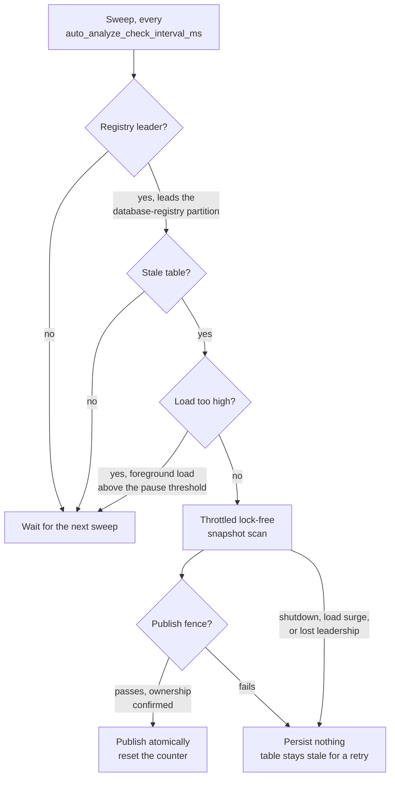

# Automatic analyze

CamusDB keeps the optimizer's statistics fresh without your help.

The statistics tell the [query planner](/docs/query-planning) how many rows a
table has and how the values in each column are distributed: the row count, the
minimum and maximum of each column, the histograms, and the number of distinct
values (NDV). The planner uses them to choose between an index and a full scan,
and to order joins. Normal writes keep the row count and index counts current,
but the histograms and NDV drift as rows change. Old statistics can then make a
fast query slow, for example by picking the wrong index or join order.

A background job detects when a table's histograms and NDV become stale and runs
`ANALYZE` on that table again, so you do not need to schedule `ANALYZE`
yourself.

The job's cost is bounded and throttled: by default it reads at most 50,000 rows
per second, analyzes one table at a time, and pauses when the node is under
load. Its reads take no locks, so it never blocks or aborts a query or a write.

This page describes how the job works and how to tune it. For how the planner
uses the statistics, see [Query Planning](/docs/query-planning). To force a
refresh, run `ANALYZE TABLE` by hand; see
[Relation to a manual ANALYZE TABLE](#relation-to-a-manual-analyze-table).

Use [`SHOW STATISTICS FOR <table>`](/docs/show-statistics) to see a table's
current statistics, including how stale they are and whether this job has
refreshed the table yet.

The feature is on by default (`auto_analyze_enabled = true`). Set it to `false`
in `config.yml` to go back to manual `ANALYZE` only.

## How CamusDB detects staleness

Every committed row mutation (an insert, an update, or a delete) increments a
per-table counter, `MutationsSinceAnalyze`. `StatisticsManager` tracks the
counter, and CamusDB persists it with the rest of the table's statistics.

A table is stale when:

```text
mutations_since_analyze >= auto_analyze_fraction_stale_rows * row_count + auto_analyze_min_stale_rows
```

- `auto_analyze_fraction_stale_rows` is the proportional trigger. The default
  is `0.20`, one fifth of the table.
- `auto_analyze_min_stale_rows` is an absolute floor. The default is `500`. The
  floor prevents constant re-analysis of small tables and tables with light
  churn.
- A table with tracked data that CamusDB has never analyzed is stale
  immediately.
- An empty table with no mutations is never stale.

Deletes count as churn too, so a table that CamusDB rewrites completely still
crosses the threshold even when its row count stays the same.

## How a background ANALYZE runs

The background collector produces the same statistics as a manual `ANALYZE`,
with three hard guarantees that keep it from disrupting a busy node.

### 1. Bounded, constant peak memory

A manual `ANALYZE` reads at most `stats_analyze_sample_rows` rows (default
`100,000`; `0` reads every row). It takes the first rows in storage order and
counts exactly within that sample, holding every distinct value in memory. Its
memory therefore grows with the sample size.

The background path samples instead, using fixed-size sketches, so its peak
memory depends on the sample size, not the table size.

- CamusDB builds each histogram from a bounded reservoir sample, using Vitter's
  Algorithm R. The sample holds at most `auto_analyze_histogram_sample_rows`
  values per column (default `10,000`). CamusDB also keeps up to
  `stats_top_values` of the most common sampled values with their sample counts.
  The planner uses those frequencies for skewed equalities and joins.
- Both forms of `ANALYZE` collect columns in the same order: the leading column
  of each index first, then the table's other columns in declaration order, up
  to `stats_analyze_max_columns` columns in total (default `32`). That cap never
  cuts indexed columns. `BOOL`, `BYTES`, and array columns get no statistics,
  because no filter estimate reads them. A background scan's peak memory is
  therefore one reservoir and one sketch per analyzed column.
- CamusDB estimates NDV with a small HyperLogLog sketch, which needs about 2 KB
  per column at the default precision instead of holding an exact set of
  distinct values.
- The row count and index entry counts stay exact. They are running integers
  and need constant memory.

Both sketches use a deterministic hash with a fixed seed, so the same data set
produces reproducible statistics.

### 2. A throttled scan

CamusDB paces the scan to `auto_analyze_max_rows_per_second` (default `50,000`)
by waiting between batches, so the scan never saturates a core or the storage
read path.

At each batch boundary, the scan also rechecks ownership and load.
`auto_analyze_ownership_check_rows` sets the batch size (default `1,000` rows).

### 3. Lock-free reads, no interference, no priority inversion

The background scan opens its own serializable read-only snapshot transaction.
That transaction takes one new timestamp from the
[hybrid logical clock](/docs/concepts#hlc), the clock CamusDB uses to order
transactions across nodes. It takes no range lock and folds no read set.

The scan takes no range locks. It reads past an open writer's uncommitted
changes; it can briefly wait for a commit already in progress, like other
timestamp reads. See [snapshot behavior](/docs/serializable-transactions#read-committed-snapshots-and-limits).

A manual `ANALYZE` also scans under its own read-only snapshot, not the
caller's transaction, so it cannot make the caller abort. If the caller's
transaction has uncommitted writes, `ANALYZE` fails at once with `CADB0522`:
its independent snapshot would otherwise omit the caller's staged rows.
Commit or roll back first.

### Atomic, delta-safe publication

At the end of the scan, CamusDB publishes the new statistics in one
transaction. It never publishes a partial mix of old and new fields.

Publication also preserves DML that committed during the scan. CamusDB computes
a correction from the scan (the scanned value minus the baseline) and applies it
to the current live value, so a concurrent insert or delete is not overwritten
with a value from the snapshot time.

CamusDB replaces the minimum and maximum with the freshly scanned values, which
corrects drift from deletes, and rebuilds the histograms and NDV completely.

Three events can stop the scan: a shutdown, a load surge, or a loss of
leadership, as described in
[Scheduling and cluster behavior](#scheduling-and-cluster-behavior). The publish
can also fail. In all of these cases, CamusDB persists nothing and does not
reset the staleness counter. The table stays marked as stale, and CamusDB
retries later. The whole operation is idempotent, so a second run is safe.

## Turn the job off for one table

You can exempt one table from automatic collection while it stays on for the
rest of the database, for example an append-only, high-churn log table where
repeated analysis is wasted work:

```camussql
ALTER TABLE application_logs SET (sql_stats_automatic_collection_enabled = false);  -- opt out
ALTER TABLE application_logs SET (sql_stats_automatic_collection_enabled = true);   -- opt back in
```

The setting controls only the background scheduler. A manual
`ANALYZE TABLE application_logs` still runs.

The setting defaults to enabled, so CamusDB analyzes tables that leave it unset
as usual. It is stored with the table's schema, does not affect row encoding,
and survives restarts. In a cluster over HTTP, you must issue the statement on
the schema [leader](/docs/concepts#leader), the node that coordinates schema
changes.

## Scheduling and cluster behavior

A background loop, owned by the engine and modeled on the orphan-object
reclaimer, sweeps on an interval set by `auto_analyze_check_interval_ms`
(default `60,000`).

Each sweep:

1. Runs on one node of the cluster. Only the leader of the database-registry
   [partition](/docs/concepts#partition), the node that coordinates writes to
   the list of databases, performs the sweep, so N nodes do not analyze the
   same table. After a failover, the new leader takes over the work.
2. Discovers candidates from authoritative metadata. The owner enumerates every
   database in the registry and, for each table, reads the per-object meta key
   rather than its local list of open objects. It then reads each table's
   persisted staleness. So if one node creates and mutates a table, the owner
   still finds and analyzes it, even if the owner never opened it.
3. Backs off under load. A probe measures foreground load: the number of
   explicit transactions in flight plus the number of HTTP and gRPC data
   requests in flight. Above `auto_analyze_load_pause_threshold`, the sweep
   starts no new analysis and cancels a running one at the next batch boundary.
   Because the reads are lock-free, this only addresses CPU and I/O contention;
   there is no lock-based priority inversion to solve.
4. Bounds concurrency and spreads the work. CamusDB analyzes at most
   `auto_analyze_max_concurrent` tables at a time (default `1`) and shuffles the
   candidate order. A burst of tables that become stale together spreads across
   several sweeps, and no table at the end of the list starves.



### Exactly-once publication fence

Discovery, the sweep, and the scan each recheck leadership, but the definitive
guarantee is a per-table publish fence.

Immediately before writing the new generation, the analyzer acquires a
cluster-wide exclusive lock on `{dbId}/meta/analyze:{tableId}`, then confirms
ownership again under that lock.

Two nodes cannot hold the lock at once. A former leader that lost leadership
during the scan fails the ownership check under the lock and aborts. Exactly one
node ever publishes, even across a failover. The scan itself stays lock-free;
only the short publish is fenced.

A per-node claim on the table adds a second layer of protection: it prevents
the timer loop and a forced run from overlapping on the same table on one node.

## Configuration

Every setting is part of the CamusDB configuration. See
[Configuration](/docs/configuration) for how CamusDB loads it. The feature is on
by default, and the tuning defaults around it are conservative by design.

| Setting | Default | Meaning |
|---|---|---|
| `auto_analyze_enabled` | `true` | The main switch. While it is off, the loop never runs, and only a manual `ANALYZE` refreshes the statistics. |
| `auto_analyze_check_interval_ms` | `60000` | The sweep interval. A value of `0` or below also disables the loop. |
| `auto_analyze_fraction_stale_rows` | `0.20` | The proportional staleness trigger. |
| `auto_analyze_min_stale_rows` | `500` | The absolute minimum number of mutations before a table can be stale. |
| `auto_analyze_max_concurrent` | `1` | The maximum number of concurrent background analyses on one node. |
| `auto_analyze_max_rows_per_second` | `50000` | The scan rate throttle, which caps CPU and I/O. A value of `0` or below disables the throttle. |
| `auto_analyze_histogram_sample_rows` | `10000` | The per-column reservoir size, which bounds memory. |
| `stats_top_values` | `100` | The most common values kept with each histogram. `0` disables the list. When a column has no more distinct values than the limit, all of them are kept. |
| `stats_analyze_max_columns` | `32` | The maximum number of columns per table that `ANALYZE` collects statistics for, indexed leading columns first. It applies to the manual form too. `0` collects only the indexed leading columns. |
| `auto_analyze_hll_precision` | `11` | The number of index bits in the HyperLogLog sketch. The register count is `2^p`. The sketch needs about 2 KB per column, with about 2.3% error. |
| `auto_analyze_load_pause_threshold` | `16` | The amount of foreground work in flight above which the sweep backs off. A value of `0` or below disables the check. |
| `auto_analyze_ownership_check_rows` | `1000` | The number of rows between ownership and load checks during a scan. |

## Relation to a manual ANALYZE TABLE

A manual `ANALYZE TABLE` behaves as before. It reads at most
`stats_analyze_sample_rows` rows and counts exactly within them. It runs under
its own read-only snapshot and fails with `CADB0522` if your transaction has
uncommitted writes. It publishes atomically, and it resets the staleness
counter, exactly as the background path does.

You can always run it by hand, and it takes precedence at that moment. Automatic
analyze only keeps the statistics fresh between manual runs.

## Known limits

- In a cluster, the mutation count is approximate. Each node flushes its own
  view of a table's count to the shared statistics blob, and the last writer
  wins, so the cluster-wide count can be too low. That error only delays a
  refresh; it never corrupts data. A durable per-table counter is a possible
  future improvement.
- On the node that publishes fresh statistics, publishing increments the
  table's analyze generation. Cached decisions that depend on that table then
  miss and are planned again. A query that is already running keeps its current
  plan.
- Other nodes keep their loaded statistics until the table entry is evicted or
  the node restarts. Until then, the plans they build and cache use that older
  local copy of the statistics.
