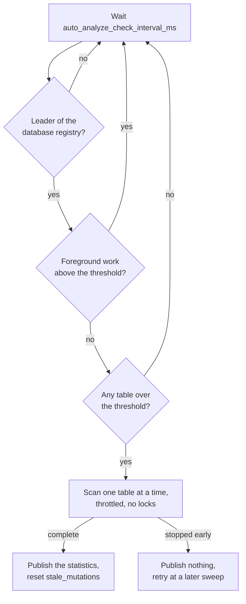

# Automatic analyze

The [query planner](/docs/query-planning) uses table statistics, such as
histograms and distinct-value counts, to choose between an index and a full scan
and to order joins. Writes update the row count at once. However, the histograms
and the distinct-value counts are rebuilt by `ANALYZE`. As the data changes,
they drift. A query that was fast can then get a slow plan.

Automatic analyze refreshes these statistics for you. A background job finds
the tables that changed enough since their last `ANALYZE`, and analyzes them
again. You don't need to schedule `ANALYZE` yourself. The job is on by default.

The job is limited to protect a busy node:

- It reads at most 50,000 rows per second, and it analyzes one table at a time.
- It pauses while the node is busy with foreground work.
- Its reads take no locks. It doesn't block your writes, and it can't make your
  transactions abort.

## Check a table

[`SHOW STATISTICS`](/docs/show-statistics) shows when a table was last analyzed,
and how many rows changed since then:

```camussql
SHOW STATISTICS FOR orders;
```

The following values are from the `table` row of a new table with 650 rows,
before and after a background analysis:

| When | `estimated_rows` | `last_analyzed` | `stale_mutations` |
| --- | --- | --- | --- |
| Before | `650` | `NULL` | `650` |
| After | `650` | `2026-11-19T17:37:05.092Z` | `0` |

Each background analysis also writes a line to the server log:

```text
info: CamusDB.Core.ICamusDB[0] Auto-analyzed table orders in database shop
```

A failed analysis logs a warning with the text
`Auto-analyze of table orders in database shop failed` and the exception.

## When a table is analyzed

A table is analyzed again when its changes since the last `ANALYZE` reach this
threshold:

```text
stale_mutations >= auto_analyze_fraction_stale_rows * row_count + auto_analyze_min_stale_rows
```

With the defaults, the threshold is 20% of the rows plus 500. For example, a
table with 10,000 rows is analyzed after 2,500 changes.

Each row that a statement writes counts as one change. For example, an `UPDATE`
of 1,000 rows adds 1,000, and a `DELETE` adds one for each deleted row.

A table with fewer than 500 changes isn't analyzed. This includes a new table.
For example, a lookup table with 50 rows gets no histograms until you run
`ANALYZE` yourself.

If you need fresh statistics at once, for example after a bulk load, you should
run `ANALYZE` yourself.



## What the job costs

The following settings limit the background scan:

| Limit | Default | Setting |
| --- | --- | --- |
| Rows read per second | `50000` | `auto_analyze_max_rows_per_second` |
| Tables analyzed at a time | `1` | `auto_analyze_max_concurrent` |
| Values sampled for each column histogram | `10000` | `auto_analyze_histogram_sample_rows` |
| Foreground work above which the job pauses | `16` | `auto_analyze_load_pause_threshold` |

The scan reads all rows of the table. At the default rate, a table with 10
million rows takes at least 200 seconds. Memory use depends on the sample size
and the number of columns. It doesn't grow with the table.

Foreground work is the number of explicit transactions and HTTP or gRPC
requests in progress on the node. Above the threshold, a sweep doesn't start.
A scan in progress stops at its next batch of 1,000 rows.

The scan reads a snapshot and takes no locks. If it stops early, for example at
shutdown or when the load goes up, no statistics are written. The table is
analyzed again at a later sweep.

The new statistics are published in one transaction. Writes that commit during
the scan aren't lost from the row counts and the index counts.

## Background and manual results

Both forms reset `stale_mutations`. They read the table in different ways:

| | Manual `ANALYZE` | Background job |
| --- | --- | --- |
| Rows read | The first 100,000 rows in storage order (`stats_analyze_sample_rows`). `0` reads all rows. | All rows, at the throttled rate. |
| Histograms | Built from the rows read. | Built from a random sample of up to 10,000 values for each column. |
| Distinct values | Counted exactly in the rows read. | Estimated, with about 2.3% error at the default precision. |

For example, after a background analysis of a table with 650 unique IDs,
`distinct_count` for `id` showed `660`.

Both forms collect statistics for the same columns. The leading column of each
index comes first. The other columns follow in declaration order, up to 32
columns in total (`stats_analyze_max_columns`). Columns of type `BOOL`, `BYTES`,
`JSONB`, and `ARRAY` get no column statistics. `SHOW STATISTICS` shows no row
for them.

### Run ANALYZE in a transaction

You can run `ANALYZE` in an explicit transaction that hasn't written anything.
The scan reads a separate snapshot, and it can't make your transaction abort.

In a transaction with uncommitted writes, `ANALYZE` returns `CADB0522`. The
transaction is also rolled back. The statistics would otherwise miss the rows
that you wrote. Commit the writes before you run `ANALYZE`.

## Turn the job off for one table

You can turn off the job for one table, for example a large append-only log
table where repeated analysis isn't useful:

```camussql
ALTER TABLE application_logs SET (sql_stats_automatic_collection_enabled = false);
```

To turn it on again, set the value to `true`, or remove the setting:

```camussql
ALTER TABLE application_logs RESET (sql_stats_automatic_collection_enabled);
```

You can also set it when you create the table:

```camussql
CREATE TABLE application_logs (
  id INT64 PRIMARY KEY,
  message STRING
) WITH (sql_stats_automatic_collection_enabled = false);
```

The setting is stored with the table's schema, and it's kept after a restart.
`SHOW CREATE TABLE` shows it in a `WITH` clause. The value must be `true` or `false`. Other values return
`CADB0400`. A manual `ANALYZE` works on the table with either value.

In a cluster, you can send `ALTER TABLE ... SET` and `ALTER TABLE ... RESET`
to any node. See [Distributed schema](/docs/distributed-schema#how-a-schema-change-flows).

## Turn the job off for all tables

All settings on this page can change at runtime:

```camussql
SET CLUSTER SETTING auto_analyze_enabled = false;
RESET CLUSTER SETTING auto_analyze_enabled;
```

To change the default at startup, set the key in `config.yml`. For more
information, see [Runtime cluster settings](/docs/runtime-cluster-settings).

A change takes effect at the next sweep. Note that a shorter
`auto_analyze_check_interval_ms` applies after the current wait ends. With the
default, this can take up to 60 seconds.

## Settings

| Setting | Default | Meaning |
| --- | --- | --- |
| `auto_analyze_enabled` | `true` | Turns the job on or off. When it's off, statistics change after a manual `ANALYZE`. |
| `auto_analyze_check_interval_ms` | `60000` | The time between sweeps. `0` or less turns the job off. |
| `auto_analyze_fraction_stale_rows` | `0.20` | The part of the row count in the threshold. |
| `auto_analyze_min_stale_rows` | `500` | The minimum number of changes before a table is analyzed. |
| `auto_analyze_max_concurrent` | `1` | The number of tables that the node analyzes at the same time. |
| `auto_analyze_max_rows_per_second` | `50000` | The scan rate limit. `0` or less removes the limit. |
| `auto_analyze_histogram_sample_rows` | `10000` | The sample size for each column histogram. |
| `auto_analyze_hll_precision` | `11` | The precision of the distinct-value estimate, from `4` to `16`. Each step up doubles the memory for each column and lowers the error. The default uses about 2 KB for each column. |
| `auto_analyze_load_pause_threshold` | `16` | The foreground work above which the job pauses. `0` or less turns the pause off. |
| `auto_analyze_ownership_check_rows` | `1000` | The rows between checks for load and leadership during a scan. |
| `stats_top_values` | `100` | The most common values saved for each column, for both forms of `ANALYZE`. `0` saves none. |
| `stats_analyze_max_columns` | `32` | The maximum number of columns for each table, for both forms. `0` collects the leading index columns only. |

`auto_analyze_max_concurrent` and `auto_analyze_load_pause_threshold` apply to
one node. The other settings apply to the cluster. For all statistics settings,
see [Settings reference](/docs/settings-reference).

## In a cluster

One node analyzes the tables of all databases: the leader of the
database-registry [partition](/docs/concepts#partition). It finds the tables
that changed on any node. After a failover, the new leader continues the work.
If leadership moves during a scan, the old leader doesn't publish its result.

Note the following limits:

- The change count that the job reads can miss recent writes on other nodes.
  This can delay an analysis. It doesn't affect your data.
- After a publish, the node that published plans the cached queries on that
  table again. A query that is in progress continues with its plan.
- Other nodes use their loaded statistics until they load the table's
  statistics again, for example after a restart. Until then, their plans use the
  older statistics.

## Related pages

- [SHOW STATISTICS](/docs/show-statistics)
- [Query planning](/docs/query-planning)
- [EXPLAIN](/docs/explain)
- [Runtime cluster settings](/docs/runtime-cluster-settings)
- [Settings reference](/docs/settings-reference)
