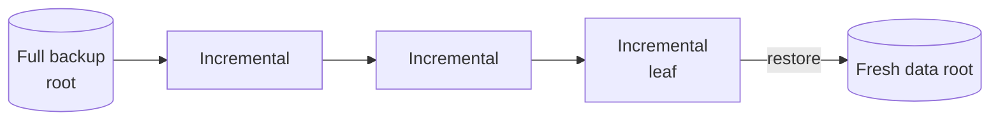
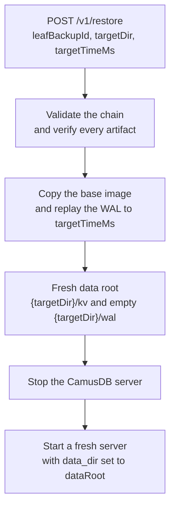
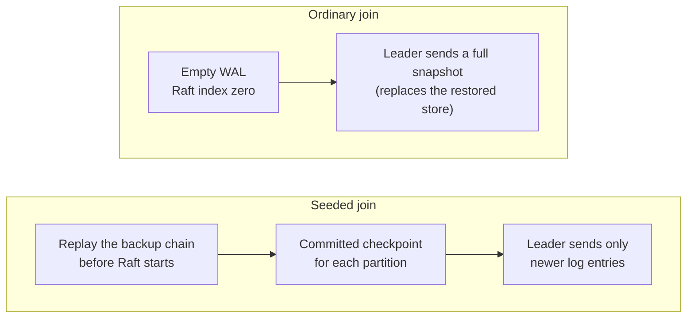

# Backup and restore

A backup gets your data back after an event that the database can't repair. It
is a copy of your data that you keep outside the running database. Use it
when:

- You lose a disk or a server.
- Storage files become corrupt.
- A bad migration, a wrong script, or a bug in an application changes or
  deletes a large amount of data.
- You must return the database to its state at an exact moment, for example
  the minute before an incident. The moment must be in the
  [retention window](#retention).

A [cluster](/docs/cluster) stores several copies of each write. Replication
copies a bad change to all nodes as fast as a good change, and a backup is the
way to go back to a point before the change.

Use this page for disaster recovery of a production node or cluster. For a
smaller problem, a lighter tool is often faster:

- To read the earlier contents of a table on a running server, use
  [Time-travel reads](/docs/time-travel-reads).
- To undo an accidental `DROP TABLE` or `DROP DATABASE`, use
  [Recover dropped objects](/docs/recover-dropped-objects).
- To copy data to another environment, or to keep an export in SQL, use
  [camus-dump](/docs/camus-dump).

[Which recovery tool to use](#which-recovery-tool-to-use) compares the four
tools.

## How a CamusDB backup works

CamusDB takes a physical backup of its storage engine. The backup contains a
base image and the [write-ahead log (WAL)](/docs/concepts#wal), which records
the changes after that image. A restore can therefore target any moment in the
retention window.

A backup covers a full node. All databases on a node share one storage engine
([Kahuna](/docs/concepts#kahuna)), and one backup contains all of them. You
can't back up one database or table, and there is no SQL `BACKUP` statement.
Backups are server administration operations over HTTP.

A restore is offline. It builds the storage in a new directory, and the running
server doesn't change. You restore first, then start a server on the restored
directory.

## Physical backups versus logical dumps

Backups are the recovery path for a database that is too large for a dump. A
logical export, such as [camus-dump](/docs/camus-dump), reads each row through
the SQL layer and writes it as text. This works for gigabytes of data. For
terabytes, the dump is slower than the disk, the file is larger than the data,
and the restore must parse each statement, check each constraint, and build
each index again. That can take hours or days.

A physical backup copies the base image and the WAL after it, and its cost
depends on the bytes on disk. A restore is a file copy and a WAL replay. With
incremental backups, the regular cost is close to the volume of changes.
Compressed large values, and large values stored outside the row, are regular
storage data. A backup contains them with their rows, and a restore to an
earlier point returns the large values of that point. See
[Large values](/docs/storage-layout).

A restore into a new directory also lets you check the restored data before you
use it.

A seeded join with `pitr_bootstrap_from` requires RocksDB for both
`kahuna.storage` and `kahuna.wal_storage`. It doesn't work with
[Solarium](https://solariumdb.github.io/). See
[storage-engine choices](/docs/configuration#solarium-storage-engine).

## Enable backups

Backups are off by default. Set a backup directory under `kahuna:`, then
restart the node:

```yaml
kahuna:
  backup_dir: /opt/camusdb/backups        # required; enables the API
  pitr_window_seconds: 3600               # how far back a restore may target
  base_snapshot_interval_seconds: 1800    # base-image cadence
```

Until you set `backup_dir`, the endpoints below return `503` with
`CADB0700 BackupNotConfigured`.

`pitr_window_seconds` must be greater than `0`, with a maximum of `21600` (six
hours). `base_snapshot_interval_seconds` must not exceed it.

A shorter interval between base images makes restores faster, because CamusDB
replays less WAL. It uses more disk space.

Restores need a second setting. Until you set a directory for restores,
`POST /v1/restore` returns `403 CADB070C RemoteRestoreDisabled`. Each restore
target must be in that directory:

```yaml
kahuna:
  restore_root: /opt/camusdb/restores
  allow_unconfined_remote_restore: false
```

`allow_unconfined_remote_restore: true` removes that limit, and a remote caller
can write to any absolute path. Don't use it in production.

The backup and restore directories must be owner-only (mode `0700`), and they
can't be symbolic links. A directory that fails this check returns
`CADB070F BackupInsecureRoot` before any file is written.

## Authorization

With authentication enabled, the backup and restore endpoints need the bearer
token of a superuser, as for user administration:

```text
Authorization: Bearer <token>
```

Use HTTPS (port 7141 by default). When TLS is required, a token over plaintext
returns an error, except from loopback. The examples below use
`http://localhost:5095`, which is loopback.

With authentication disabled, only loopback callers can use these endpoints.
Requests from other addresses return `CADB0517 InsufficientPrivilege`. See
[Authentication and authorization](/docs/sql-authentication).

## API

All endpoints are under `/v1`, and they use JSON with camelCase fields.

| Method | Path | Body | Purpose |
| --- | --- | --- | --- |
| `POST` | `/v1/backups/full` | none | Take a full backup now. |
| `POST` | `/v1/backups/incremental` | `{ "parentBackupId": "<guid>" }` | Take an incremental backup on top of a parent. |
| `POST` | `/v1/backups/coordinated` | none | Take a consistent backup across the cluster. |
| `GET` | `/v1/backups` | none | List the catalog. |
| `GET` | `/v1/backups/{id}/chain` | none | Resolve and validate the chain that ends at `{id}`. |
| `POST` | `/v1/backups/gc?dryRun=<bool>` | none | Preview or run the retention pass and the orphan file sweep. |
| `POST` | `/v1/restore` | `{ "leafBackupId", "targetDir", "targetTimeMs" }` | Restore offline into a fresh data root. |

Backups, catalog listings, and chain validation are online operations. They are
safe while the server serves traffic.

The `backup` commands of `camus-cli` cover all operations except restore, and
they are usually easier than curl. See [camus-cli](/docs/camus-cli#backups).

```sh
# Take a full backup, then an incremental on top of it
curl -sX POST http://localhost:5095/v1/backups/full \
  -H "Authorization: Bearer $TOKEN"

curl -sX POST http://localhost:5095/v1/backups/incremental \
  -H "Authorization: Bearer $TOKEN" -H 'Content-Type: application/json' \
  -d '{"parentBackupId":"<full-guid>"}'

# List the catalog and inspect one chain
curl -s http://localhost:5095/v1/backups -H "Authorization: Bearer $TOKEN"
curl -s http://localhost:5095/v1/backups/<leaf-guid>/chain -H "Authorization: Bearer $TOKEN"
```

Each response has a status. A failure has an error code:

```json
{ "status": "failed", "code": "CADB0701", "message": "..." }
```

### Chains and recoverable coverage

A restore replays one chain: a full backup at the root plus the incremental
backups on top of it. `GET /v1/backups/{id}/chain` validates that chain and
returns it, root first.



A chain that doesn't start at a full backup, or has a gap, a broken parent link,
or a cycle, returns `CADB0701 BackupChainInvalid`.

The first backup in the chain response, the full backup, has
`minRecoverablePhysicalMs` and `maxRecoverablePhysicalMs`. These two numbers set the range of possible restore
points.

The coverage of the chain sets what you can restore, and the age of the backup
doesn't. `pitr_window_seconds` limits the live WAL of the running node. A backup
that is written has a fixed coverage. A chain from last month can be restored to
any point in its range.

`targetTimeMs` is in Unix epoch milliseconds. `0` means the latest recoverable
point in the chain. A value outside the coverage of the chain returns
`CADB0703 RestorePointOutOfWindow` (HTTP 422).

### Verification and incremental fallback {#verification-and-a-fallback-for-an-incremental-backup}

CamusDB checks the size and SHA-256 of each file before it publishes a backup,
and again before a restore. A missing or damaged file stops
the operation with `CADB0706 BackupCorruptArtifact`.

If the parent of an incremental backup is older than the retention limit, an
incremental backup isn't possible. CamusDB then takes a full backup. The
`actualKind` and `substitutionReason` fields of the response and the catalog
show the substitution.

When the parent chain spans several nodes, the replacement must be a
coordinated full backup. If the node that received the request isn't the backup
coordinator (the node that [leads](/docs/concepts#leader) the backup metadata
of the cluster), the request returns `CADB070E BackupNotCoordinator`. Retry it
on the coordinator node.

## Restore runbook {#the-restore-runbook}

A restore is offline. Follow this sequence:

1. Restore into a new data directory. Call `POST /v1/restore` with a new or
   empty `targetDir`. A directory that isn't empty returns `CADB0400`. A target
   outside `restore_root`, or one that overlaps the live `data_dir`, its `kv` or
   `wal` subdirectory, or the target of another job, returns
   `CADB0707 RestoreTargetConflict`. The running server doesn't change.

   ```sh
   curl -sX POST http://localhost:5095/v1/restore \
     -H "Authorization: Bearer $TOKEN" -H 'Content-Type: application/json' \
     -d '{"leafBackupId":"<leaf-guid>","targetDir":"/data/restored","targetTimeMs":1750000000000}'
   ```

   The response returns the restored directory as `dataRoot`. Other fields
   show the recoverable range and the number of restored entries.

2. Stop the CamusDB server.

3. Start a new server with `data_dir` set to that `dataRoot`. CamusDB puts the
   restored storage in `{targetDir}/kv` and creates an empty `{targetDir}/wal`.
   The target is a complete data directory, and you don't need to move files.
   Use the same `kahuna.storage` value and revision settings as the backup. A
   physical backup works only with the storage revision that created it. To move
   data to another storage revision, restore with the CamusDB version that took
   the backup, then use a
   [logical dump and reimport](/docs/logical-dump-and-reimport).

4. For disaster recovery of a full cluster, restore all nodes to one
   coordinated point, and start the cluster together. To add a node to a running
   cluster from a backup, use the seeded join below. A restored data directory
   that starts as a regular joining node loses its restored data.



`kahuna.backup_restore_throttle_bytes_per_sec` limits the copy rate of a
restore. Use it when the restore shares a volume with other important
workloads.

## Seed a joining node from a backup

A regular node that joins a running cluster with an empty WAL starts at index
zero of the replication log ([Raft](/docs/concepts#raft)). The leader sends it a
full snapshot, which replaces the restored data. A seeded join replays the
backup chain before Raft starts, and it writes a committed checkpoint for each
[partition](/docs/concepts#partition) at the index of the chain. The leader then
sends only newer log entries.



1. Restore a backup chain into a fresh data root with `POST /v1/restore`. Keep
   the `leafBackupId` and `targetTimeMs`.
2. Copy that data directory to the joining host. Don't start CamusDB on it. Its
   WAL must be empty.
3. Make the same backup catalog available on the joining host, and set
   `kahuna.backup_dir` to it.
4. Start the node with the seed settings:

   ```yaml
   mode: cluster
   peers:
     - 10.0.0.1:7070
     - 10.0.0.2:7070
   join_existing: true
   pitr_bootstrap_from: <leafBackupId>
   pitr_bootstrap_target_time_ms: 0
   kahuna:
     backup_dir: /opt/camusdb/backups
   ```

   The equivalent command-line option is `--pitr-bootstrap-from
   <leafBackupId>`, together with `--join-existing true`. Set
   `--pitr-bootstrap-target-time-ms` when the restore targeted a specific time.
5. Remove `pitr_bootstrap_from` after the node joins successfully.

The target time must match the point of the restore. In these cases, the
startup stops with `CADB0710 PitrBootstrapFailed`:

- The restored image is missing, or the WAL isn't empty.
- The storage backend isn't supported.
- The chain or its MAC is invalid.
- The backup belongs to another configured cluster.
- The seeded point is older than the log that the leader retains.

After a partial seed attempt, copy a new restored directory before you retry.

## Clusters

On a single node, coordinated and full backups are the same operation.

In a cluster, a coordinated backup takes one consistent cut across all
partitions at one cluster timestamp ([HLC](/docs/concepts#hlc)). A transaction
across partitions can't be split in half. Both the backup and the restore cut at
the shared commit timestamp.

As a result:

- Send a coordinated backup to the coordinator node. Other nodes return `421`
  with `CADB070E BackupNotCoordinator`.
- If the topology changes during the backup, the operation stops with
  `CADB070D BackupTopologyChanged`, and no backup is published. Retry when
  the membership is stable.

Set `kahuna.backup_cluster_id` to the same value on all nodes. Each manifest
records that value and the name of the node that coordinated the backup.
Listings show both as `clusterId` and `coordinatorNode`. A restore returns an
error for files from another cluster or an old topology.

To detect a replaced manifest, set `kahuna.backup_mac_key_file` to an
HMAC-SHA-256 key file. Use the same key on all nodes, and store it outside
`backup_dir`. A node with a key returns an error for unsigned or changed
manifests.

Backups aren't encrypted at rest. File system permissions protect the files,
and the MAC protects their integrity. Keep `backup_dir` on a volume with access
control, ideally an encrypted one.

## Retention

Garbage collection is automatic. It starts after each backup and at regular
intervals. These settings control it:

| Setting | Default | Meaning |
| --- | --- | --- |
| `kahuna.backup_retention_max_chains` | `0` | Keep at most N chains. `0` means no limit. |
| `kahuna.backup_retention_max_age_seconds` | `0` | Delete a chain older than this age. `0` means no limit. |
| `kahuna.backup_retention_max_bytes` | `0` | Cap total backup bytes. `0` means no limit. |
| `kahuna.backup_gc_interval_seconds` | `3600` | The interval of the background collection. `0` turns it off. |

Garbage collection deletes only full chains. Each retained backup can be
restored.

Preview a pass first:

```sh
curl -sX POST 'http://localhost:5095/v1/backups/gc?dryRun=true' \
  -H "Authorization: Bearer $TOKEN"
```

The response has `bytesReclaimed`, `retentionDeletions` (with a reason for each
backup), and `orphanReclamations`. An orphan is a file in the backup directory
that belongs to no manifest. `dryRun=false` applies the same pass.

For disk space, plan for the retained WAL (`pitr_window_seconds` times your
write throughput) plus the base images in that window. Set the window to a
realistic recovery need, because a longer window retains more WAL.

## Which recovery tool to use

CamusDB has four recovery tools, each for a different need.

| Your goal | The tool |
| --- | --- |
| Recover a node or a cluster from data loss, to a chosen point in time | Backup and restore, on this page |
| Read the earlier contents of a table on a running server | [Time-Travel Reads](/docs/time-travel-reads) |
| Undo a `DROP DATABASE` or a `DROP TABLE` | [Recover Dropped Objects](/docs/recover-dropped-objects) |
| Move data to another cluster, or keep a readable SQL export | [camus-dump](/docs/camus-dump) |

The first three tools are physical, and they work in the engine.

`camus-dump` is logical. It writes SQL that you can inspect and replay anywhere,
and it is the right tool for migrations. For disaster recovery, a
large dump takes much longer to replay than an image takes to restore. See
[Physical backups versus logical dumps](#physical-backups-versus-logical-dumps).

## Error codes

| Code | Name | HTTP | Meaning |
| --- | --- | --- | --- |
| `CADB0700` | `BackupNotConfigured` | 503 | `kahuna.backup_dir` is unset. Backups are opt-in. |
| `CADB0701` | `BackupChainInvalid` | 422 | The chain has no full root, a gap, a broken link, or a cycle. |
| `CADB0702` | `BackupNeedsFullBackup` | 409 | Reserved, and not returned in practice. When an incremental backup isn't possible, CamusDB takes a full backup (see [the fallback](#verification-and-a-fallback-for-an-incremental-backup)). |
| `CADB0703` | `RestorePointOutOfWindow` | 422 | `targetTimeMs` falls outside the recoverable coverage of the chain. |
| `CADB0704` | `RestoreFailed` | 500 | The restore failed while copying the base image or replaying the WAL. |
| `CADB0705` | `BackupParentMissing` | 404 | The named `parentBackupId` does not exist. |
| `CADB0706` | `BackupCorruptArtifact` | 422 | An artifact is absent, truncated, extra, or duplicated, or it fails its digest. |
| `CADB0707` | `RestoreTargetConflict` | 409 | The target is outside `restore_root`, or it overlaps a protected path. |
| `CADB0708` | `BackupExactCheckpointUnavailable` | 409 | The backend cannot cut an exact checkpoint at that point. |
| `CADB0709` | `BackupUnsupportedFormat` | 422 | The manifest uses a legacy format, or a format that CamusDB does not support. |
| `CADB070A` | `BackupRetryableLeadershipLoss` | 503 | The partition lost its leader during the operation. CamusDB applied nothing durable. Retry. |
| `CADB070B` | `BackupCancelled` | 499 | The caller cancelled the operation. |
| `CADB070C` | `RemoteRestoreDisabled` | 403 | There is no `kahuna.restore_root`, and the unconfined opt-in is off. |
| `CADB070D` | `BackupTopologyChanged` | 503 | The topology changed during a coordinated backup. CamusDB published nothing. Retry. |
| `CADB070E` | `BackupNotCoordinator` | 421 | A caller requested a coordinated backup on a node that is not the coordinator. An incremental backup whose fallback must be a coordinated full backup fails the same way. Retry on the coordinator. |
| `CADB070F` | `BackupInsecureRoot` | 500 | The backup or restore root is a symbolic link, or is group- or world-writable. |
| `CADB0710` | `PitrBootstrapFailed` | 500 | A joining node could not validate or seed its restored data root and WAL from the configured backup chain. |

Three codes are retryable: `CADB070A`, `CADB070B`, and `CADB070D`. After each
one, no backup is published. The other codes need an operator decision first.

## Current limits

- Backups use the local file system only. Object storage isn't available yet.
- Backups aren't encrypted at rest.
- A restore is offline, and you can't restore one database or table.
- There is no SQL interface. Backup and restore are HTTP administration
  operations. `camus-cli` has a shell command for each operation except
  restore.

## Related pages

- [Configuration](/docs/configuration)
- [Cluster mode](/docs/cluster)
- [WAL and recovery](/docs/wal-recovery)
- [camus-dump](/docs/camus-dump)
- [HTTP API](/docs/http-api)
