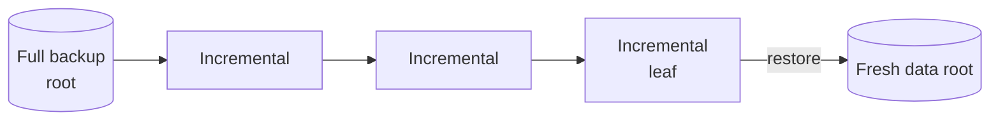
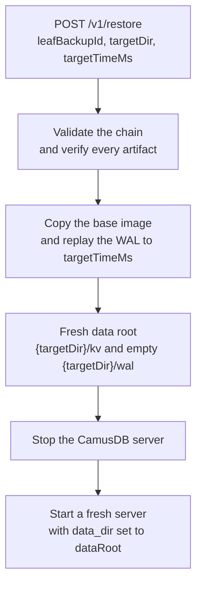
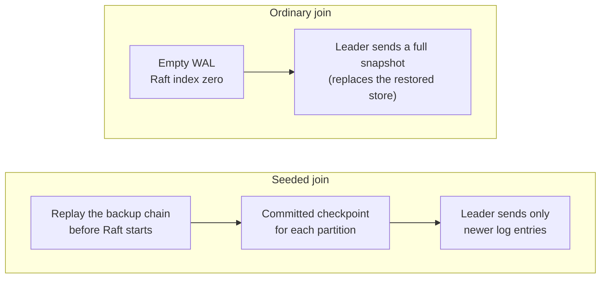

# Backup and restore

A backup is a copy of your data that you keep outside the running database. You
use it to get the data back after an event that the database cannot repair by
itself:

- A disk or a whole server is lost.
- Storage files become corrupt.
- A bad migration, a wrong script, or a bug in an application changes or
  deletes a large amount of data.
- You must return the database to its state at an exact moment, for example
  the minute before an incident. The moment must be inside the
  [retention window](#retention).

A [cluster](/docs/cluster) keeps several copies of each write, but it does not
replace a backup. Replication copies a bad change to every node as fast as a
good change. Only a backup lets you go back to a point before the change.

Use this page when you need disaster recovery for a production node or
cluster. For a smaller problem, a lighter tool is often faster:

- To read the earlier contents of a table while the server runs, use
  [Time-travel reads](/docs/time-travel-reads).
- To undo an accidental `DROP TABLE` or `DROP DATABASE`, use
  [Recover dropped objects](/docs/recover-dropped-objects).
- To copy data to another environment, or to keep an export in SQL, use
  [camus-dump](/docs/camus-dump).

[Which recovery tool to use](#which-recovery-tool-to-use) compares the four
tools.

## How a CamusDB backup works

CamusDB takes a physical backup of its storage engine. The backup holds a base
image, and the [write-ahead log (WAL)](/docs/concepts#wal): the record of
changes that the engine wrote after that image. A restore can
therefore target any moment inside the retention window. It is not limited to
the instant of the backup.

A backup covers a whole node. Every database on a node shares one storage
engine ([Kahuna](/docs/concepts#kahuna)), so one backup captures all of them together. There is no backup of one
database, and no backup of one table. There is no `BACKUP` statement in SQL.
These operations administer the server, and CamusDB exposes them over HTTP.

A restore is offline. It builds the storage into a fresh directory. It never
touches the server that runs. There is no hot restore in place. You restore
first. You then start a server against the restored directory.

## Why it works this way

This is the recovery path for a database that is too large for a dump. A
logical export, such as [camus-dump](/docs/camus-dump), reads every row through
the SQL layer and writes it out as text. That works at gigabyte scale, but not
at terabyte scale: the dump is slower than the disk, the file is larger than the
data, and the restore must parse every statement, check every constraint, and
build every index again. That replay can take hours or days.

A physical backup copies the base image and the WAL after it, so its cost
follows the bytes on disk, not the row count. A restore is a file copy plus a
WAL replay. An incremental backup keeps the steady cost close to the volume of
change. Compressed and out-of-line large values are ordinary storage data, so a
backup captures them with the rows that reference them, and a restore to an
earlier point returns the large values each row pointed at then. See
[Large Values](/docs/storage-layout).

The two constraints above follow from this design:

- A backup covers a whole node because the image does. Taking one database out
  would mean reading it row by row, which is the logical dump this design avoids.
- A restore is offline because CamusDB cannot replace files that a running
  server holds open and caches. A build into a fresh directory leaves the live
  node untouched, and lets you verify the restore first.

## Enable backups

Backups are off by default. Set a backup directory under `kahuna:`. Then restart
the node:

```yaml
kahuna:
  backup_dir: /opt/camusdb/backups        # required; enables the API
  pitr_window_seconds: 3600               # how far back a restore may target
  base_snapshot_interval_seconds: 1800    # base-image cadence
```

Every endpoint below answers `503` with `CADB0700 BackupNotConfigured` until you
set `backup_dir`.

`pitr_window_seconds` must be above `0`. Its maximum is `21600`, which is six
hours. `base_snapshot_interval_seconds` must not exceed it.

A shorter interval between base images makes a restore faster, because CamusDB
replays less WAL. The cost is more disk space.

A restore needs a second opt-in. `POST /v1/restore` refuses with `403 CADB070C
RemoteRestoreDisabled` until you name a directory that the server owns. Every
destination of a restore must be inside that directory:

```yaml
kahuna:
  restore_root: /opt/camusdb/restores
  allow_unconfined_remote_restore: false
```

`allow_unconfined_remote_restore: true` removes the confinement. A remote caller
can then write to any absolute path. Do not use that value in production.

The backup root and the restore root must belong to the owner only, in mode
`0700`. Neither may be a symbolic link. CamusDB rejects a root that fails that
check with `CADB070F BackupInsecureRoot`. The rejection happens before any
write.

## Authorization

While authentication is enabled, every backup endpoint and restore endpoint
needs a superuser bearer token. That is the same requirement as the
administration of users:

```
Authorization: Bearer <token>
```

Use HTTPS (port 7141 by default). CamusDB refuses a token over plaintext while
TLS is required, except from loopback. The examples below use
`http://localhost:5095`, which is loopback.

While authentication is disabled, only a loopback caller can use these
endpoints. A request from any other address fails with `CADB0517
InsufficientPrivilege`, so a network peer cannot start a backup or a restore
without credentials. See
[Authentication And Authorization](/docs/sql-authentication).

## The API

Every endpoint is under `/v1`. Each one speaks JSON, with fields in camel case.

| Method | Path | Body | Purpose |
| --- | --- | --- | --- |
| `POST` | `/v1/backups/full` | none | Take a full backup now. |
| `POST` | `/v1/backups/incremental` | `{ "parentBackupId": "<guid>" }` | Take an incremental backup on top of a parent. |
| `POST` | `/v1/backups/coordinated` | none | Take a consistent backup across the cluster. |
| `GET` | `/v1/backups` | none | List the catalog. |
| `GET` | `/v1/backups/{id}/chain` | none | Resolve and validate the chain that ends at `{id}`. |
| `POST` | `/v1/backups/gc?dryRun=<bool>` | none | Preview or run the retention pass and the sweep for orphan files. |
| `POST` | `/v1/restore` | `{ "leafBackupId", "targetDir", "targetTimeMs" }` | Restore offline into a fresh data root. |

Three operations are online, and they are safe while the server serves traffic:
a backup, a list of the catalog, and a validation.

`camus-cli` wraps every operation except the restore, in a `backup` command
family. That family is usually easier than curl for daily work. See
[camus-cli](/docs/camus-cli#backups).

```sh
# Take a full backup, then an incremental on top of it
curl -sX POST http://localhost:5095/v1/backups/full \
  -H "Authorization: Bearer $TOKEN"

curl -sX POST http://localhost:5095/v1/backups/incremental \
  -H "Authorization: Bearer $TOKEN" -H 'Content-Type: application/json' \
  -d '{"parentBackupId":"<full-guid>"}'

# List the catalog and inspect one chain
curl -s http://localhost:5095/v1/backups -H "Authorization: Bearer $TOKEN"
curl -s http://localhost:5095/v1/backups/<leaf-guid>/chain -H "Authorization: Bearer $TOKEN"
```

Every response is an envelope with a status. A failure carries a domain code:

```json
{ "status": "failed", "code": "CADB0701", "message": "..." }
```

### Chains and recoverable coverage

A restore replays one chain. A chain is a full backup at the root, plus the
incremental backups on top of it. `GET /v1/backups/{id}/chain` returns that
chain, with the root first, and validates it.



CamusDB rejects a chain with `CADB0701 BackupChainInvalid` in four cases: the
chain does not start at a full backup, the chain has a gap, a parent link is
broken, or the chain has a cycle. CamusDB does not reconstruct a state that
never existed.

The head of the chain reports `minRecoverablePhysicalMs` and
`maxRecoverablePhysicalMs`. Those two numbers define your possible restore
points. The clock does not define them.

That distinction matters. Recoverability is a property of the chain. It is not a
property of the age of the backup. `pitr_window_seconds` bounds the live WAL
that the running node keeps. A backup that CamusDB already wrote keeps its own
coverage. An archived chain from last month is therefore still restorable, to
any point inside its own range.

`targetTimeMs` is in Unix epoch milliseconds. A value of `0` means the latest
recoverable point in this chain. CamusDB rejects a value above zero that falls
outside the coverage of the chain. The error is `CADB0703
RestorePointOutOfWindow`, with HTTP 422.

### Verification, and a fallback for an incremental backup

CamusDB verifies every artifact by size and by SHA-256. It does so before the
publish, and again before the restore. A file that is absent, truncated,
duplicated, extra, or corrupt fails the operation closed, with `CADB0706
BackupCorruptArtifact`. The engine refuses the restore. It does not guess.

The parent of an incremental backup can age past the retention floor. A
contiguous increment is then impossible. CamusDB does not fail in that case. It
takes a full backup instead, and it says so. The response carries
`requestedKind`, `actualKind`, and `substitutionReason`. The substitution is
therefore visible in the catalog. It does not change the shape of your chain in
silence.

When the parent chain spans several nodes, the replacement must be a
coordinated full backup. If the node that received the request is not the
backup coordinator (the node that currently [leads](/docs/concepts#leader) the
cluster's backup metadata), the request fails with `CADB070E
BackupNotCoordinator`. Retry it on the coordinator node.

## The restore runbook

A restore is offline. Follow this sequence:

1. Restore into a fresh data root. Call `POST /v1/restore` with a `targetDir`
   that is new or empty. It must not be the live `data_dir`. It must not be the
   `kv` or the `wal` subdirectory of that root. It must not be the target of
   another job. CamusDB rejects an overlap with `CADB0707
   RestoreTargetConflict`. The running server is unaffected.

   ```sh
   curl -sX POST http://localhost:5095/v1/restore \
     -H "Authorization: Bearer $TOKEN" -H 'Content-Type: application/json' \
     -d '{"leafBackupId":"<leaf-guid>","targetDir":"/data/restored","targetTimeMs":1750000000000}'
   ```

   The response repeats the finished directory as `dataRoot`. It also carries
   `partitionsRestored`, `entriesApplied`, `lastAppliedPhysicalMs`, the
   recoverable range, and the resolved chain.

2. Stop the CamusDB server.

3. Start a fresh server, with `data_dir` set to that `dataRoot`. CamusDB puts
   the restored storage at `{targetDir}/kv`. It creates an empty
   `{targetDir}/wal`. The target is therefore already a complete data directory,
   and a server can boot from it. You need to move no file by hand. Keep the
   same `kahuna.storage` value and the same revision settings as the backup.
   A physical backup is bound to the storage revision that produced it. To move
   data across storage revisions, restore with the CamusDB version that took
   the backup, then use a
   [logical dump and reimport](/docs/logical-dump-and-reimport).

4. For whole-cluster disaster recovery, restore every node to one coordinated
   point and start the cluster together. To add a node to a running cluster from
   a backup, use the seeded join below. Starting a restored data root as an
   ordinary joining node does not preserve its restored data.



`kahuna.backup_restore_throttle_bytes_per_sec` limits the rate of the checkpoint
copy of a restore. Use it when the restore shares a volume with something that
matters to you.

## Seed a joining node from a backup

An ordinary node joining a running cluster with an empty WAL starts at index
zero of the replication log ([Raft](/docs/concepts#raft)). The leader sends it a
full snapshot, replacing the restored store. A seeded join instead replays the
backup chain before Raft starts and writes a committed checkpoint for each
[partition](/docs/concepts#partition) at the index reached by that chain.
The leader then sends only newer log entries.



1. Restore a backup chain into a fresh data root with `POST /v1/restore`. Keep
   the `leafBackupId` and `targetTimeMs`.
2. Copy that complete data root to the joining host. Do not start CamusDB on it;
   its WAL must remain empty.
3. Make the same backup catalog available on the joining host and configure
   `kahuna.backup_dir` to point to it.
4. Start the node with the seed settings:

   ```yaml
   mode: cluster
   peers:
     - 10.0.0.1:7070
     - 10.0.0.2:7070
   join_existing: true
   pitr_bootstrap_from: <leafBackupId>
   pitr_bootstrap_target_time_ms: 0
   kahuna:
     backup_dir: /opt/camusdb/backups
   ```

   The equivalent command-line option is `--pitr-bootstrap-from
   <leafBackupId>`, together with `--join-existing true`. Set
   `--pitr-bootstrap-target-time-ms` when the restore targeted a specific time.
5. Remove `pitr_bootstrap_from` after the node joins successfully.

The target time must match the point used to restore the data root. CamusDB
fails startup with `CADB0710 PitrBootstrapFailed` when the restored image is
missing, the WAL is not empty, the storage backend is unsupported, the chain
or its MAC is invalid, the backup belongs to another configured cluster, or the
seeded point is older than the leader's retained log window. Copy a fresh
restored root before retrying after a partial seed attempt.

## Clusters

On a single embedded node, a coordinated backup and a full backup are
effectively the same operation.

A coordinated backup matters in a real cluster. It takes one consistent cut
across every partition, at a single cluster timestamp
([HLC](/docs/concepts#hlc)). A transaction across partitions therefore cannot
break in half. The capture and the restore both cut on the shared commit
timestamp, not on the WAL time of one partition.

Two rules follow:

- Issue a coordinated backup on the coordinator node. Any other node answers
  `421` with `CADB070E BackupNotCoordinator`.
- The operation aborts if the topology changes during the backup. The code is
  `CADB070D BackupTopologyChanged`, and CamusDB publishes nothing. Retry after
  the membership becomes stable.

Set `kahuna.backup_cluster_id` to the same value on every node. A manifest
carries that value, together with the name of the node that coordinated the
backup. A listing shows both, as `clusterId` and `coordinatorNode`. A restore
refuses to chain artifacts from a different cluster, or from a stale topology.

For authenticity, set `kahuna.backup_mac_key_file` to a key file for
HMAC-SHA-256. Authenticity here means detection of a substituted manifest, not
only of a damaged one. Use the same key on every node. Store the key outside
`backup_dir`. A node with a key refuses a manifest that is unsigned or altered.

There is no encryption at rest. The artifacts are plaintext. Two mechanisms
protect them: the permissions of the file system, and the MAC for integrity.
Keep `backup_dir` on a volume with access control, and preferably on an
encrypted volume.

## Retention

Garbage collection is automatic. It runs after each backup, and again on a
periodic tick. Four settings govern it:

| Setting | Default | Meaning |
| --- | --- | --- |
| `kahuna.backup_retention_max_chains` | `0` | Keep at most N chains. `0` means no limit. |
| `kahuna.backup_retention_max_age_seconds` | `0` | Delete a chain older than this age. `0` means no limit. |
| `kahuna.backup_retention_max_bytes` | `0` | Cap the total bytes of the backups. `0` means no limit. |
| `kahuna.backup_gc_interval_seconds` | `3600` | The period of the background reaper. `0` disables the tick. |

Garbage collection deletes a whole chain only. It always leaves a valid full
root behind, for every leaf that it keeps. It never strands a leaf that you
cannot restore.

Preview a pass before you trust it:

```sh
curl -sX POST 'http://localhost:5095/v1/backups/gc?dryRun=true' \
  -H "Authorization: Bearer $TOKEN"
```

The response reports `bytesReclaimed`. It also reports `retentionDeletions`,
with a reason for each backup, and `orphanReclamations`. An orphan is a file in
the backup directory that belongs to no manifest. `dryRun=false` applies the
same pass.

Plan the disk space from two quantities. The first is `pitr_window_seconds`
multiplied by your write throughput, which gives the retained WAL. The second is
the base images that overlap that window.

Choose the window from a realistic recovery need. Do not choose it from the
furthest point that you can imagine.

## Which recovery tool to use

CamusDB has four recovery mechanisms. They answer four different questions.

| Your goal | The tool |
| --- | --- |
| Recover a node or a cluster from data loss, to a chosen point in time | Backup and restore, on this page |
| Read the earlier contents of a table, while the server runs | [Time-Travel Reads](/docs/time-travel-reads) |
| Undo a `DROP DATABASE` or a `DROP TABLE` | [Recover Dropped Objects](/docs/recover-dropped-objects) |
| Move data to another cluster, or keep a readable SQL export | [camus-dump](/docs/camus-dump) |

The first three tools are physical. They stay inside the engine.

`camus-dump` is logical. It writes SQL that you can inspect, compare, and replay
anywhere. It is therefore the correct tool for a migration. It is the wrong tool
for disaster recovery, because a replay of a large dump is far slower than a
restore of an image. See [Why it works this way](#why-it-works-this-way) for the
position of that line.

## Error codes

| Code | Name | HTTP | Meaning |
| --- | --- | --- | --- |
| `CADB0700` | `BackupNotConfigured` | 503 | `kahuna.backup_dir` is unset. Backups are opt-in. |
| `CADB0701` | `BackupChainInvalid` | 422 | The chain has no full root, or a gap, or a broken link, or a cycle. |
| `CADB0702` | `BackupNeedsFullBackup` | 409 | Reserved. When an incremental backup is impossible, CamusDB takes a full backup instead (see [the fallback](#verification-and-a-fallback-for-an-incremental-backup)), so this code is effectively not returned. |
| `CADB0703` | `RestorePointOutOfWindow` | 422 | `targetTimeMs` falls outside the recoverable coverage of the chain. |
| `CADB0704` | `RestoreFailed` | 500 | The restore failed during the copy of the base image, or during the WAL replay. |
| `CADB0705` | `BackupParentMissing` | 404 | The named `parentBackupId` does not exist. |
| `CADB0706` | `BackupCorruptArtifact` | 422 | An artifact is absent, truncated, extra, or duplicated, or it fails its digest. |
| `CADB0707` | `RestoreTargetConflict` | 409 | The destination exists, or it overlaps a protected path. |
| `CADB0708` | `BackupExactCheckpointUnavailable` | 409 | The backend cannot cut an exact checkpoint at that point. |
| `CADB0709` | `BackupUnsupportedFormat` | 422 | The manifest uses a legacy format, or a format that CamusDB does not support. |
| `CADB070A` | `BackupRetryableLeadershipLoss` | 503 | The partition lost its leader during the operation. CamusDB applied nothing durable. Retry. |
| `CADB070B` | `BackupCancelled` | 499 | The caller cancelled the operation. |
| `CADB070C` | `RemoteRestoreDisabled` | 403 | There is no `kahuna.restore_root`, and the unconfined opt-in is off. |
| `CADB070D` | `BackupTopologyChanged` | 503 | The topology changed during a coordinated backup. CamusDB published nothing. Retry. |
| `CADB070E` | `BackupNotCoordinator` | 421 | A caller requested a coordinated backup on a node that is not the coordinator. An incremental backup whose fallback must be a coordinated full backup fails the same way. Retry on the coordinator. |
| `CADB070F` | `BackupInsecureRoot` | 500 | The backup root or the restore root is a symbolic link, or the group or the world can write to it. |
| `CADB0710` | `PitrBootstrapFailed` | 500 | A joining node could not validate or seed its restored data root and WAL from the configured backup chain. |

Three codes are retryable: `CADB070A`, `CADB070B`, and `CADB070D`. Each one
leaves nothing published. The other codes need a decision from an operator
first.

## Current limits

- A backup targets the local file system only. There is no target in object
  storage yet.
- There is no encryption at rest.
- There is no hot restore in place. There is no restore of one database, and no
  restore of one table.
- There is no surface in SQL. Backup and restore are HTTP administration
  operations. `camus-cli` exposes every operation except the restore as a shell
  command.

## Related pages

- [Configuration](/docs/configuration)
- [Cluster Mode](/docs/cluster)
- [WAL And Recovery](/docs/wal-recovery)
- [camus-dump](/docs/camus-dump)
- [HTTP API](/docs/http-api)
