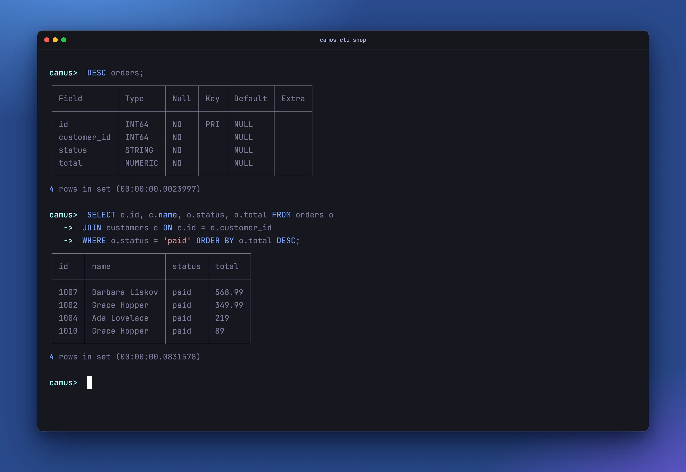
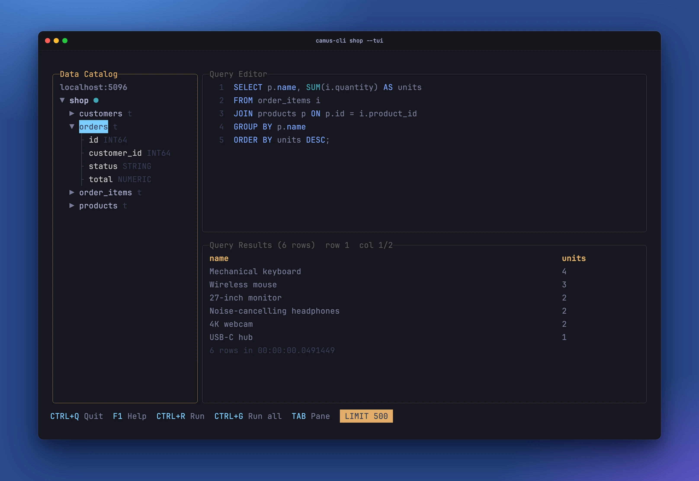

# camus-cli



`camus-cli` is the command-line SQL shell for CamusDB. Use it to try a query,
test a transaction, or read a query plan from a terminal. It can also execute
`.sql` files in CI and take backups. The prompt has syntax coloring and
completion, and scripts can read JSON or YAML output.

For a browser workspace, see [Web Console](/docs/web-console). To connect from
an application, use a driver, such as the [.NET driver](/docs/dotnet-driver) or
the [Python driver](/docs/python-driver).

## Quick start

Install the .NET tool:

```bash
dotnet tool install --global CamusDB.SqlSh
```

Connect to a local server:

```bash
camus-cli              # no current database
camus-cli northwind    # current database "northwind"
```

The shell tries gRPC on `http://localhost:5096`. If that fails, it tries REST on
`http://localhost:5095`. The banner shows the endpoint and the transport. If
you don't give a database name, select one with `use`:

```camussql
CREATE DATABASE IF NOT EXISTS test;
USE test;
```

To update the tool, run `dotnet tool update --global CamusDB.SqlSh`.

### Connect with a connection string

```bash
camus-cli -c "Endpoint=https://db.example.com:5095;Database=northwind"
camus-cli -c "Endpoint=http://node1:5096,http://node2:5096;Protocol=grpc"
```

- `Endpoint` is required. It can be a comma-separated list of nodes.
- Without `Protocol`, the shell tries gRPC, then REST, on the same endpoint.
  `Protocol=grpc` or `Protocol=rest` uses one transport only.
- `-c` takes the connection string keys of the [.NET driver](/docs/dotnet-driver).
- The shell connects at startup. An endpoint that can't be reached returns an
  error at once.

Server-level statements, such as `CREATE DATABASE` and `SHOW DATABASES`, don't
need a current database. Statements on tables need one.

## Interactive shell

The prompt is `camus>`. A statement that continues on more lines shows `   ->`.
The shell handles the following commands. It sends all other text to the
server as SQL.

| Command | Action |
| --- | --- |
| `use <database>` | Make `<database>` the current database. |
| `\d [name]`, `\d+ [name]` | List relations, or describe one. See [Describe objects](#describe-objects). |
| `\dt`, `\dv`, `\dm`, `\ds`, `\di [pattern]` | List tables, views, materialized views, sequences, or indexes. |
| `\df [pattern]`, `\df+ [pattern]` | List inline functions. |
| `\l` | List databases. |
| `source <file> [--force]` | Run a file of statements. See [Source files](#source-files). |
| `\export csv\|json\|yaml [to <file>] <query>` | Write query rows to a file. See [Export a result set](#export-a-result-set). |
| `\plan [flow\|table]` | Choose how `EXPLAIN` shows a plan. |
| `show prepared [sql]`, `\prepared` | Show the statements that the driver has prepared. |
| `backup …` | Take and manage [backups](#backups). |
| `clear` | Clear the screen. |
| `help`, `\h`, `\?`, `?`, `/help` | List the shell commands. |
| `exit`, `quit`, `\q`, `/quit`, `/exit` | Leave the shell. |

A `/` prefix works the same as `\` for `\d`, `\df`, `\l`, `\plan`, and
`\export`.

### Edit and run statements

`Enter` sends the statement. It starts a new line in the following cases:

- The statement has an open quote or parenthesis.
- The statement has an open `$$` body.
- The line ends with a comma.

A pasted `Enter` adds a line, and it doesn't send the statement.

| Key | Action |
| --- | --- |
| `Enter` | Run the current statement. |
| `Shift+Enter` | New line. Use `Alt+Enter` or `Ctrl+O` if the terminal does not report `Shift+Enter`. |
| `Up` / `Down` | Previous or next line. On the first or last line, browse history. |
| `Ctrl+Left` / `Ctrl+Right` | Move one word. |
| `Home` / `End` | Start or end of the line. |
| `PageUp` / `PageDown` | First or last line. |
| `Tab` / `Ctrl+Tab` | Next or previous completion. |

The editor colors the SQL syntax. The inline functions of the current database
are colored as functions.

### Completion

`Tab` completes the word at the cursor, based on its context:

| After | Suggests |
| --- | --- |
| `from`, `into`, `update`, `join`, `table`, `view`, `desc`, `truncate`, `references`, `delete … using` | Tables and views. In a `WITH` statement, its CTE names come first. |
| `\d`, `\d+` | Tables, views, and sequences. |
| `drop index`, `alter table <t> drop index`, `show ranges from index` | Indexes, as `table.index`, index name, or `table@index`. |
| `alter sequence`, `drop sequence`, `show create sequence` | Sequences. |
| `drop function`, `show create function`, `\df` | Inline functions. |
| `create trigger <name> on`, `show triggers on` | Tables. |
| `drop trigger`, `show create trigger` | Triggers. |
| `set cluster setting`, `reset cluster setting` | Configuration keys. |
| `language` | `csharp`. |
| `call`, `external name` | Procedures and trigger types of loaded C# extensions. |
| Any other word | Keywords, functions, and shell commands. |

The names are loaded at startup, and again after `use` or a schema change. C# extension names load once at startup with
`SHOW EXTENSIONS`, which needs a superuser.

```camussql
select * from us<Tab>
with t as (select 1) select * from <Tab>
show ranges from index users@<Tab>
```

### Switch databases

```camussql
use northwind;
use `order details`;
```

`use` reconnects with the new database, which must exist. Quote a name that is a
keyword or has spaces, with backticks or double quotes. `use` also works in
scripts. This means that a script can change databases.

### Transactions

```camussql
begin;
update accounts set balance = balance - 100 where id = 1;
update accounts set balance = balance + 100 where id = 2;
commit;
```

- Only one transaction can be open at a time.
- `exit` and `use` return an error while a transaction is open. Run `commit` or
  `rollback` before them.
- If a statement in the transaction fails, the transaction ends. This also
  applies to a failed `commit` or `rollback`.

`start transaction` is the same as `begin`. See
[Transactions](/docs/sql-transactions).

### History

The shell saves the last 2,000 statements at exit and on `Ctrl+C`.

| Platform | Path |
| --- | --- |
| Any, when `XDG_STATE_HOME` is set | `$XDG_STATE_HOME/camusdb/history.json` |
| Linux and macOS | `~/.config/camusdb/history.json` |
| Windows | `%LOCALAPPDATA%\camusdb\history.json` |

Only your user can read the file. A statement with a password, such as
`CREATE USER … IDENTIFIED BY` or `ALTER USER`, isn't saved to disk. `Up` recalls
it until the session ends. `--no-history` turns history off.

## Describe objects

The `\d` commands work like the psql commands of the same names:

```text
camus> \d robots
Table "robots"
┌──────────┬─────────┬──────────┬─────────┐
│ Column   │ Type    │ Nullable │ Default │
├──────────┼─────────┼──────────┼─────────┤
│ id       │ OID     │ not null │         │
│ name     │ STRING  │ not null │         │
│ year     │ INT64   │          │ 2024    │
│ owner_id │ OID     │          │         │
│ price    │ FLOAT64 │          │         │
└──────────┴─────────┴──────────┴─────────┘
Indexes:
    "~pk" PRIMARY KEY (id)
    "~fk_robots_owner_id_fkey" (owner_id)
    "robots_name_idx" UNIQUE (name)
    "robots_year_idx" (year) INCLUDE (price)
Foreign-key constraints:
    "robots_owner_id_fkey" FOREIGN KEY (owner_id) REFERENCES owners (id)
```

| Object | `\d` shows | `\d+` adds |
| --- | --- | --- |
| Table | Columns, indexes, check constraints, foreign keys, and triggers. | Comments, `WITH` options, and inline trigger bodies. |
| View | Columns. | The view definition. |
| Materialized view | Columns, indexes, and data status. | The view definition. |
| Sequence | Settings and the owning column. | The comment. |

- Letters combine: `\dtv` lists tables and views.
- Names and patterns accept the `*` and `?` wildcards and ignore case. A name in
  backticks matches exactly.
- `\d` does not list foreign keys in other tables that reference the table.
- The `\d` commands need a current database and always print tables. For rows
  that a program reads, use the `SHOW` statements in
  [Inspecting the database](/docs/sql-inspection).

## Inline functions and triggers

Type [inline C# functions and triggers](/docs/csharp-extensions#inline-functions)
as ordinary SQL. The shell reads the dollar-quoted body as raw text:

```camussql
CREATE FUNCTION slugify(s STRING) RETURNS STRING LANGUAGE csharp AS $$
    return s.Trim().ToLowerInvariant().Replace(' ', '-');
$$;

CREATE TRIGGER slug ON posts BEFORE INSERT, UPDATE LANGUAGE csharp AS $$
    if (NEW!.title is { } title)
        NEW.slug = slugify(title);
$$;
```

- The body can contain semicolons, quotes, and comments.
- `Enter` in an open body adds a line. The statement is sent after the closing
  `$$` and `;`.
- A body that contains `$$` uses a tagged quote, such as `$fn$ … $fn$`.

`\df` lists the inline functions of the current database. `\df+` adds the
generation, the compile state on this node, and the `CREATE FUNCTION`
statement. `\d <table>` lists the table's triggers.

When a body doesn't compile (`CADB0838`), or uses a type or member that isn't
allowed (`CADB0839`), the shell marks the position with a caret:

```text
CamusException (CADB0838): Function 'broken' does not compile: (2,12): CS0103: The name 'z' does
not exist in the current context

      return z.Trim();
             ^ CS0103: The name 'z' does not exist in the current context
```

## Output

```text
+----+------+
| id | name |
+----+------+
| 1  | Ada  |
+----+------+
1 rows in set (00:00:00.0123456)

Query OK, 1 rows affected (00:00:00.0123456)
```

- Queries print a table. DDL prints `Query OK`, and writes print the affected
  row count.
- A write with `RETURNING` prints the returned rows, and then `Query OK`.
- A statement after a `WITH` clause decides the output. `WITH … SELECT` prints
  rows, and `WITH … UPDATE … RETURNING` prints the returned rows.
- Values print in a form that you can type back into SQL. For example, `BYTES`
  prints as an `x'…'` literal, and `NUMERIC` prints all its digits.

An error shows its [error code](/docs/error-codes) and message. When the
message gives a position, the shell prints the line with a `^` under the
column. Some errors add a hint. For example, `CADB0560` and `CADB0561` show the
`SET CLUSTER SETTING` statement that raises the limit.

### Vertical output

End a statement with `\G` in place of `;` to print one column per line. This
helps with wide rows and long JSON values.

```text
camus> select * from users\G
*************************** 1. row ***************************
  id: 1
name: Ada
1 rows in set (00:00:00.0123456)
```

### Query plans

The shell draws `EXPLAIN` as a flow, from the source at the top to the result
at the bottom. Each operator is a box colored by its family, with a bar for its
share of the plan cost. Arrows show the rows that flow between operators.

```text
╭─ SOURCE ─────────────────────────────────────────────────────────────────╮
│ table-scan  title  Highest cost                                          │
│ Reads every row of the table.                                            │
│ table=title                                                              │
│ est. cost 600 (83%)                                                      │
│ ━━━━━━━━━━━━━━━━━━━━━━━━━━━━━━━━━━━━━━━━━━━━━━━━━━━━━━━━━━━━──────────── │
╰──────────────────────────────────────────────────────────────────────────╯
                                      │ est. 60 rows
                                      ▼
╭─ JOIN ───────────────────────────────────────────────────────────────────╮    ┌┄┄┄┄┄┄┄┄┄┄┄┄┄┄┄┄┄┄┄┄┄┄┄┄┄┄┄┄┐
│ index-nested-loop-join                                                   │ ◀╌╌┆ Right input                ┆
│ For each left row, finds the matching right rows through an index.       │    ┆ looked up in index         ┆
│ on=ci.movie_id = t.id, index=movie_id_cast_info, left=t.id,              │    ┆ movie_id_cast_info         ┆
│ right=movie_id                                                           │    └┄┄┄┄┄┄┄┄┄┄┄┄┄┄┄┄┄┄┄┄┄┄┄┄┄┄┄┄┘
│ est. cost 120 (17%)                                                      │
│ ━━━━━━━━━━━━──────────────────────────────────────────────────────────── │
╰──────────────────────────────────────────────────────────────────────────╯
```

- `Highest cost` marks the most expensive operator.
- A dashed box shows the right input of a join.
- Nested boxes show the branches of a plan. See the table below.
- `Computed once` marks a reader of a CTE that the server computes one time and
  reuses.
- With `EXPLAIN (ANALYZE)`, arrows show measured and estimated rows, and each
  operator shows its storage counters. `Estimate off Nx` marks a difference of
  ten times or more.

| Nested box | Branch |
| --- | --- |
| `LEFT OPERAND`, `RIGHT OPERAND` | The operands of a set operation. |
| `NON-RECURSIVE TERM`, `RECURSIVE TERM` | The terms of `WITH RECURSIVE`. |
| `QUERY OF <alias>` | A derived table, a CTE, or a view. |
| `LEFT INPUT`, `RIGHT INPUT` | A join on a derived table. |

`\plan table` prints the raw plan rows, and `\plan flow` returns to the
diagram. `\G`, `--format json|yaml`, and `--tui` always print the raw rows. See
[EXPLAIN](/docs/explain).

### Export a result set

`\export` writes query rows to a CSV, JSON, or YAML file:

```camussql
\export csv select * from titles
\export json to titles.json select id, title from titles where production_year > 2000
/export yaml to 'my titles.yaml' select * from titles
```

- Without `to <file>`, the name is the first table after `FROM` plus a
  timestamp, such as `titles-20261014-134650.csv`. At the prompt, you can edit
  the suggestion. In a script, the shell uses it.
- Quote a file name with spaces. An existing file is replaced.
- JSON and YAML have the same shape as [`--format`](#json-and-yaml-output). CSV
  has a header row. In CSV, `NULL` is an empty field, `BYTES` is base64, and
  arrays and `JSONB` are JSON text.
- Rows are written to a temporary file. A failed query doesn't change the target
  file.

## Full-screen mode

`--tui` opens a full-screen mode with three panes:

```bash
camus-cli northwind --tui
```



| Pane | Shows |
| --- | --- |
| Data Catalog | Databases, tables, and columns. A green dot marks the current database. |
| Query Editor | SQL tabs with coloring and completion. |
| Query Results | The rows of the active tab's last query, and one log line per statement. |

| Key | Action |
| --- | --- |
| `Tab` / `Shift+Tab` | Next or previous pane. |
| `Ctrl+R`, `F5`, `Shift+Enter` | Run the statement at the cursor. |
| `Ctrl+G`, `F6` | Run all statements in the editor. |
| `Esc` | Cancel the running query, or close the help. |
| `Ctrl+C` | Cancel the running query. When idle, quit. |
| `F1` | Show all keys. |
| `F2` | Turn the 500-row display cap on or off. |
| `F4` | Reload the catalog. |
| `Ctrl+T` / `Ctrl+D` | Open or close a tab. |
| `Ctrl+O`, `F8` / `F7` | Next or previous tab. `Alt+1` to `Alt+9` go to a tab. |
| `Ctrl+S` | Save the text of all tabs. |
| `Ctrl+Q` | Quit. |
| `Ctrl+N` / `Ctrl+P` | Next or previous completion in the editor. |

- **Tabs.** You can open up to 9 tabs. Each tab has a separate editor and
  results. All tabs share one connection. This means that the current database
  and an open transaction apply to all tabs. One statement is executed at a
  time, and its rows go to the tab where it started.
- **Catalog.** `Enter` on a database selects it with `use`. `Space` puts the selected name
  into the editor. The catalog reloads after DDL in this session. Press `F4` to
  see changes from other sessions.
- **Results.** The arrows select a cell, and `Enter` shows the full value. `c`
  copies the cell, and `Shift+C` copies the row. `m` shows the last 500
  messages. Copy uses OSC 52, and it works in terminals that support it.
- **Paging.** The grid reads 200 rows at a time as you scroll. The 500-row
  display cap is on at start. It does not add a `LIMIT` to the statement.
- **Saved tabs.** Tab text is saved to `tui-tabs.json` next to the history file
  at exit and on `Ctrl+S`. Results are not saved.
- With a transaction open, `Ctrl+Q` and `Ctrl+C` ask before they roll back and
  quit.
- `backup` commands do not run in `--tui`.

The mode needs an ANSI terminal. See [Terminal detection](#terminal-detection).

## Scripts and automation

### Run SQL with -e

```bash
camus-cli northwind -e "select * from users"
camus-cli demo -e "insert into users (id, name) values (1, 'Ada'); select * from users"
camus-cli demo -e "select * from users\G" > users.txt
```

The output matches the prompt, without the banner. A failed statement makes
the process exit with status `1`.

### Run a .sql file with -f

```bash
camus-cli northwind -f schema.sql
cat schema.sql | camus-cli northwind -f -
camus-cli demo -f seed.sql -e "select count(*) from users"
```

`-f` streams the file. This means that the file size doesn't matter. At the
first failed statement, `-f` prints the error and the line of the statement,
and it exits with status `1`. `-f -` reads standard input. With `-f` and `-e`
together, the file is executed first.

### Source files

```camussql
source ./seed.sql
source ./seed.sql --force
```

`source` executes a file from the prompt, with the same rules as `-f`.
`--force` continues after failures and prints a summary at the end. Note that a
failure in an open transaction stops the file. The server ends that
transaction.

Statements split at semicolons outside:

- Single-quoted and double-quoted strings, and backtick identifiers.
- Dollar-quoted bodies (`$$ … $$`, `$tag$ … $tag$`).
- `--` and `#` line comments, and `/* */` block comments.

The [JSONB operators](/docs/json) `#>`, `#>>`, and `#-` aren't read as
comments. The shell reads doubled quotes (`'it''s'`) and backslash escapes. It
removes the comments before it sends a statement.

### JSON and YAML output

Use `--format json` or `--format yaml` with `-e` or `-f` when a program reads
the rows:

```bash
camus-cli demo -e "select id, name from users" --format json | jq '.[].name'
```

- Standard output contains only rows. The status lines and the errors go to
  standard error.
- Each statement that returns rows writes one document: a JSON array of
  objects, or a YAML sequence of mappings separated by `---`. No rows writes
  `[]`. DDL writes no document.

| SQL type | JSON | YAML |
| --- | --- | --- |
| `INT64`, `FLOAT32`, `FLOAT64` | Number. `NaN` and infinities are strings. | Number, `.nan`, `.inf`, `-.inf`. |
| `BOOL`, `NULL` | `true`, `false`, `null` | `true`, `false`, `null` |
| `NUMERIC` | String. This keeps all digits. | String |
| `STRING`, `UUID`, `DATE`, `TIMESTAMP` | String | String |
| `INTERVAL` | ISO-8601 string, such as `P1DT2H`. | String |
| `BYTES` | Base64 string | `!!binary` |
| Array | Array | Flow sequence (`[1, 2, 3]`) |
| `JSONB` | The document, with all numeric digits. | The document in flow syntax. |

## Read-only mode

Start the shell with `--read-only` to prevent accidental writes, for example
when you inspect a production database:

```bash
camus-cli northwind --read-only
```

The shell sends only these statements:

- `SELECT`, `WITH` queries, and set operations.
- `EXPLAIN`, `SHOW`, `DESC`, and `DESCRIBE`.
- `BEGIN`, `START TRANSACTION`, `COMMIT`, `ROLLBACK`, and `SET TRANSACTION`.
- Shell commands such as `use`, `\d`, and `\export`. `\export` checks its
  query.
- `backup list`, `backup chain`, and `backup gc preview`.

The shell doesn't send other statements, including statements that it doesn't
recognize. It also checks for writes that the first word hides:

- A `WITH` clause before a write statement.
- Locking reads, such as `FOR UPDATE` or `FOR SHARE`.
- Calls to `nextval` or `setval`.
- `ANALYZE <table>`, which stores new statistics.

```text
camus> delete from users where id = 1;
Refused by --read-only: DELETE is not a statement that only reads.
The shell did not send the statement. To run writes, start the shell without --read-only.
```

A statement that the check stops doesn't reach the server, and an open
transaction continues. With `-e` or `-f`, the script stops with exit status
`1`.

The check is in the shell, and it doesn't read C# function bodies. Use it to
prevent mistakes. To make sure that a user can't write, give that user a
server account with read [privileges](/docs/sql-authentication#grant-privileges)
only.

## Prepared statements

After the driver sees the same SQL text twice, it prepares the statement on the
server and reuses it. The result is identical to an inline run. `show prepared`
shows the state of the last statement, or of the statement that you pass:

```text
camus> show prepared
Prepared statements: 1 (MaxAutoPrepare=128, AutoPrepareMinUsages=2)
  prepared     select id from robots where year = 1984
(the statement you ran last)
```

A typed statement usually shows `inline`. Its literal values make the text
different each time. Statements from `source` files and applications repeat
exactly and reach prepared form. Set the thresholds in the connection string:

- `MaxAutoPrepare` is the number of statements kept prepared. `0` turns the
  feature off.
- `AutoPrepareMinUsages` is the number of executions before the driver prepares
  a statement.

See [Prepared statements](/docs/prepared-statements).

## Backups

The `backup` commands take and manage online backups while the server serves
traffic:

```text
backup full                            take a full backup
backup incremental <parent-backup-id>  add an incremental backup to a chain
backup coordinated                     take a cluster-wide consistent backup
backup list                            list the node's backup catalog
backup chain <leaf-backup-id>          find and validate a restore chain
backup gc preview                      show what retention would delete
backup gc                              run retention now
```

```text
camus> backup full
    Backup Id: 971a0a88-3d36-42c6-b36b-8d1e773f40c4
         Type: Full
Created (UTC): 2026-08-10 03:45:47
       Parent: (none)
   Partitions: 4
Backup OK (00:00:03.117)
```

- A backup covers all databases of the node. This means that it doesn't need a
  current database.
- The commands work at the prompt and in scripts. They don't work in `--tui`.
- The server must have backups configured (`kahuna.backup_dir`). Otherwise,
  each command returns `CADB0700`.
- With authentication on, connect as a superuser. With authentication off, the
  server allows backup calls from the same machine (loopback) only.
- The backup API is REST only. With a `-c` connection string that sets
  `Protocol=grpc`, add `BackupEndpoint=` with the server's HTTP endpoint.
- `backup coordinated` must reach the backup coordinator, the node that
  currently [leads](/docs/concepts#leader) backup metadata. When `Endpoint`
  lists several nodes, set `BackupEndpoint=` to the coordinator.
- `BackupTimeout=` sets the backup timeout in seconds. The default is `300`.
- `backup chain` checks that a chain can restore before you need it.
- An incremental backup becomes a full backup when its parent is past the
  retention floor. The command shows the change.

Retention starts after each backup and on a timer. Use `backup gc` to free
space at once after you lower a limit. `backup gc preview` doesn't delete
anything.

The shell cannot restore. See
[Backup and restore](/docs/backup-and-restore#the-restore-runbook).

## Authentication

CamusDB authentication is off by default. On a server with authentication on,
sign in with a user:

```bash
camus-cli northwind -u app         # prompts for the password
CAMUS_PASSWORD=app-secret camus-cli northwind -u app
```

The driver sends the password once and receives a short-lived token. Later
statements send only the token, and the driver renews it before it expires.

- `-p` with no value also prompts. Avoid `-p <password>` on a shared host.
  Other users can read the command line of a process.
- `CAMUS_USER` and `CAMUS_PASSWORD` set the defaults. `User=` and `Password=`
  in `-c` also work. A flag overrides the same key in `-c`.
- `--token` or `CAMUS_ACCESS_TOKEN` passes a token from another source. The
  shell doesn't renew it, and the session ends when the token expires.

Credentials aren't sent to an `http://` endpoint on another machine. The shell
returns `CADB0519` before the password leaves the machine. Use `https://`
for remote servers. If TLS ends in front of the server on a trusted network,
add `--allow-insecure-credentials`. The shell then prints a warning and
connects.

Manage users and grants from a superuser session. These statements need no
current database:

```camussql
CREATE USER app IDENTIFIED BY 'app-secret';
GRANT SELECT, INSERT ON northwind.* TO app;
SHOW GRANTS FOR app;
```

See [Authentication and authorization](/docs/sql-authentication) and the
[error codes](/docs/error-codes#common-user-facing-errors) `CADB0516` to
`CADB0519`.

## Command-line reference

```text
camus-cli [database] [options]
camus-cli workload <init|run> <bank|northwind|factory|tpcc|tpcb> [options]
```

| Option | Description |
| --- | --- |
| `[database]` | Current database at start. |
| `-c`, `--connection-source` | Full connection string. It must contain `Endpoint`. |
| `-e`, `--execute` | Run SQL and exit. |
| `-f`, `--file` | Run a `.sql` file and exit. `-f -` reads standard input. |
| `--format` | Output of `-e` and `-f`: `table` (default), `json`, or `yaml`. |
| `-u`, `--user` | User to sign in as. |
| `-p`, `--password` | Password. With no value, the shell prompts. |
| `--token` | Bearer token, in place of a user and password. |
| `--allow-insecure-credentials` | Send credentials to a remote `http://` endpoint. |
| `--read-only` | Refuse statements that can change data or the server. |
| `--no-history` | Do not load or save history. |
| `--tui` | Open the full-screen mode. |
| `--force-rich` | Use the rich editor on an unrecognized terminal. |
| `--diagnose-terminal` | Print detected terminal capabilities and exit. |
| `-h`, `--help` | Show help. |
| `-v`, `--version` | Show the version. |

| Variable | Description |
| --- | --- |
| `CAMUS_USER` | Default for `-u`. |
| `CAMUS_PASSWORD` | Default for `-p`. The password then isn't on the command line. |
| `CAMUS_ACCESS_TOKEN` | Default for `--token`. |
| `CAMUS_FORCE_RICH` | `1`, `true`, or `yes` acts as `--force-rich`. |

## Workloads

`camus-cli workload` creates sample data and puts load on a server, for demos
and quick experiments. `init` creates the schema and data. `run` puts load on
the server for a set time.

```bash
camus-cli workload init bank --database demo --rows 5000
camus-cli workload run bank --database demo --concurrency 8 --duration 120
```

| Option | Description |
| --- | --- |
| `-c`, `--connection-source` | Connection string. The default matches the shell. |
| `--database` | Target database. Default `demo`. |
| `--rows N` | Rows that `init` creates: accounts for `bank` and `tpcb`, warehouses for `tpcc`. Default `1000`. |
| `--concurrency N` | Parallel workers for `run`, and writers for `init`. Default `64`. |
| `--duration N` | Run time in seconds. Default `60`. |
| `--locking MODE` | `optimistic` (default) or `pessimistic`. |
| `--isolation LEVEL` | `serializable` (default) or `read-committed`. |
| `--no-prepare` | Run each statement inline, to compare with the default prepared path. |
| `-u`, `-p`, `--allow-insecure-credentials` | Same as the shell. |

For repeatable validation and performance measurement, see the
[Workload utility](/docs/workload-utility).

## Troubleshooting

### Terminal detection

The rich editor and `--tui` need an interactive ANSI terminal. Some terminals
report an unknown `TERM` value, such as Rio (`TERM=rio`). The shell then uses a
simple prompt. Check what the shell detects:

```bash
camus-cli --diagnose-terminal
```

To use the rich editor on such a terminal, do one of these:

- Add `--force-rich`.
- Set `CAMUS_FORCE_RICH=1`.
- Run with a known `TERM`, for example `TERM=xterm-256color camus-cli`.

### The shell does not exit

A transaction is open. Run `commit` or `rollback` first.

### An old version starts

```bash
camus-cli -v
dotnet tool update --global CamusDB.SqlSh --no-http-cache
```

NuGet caches package feed responses for up to 30 minutes. This means that an
update can miss a version that was published recently. `--no-http-cache` reads the feed again.

## Related pages

- [Web Console](/docs/web-console)
- [camus-dump](/docs/camus-dump)
- [SQL overview](/docs/sql)
- [Inspecting the database](/docs/sql-inspection)
- [Backup and restore](/docs/backup-and-restore)
- [Authentication and authorization](/docs/sql-authentication)
- [.NET driver](/docs/dotnet-driver)
