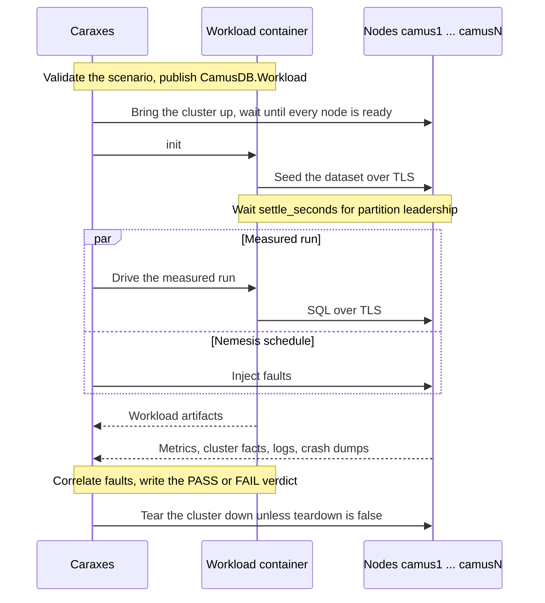

# Caraxes


Caraxes is the reliability, chaos, and capacity evidence harness for CamusDB.
It lives in the [`camusdb-caraxes`](https://github.com/camusdb/camusdb-caraxes)
repository. It builds a Docker cluster from a declarative YAML spec, drives SQL
load through [`CamusDB.Workload`](/docs/workload-utility), injects process,
network, disk, and topology faults, and turns the collected artifacts into a
PASS or FAIL verdict.

Use Caraxes when you want evidence about how a build behaves. A passing run
does not prove CamusDB correct for every possible history. It shows that the
specific build, cluster shape, workload, faults, and checks in the scenario
survived the measured window and left artifacts that explain the result.

Caraxes has helped catch, fix, and prevent user-facing failures in these areas:

- Atomicity regressions during contended bank transfers, where the conserved
  balance changed after a run.
- Scan visibility defects that post-run reconciliation could not see, because
  `COUNT(*)` was short only while writes were in flight.
- Crash, re-election, rejoin, and [leader](/docs/concepts#leader)-transfer bugs
  around `kill`, `pause`, `partition` (a network split), `stop`, and zone-loss
  scenarios.
- Full-disk and slow-device behavior, including write admission when a node is
  out of space and recovery when a durable write path stalls.
- Placement, range-split, and leader-balancer regressions that only show up
  when every data [partition](/docs/concepts#partition) or every failure zone
  carries work.
- Measurement false positives caused by host disk regime changes, host load,
  client saturation, moving placement, or comparing runs from different builds
  or durability settings.
- Lost diagnostic evidence after teardown, by preserving node logs and crash
  dumps before containers and volumes are removed.

Caraxes runs beside a CamusDB checkout and builds the node image from that
checkout's `docker/Dockerfile`, so a run tests the code on your disk.

## Requirements

- .NET 10 SDK
- Docker with `docker compose`
- A CamusDB checkout, `~/camusdb` by default

Run every command below from the root of the Caraxes repository.

## Cluster lifecycle

These commands manage a cluster without a workload:

```bash
# build the image, generate artifacts, start the fleet, wait until every node is ready
dotnet run --project Caraxes -- up --spec scenarios/cluster-3.yml

# per-node health plus the cluster's partition placement table
dotnet run --project Caraxes -- status --spec scenarios/cluster-3.yml

# one node's container logs
dotnet run --project Caraxes -- logs --spec scenarios/cluster-3.yml --node camus2

# stop the cluster and remove its containers, network, and volumes
dotnet run --project Caraxes -- down --spec scenarios/cluster-3.yml
```

`up` builds the image, writes one `config.yml` for each node and one
`compose.yml` under `runs/<cluster>/`, starts the fleet, and polls
`GET /v1/cluster/health` until every node is ready. Pass `--skip-build` to reuse
the existing image. Pass `--ready-timeout <seconds>` to change the default
180-second readiness deadline.

`down` removes data volumes unless you pass `--keep-volumes`. The run directory
is disposable output; the spec is the source of truth. `down` recreates the
compose file and still works after you delete `runs/`.

The nodes are named `camus1` through `camusN`. Node `i` publishes REST on host
port `15095 + i - 1` and gRPC on `16095 + i - 1`, so a Caraxes cluster can run
beside a local development server on ports 5095 and 5096.

## Cluster spec

A cluster spec is YAML. Only `name` is required.

```yml
name: rf3-baseline
nodes: 3
partitions: 3
replication_factor: 3
placement_rebalancer: true
leader_balancer: true
locking: optimistic
isolation: read_committed
diagnostics: true
```

| Key | Default | Meaning |
|---|---|---|
| `name` | (required) | Lowercase `[a-z0-9-]` identifier. Names containers, volumes, the compose project, and the derived image tag. |
| `nodes` | `3` | Node count. |
| `partitions` | `3` | Initial cluster partitions. |
| `replication_factor` | `3` | Number of [replicas](/docs/concepts#replica-and-replication-factor) (copies) of each partition. `0` keeps full replication, where every node hosts every partition. |
| `placement_rebalancer` | `true` | Repair under-replication, trim over-replication, and smooth skew on join or leave. |
| `leader_balancer` | `true` | Spread partition leadership using load reports. |
| `zones` | `[]` | One failure-zone label per node, parallel to the node list. Empty means zone-unaware placement. |
| `locking` | `optimistic` | Maps to CamusDB `default_transaction_locking`. |
| `isolation` | `read_committed` | Maps to CamusDB `default_isolation_level`. Caraxes sets it on every node, so its default replaces the server default, which is `serializable`. |
| `read_validation` | (engine default) | Optional `default_read_validation`, usually swept when testing pessimistic transaction behavior. |
| `key_range_sharding` | `false` | Maps to CamusDB `key_range_sharding`. |
| `distributed_query_execution` | `false` | Maps to CamusDB `distributed_query_execution`. See [Distributed Queries](/docs/distributed-queries). |
| `max_query_parallelism` | `1` | Maps to CamusDB `max_query_parallelism`. |
| `diagnostics` | `true` | Turns on OpenTelemetry and the Prometheus `/metrics` endpoint on every node. |
| `subnet` | `10.101.0` | First three octets of the cluster's `/24` bridge network. |
| `first_ip` | `2` | Last octet of node 1. Node `i` gets `first_ip + i - 1`. |
| `base_rest_port` | `15095` | Host port of node 1's REST API. |
| `base_grpc_port` | `16095` | Host port of node 1's gRPC API. |
| `base_raft_port` | `7070` | Internal cluster port ([Raft](/docs/concepts#raft)) of node 1. Node `i` advertises `base_raft_port + 2 * (i - 1)`. Not published to the host. |
| `spare_certs` | `5` | Extra certificate SAN entries, so a node added later is covered without regenerating certificates. |
| `tls` | `true` | Serve TLS on the client gRPC port. `false` writes `grpc_tls_enabled: false` and gives the workload `http://` endpoints. The Raft port keeps its certificate either way, so a cleartext run measures only the client-side TLS cost. |
| `clock_skew` | `false` | Preload the clock skew shim on every node. The `clock-skew` fault needs it; a scenario that schedules that fault without it is rejected. |
| `backups` | `false` | Give each node a backup directory: `kahuna.backup_dir`, `kahuna.restore_root`, and `kahuna.backup_cluster_id` (the cluster name). The `backup` fault, the `backup_verify` stage, and an `add-node` seeded from a backup need it. Set the PITR window and retention through `kahuna`. |
| `data_tmpfs_mb` | `0` | When above zero, each node's `/data` is a size-capped tmpfs instead of a named volume. Required by `fill-disk`. |
| `memory_limit_mb` | `0` | Optional container memory limit for each node, useful for OOM and memory-posture soaks. |
| `gc_heap_hard_limit_mb` | `0` | Optional managed-heap hard limit. Use with `memory_limit_mb`, especially when `data_tmpfs_mb` charges data pages to the same cgroup. |
| `camusdb_repo` | `~/camusdb` | Path of the CamusDB checkout that supplies the Dockerfile, certificate script, and build context. |
| `image` | (derived) | Image tag. Empty derives `caraxes/camusdb:{name}`. |
| `kahuna` | `{}` | Raw passthrough into the generated config's `kahuna:` section, for engine knobs the spec does not model. |
| `camusdb` | `{}` | Raw passthrough into the generated CamusDB root config for options the spec does not model. `kahuna` and `data_dir` are refused because Caraxes owns those sections. |
| `log_levels` | `{}` | Per-category log-level overrides for diagnostic runs, for example election or leader-balancer investigations. |
| `env` | `{}` | Extra environment variables set on every node container after the values Caraxes derives. Use this for runtime or allocator experiments such as `MALLOC_ARENA_MAX`. |

Caraxes validates the spec before anything starts. Invalid names, zones, subnet
forms, ports, locking modes, isolation levels, and impossible memory or disk
settings fail immediately with exit code 2.

## Running a scenario

A scenario is one file with a `cluster:` block and a `workload:` block. It can
also include a `nemesis:` fault schedule (the faults to inject during the run;
the name comes from Jepsen), `checks:`, and run-level controls.

```bash
dotnet run --project Caraxes -- run --scenario scenarios/smoke-optimistic.yml
```

Use `--tag <name>` when you repeat one scenario and want to keep every run side
by side under `runs/scenarios/<scenario>-<tag>`. Use `--correctness-only` on CI
or other variable-speed machines when recovery timing and throughput recovery
should be reported but not used as pass/fail criteria. Reconciliation, Elle
(an isolation checker, described [below](#elle-block)), node health,
divergent-apply checks, and total-outage checks still grade the run.

`run` performs the whole cycle:

1. Publish `CamusDB.Workload` from the CamusDB checkout.
2. Bring the cluster up and wait until every node is ready.
3. Seed the dataset with `CamusDB.Workload init`.
4. Wait for partition leadership to settle, according to `settle_seconds`.
5. Drive the measured run, with the nemesis schedule in parallel when there is one.
6. Collect workload artifacts, node metrics, cluster facts, logs, crash dumps, and host evidence.
7. Correlate faults, write the verdict, and tear the cluster down unless `teardown: false`.

The command exits 0 on PASS, 1 on FAIL, and 2 for an invalid spec, scenario, or
matrix file. Your CI can gate on it directly.

The workload runs in a one-shot container attached to the cluster's Docker
network. It reaches every node over TLS using the in-cluster DNS names, without
changing trust on the host.



```yml
name: smoke-optimistic
cluster:
  name: smoke-opt
  nodes: 3
  partitions: 3
  replication_factor: 3
  locking: optimistic
  isolation: read_committed
workload:
  database: caraxes
  rows: 20000
  mode: open
  target_ops: 400
  workers: 32
  duration: 60s
  warmup: 15s
  read_percent: 60
  write_percent: 40
teardown: true
```

### Workload block

`workload:` keys map onto `CamusDB.Workload` flags. Defaults are lighter than the standalone workload utility because chaos scenarios run
many workloads and care about behavior under fault, not just peak throughput.

| Key | Default | Meaning |
|---|---|---|
| `kind` | `accounts` | `accounts` for shard-disjoint read-modify-write, `bank` for conserved-balance transfers, `fanout` for cross-table bank transfers that load every partition, `append` for Elle list-append histories. |
| `database` | `caraxes` | Database the scenario seeds and drives. `init` creates it when it is absent. |
| `seed` | `1847` | Dataset and workload seed. |
| `rows` | `100000` | Seeded row count. |
| `tables` | `1` | Number of tables to spread rows over. `fanout` requires at least 2. |
| `append_keys` | workload default | `append` only: number of active list keys. Fewer keys increase contention and dependency edges. |
| `append_max_writes_per_key` | workload default | `append` only: rotate a list key after this many appends, keeping histories cheaper for Elle. |
| `append_max_txn_length` | workload default | `append` only: maximum read or append steps in one transaction. |
| `payload_bytes` | `256` | Payload size per row. |
| `batch` | `500` | Rows per seeding transaction. |
| `mode` | `open` | `open` for a fixed arrival rate, `closed` for saturation. |
| `target_ops` | `500` | Open-loop submitted operations per second. |
| `workers` | `32` | Concurrent workers. |
| `read_percent` / `write_percent` | `60` / `40` | Operation mix. The two must add up to 100. |
| `writes_per_transaction` | `1` | Writes per write transaction. |
| `duration` | `60s` | Measured window. |
| `warmup` | `15s` | Unmeasured warmup. |
| `drain` | `10s` | Drain period after the measured window. |
| `connections` | `8` | Client connections. |
| `max_in_flight` | `4096` | Concurrency ceiling. |
| `locking` | (inherits) | Empty inherits the cluster's `locking`. |
| `isolation` | (inherits) | Empty inherits the cluster's `isolation`. |
| `routing_mode` | (driver default) | Optional learned statement routing mode: `off`, `learned`, or `auto`. |
| `connection_options` | (empty) | Extra client connection-string pairs for the measured run. |
| `gateway` | endpoint pool | Send all requests through one node, or leave empty for the normal round-robin node pool. |
| `no_auto_prepare` | `false` | Disables automatic prepared statements. |
| `request_timeout` | `0` | Per-request timeout in seconds. `0` keeps the client default. |
| `expect_faults` | `true` | Treats conflicts and open-loop pacing shortfalls as expected chaos-run noise instead of invalidating the run. |
| `reconcile_timeout` | `0` | Extra time for post-run aggregate reconciliation on a settling cluster. `0` keeps the workload default. |
| `scan_probe_interval` | (off) | Run in-window `COUNT(*)` probes on every gateway, for example `5s`. |
| `scan_probe_timeout` | `0` | Per-probe request timeout in seconds. `0` keeps the workload default. |
| `node_metrics` | `true` | Collect `node-metrics.csv` and bottleneck-report evidence from every node. Requires diagnostics. |
| `metrics_interval` | `5s` | Scrape interval for node metrics. |
| `cluster_facts` | `true` | Write `cluster-facts.json` with build, config, readiness, durability, and placement facts from the nodes. |

A duration accepts forms such as `15s`, `1m`, `250ms`, and `1h`. A bare number
means seconds.

### Workloads and what they detect

`accounts` is the baseline load. It performs shard-disjoint read-modify-write
operations, which makes it useful for smoke tests, throughput ceilings, and
general fault recovery without intentionally creating write/write contention.

`bank` transfers between any two rows of the table, so a transfer can span
partitions. Every transfer must preserve `SUM(balance)` and commit atomically. Caraxes checks that
sum after the run and never waives it. Conflicts under fault can be expected; a
changed balance is a correctness failure.

`fanout` keeps the bank invariant but spreads the dataset over many tables and
moves each transfer between two different tables. That makes every partition
carry writes and gives range-split, placement, failover, and leader-balancer
logic meaningful work to move around.

`append` runs Elle's list-append workload over SQL. It writes to a separate
`elle_append` table and records every attempt to `history.edn`. After the run,
Caraxes can run Elle against that history to look for dependency cycles: lost
updates, write skew, read skew, dirty reads, and reads of aborted writes. That
kind of evidence complements the bank invariant, because a conserved sum cannot
see every invalid serialization.

The scan probe is a live visibility check. With `scan_probe_interval` enabled,
the workload runs `SELECT COUNT(*)` on every gateway during the measured window.
This catches short scans under concurrent writes that a quiet post-run
reconciliation can miss.

### Elle block

The `elle:` block configures the checker for `workload.kind: append`. Other
workload shapes ignore it.

```yml
workload:
  kind: append
  append_keys: 8
  read_percent: 20
  write_percent: 80
elle:
  enabled: true
  consistency_models: ""
  anomalies: ""
  cycle_search_timeout_ms: 0
  heap_mb: 0
  plots: false
```

| Key | Default | Meaning |
|---|---|---|
| `enabled` | `true` | Run the Elle check. Turning it off leaves an append run without an isolation verdict. |
| `jar` | `tools/elle/elle-cli-0.1.11-standalone.jar` | Path to the pinned `elle-cli` jar. Run `tools/elle/fetch.sh` once, or point this at another jar. |
| `image` | `eclipse-temurin:21-jdk` | Docker image that provides `java`. A JDK image is required. |
| `consistency_models` | derived | Empty uses `serializable`, or `read-committed` for Read Committed runs. Set `strict-serializable` only when real-time order is the claim under test. |
| `anomalies` | none | Extra anomaly families for Elle to search, such as `G1a,G1b`. |
| `cycle_search_timeout_ms` | Elle default | Per-component cycle-search budget. Raise it if Elle returns `unknown`. |
| `heap_mb` | JVM default | JVM heap for long histories. |
| `plots` | `false` | Ask Elle for cycle diagrams. Requires an image with Graphviz. |

Elle writes `elle-result.json` beside the workload artifacts. `valid? = true`
passes. `false` fails. `unknown` also fails, because the search did not prove
the requested model.

## Fault injection

A `nemesis:` block drives faults at the same time as the workload. Caraxes times
every event from the start of the measured run, so fault windows align with the
per-second series in `intervals.csv`.

```yml
nemesis:
  seed: 7
  events:
    - { at: 20s, fault: kill, target: random, duration: 20s }
```

### Fault kinds

| Fault | What it does | Heals by |
|---|---|---|
| `kill` | SIGKILL the node process. Exercises crash recovery and re-election. | Restarting the container. |
| `stop` | Graceful stop: SIGTERM, then SIGKILL after Docker's grace period. | Restarting the container. |
| `pause` | Freeze the process with SIGSTOP. TCP connections stay open, so suspicion timeouts are exercised. | SIGCONT. |
| `partition` | Isolate the node from every peer with iptables DROP rules in both directions. | Flushing the node's filter table. |
| `slow` | Add one-way latency with `tc qdisc netem`. Set `delay_ms`, default `100`. | Removing the qdisc. |
| `loss` | Add packet loss with `tc qdisc netem`. Set `loss_percent`, default `10`. | Removing the qdisc. |
| `fill-disk` | Write a filler file into `/data` until the mount returns ENOSPC. | Deleting the filler. |
| `slow-disk` | Cap a node's block I/O with cgroup v2 `io.max`, modeling a slow or paused durable device. | Removing the throttle. |
| `remove-node` | Drain the node through `POST /v1/cluster/leave`, then stop the container. | Never. This is a one-way scale-down. |
| `backup` | Take a full, incremental, or coordinated backup while load continues, so its latency and availability cost are measured. | No healing is required. |
| `add-node` | Boot a replacement through `--join-existing`, optionally seeded from a verified backup chain. | The new node catches up and is promoted to a [voter](/docs/concepts#learner-and-voter). |

Set `heal: false` on an event to hold it open for the rest of the run. An
unhealed `kill` becomes a crash without repair, and an unhealed partition leaves
the cluster to continue without the isolated node.

Targets can be a node name such as `camus2`, `random`, or `zone:<name>`.
`random` is seeded and reproducible. A zone target expands to every node in that
failure zone, so a zone kill takes the whole zone down together.

A seeded `random:` soak is the alternative to an explicit `events:` timeline:

```yml
nemesis:
  seed: 42
  random:
    faults: [kill, pause, partition, slow, slow-disk]
    min_interval: 10s
    max_interval: 18s
    duration: 12s
```

### Disk faults

`fill-disk` needs a size cap, so the cluster must set `data_tmpfs_mb`. Each
node's `/data` becomes a RAM-backed, size-capped tmpfs that the fault can
exhaust. The full node must refuse writes cleanly with `CADB0536`
(`InsufficientDiskSpace`) and admit writes again after the filler is deleted,
without a restart. Because tmpfs disappears on restart, this tests disk-pressure
behavior, not durability.

`slow-disk` targets the durable path instead. It uses cgroup v2 `io.max` to cap
the block device behind Docker's named volumes, while the node process, network,
and peers remain healthy. The default `write_bps: 4096` is effectively a paused
device for write-heavy workloads; a few MiB per second models a merely slow
disk. `write_iops`, `read_bps`, and `device: "MAJ:MIN"` can tune or override the
cap. The fault refuses tmpfs-backed data because those writes do not reach the
block device.

```yml
nemesis:
  events:
    - { at: 4m, fault: slow-disk, target: camus1, duration: 30s }
    - { at: 7m, fault: slow-disk, target: camus2, duration: 60s, write_bps: 2097152 }
```

The slow-disk implementation avoids creating or removing containers while the
throttle is active. Container removal can force overlay writeback through the
throttled device and stall Docker itself, which would make the test measure the
host rather than CamusDB.

### Backup recovery and node replacement

With `cluster.backups: true`, Caraxes can take backups during a workload and
then verify the chain by restoring it and comparing a live ledger fingerprint
with the restored cluster. The fingerprint includes values that advance with
writes, so the check detects a restore that preserved row count or total balance
but lost a committed tail.

An `add-node` event exercises the operator path for replacing a permanently lost
member. By default, Caraxes takes a closing incremental backup, restores the
chain into the replacement, and starts it with `--pitr-bootstrap-from`. The node
replays the backup before Raft starts and then receives only the newer delta
from the cluster. Set `seed_from_backup: false` to test an empty replacement
that must receive a complete snapshot instead.

The event succeeds only after the replacement is ready and promoted to a voter.
Post-run verification also checks that it appears in membership, hosts the
expected partitions, and reads the same ledger as the surviving nodes. This
tests backup usability, point-in-time bootstrap, membership changes, catch-up,
and continued correctness under concurrent traffic as one recovery workflow.

## Verdict

A scenario passes when the workload accepted the run, reconciliation held,
internal errors were explained by the injected fault context, and every
configured resilience check passed.

For a run with faults, Caraxes correlates the nemesis `timeline.jsonl` with the
workload's per-second `intervals.csv`. Each fault window yields the peak error
rate, whether the workload continued to complete operations, and the recovery
time from heal until the error rate returns near zero.

```yml
checks:
  max_recovery_seconds: 45
  min_recovered_throughput_fraction: 0.9
  require_recovery: true
  require_progress_under_fault: true
  require_node_health: true
  require_no_divergent_apply: true
```

| Key | Default | Fails the run when |
|---|---|---|
| `max_recovery_seconds` | `45` | A healed fault took longer than this to recover. |
| `min_recovered_throughput_fraction` | `0.9` | A healed fault does not regain this share of its pre-fault throughput within `max_recovery_seconds`, or regains it but does not hold it. `0` disables the throughput gate. |
| `require_recovery` | `true` | A healed fault never recovered before the run ended. |
| `require_progress_under_fault` | `true` | A fault window completed zero operations, meaning a total outage. |
| `grade_recovery` | `true` | Recovery-time and throughput-recovery findings fail the run. `caraxes run --correctness-only` sets this false and reports them as not graded. |
| `require_node_health` | `true` | A node stops answering `/ping` outside a matching fault window and recovery grace. |
| `require_no_divergent_apply` | `true` | Captured node logs contain a same-revision divergent apply, meaning an acknowledged write was overwritten. |
| `require_client_headroom` | `false` | The load generator appears CPU-bound, GC-bound, thread-pool backed up, or pinned at its in-flight cap. Useful for capacity runs. |
| `require_cluster_facts` | `false` | The run cannot capture build/config facts, or a fault-free run captures a node that is not ready. Useful for reproducible capacity runs. |
| `require_quiet_host` | `false` | The host was already busy before the scenario started. Useful for capacity runs. |
| `require_spread_leadership` | `false` | Leadership was still concentrated when the measured window opened. Useful when the number is meant to describe the cluster, not one leader. |

A second counts as recovered at an error rate of 1 percent or below. Throughput
recovery compares a trailing mean against the clean pre-fault median. Caraxes
writes the correlation to `analysis.md` and `scenario.json`.

```text
# Fault analysis - bank-kill

- Baseline (clean seconds): error rate 0.00 %, write p99 1,382.0 ms
- In-fault: error rate 40.45 %, write p99 392.9 ms (0.3x baseline)
- Max recovery time: 5.5 s; all healed faults recovered: yes

| fault | healed | window (s) | peak error | failed | progressed | recovery (s) |
|---|---|---|---|---|---|---|
| kill/camus2 | yes | 20.3 | 100 % | 4,074 | yes | 5.5 |
```

Two checks run for every scenario, not only for nemesis scenarios. The node
health monitor samples `/ping` during the measured window and distinguishes a
node process that died from a container that still says `Up`. The divergent
apply check scans captured node logs for the message that
[Kahuna](/docs/concepts#kahuna), the storage layer, logs when two nodes apply
different data at the same revision, and writes matches to
`divergent-applies.txt`.

## Measurement evidence

Caraxes records more than a single throughput number because cluster reliability
and capacity results are easy to misread without context.

`cluster-facts.json` records what each node was actually running: build and
assembly versions, resolved configuration, readiness, durability-relevant
settings, and table or range placement. This prevents comparing two runs that
look similar but were taken against different builds or storage settings.

`node-metrics.csv` and `bottleneck-report.md` show per-node work distribution,
commit path, batch density, and backlog growth. They make it visible when a flat
cluster-wide rate hides one write leader carrying all durable work.

`client-resources.json` records the load generator's own CPU, memory, and
headroom, so a saturated client does not get mistaken for a server limit.

`host-io.csv` and host-load notes capture the benchmark machine's behavior.
This matters for sustained storage tests where the host device can change
regime mid-run and make two identical CamusDB builds appear different.

`precondition_device_gb` writes fsynced ballast during warmup and records
`precondition.json`, so a measured window can start after the host device has
entered its steady write regime. Tmpfs, unpreconditioned NVMe, and
preconditioned NVMe runs are separate denominators and should be compared only
within the same posture.

`settle_seconds` waits after seeding for partition leadership to resolve before
the measured window opens. If leadership never settles in time, the run
continues with a note instead of silently charging the benchmark for an election
it did not cause.

`drain_observation_seconds` keeps scraping node metrics after the workload ends,
so deferred work can be watched draining to idle without affecting the measured
numbers.

`capture_node_logs` defaults to true and writes `node-log-camusN.txt` before
teardown. Crash dumps are written under `runs/clusters/<name>/dumps/camusN/`,
outside `/data`, so they survive both tmpfs data mounts and `down -v`.

## Matrix sweeps

A matrix runs a cartesian product of scenario settings and writes a report
across the cells.

```bash
dotnet run --project Caraxes -- matrix --matrix scenarios/matrix-resilience.yml
```

A matrix file holds a base `cluster:` block, `workload:` block, and `checks:`
block, plus `axes:`. The cells run one after another through the ordinary
scenario path. Each cell gets its own cluster name, containers, and volumes.

```yml
axes:
  locking: [optimistic, pessimistic]
  nemesis:
    - name: none
    - name: kill
      seed: 7
      events:
        - { at: 20s, fault: kill, target: random, duration: 20s }
```

The sweep writes `matrix-report.md` and `matrix.json`. They align the verdict,
maximum recovery time, latency growth, and first failure note for every cell.
The command exits nonzero if any cell failed.

## Leader-balance test

This test targets Raft leader balancing directly and uses no workload:

```bash
dotnet run --project Caraxes -- leader-balance --spec scenarios/leader-balance.yml
```

It measures partition leadership through `GET /v1/cluster/placement`, kills the
node with the most leaders, waits for election, restarts that node, and watches
the leader balancer move leadership back. The test passes when the rejoined node
regains at least half of its fair share and the final spread is near even.

The test writes `leader-balance.md` and `leaders.jsonl` with one entry per poll.

## Artifacts

Everything a run produces lands under `runs/`. That output is disposable, but it
is the evidence behind the verdict.

| Path | Holds |
|---|---|
| `runs/<cluster>/` | Generated `compose.yml` and one `config/camusN.yml` per node for a cluster started from a bare spec. |
| `runs/clusters/<cluster>/` | Generated cluster files for the cluster embedded in a scenario. |
| `runs/clusters/<cluster>/dumps/camusN/` | Runtime crash dumps for each node, preserved outside `/data`. |
| `runs/scenarios/<name>/scenario.json` | Run manifest: settings, CamusDB commit, exit codes, verdict, notes, and fault analysis. |
| `runs/scenarios/<name>/analysis.md` | Human-readable fault correlation. |
| `runs/scenarios/<name>/timeline.jsonl` | One line per injection, heal, error, and note, with UTC timestamp and nemesis offset. |
| `runs/scenarios/<name>/node-health.csv` | Per-node `/ping` samples collected during the measured window. |
| `runs/scenarios/<name>/host-io.csv` | Host device I/O samples for the run, when available. |
| `runs/scenarios/<name>/precondition.json` | Device preconditioning record, when enabled. |
| `runs/scenarios/<name>/artifacts/run/` | Workload artifacts such as `summary.json`, `summary.md`, `intervals.csv`, `errors.json`, `reconciliation.json`, `manifest.json`, and `run-meta.json`. |
| `runs/scenarios/<name>/artifacts/run/cluster-facts.json` | Build, config, readiness, durability, and placement facts from the nodes. |
| `runs/scenarios/<name>/artifacts/run/node-metrics.csv` | Per-node metric time series. |
| `runs/scenarios/<name>/artifacts/run/bottleneck-report.md` | Bottleneck and work-distribution report derived from node metrics. |
| `runs/scenarios/<name>/artifacts/run/client-resources.json` | Load-generator resource evidence. |
| `runs/scenarios/<name>/artifacts/run/scan-probe.csv` | In-window scan-probe observations, when enabled. |
| `runs/scenarios/<name>/artifacts/run/history.edn` | Elle list-append history for `workload.kind: append`. |
| `runs/scenarios/<name>/artifacts/run/elle.json` | Workload-side summary of the append history. |
| `runs/scenarios/<name>/artifacts/run/elle-result.json` | Elle checker JSON verdict. |
| `runs/scenarios/<name>/artifacts/run/elle/` | Elle anomaly explanations and, when enabled, plots. |
| `runs/scenarios/<name>/artifacts/run/divergent-applies.txt` | Same-revision divergent apply log matches, when any are found. |
| `runs/scenarios/<name>/artifacts/run/node-log-camusN.txt` | Captured node logs, when `capture_node_logs` is enabled. |
| `runs/matrix/<name>/` | `matrix-report.md`, `matrix.json`, and one cell directory per combination. |
| `runs/leader-balance/<cluster>/` | `leader-balance.md` and `leaders.jsonl`. |

`scenario.json` records the short hash of the CamusDB checkout that Caraxes
built, so you can trace a verdict back to the code it judged.

## Exit codes

| Code | Meaning |
|---|---|
| `0` | PASS. |
| `1` | FAIL, or the harness itself errored. |
| `2` | Spec, scenario, or matrix file was invalid or unreadable. |
| `130` | Interrupted with Ctrl-C. |

## Bundled scenarios

The repository includes both small smoke scenarios and longer investigative
scenarios. Representative files:

| File or family | Tests |
|---|---|
| `cluster-3.yml`, `cluster-5.yml`, `cluster-zones.yml` | Reusable cluster specs for RF=3, larger clusters, and zone-aware placement. |
| `smoke-optimistic.yml`, `smoke-pessimistic.yml` | Fault-free end-to-end baselines. |
| `kill-follower.yml`, `partition-and-slow.yml`, `zone-failure.yml`, `soak-random.yml` | Process, network, zone, and random-chaos recovery. |
| `disk-full.yml`, `bank-slow-disk-pause-nvme.yml` | Full-disk admission/recovery and slow durable-device behavior. |
| `bank-backup-preflight.yml`, `bank-backup-replace-node-preflight.yml`, `bank-backup-replace-node-*` | Backup-chain restore and replacement nodes seeded from point-in-time recovery. |
| `bank-kill.yml`, `bank-optimistic-*`, `bank-pessimistic-*`, `bank-soak-*` | Bank invariant under kills, lock modes, and long soaks. |
| `fanout-failover.yml`, `fanout-gate.yml`, `split-preflight.yml`, `split-optimistic-45m.yml`, `bank-optimistic-split-45m.yml` | Many-table placement, failover, and range-split behavior. |
| `capacity-baseline.yml`, `bank-cap-*`, `onepart-*`, `tables-scale-*` | Capacity ceilings and partition/table scaling. |
| `p3c-*`, `bank-rebase-*routing*`, `wal-*`, `fsync-gate-*` | Performance comparison, WAL/fsync, routing, and storage-path investigations. |
| `leader-balance.yml`, `leader-selfmove.yml`, `leader-transfer-probe.yml`, `leaders-*` | Leader-balancer and leader-transfer behavior. |
| `append-smoke.yml`, `append-optimistic.yml`, `append-rw-*`, `append-kill-*`, `append-partition.yml`, `append-pause.yml`, `append-slow.yml`, `append-leader-transfer.yml` | Elle list-append histories under clean runs and faults. |
| `matrix-resilience.yml`, `matrix-concurrency-sweep*.yml` | Cross-product sweeps of configuration, workload, and fault settings. |
| `log-capture-smoke.yml`, `placement-probe.yml`, `mem-diagnostic.yml` | Evidence-capture and diagnostic scenarios. |

## Related

- [Workload Utility](/docs/workload-utility): the load generator Caraxes drives,
  and the meaning of the artifacts it writes.
- [Cluster](/docs/cluster): partitions, placement, and replication in CamusDB.
- [Configuration](/docs/configuration): the node settings a cluster spec writes.
- [Distributed Transactions](/docs/distributed-transactions): the commit path a
  kill under load exercises.
- [A dragon to attack our own database](/blog/a-dragon-to-attack-our-own-database/):
  the story behind Caraxes and the reliability work it supports.
- [Caraxes nightly append tests](https://github.com/camusdb/camusdb-caraxes/actions/workflows/nightly-append.yml):
  scheduled CamusDB end-to-end history checking.
- [Kahuna Jepsen](https://github.com/kahunakv/kahuna-jepsen): Jepsen tests for
  the distributed key/value and locking layer under CamusDB.
- [Kommander Jepsen](https://github.com/kahunakv/kommander-jepsen): Jepsen tests
  for the Raft consensus library used by Kahuna.
