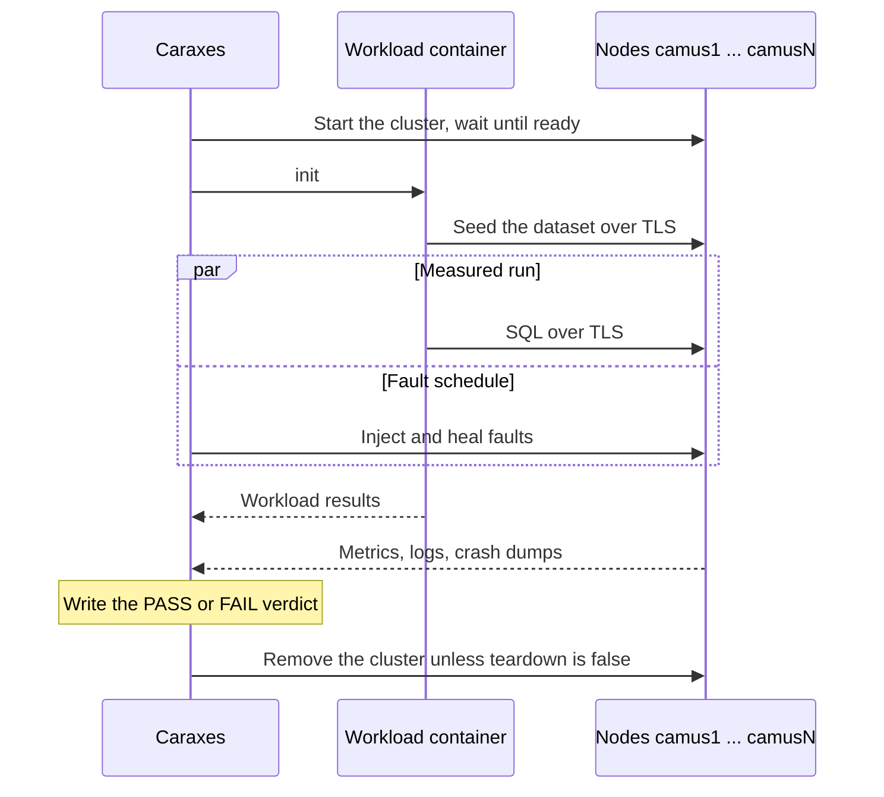

# Caraxes chaos testing


Caraxes is the test harness that attacks CamusDB on purpose. It starts a real
cluster in Docker, sends SQL load to it, and injects faults such as crashes and
network splits. Then it checks that no committed data was lost
or corrupted, and it gives a PASS or FAIL verdict with the evidence.

Unit tests on one node can't show what happens when a leader dies during a
commit or a disk stalls under load. Caraxes makes these events repeatable and
checks the result. It lives in the
[`camusdb-caraxes`](https://github.com/camusdb/camusdb-caraxes) repository and
generates load with [`CamusDB.Workload`](/docs/workload-utility).

A PASS is evidence about one run. It shows that one build, cluster shape,
workload, and fault schedule passed the checks for the measured window.

Caraxes has found or guarded against these failures:

- Bank transfers that changed the total balance under contention, which means a
  transfer wasn't atomic.
- Scans that returned short counts while writes were in flight. A check after
  the run couldn't see them.
- Acknowledged writes that were overwritten when two nodes applied different
  values at the same revision.
- Bugs in crash recovery, re-election, rejoin, and
  [leader](/docs/concepts#leader) transfer.
- Wrong behavior on a full or stalled disk.
- Placement, range-split, and leader-balancer bugs that appear only when all
  [partitions](/docs/concepts#partition) carry work.
- False performance results caused by host disk behavior, a saturated client,
  or a comparison of runs from different builds.

## Quick start

You need:

- .NET 10 SDK
- Docker with `docker compose`
- A CamusDB checkout, by default at `~/camusdb`

Run the commands on this page from the root of the Caraxes repository:

```bash
dotnet run --project Caraxes -- run --scenario scenarios/smoke-optimistic.yml
```

Caraxes builds the node image from `docker/Dockerfile` in your CamusDB
checkout. This means that a run tests the code on your disk. CI can use the
exit code directly. See [Exit codes](#exit-codes).

## How a run works

`run` does the full cycle:

1. Publishes `CamusDB.Workload` from the CamusDB checkout.
2. Starts the cluster and waits until all nodes are ready.
3. Seeds the dataset.
4. Waits `settle_seconds` (default 30) for partition leadership to settle.
5. Starts the measured workload, with the fault schedule in parallel.
6. Collects workload results, node metrics, logs, and crash dumps.
7. Matches faults with errors, writes the verdict, and removes the cluster.



The workload is a one-shot container on the cluster's Docker network. It
connects to the nodes over TLS by their in-cluster names, and you don't have to
change certificate trust on the host.

Useful flags:

- `--tag <name>` stores the run in a separate directory,
  `runs/scenarios/<scenario>-<tag>`. If you omit it, a run replaces the
  previous one.
- `--skip-build` reuses the existing image.
- `--run-root <dir>` sets the directory for run output. The default is
  `./runs`.
- `--correctness-only` shows recovery time and throughput recovery but
  doesn't fail the run on them. Use it on CI machines of unknown speed. The
  correctness checks apply as usual.

## Scenario files

A scenario is one YAML file. Its `name` is required and uses the pattern
`[a-z0-9][a-z0-9-]*`:

```yml
name: bank-kill
cluster:
  name: bank-kill
  nodes: 3
  replication_factor: 3
  locking: optimistic
  isolation: read_committed
workload:
  kind: bank
  rows: 20000
  target_ops: 400
  duration: 60s
nemesis:
  seed: 7
  events:
    - { at: 20s, fault: kill, target: random, duration: 20s }
checks:
  max_recovery_seconds: 45
```

| Block | Purpose |
|---|---|
| `cluster` | Cluster shape and CamusDB settings. See [Cluster spec](#cluster-spec). |
| `workload` | The load to generate. See [Workloads](#workloads). |
| `nemesis` | The faults to inject. The name comes from Jepsen. See [Faults](#faults). |
| `checks` | Pass and fail rules. See [Verdict](#verdict). |
| `elle` | Settings for the isolation checker. See [Elle](#isolation-checks-with-elle). |
| `backup_verify` | Restore checks after a backup run. See [Backups](#backups-and-node-replacement). |
| `schema_verify` | Checks after an online schema change. See [Schema changes](#online-schema-changes). |
| `settle_seconds` | Wait after seeding for leadership to settle. Default `30`. `0` skips the wait. |
| `teardown` | Remove the cluster after the run. Default `true`. |
| `capture_node_logs` | Save node logs before teardown. Default `true`. |
| `precondition_device_gb` | Write this much synced data during warmup to put the host disk in its steady state. |
| `drain_observation_seconds` | Read node metrics for this long after the workload ends. |
| `drain_observation_interval_seconds` | Interval of those metric reads. Default `15`. |
| `node_log_tail` | Lines of each node log to save. Default `0`, the whole log. |

A duration can be `250ms`, `15s`, `1m`, or `1h`. A bare number means seconds.

## Workloads

Each workload kind has a different correctness check. Choose the kind by the failure
that you want to catch.

| `kind` | What it does | What it catches |
|---|---|---|
| `accounts` | Read-modify-write on rows that don't conflict. The default. | Throughput limits and recovery after faults. |
| `bank` | Transfers money between any two rows, across partitions. | A changed `SUM(balance)`, which means a transfer wasn't atomic. This check is always on. |
| `fanout` | Bank transfers between two different tables. Needs `tables: 2` or more. | The same as `bank`, with load on all partitions. Use it for split, placement, and failover tests. |
| `tokens` | Each write deletes a row and inserts its successor in one transaction. | Lost deletes, lost inserts, a deleted row that comes back, double spends, and stale index entries. |
| `append` | Elle list-append transactions. | Lost updates, write skew, read skew, dirty reads, and reads of aborted writes. |
| `rw` | Elle read-write registers: single-row reads and blind writes. | The same anomalies on point reads and writes, through the primary key, a scan, an index, or a join. |
| `predicate` | Reads groups of rows with a `WHERE` clause and writes rows into groups. | Phantoms and write skew on predicate reads, and a `COUNT(*)` that disagrees with the rows read. |

A conserved sum can't detect all wrong orderings of transactions. The Elle
kinds cover that gap.

**Live scan probe.** `scan_probe_interval: 5s` sends `SELECT COUNT(*)` to each
gateway node during the run. A short count fails the run. This catches scan
bugs that appear only while writes are in flight.

**Delete workload.** With the `tokens` kind, a table has exactly `tokens` rows
(default 2,000) at each committed state. Each move reads a row through a
non-unique index, deletes it, and inserts the next version. The index isn't
unique, and only the engine's conflict detection prevents a double spend. After
the run, each slot must have exactly one row at the expected version.

**Range splits.** With `key_range_sharding: true` and split thresholds in the
`kahuna:` block, `fanout` gives ranges enough keys to split. A node with wrong
split settings starts as normal, and no split happens. Set
`checks.require_split: true` to fail the run as VACUOUS when no split happened.
VACUOUS means that the run didn't test what it claims to test. See
[Key-range sharding](/docs/key-range-sharding).

### Isolation checks with Elle

[Elle](https://github.com/jepsen-io/elle) is the isolation checker from the
Jepsen project. The `append`, `rw`, and `predicate` workloads record each
attempt in `history.edn`. After the run, Elle searches that history for
dependency cycles that the isolation level forbids.

Build and check the Elle jar once:

```bash
tools/elle/build.sh     # builds elle-cli with Elle 0.2.8 in Docker
tools/elle/validate.sh  # runs it against histories with known verdicts
dotnet run --project Caraxes -- run --scenario scenarios/append-smoke.yml
```

`build.sh` builds the jar in Docker, and it stops with an error for a jar with a
different Elle version. The last elle-cli release bundles Elle 0.2.7, which has
a defect in its read-write register checker. The host needs Docker, git, and
`unzip`.

What fails the run, by isolation level:

| Level | Forbidden |
|---|---|
| Read committed | G0, G1a, G1b, G1c (write cycles, aborted reads, intermediate reads, and circular information flow). |
| Serializable | All of the above, plus G-single, G2-item, G2, lost updates, internal inconsistency, and a predicate `COUNT(*)` mismatch when both reads share one transaction snapshot. |
| All levels | Final-state errors. See the next paragraph. |

By default, the model follows the isolation level: `read-committed` for read
committed runs, and `serializable` for the others. The cluster default isolation
is `read_committed`. Neither model requires real-time order, and a read-only
snapshot can lag behind a write that already returned. Set
`elle.consistency_models: strict-serializable` if you want to test real-time
order.

**Final-state check.** After the writers stop, the workload reads back each key
it wrote and compares it with its log of attempted writes:

- A list must contain each acknowledged append exactly once.
- A register must have a value that an acknowledged or unresolved write
  produced.
- The primary key, the index, and the join must return the same value.
- A row count over the key range detects duplicate primary keys.

**How statements reach the server.** `txn_mode` sends the same transactions
through a different server path:

- `explicit` (default): `BEGIN`, one round trip per statement, then `COMMIT`.
- `autocommit`: each statement is a separate transaction.
- `pipeline`: all statements in pipelined frames.

`rw_access: secondary` and `rw_access: index` don't work in `pipeline` mode.

**Runs with too little history.** A stuck cluster can pass with almost no
history. `checks.min_committed_txns` fails such a run as VACUOUS.
`workload.stop_after_completed` ends the run after a fixed number of
operations. The run length then doesn't depend on machine speed.

```yml
workload:
  kind: rw                  # or append, predicate
  rw_key_type: int64        # int64 | string | numeric
  rw_access: pk             # pk | secondary | index | join
  txn_mode: explicit        # explicit | autocommit | pipeline
  stop_after_completed: 0   # 0 runs the whole duration
checks:
  min_committed_txns: 1000
elle:
  gated: true               # false reports findings without failing the run
```

| `elle` key | Default | Meaning |
|---|---|---|
| `enabled` | `true` | Run the check. `false` gives no isolation verdict. |
| `jar` | `tools/elle/elle-cli-0.1.11-elle0.2.8-standalone.jar` | Path to the elle-cli jar that `build.sh` builds. |
| `image` | `eclipse-temurin:21-jdk` | Docker image that supplies `java`. It must be a JDK image. |
| `consistency_models` | derived | Empty uses `serializable`, or `read-committed` for read committed runs. |
| `anomalies` | none | Extra anomalies to search for, such as `G1a,G1b`. |
| `gated` | `true` | `false` shows Elle findings as `MEASURED, NOT GATED`. |
| `cycle_search_timeout_ms` | Elle default | Raise it if Elle returns `unknown`. |
| `heap_mb` | JVM default | JVM heap for long histories. |
| `plots` | `false` | Cycle diagrams. Needs an image with Graphviz. |

Elle writes `elle-result.json`. `valid? = true` passes, and `false` fails.
`unknown` also fails, because the search didn't prove the model.

## Faults

The `nemesis` block injects faults while the workload is in progress. Event
times count from the start of the workload container, which includes the
`warmup` (default 15 s). Caraxes lines up each fault with the per-second results
in `intervals.csv` by UTC time.

Each event has an `at` time (default `0s`), a `fault`, a `target` (default
`random`), and a `duration` (default `10s`). `nemesis.seed` defaults to `1`.

| Fault | What it does | Heals by |
|---|---|---|
| `kill` | Kills the node process (SIGKILL). | Restarting the container. |
| `stop` | Stops the node cleanly (SIGTERM). | Restarting the container. |
| `pause` | Freezes the process (SIGSTOP). Connections stay open. | Resuming the process. |
| `partition` | Cuts the node off from all peers. | Removing the firewall rules. |
| `slow` | Adds network latency. Set `delay_ms`, default `100`. | Removing the delay. |
| `loss` | Drops packets. Set `loss_percent`, default `10`. | Removing the loss. |
| `fill-disk` | Fills `/data` until the disk is full. | Deleting the filler file. |
| `slow-disk` | Throttles the node's disk I/O. | Removing the throttle. |
| `clock-skew` | Moves the node's wall clock by `offset_ms` (default +10 s). | Restoring real time. |
| `leader-transfer` | Hands the node's partition leadership to other nodes. Set `to` to pick one. | No heal needed. |
| `remove-node` | Drains the node from the cluster, then stops it. | It isn't healed. This is a permanent scale-down. |
| `backup` | Takes an online backup under load. | No heal needed. |
| `add-node` | Boots a replacement node that joins the cluster. | The node catches up and becomes a [voter](/docs/concepts#learner-and-voter). |
| `sql` | Executes one SQL statement, such as an online schema change. | No heal needed. |
| `disk-corrupt` | Kills the node (SIGKILL) and damages one data file on its volume. See [Storage corruption](#storage-corruption). | Restarting the node. |
| `split` | Splits one key space of a table at its median key. See [Range splits](#range-splits). | No heal needed. The fault window closes after `duration`. |

Targets:

- A node name, such as `camus2`.
- `random`: a node picked from the seed, which makes the run reproducible.
- `leader`: the node that leads the most partitions when the event fires.
- `zone:<name>`: all nodes in that failure zone, together.

Set `heal: false` to leave a fault in place for the rest of the run. When the
workload ends, Caraxes heals the open faults that it can heal. A fault with
`heal: false` and a `remove-node` fault stay in place.

A seeded `random` schedule gives a chaos soak in place of a fixed timeline:

```yml
nemesis:
  seed: 42
  random:
    faults: [kill, pause, partition, slow, slow-disk]
    min_interval: 10s
    max_interval: 18s
    duration: 12s
```

`count` limits the number of faults. The default, `0`, injects faults until the
workload ends. The defaults for the other keys are `min_interval: 10s`,
`max_interval: 20s`, and `duration: 10s`. A `random` schedule can't pick the
`sql` fault.

### Disk faults

`fill-disk` needs `cluster.data_tmpfs_mb`, which puts `/data` on a size-capped
RAM disk. The full node must refuse writes with `CADB0536`
(`InsufficientDiskSpace`). After the space is free, it must accept writes again,
and it must not need a restart. A RAM disk is lost on restart, so this fault
tests disk pressure only.

`slow-disk` throttles the real disk behind the node's data volume. The process,
the network, and the peers stay healthy. The default `write_bps: 4096` acts as
a paused disk, and a few MiB per second acts as a slow disk. `write_iops` and
`read_bps` (default `0`, no limit) add more limits. `device` sets the
`MAJ:MIN` of the disk, which Caraxes finds by default. `slow-disk` doesn't
work with `data_tmpfs_mb`.

```yml
nemesis:
  events:
    - { at: 4m, fault: slow-disk, target: camus1, duration: 30s }
    - { at: 7m, fault: slow-disk, target: camus2, duration: 60s, write_bps: 2097152 }
```

### Storage corruption

`disk-corrupt` kills the node with SIGKILL, damages one data file on its
volume, and restarts the node when the fault heals. It doesn't work with
`data_tmpfs_mb`. Caraxes records each damage in
`runs/clusters/<cluster>/storage-damage/storage-damage.jsonl`.

| Key | Default | Meaning |
|---|---|---|
| `damage` | (required) | `bit-flip`, `truncate-tail`, `truncate-middle`, `chunk-shuffle`, `chunk-duplicate`, or `chunk-replace`. |
| `damage_layer` | `store` | `store` for the key-value store, or `wal` for the Raft log. |
| `damage_file` | `sst` | `sst` (the largest), `live-log`, `closed-log`, or `manifest`. |
| `damage_seed` | `1` | Seed of the damage, for a reproducible run. |
| `damage_count` | `2` | Bits for `bit-flip`, or chunks for `chunk-shuffle`. Other damages ignore it. |

See `scenarios/corrupt-store-sst-bitflip-rf1.yml` and
`scenarios/corrupt-store-sst-bitflip-rf3.yml`.

### Clock skew

`clock-skew` needs `cluster.clock_skew: true`. It moves only the node's wall
clock. `offset_ms` can't be `0`, and it must be within ±12 hours. That clock feeds CamusDB's [hybrid logical clock](/docs/concepts#hlc)
and the timeouts built on it. Raft elections use a separate clock, and the
fault doesn't affect them. The bundled scenarios test jumps above 5 seconds,
above 15 seconds, and of several minutes. A ±2 second run is the control.

```yml
cluster:
  clock_skew: true
nemesis:
  events:
    - { at: 15s, fault: clock-skew, target: camus1, duration: 20s, offset_ms: 10000 }
```

### Range splits

`split` divides one key space of a table in the workload database at its median
key. At the scheduled time, it calls
[`POST /v1/cluster/split-range`](/docs/key-range-sharding#split-a-range-manually).
It asks the target node first and then the other nodes, follows the leader
hint, and retries refusals that can clear with time. The run fails if a
scheduled split didn't commit or didn't start.

| Key | Default | Meaning |
|---|---|---|
| `split_table` | `workload_accounts` | The table to split. |
| `split_index` | (row space) | An index of the table to split. `primary` or `<table>_pkey` names the primary index. |
| `split_timeout_seconds` | `60` | Time limit for one split event. |
| `split_retries` | `60` | Attempts, half a second apart. |

See `scenarios/bank-split-kill-window.yml`.

### Backups and node replacement

With `cluster.backups: true`, the `backup` fault takes backups during the load,
and Caraxes grades their cost. `backup_kind` is `incremental` (the default),
`full`, or `coordinated`.

`backup_verify` then checks that no data was lost:

1. Take a final incremental backup after the load stops.
2. Read a fingerprint of the live data: row count, `SUM(balance)`, and
   `SUM(version)`.
3. Restore the backup chain and start the cluster from it.
4. Read the fingerprint from each node and compare it with the live one.

The fingerprint includes `SUM(version)` because transfers don't change
`SUM(balance)`. `SUM(version)` grows with each write, and it detects a restore
that lost the latest writes.

`add-node` replaces a node that is gone for good. By default, it seeds the new
node from the backup chain. The node replays the backup and then receives the
newer changes from the cluster. Set `seed_from_backup: false` to start the node
empty and send it a full snapshot. `node_name` sets the name of the new node. The default is the next free
index. The new node must become a voter, host the expected partitions, and read
the same data as the other nodes.

```yml
nemesis:
  events:
    - { at: 20s,  fault: backup,   target: camus1, duration: 5s }
    - { at: 40s,  fault: kill,     target: camus3, heal: false }
    - { at: 100s, fault: add-node, target: camus1, duration: 5s }
```

See [Backup and restore](/docs/backup-and-restore).

### Online schema changes

The `sql` fault executes one statement on a node during the workload, such as
`CREATE INDEX` or `ALTER TABLE ... ADD COLUMN`. The `sql` key holds the
statement. `sql_timeout_seconds` (default 1800) limits one statement, and it
must cover the backfill of the largest table. Schedule kills around it to crash
the node that applies the change. Retryable errors are retried up to
`sql_retries` times (default 10). `expect` sets the required result: `ok`
(default), `error`, or `any`.

After the workload, `schema_verify` checks that:

- All nodes report the same schema, and the schema is stable.
- An index contains the same rows and values as the table.
- A new column has its default value in each row.
- No foreign key points to a missing parent row.
- The workload saw no errors that it couldn't retry.
- With `require_resume: true`, a node logged that it resumed the interrupted
  change. If that log line is missing, the kill missed the change, and the run
  fails as VACUOUS.

See `scenarios/schema-add-column-kill.yml` and `scenarios/schema-index-kill.yml`.

## Verdict

A scenario passes when:

- The workload accepted the run, and its correctness checks held.
- The run had no internal errors. In a scenario with a `nemesis` block,
  internal errors are reported in `errors.json`, and they don't fail the run by
  themselves.
- All rules in `checks` passed.

For each fault, Caraxes measures three values: the peak error rate, whether the
workload completed operations during the fault, and the time from heal until
the error rate falls to 1 percent or below. It writes the results to
`analysis.md` and `scenario.json`.

```text
# Fault analysis - bank-kill

- Baseline (clean seconds): error rate 0.00 %, write p99 1,382.0 ms
- In-fault: error rate 40.45 %, write p99 392.9 ms (0.3x baseline)
- Max recovery time: 5.5 s; all healed faults recovered: yes

| fault | healed | window (s) | peak error | failed | progressed | recovery (s) |
|---|---|---|---|---|---|---|
| kill/camus2 | yes | 20.3 | 100 % | 4,074 | yes | 5.5 |
```

| `checks` key | Default | Fails the run when |
|---|---|---|
| `max_recovery_seconds` | `45` | A healed fault took longer than this to recover. |
| `min_recovered_throughput_fraction` | `0.9` | Throughput didn't return to this share of its pre-fault level. `0` turns it off. |
| `min_throughput_under_fault_fraction` | `0` | Throughput during a fault fell below this share. Use it for operations that aren't outages, such as backups. |
| `require_recovery` | `true` | A healed fault didn't recover. |
| `require_progress_under_fault` | `true` | No operation completed during a fault (a total outage). |
| `grade_recovery` | `true` | `false` shows recovery results and doesn't fail the run. `--correctness-only` sets it. |
| `require_node_health` | `true` | A node stopped answering `/ping` outside a fault window. |
| `require_no_divergent_apply` | `true` | Node logs show that two nodes applied different values at the same revision. This means that an acknowledged write was lost. |
| `min_committed_txns` | `0` | An Elle history has fewer committed transactions than this. |
| `require_split` | `false` | No range split happened during the run. |
| `require_replica_move` | `false` | No replica moved during the run. |
| `require_client_headroom` | `false` | The load generator was the bottleneck. For capacity runs. |
| `require_cluster_facts` | `false` | The run can't record which build it measured. For capacity runs. |
| `require_quiet_host` | `false` | The host was busy before the run started. For capacity runs. |
| `require_spread_leadership` | `false` | Leadership was on few nodes when the measured run started. |

The node health and divergent-apply checks apply to all scenarios, also to
those that inject no faults.

## Capacity evidence

A throughput number alone is easy to misread. Caraxes records the context that
explains it:

| File | Shows |
|---|---|
| `cluster-facts.json` | The build, settings, and data placement on each node. Don't compare two runs with different fingerprints. |
| `node-metrics.csv`, `bottleneck-report.md` | Work per node, the commit path, and backlog growth. They show when one leader does all the writes. |
| `client-resources.json` | The load generator's CPU, memory, and thread-pool backlog. Use it to check that a slow result isn't caused by the client. |
| `host-io.csv` | Host disk behavior during the run. |
| `precondition.json` | The warmup data written to put the host disk in its steady state. |

Don't compare runs across disk setups: a RAM disk, a preconditioned disk, and a
disk that wasn't preconditioned. Each setup is a different baseline.

To set a baseline, repeat a scenario at least three times and combine the
results:

```bash
for i in 1 2 3; do
  dotnet run --project Caraxes -- run --scenario scenarios/capacity-baseline.yml --tag r$i
done

CamusDB.Workload baseline --runs \
  runs/scenarios/capacity-baseline-r1/artifacts/run,\
  runs/scenarios/capacity-baseline-r2/artifacts/run,\
  runs/scenarios/capacity-baseline-r3/artifacts/run
```

`baseline` sets a baseline when it has at least three comparable runs and
their coefficient of variation is 10 percent or less. It also reports the
spread between runs, as context.
`CamusDB.Workload compare` returns an error for two runs from different builds
or workload shapes. See [Workload utility](/docs/workload-utility).

## Matrix sweeps

A matrix tests each combination of settings and writes one report:

```bash
dotnet run --project Caraxes -- matrix --matrix scenarios/matrix-resilience.yml
```

A matrix file has base `cluster`, `workload`, and `checks` blocks, plus `axes`.
It can also set `elle`, `teardown`, and `settle_seconds`. Each cell is a
separate scenario with a separate cluster.

```yml
axes:
  locking: [optimistic, pessimistic]
  nemesis:
    - name: none
    - name: kill
      seed: 7
      events:
        - { at: 20s, fault: kill, target: random, duration: 20s }
```

The axes are `locking`, `isolation`, `txn_mode`, `nodes`, `sharding`,
`parallelism`, `workers`, and `nemesis`.

`--list-cells` prints the cell names, and `--correctness-only` works as for
`run`. With `--cell <name>`, each CI job can
test one cell. The sweep writes `matrix-report.md` and `matrix.json`, and it
exits with a nonzero code if a cell failed.

## Leader-balance test

This test checks the leader balancer on an idle cluster:

```bash
dotnet run --project Caraxes -- leader-balance --spec scenarios/leader-balance.yml
```

It kills the node that leads the most partitions, restarts it, and checks that
the balancer moves leadership back. The test passes when the node gets back at
least half of its fair share and the leadership spread is close to even.
`leader-balance` takes `--skip-build`.

## Cluster commands

These commands manage a cluster outside a test run:

```bash
dotnet run --project Caraxes -- up --spec scenarios/cluster-3.yml       # start and wait until ready
dotnet run --project Caraxes -- status --spec scenarios/cluster-3.yml   # health and placement
dotnet run --project Caraxes -- logs --spec scenarios/cluster-3.yml --node camus2
dotnet run --project Caraxes -- down --spec scenarios/cluster-3.yml     # remove containers and volumes
```

`up` takes `--skip-build` and `--ready-timeout <seconds>` (default 180).
`down` takes `--keep-volumes`. `logs` takes `--tail <lines>` (default 200).

Nodes are named `camus1` to `camusN`. Node `i` publishes REST on host port
`15095 + i - 1` and gRPC on `16095 + i - 1`. A Caraxes cluster can then run
next to a local server on ports 5095 and 5096.

## Cluster spec

Only `name` is required. Caraxes checks the spec before it starts anything. An
invalid `--spec` file exits with code `2`. An invalid `cluster` block in a
scenario or matrix file exits with code `1`.

| Key | Default | Meaning |
|---|---|---|
| `name` | (required) | Lowercase `[a-z0-9-]` name for containers, volumes, and the image tag. |
| `nodes` | `3` | Node count. |
| `partitions` | `3` | Initial partitions. |
| `replication_factor` | `3` | [Replicas](/docs/concepts#replica-and-replication-factor) per partition. `0` puts each partition on all nodes. |
| `placement_rebalancer` | `true` | Repair and balance replica placement. |
| `leader_balancer` | `true` | Spread partition leadership across nodes. |
| `zones` | `[]` | One failure-zone label per node. |
| `locking` | `optimistic` | Sets `default_transaction_locking`. |
| `isolation` | `read_committed` | Sets `default_isolation_level`. This replaces the server default, `serializable`. |
| `read_validation` | (engine default) | Sets `default_read_validation`. |
| `key_range_sharding` | `false` | Sets `key_range_sharding`. |
| `distributed_query_execution` | `false` | Sets `distributed_query_execution`. See [Distributed queries](/docs/distributed-queries). |
| `max_query_parallelism` | `1` | Sets `max_query_parallelism`. |
| `diagnostics` | `true` | Turns on OpenTelemetry and `/metrics` on all nodes. |
| `tls` | `true` | TLS on the client gRPC port. Raft traffic uses TLS in both cases. |
| `clock_skew` | `false` | Loads the clock shim that the `clock-skew` fault needs. |
| `backups` | `false` | Gives each node a backup directory. The `backup` fault needs it, and so does `add-node` with `seed_from_backup: true` (the default). |
| `data_tmpfs_mb` | `0` | Puts `/data` on a size-capped RAM disk. `fill-disk` needs it. |
| `memory_limit_mb` | `0` | Container memory limit per node. |
| `gc_heap_hard_limit_mb` | `0` | .NET heap limit. With `memory_limit_mb` set and this at `0`, the heap gets 60 percent and the storage engine gets the rest. |
| `subnet` | `10.101.0` | First three octets of the cluster's `/24` network. |
| `first_ip` | `2` | Last octet of node 1's address. |
| `base_rest_port` | `15095` | Host REST port of node 1. |
| `base_grpc_port` | `16095` | Host gRPC port of node 1. |
| `base_raft_port` | `7070` | Internal [Raft](/docs/concepts#raft) port of node 1. Not published to the host. |
| `spare_certs` | `5` | Extra certificate names, so `add-node` works without new certificates. |
| `camusdb_repo` | `~/camusdb` | Path to the CamusDB checkout. |
| `image` | (derived) | Image tag. Empty uses `caraxes/camusdb:{name}`. |
| `kahuna` | `{}` | Raw settings for the generated `kahuna:` config section. |
| `camusdb` | `{}` | Raw settings for the generated CamusDB config. `kahuna` and `data_dir` aren't allowed here. |
| `log_levels` | `{}` | Log level per category, for diagnostic runs. |
| `env` | `{}` | Extra environment variables for all nodes. |

## Workload keys

`workload` keys map to [`CamusDB.Workload`](/docs/workload-utility) flags.
Chaos runs test behavior under faults, and the defaults put less load on the
cluster than the defaults of the standalone tool.

| Key | Default | Meaning |
|---|---|---|
| `kind` | `accounts` | `accounts`, `bank`, `fanout`, `tokens`, `append`, `rw`, or `predicate`. See [Workloads](#workloads). |
| `database` | `caraxes` | Database to seed and use. |
| `seed` | `1847` | Data and workload seed. |
| `rows` | `100000` | Rows to seed. |
| `tables` | `1` | Tables to spread rows over. `fanout` needs 2 or more. |
| `payload_bytes` | `256` | Payload size per row. |
| `batch` | `500` | Rows per seeding transaction. |
| `mode` | `open` | `open` for a fixed rate, `closed` for saturation. |
| `target_ops` | `500` | Operations per second in `open` mode. |
| `workers` | `32` | Concurrent workers. |
| `connections` | `8` | Client connections. |
| `max_in_flight` | `4096` | Concurrency limit. |
| `read_percent` / `write_percent` | `60` / `40` | Operation mix. Must add up to 100. |
| `writes_per_transaction` | `1` | Writes per write transaction. |
| `duration` | `60s` | Measured window. |
| `warmup` | `15s` | Unmeasured warmup. |
| `drain` | `10s` | Drain time after the measured window. |
| `stop_after_completed` | `0` | End the run after this many operations. `0` uses the full duration. |
| `locking` / `isolation` | (cluster) | Empty uses the cluster's value. |
| `routing_mode` | (driver default) | `off`, `learned`, or `auto`. |
| `connection_options` | (empty) | Extra connection-string settings. |
| `gateway` | (all nodes) | Send all requests through one node. |
| `no_auto_prepare` | `false` | Turns off automatic prepared statements. |
| `request_timeout` | `0` | Request timeout in seconds. `0` uses the client default. |
| `expect_faults` | `true` | Treat conflicts and missed pacing as normal under faults. |
| `reconcile_timeout` | `0` | Extra time for the check after the run. |
| `scan_probe_interval` | (off) | Send live `COUNT(*)` probes at this interval. |
| `scan_probe_timeout` | `0` | Probe timeout in seconds. |
| `node_metrics` | `true` | Collect per-node metrics. Needs `diagnostics`. |
| `metrics_interval` | `5s` | Metrics scrape interval. |
| `cluster_facts` | `true` | Write `cluster-facts.json`. |
| `tokens` | `2000` | `tokens` only: rows in the token table. |
| `pipeline` | `false` | Send writes in pipelined frames during the measured run. |
| `txn_mode` | `explicit` | Elle kinds only: `explicit`, `autocommit`, or `pipeline`. |
| `elle_key_distribution` | (by kind) | Elle kinds only: `uniform` or `exponential`. `rw` and `predicate` default to `exponential`. |
| `append_keys`, `append_max_writes_per_key`, `append_max_txn_length` | `10`, `64`, `4` | `append` only: active lists, appends per list, steps per transaction. |
| `rw_keys`, `rw_max_writes_per_key`, `rw_max_txn_length` | `10`, `32`, `4` | `rw` only: active registers, writes per register, steps per transaction. |
| `rw_key_type` | `int64` | `rw` only: `int64`, `string`, or `numeric`. |
| `rw_access` | `pk` | `rw` only: `pk`, `secondary` (scan), `index`, or `join`. |
| `predicate_groups`, `predicate_group_size` | `8`, `8` | `predicate` only: active groups and keys per group. |
| `predicate_max_writes_per_group`, `predicate_max_txn_length` | `12`, `3` | `predicate` only: writes per group, steps per transaction. |
| `predicate_read` | `index` | `predicate` only: `index`, `scan`, or `range`. |

## Artifacts

Each run writes to `runs/`, or to the directory that `--run-root` sets. You can
delete the files, but they are the evidence
for the verdict. `scenario.json` records the CamusDB commit that Caraxes built.
Use it to trace a verdict back to its code.

| Path | Contains |
|---|---|
| `runs/scenarios/<name>/scenario.json` | Settings, CamusDB commit, verdict, notes, and fault analysis. |
| `runs/scenarios/<name>/analysis.md` | Fault analysis in readable form. |
| `runs/scenarios/<name>/timeline.jsonl` | One line per fault, heal, error, and note. |
| `runs/scenarios/<name>/node-health.csv` | `/ping` samples per node. |
| `runs/scenarios/<name>/artifacts/run/` | Workload results: `summary.md`, `intervals.csv`, `errors.json`, `reconciliation.json`, metrics, and node logs. |
| `runs/scenarios/<name>/artifacts/run/history.edn` | Elle history for the Elle kinds. |
| `runs/scenarios/<name>/artifacts/run/elle-result.json` | Elle verdict. Explanations are in `elle/`. |
| `runs/scenarios/<name>/artifacts/run/divergent-applies.txt` | Divergent-apply log lines, when found. |
| `runs/scenarios/<name>/backup-verify.json` | Backup check results. |
| `runs/scenarios/<name>/artifacts/run/schema-verify.json` | Schema check results. |
| `runs/clusters/<cluster>/dumps/camusN/` | Crash dumps. They are stored outside `/data`, and teardown doesn't delete them. A cluster started with `up` uses `runs/<cluster>/dumps/camusN/`. |
| `runs/matrix/<name>/` | `matrix-report.md` and `matrix.json`. The cells are in `cells/scenarios/<cell>/`, and their clusters are in `cells/clusters/`. |
| `runs/leader-balance/<cluster>/` | `leader-balance.md` and `leaders.jsonl`. |

## Exit codes

| Code | Meaning |
|---|---|
| `0` | PASS. |
| `1` | FAIL, or the harness failed. This includes a wrong value in a scenario's `cluster` or `nemesis` block, such as an unknown fault name. |
| `2` | The command line or a `--spec` file is invalid, or a scenario or matrix file has a YAML error or an unknown key. |
| `130` | Stopped with Ctrl-C. |

## Bundled scenarios and CI

| File or family | Tests |
|---|---|
| `cluster-3.yml`, `cluster-5.yml`, `cluster-zones.yml` | Cluster specs for reuse. |
| `smoke-optimistic.yml`, `smoke-pessimistic.yml` | Baselines with no faults. |
| `kill-follower.yml`, `partition-and-slow.yml`, `zone-failure.yml`, `soak-random.yml` | Recovery from process, network, and zone faults. |
| `disk-full.yml`, `bank-slow-disk-pause-nvme.yml` | Full and stalled disks. |
| `corrupt-store-*.yml` | Storage corruption with replication factor 1 and 3. |
| `append-clock-*.yml` | Clock jumps of different sizes. |
| `bank-backup-*` | Backup restore and node replacement. |
| `schema-*.yml` | Online schema changes under kills. |
| `tokens-*.yml` | Delete correctness under faults, splits, and leader changes. |
| `bank-*.yml`, `fanout-*.yml`, `split-*.yml` | The bank invariant under faults, lock modes, splits, and long soaks. |
| `append-*.yml`, `rw-*.yml`, `predicate-*.yml` | Elle histories, with and without faults. |
| `matrix-elle-*.yml` | Elle sweeps of locking, isolation, and `txn_mode` on 1 and 3 nodes. |
| `capacity-baseline.yml`, `bank-cap-*`, `tables-scale-*` | Capacity limits and scaling. |
| `leader-*.yml`, `leaders-*.yml` | Leader balancing and transfer. |

The `scenarios/` directory has more files for specific investigations.

GitHub Actions runs these on a schedule:

- [Nightly append](https://github.com/camusdb/camusdb-caraxes/actions/workflows/nightly-append.yml):
  the Elle list-append scenarios except `append-autocommit.yml` and
  `append-pipeline.yml`, plus the bank split and placement scenarios and
  `bank-split-kill-window.yml`.
- [Nightly Elle](https://github.com/camusdb/camusdb-caraxes/actions/workflows/nightly-elle.yml):
  the `rw`, `predicate`, and `append` matrices with no faults, plus single-node
  kill runs.
- [Weekly Elle volume](https://github.com/camusdb/camusdb-caraxes/actions/workflows/weekly-elle-volume.yml):
  each Sunday, one of six `matrix-elle-volume-*` files, chosen by ISO week. Each
  cell runs up to one million committed transactions, with a 4-hour limit.

Not covered yet: block-device faults through device-mapper, because they need
root access on the host.

## Related pages

- [Workload utility](/docs/workload-utility): the load generator that Caraxes
  uses.
- [Cluster mode](/docs/cluster): partitions, placement, and replication.
- [Distributed transactions and HLC](/docs/distributed-transactions): the
  commit path that a kill under load tests.
- [A dragon to attack our own database](/blog/a-dragon-to-attack-our-own-database/):
  the story behind Caraxes.
- [Kahuna Jepsen](https://github.com/kahunakv/kahuna-jepsen): Jepsen tests for
  the key/value and locking layer under CamusDB.
- [Kommander Jepsen](https://github.com/kahunakv/kommander-jepsen): Jepsen tests
  for the Raft library under Kahuna.
