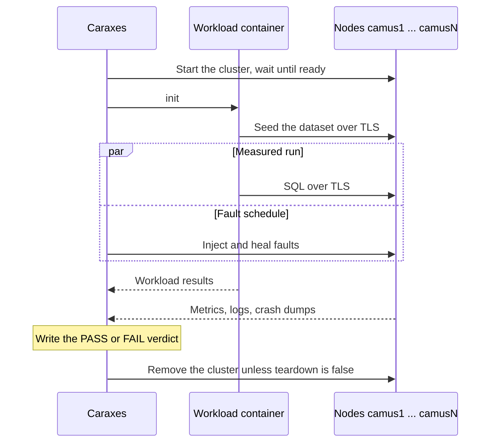

# Caraxes


Caraxes is the test harness that attacks CamusDB on purpose. It starts a real
cluster in Docker, runs SQL load against it, and injects faults: crashes,
network splits, slow disks, clock jumps, backups, schema changes, and node
replacements. Then it checks that no committed data was lost or corrupted and
gives a PASS or FAIL verdict with the evidence behind it.

Unit tests on one node cannot show what happens when a leader dies in the middle
of a commit or a disk stalls under load. Caraxes makes those events repeatable
and graded. It lives in the
[`camusdb-caraxes`](https://github.com/camusdb/camusdb-caraxes) repository and
drives load through [`CamusDB.Workload`](/docs/workload-utility).

A PASS is evidence, not proof. It shows that one build, cluster shape, workload,
and fault schedule passed every check for the measured window.

Caraxes has found or guarded against these failures:

- Bank transfers that changed the total balance under contention (an atomicity
  break).
- Scans that returned short counts only while writes were in flight, which a
  check after the run could not see.
- Acknowledged writes overwritten when two nodes applied different values at the
  same revision.
- Bugs in crash recovery, re-election, rejoin, and
  [leader](/docs/concepts#leader) transfer.
- Wrong behavior on a full disk or a stalled disk.
- Placement, range-split, and leader-balancer bugs that show only when every
  [partition](/docs/concepts#partition) carries work.
- False performance results caused by host disk behavior, a saturated client,
  or a comparison of runs from different builds.

## Quick start

You need:

- .NET 10 SDK
- Docker with `docker compose`
- A CamusDB checkout, `~/camusdb` by default

Run every command from the root of the Caraxes repository:

```bash
dotnet run --project Caraxes -- run --scenario scenarios/smoke-optimistic.yml
```

Caraxes builds the node image from the checkout's `docker/Dockerfile`, so a run
tests the code on your disk. The command exits `0` on PASS, `1` on FAIL, and `2`
for an invalid file. CI can gate on it directly.

## How a run works

`run` does the whole cycle:

1. Publish `CamusDB.Workload` from the CamusDB checkout.
2. Start the cluster and wait until every node is ready.
3. Seed the dataset.
4. Wait `settle_seconds` (default 30) for partition leadership to settle.
5. Run the measured workload, with the fault schedule in parallel.
6. Collect workload results, node metrics, logs, and crash dumps.
7. Line up faults with errors, write the verdict, and remove the cluster.



The workload runs in a one-shot container on the cluster's Docker network. It
reaches the nodes over TLS by their in-cluster names, so you do not change
certificate trust on the host.

Useful flags:

- `--tag <name>` keeps repeated runs side by side under
  `runs/scenarios/<scenario>-<tag>`. Without it, each run replaces the last one.
- `--skip-build` reuses the existing image.
- `--correctness-only` reports recovery time and throughput recovery but does
  not fail on them. Use it on CI machines with unknown speed. Correctness checks
  still grade the run.

## Scenario files

A scenario is one YAML file:

```yml
name: bank-kill
cluster:
  name: bank-kill
  nodes: 3
  replication_factor: 3
  locking: optimistic
  isolation: read_committed
workload:
  kind: bank
  rows: 20000
  target_ops: 400
  duration: 60s
nemesis:
  seed: 7
  events:
    - { at: 20s, fault: kill, target: random, duration: 20s }
checks:
  max_recovery_seconds: 45
```

| Block | Purpose |
|---|---|
| `cluster` | Cluster shape and CamusDB settings. See [Cluster spec](#cluster-spec). |
| `workload` | What load to run. See [Workloads](#workloads). |
| `nemesis` | The faults to inject. The name comes from Jepsen. See [Faults](#faults). |
| `checks` | Pass and fail rules. See [Verdict](#verdict). |
| `elle` | Settings for the isolation checker. See [Elle](#isolation-checks-with-elle). |
| `backup_verify` | Restore checks after a backup run. See [Backups](#backups-and-node-replacement). |
| `schema_verify` | Checks after an online schema change. See [Schema changes](#online-schema-changes). |
| `settle_seconds` | Wait after seeding for leadership to settle. Default `30`. `0` skips. |
| `teardown` | Remove the cluster after the run. Default `true`. |
| `capture_node_logs` | Save node logs before teardown. Default `true`. |
| `precondition_device_gb` | Write this much synced data during warmup so the host disk is in its steady state. |
| `drain_observation_seconds` | Keep reading node metrics after the workload ends. |

A duration accepts `250ms`, `15s`, `1m`, or `1h`. A bare number means seconds.

## Workloads

Each workload kind has its own correctness check. Pick the kind by the failure
you want to catch.

| `kind` | What it does | What it catches |
|---|---|---|
| `accounts` | Read-modify-write on rows that do not conflict. The default. | Throughput limits and recovery after faults. |
| `bank` | Transfers money between any two rows, across partitions. | A changed `SUM(balance)`, which means a transfer was not atomic. Never waived. |
| `fanout` | Bank transfers between two different tables. Needs `tables: 2` or more. | The same as `bank`, with load on every partition. Use it for split, placement, and failover tests. |
| `tokens` | Each write deletes a row and inserts its successor in one transaction. | Lost deletes, lost inserts, a deleted row that comes back, double spends, and stale index entries. |
| `append` | Elle list-append transactions. | Lost updates, write skew, read skew, dirty reads, and reads of aborted writes. |
| `rw` | Elle read-write registers: single-row reads and blind writes. | The same anomalies on point reads and writes, through the primary key, a scan, an index, or a join. |
| `predicate` | Reads groups of rows with a `WHERE` clause and writes rows into groups. | Phantoms and write skew on predicate reads, and `COUNT(*)` that disagrees with the rows read. |

A conserved sum cannot see every wrong ordering of transactions. The Elle kinds
fill that gap.

**Live scan probe.** Set `scan_probe_interval: 5s` to run `SELECT COUNT(*)` on
every gateway node during the run. A short count fails the run. This catches scan bugs
that show only while writes are in flight.

**Delete workload.** `tokens` keeps exactly `tokens` rows (default 2,000) in a
table at every committed state. Each move reads a row through a non-unique
index, deletes it, and inserts the next version. Because the index is not
unique, only the engine's conflict detection prevents a double spend. After the
run, each slot must hold exactly one row at the expected version.

**Range splits.** With `key_range_sharding: true` and split thresholds in the
`kahuna:` block, `fanout` gives ranges enough keys to split. A node with wrong
split settings still starts, so set `checks.require_split: true`. It fails the
run as VACUOUS (the test did not test what it claims) when no split happened.
See [Key-Range Sharding](/docs/key-range-sharding).

### Isolation checks with Elle

[Elle](https://github.com/jepsen-io/elle) is the isolation checker from the
Jepsen project. The `append`, `rw`, and `predicate` workloads record every
attempt to `history.edn`. After the run, Elle searches that history for
dependency cycles that the isolation level forbids.

Build and check the pinned Elle jar once:

```bash
tools/elle/build.sh     # builds elle-cli with Elle 0.2.8 in Docker
tools/elle/validate.sh  # runs it against histories with known verdicts
dotnet run --project Caraxes -- run --scenario scenarios/append-smoke.yml
```

The jar is built, not downloaded. The last elle-cli release bundles Elle 0.2.7,
which has a known defect in its read-write register checker. `build.sh` refuses
any jar without the fixed version. The host needs only Docker.

What fails the run, by isolation level:

| Level | Forbidden |
|---|---|
| Read committed | G0, G1a, G1b, G1c (write cycles, aborted reads, intermediate reads, and circular information flow). |
| Serializable | All of the above, plus G-single, G2-item, G2, lost updates, internal inconsistency, and a predicate `COUNT(*)` mismatch when both reads share one transaction snapshot. |
| Every level | Final-state errors (see below). |

The default model is `serializable`, not `strict-serializable`. A read-only
snapshot can lag a write that already returned. Set
`elle.consistency_models: strict-serializable` only when real-time order is the
claim under test.

**Final-state check.** After the writers stop, the workload reads back every key
it touched and compares it with its log of attempted writes:

- A list must hold every acknowledged append exactly once.
- A register must hold a value that some acknowledged or unresolved write
  produced.
- The primary key, the index, and the join must return the same value.
- A row count over the key range catches duplicate primary keys.

**How statements reach the server.** `txn_mode` runs the same transactions on a
different server path:

- `explicit` (default): `BEGIN`, one round trip per statement, `COMMIT`.
- `autocommit`: every statement is its own transaction.
- `pipeline`: all statements in pipelined frames.

`rw_access: secondary` and `index` cannot run in `pipeline` mode.

**Empty runs.** `checks.min_committed_txns` fails a run as VACUOUS when the
history has too few committed transactions. A stuck cluster can otherwise pass
with almost no history. `workload.stop_after_completed` ends the run after a
fixed number of operations, so a run is defined by a count, not by machine
speed.

```yml
workload:
  kind: rw                  # or append, predicate
  rw_key_type: int64        # int64 | string | numeric
  rw_access: pk             # pk | secondary | index | join
  txn_mode: explicit        # explicit | autocommit | pipeline
  stop_after_completed: 0   # 0 runs the whole duration
checks:
  min_committed_txns: 1000
elle:
  gated: true               # false reports findings without failing the run
```

| `elle` key | Default | Meaning |
|---|---|---|
| `enabled` | `true` | Run the check. Off leaves the run without an isolation verdict. |
| `jar` | `tools/elle/elle-cli-0.1.11-elle0.2.8-standalone.jar` | Path to the elle-cli jar that `build.sh` makes. |
| `image` | `eclipse-temurin:21-jdk` | Docker image that supplies `java`. It must be a JDK image. |
| `consistency_models` | derived | Empty uses `serializable`, or `read-committed` for read committed runs. |
| `anomalies` | none | Extra anomalies to search for, such as `G1a,G1b`. |
| `gated` | `true` | `false` reports Elle findings as `MEASURED, NOT GATED`. |
| `cycle_search_timeout_ms` | Elle default | Raise it if Elle returns `unknown`. |
| `heap_mb` | JVM default | JVM heap for long histories. |
| `plots` | `false` | Cycle diagrams. Needs an image with Graphviz. |

Elle writes `elle-result.json`. `valid? = true` passes. `false` fails. `unknown`
also fails, because the search did not prove the model.

## Faults

The `nemesis` block injects faults while the workload runs. Event times count
from the start of the measured run, so each fault lines up with the per-second
results in `intervals.csv`.

| Fault | What it does | Heals by |
|---|---|---|
| `kill` | Kills the node process (SIGKILL). | Restarting the container. |
| `stop` | Stops the node cleanly (SIGTERM). | Restarting the container. |
| `pause` | Freezes the process (SIGSTOP). Connections stay open. | Resuming the process. |
| `partition` | Cuts the node off from every peer. | Removing the firewall rules. |
| `slow` | Adds network latency. Set `delay_ms`, default `100`. | Removing the delay. |
| `loss` | Drops packets. Set `loss_percent`, default `10`. | Removing the loss. |
| `fill-disk` | Fills `/data` until the disk is full. | Deleting the filler file. |
| `slow-disk` | Throttles the node's disk I/O. | Removing the throttle. |
| `clock-skew` | Moves the node's wall clock by `offset_ms` (default +10 s). | Restoring real time. |
| `leader-transfer` | Hands the node's partition leadership to other nodes. Set `to` to pick one. | Nothing to undo. |
| `remove-node` | Drains the node from the cluster, then stops it. | Never. This is a permanent scale-down. |
| `backup` | Takes an online backup under load. | Nothing to undo. |
| `add-node` | Boots a replacement node that joins the cluster. | The node catches up and becomes a [voter](/docs/concepts#learner-and-voter). |
| `sql` | Runs one SQL statement, such as an online schema change. | Nothing to undo. |

Targets:

- A node name, such as `camus2`.
- `random`: a node picked from the seed, so the run is reproducible.
- `leader`: the node that leads the most partitions when the event fires.
- `zone:<name>`: every node in that failure zone, together.

Set `heal: false` to keep a fault in place for the rest of the run. Caraxes heals
every open fault when the workload ends, so the cluster is never left broken.

Instead of a fixed timeline, a seeded `random` schedule runs a chaos soak:

```yml
nemesis:
  seed: 42
  random:
    faults: [kill, pause, partition, slow, slow-disk]
    min_interval: 10s
    max_interval: 18s
    duration: 12s
```

### Disk faults

`fill-disk` needs `cluster.data_tmpfs_mb`, which makes `/data` a size-capped RAM
disk. The full node must refuse writes with `CADB0536`
(`InsufficientDiskSpace`) and accept writes again after the space is free,
without a restart. This tests disk pressure, not durability, because a RAM disk
is lost on restart.

`slow-disk` throttles the real disk behind the node's data volume. The process,
network, and peers stay healthy. The default `write_bps: 4096` is a paused disk.
A few MiB per second is a slow disk. It does not work with `data_tmpfs_mb`.

```yml
nemesis:
  events:
    - { at: 4m, fault: slow-disk, target: camus1, duration: 30s }
    - { at: 7m, fault: slow-disk, target: camus2, duration: 60s, write_bps: 2097152 }
```

### Clock skew

`clock-skew` needs `cluster.clock_skew: true`. It moves only the node's wall
clock, which reaches CamusDB's [hybrid logical clock](/docs/concepts#hlc) and the
timeouts built on it. Raft elections use a separate clock and are not affected.
The bundled scenarios test jumps above 5 seconds, above 15 seconds, and of
several minutes, with a ±2 second run as the control.

```yml
cluster:
  clock_skew: true
nemesis:
  events:
    - { at: 15s, fault: clock-skew, target: camus1, duration: 20s, offset_ms: 10000 }
```

### Backups and node replacement

With `cluster.backups: true`, the `backup` fault takes backups while load
continues, and Caraxes grades their cost. `backup_kind` is `incremental` (the
default), `full`, or `coordinated`.

`backup_verify` then proves that no data was lost:

1. Take a final incremental backup after the load stops.
2. Read a fingerprint of the live data: row count, `SUM(balance)`, and
   `SUM(version)`.
3. Restore the backup chain and start the cluster from it.
4. Read the fingerprint from every node and compare it with the live one.

`SUM(balance)` alone is not enough, because every transfer keeps it unchanged.
`SUM(version)` grows with every write, so it shows a restore that lost the most
recent writes.

`add-node` replaces a node that is gone for good. By default it seeds the new
node from the backup chain, so the node replays the backup and then receives
only newer changes from the cluster. Set `seed_from_backup: false` to start the
node empty and send it a full snapshot instead. The new node must become a
voter, host the expected partitions, and read the same data as the others.

```yml
nemesis:
  events:
    - { at: 20s,  fault: backup,   target: camus1, duration: 5s }
    - { at: 40s,  fault: kill,     target: camus3, heal: false }
    - { at: 100s, fault: add-node, target: camus1, duration: 5s }
```

See [Backup and Restore](/docs/backup-and-restore).

### Online schema changes

The `sql` fault runs one statement on a node during the workload, such as
`CREATE INDEX` or `ALTER TABLE ... ADD COLUMN`. Schedule kills around it to
crash the node that runs the change. Retryable errors are retried up to
`sql_retries` times (default 10). `expect` sets the required result: `ok`
(default), `error`, or `any`.

`schema_verify` runs after the workload and checks that:

- Every node reports the same schema, and the state is stable.
- An index holds the same rows and values as the table.
- A new column holds its default value in every row.
- No foreign key points to a missing parent row.
- The workload saw no errors that it could not retry.
- With `require_resume: true`, a node logged that it resumed the interrupted
  change. Without that log line, the kill missed the change and the run fails as
  VACUOUS.

See `scenarios/schema-add-column-kill.yml` and `scenarios/schema-index-kill.yml`.

## Verdict

A scenario passes when:

- The workload accepted the run and its correctness checks held.
- Internal errors happened only as known side effects of an injected fault.
- Every rule in `checks` passed.

For each fault, Caraxes measures the peak error rate, whether the workload
still completed operations, and the time from heal until the error rate falls
to 1 percent or below. It writes the results to `analysis.md` and
`scenario.json`.

```text
# Fault analysis - bank-kill

- Baseline (clean seconds): error rate 0.00 %, write p99 1,382.0 ms
- In-fault: error rate 40.45 %, write p99 392.9 ms (0.3x baseline)
- Max recovery time: 5.5 s; all healed faults recovered: yes

| fault | healed | window (s) | peak error | failed | progressed | recovery (s) |
|---|---|---|---|---|---|---|
| kill/camus2 | yes | 20.3 | 100 % | 4,074 | yes | 5.5 |
```

| `checks` key | Default | Fails the run when |
|---|---|---|
| `max_recovery_seconds` | `45` | A healed fault took longer than this to recover. |
| `min_recovered_throughput_fraction` | `0.9` | Throughput did not return to this share of its pre-fault level. `0` turns it off. |
| `min_throughput_under_fault_fraction` | `0` | Throughput during a fault fell below this share. Use it for operations that are not outages, such as backups. |
| `require_recovery` | `true` | A healed fault never recovered. |
| `require_progress_under_fault` | `true` | No operation completed during a fault (a total outage). |
| `grade_recovery` | `true` | `false` reports recovery results without failing. `--correctness-only` sets it. |
| `require_node_health` | `true` | A node stopped answering `/ping` outside a fault window. |
| `require_no_divergent_apply` | `true` | Node logs show two nodes applied different values at the same revision, which means an acknowledged write was lost. |
| `min_committed_txns` | `0` | An Elle history has fewer committed transactions than this. |
| `require_split` | `false` | No range split happened during the run. |
| `require_replica_move` | `false` | No replica moved during the run. |
| `require_client_headroom` | `false` | The load generator was the bottleneck. For capacity runs. |
| `require_cluster_facts` | `false` | The run cannot record which build it measured. For capacity runs. |
| `require_quiet_host` | `false` | The host was busy before the run started. For capacity runs. |
| `require_spread_leadership` | `false` | Leadership was still on few nodes when the measured run started. |

The node health and divergent-apply checks run on every scenario, with or
without faults.

## Capacity evidence

A throughput number alone is easy to misread. Caraxes records the context that
explains it:

| File | Shows |
|---|---|
| `cluster-facts.json` | The build, settings, and data placement on each node. Two runs with different fingerprints must not be compared. |
| `node-metrics.csv`, `bottleneck-report.md` | Work per node, commit path, and backlog growth. They show when one leader does all the writes. |
| `client-resources.json` | The load generator's CPU, memory, and thread-pool backlog, so a slow client is not mistaken for a slow server. |
| `host-io.csv` | Host disk behavior during the run. |
| `precondition.json` | The warmup data written to put the host disk in its steady state. |

Do not compare RAM disk runs, preconditioned disk runs, and plain disk runs with
each other. Each is a different baseline.

To set a baseline, run a scenario at least three times and combine the results:

```bash
for i in 1 2 3; do
  dotnet run --project Caraxes -- run --scenario scenarios/capacity-baseline.yml --tag r$i
done

CamusDB.Workload baseline --runs \
  runs/scenarios/capacity-baseline-r1/artifacts/run,\
  runs/scenarios/capacity-baseline-r2/artifacts/run,\
  runs/scenarios/capacity-baseline-r3/artifacts/run
```

`baseline` fails when the spread between runs is above 10 percent.
`CamusDB.Workload compare` refuses to compare two runs from different builds or
workload shapes. See [Workload Utility](/docs/workload-utility).

## Matrix sweeps

A matrix runs every combination of settings and writes one report:

```bash
dotnet run --project Caraxes -- matrix --matrix scenarios/matrix-resilience.yml
```

A matrix file has base `cluster`, `workload`, and `checks` blocks plus `axes`.
Each cell runs as a normal scenario with its own cluster.

```yml
axes:
  locking: [optimistic, pessimistic]
  nemesis:
    - name: none
    - name: kill
      seed: 7
      events:
        - { at: 20s, fault: kill, target: random, duration: 20s }
```

Axes: `locking`, `isolation`, `txn_mode`, `nodes`, `sharding`, `parallelism`,
`workers`, and `nemesis`.

`--list-cells` prints the cell names. `--cell <name>` runs only those cells, so
CI can run one cell per job. The sweep writes `matrix-report.md` and
`matrix.json` and exits nonzero if any cell failed.

## Leader-balance test

This test checks the leader balancer without a workload:

```bash
dotnet run --project Caraxes -- leader-balance --spec scenarios/leader-balance.yml
```

It kills the node that leads the most partitions, restarts it, and checks that
the balancer moves leadership back. It passes when the node regains at least
half of its fair share and the spread is near even.

## Cluster commands

These commands manage a cluster without a workload:

```bash
dotnet run --project Caraxes -- up --spec scenarios/cluster-3.yml       # start and wait until ready
dotnet run --project Caraxes -- status --spec scenarios/cluster-3.yml   # health and placement
dotnet run --project Caraxes -- logs --spec scenarios/cluster-3.yml --node camus2
dotnet run --project Caraxes -- down --spec scenarios/cluster-3.yml     # remove containers and volumes
```

`up` accepts `--skip-build` and `--ready-timeout <seconds>` (default 180).
`down` accepts `--keep-volumes`.

Nodes are named `camus1` to `camusN`. Node `i` publishes REST on host port
`15095 + i - 1` and gRPC on `16095 + i - 1`, so a Caraxes cluster can run next to
a local server on ports 5095 and 5096.

## Cluster spec

Only `name` is required. Caraxes checks the spec before it starts anything and
exits with code `2` on an error.

| Key | Default | Meaning |
|---|---|---|
| `name` | (required) | Lowercase `[a-z0-9-]` name for containers, volumes, and the image tag. |
| `nodes` | `3` | Node count. |
| `partitions` | `3` | Initial partitions. |
| `replication_factor` | `3` | [Replicas](/docs/concepts#replica-and-replication-factor) per partition. `0` puts every partition on every node. |
| `placement_rebalancer` | `true` | Repair and balance replica placement. |
| `leader_balancer` | `true` | Spread partition leadership across nodes. |
| `zones` | `[]` | One failure-zone label per node. |
| `locking` | `optimistic` | Sets `default_transaction_locking`. |
| `isolation` | `read_committed` | Sets `default_isolation_level`. This replaces the server default, `serializable`. |
| `read_validation` | (engine default) | Sets `default_read_validation`. |
| `key_range_sharding` | `false` | Sets `key_range_sharding`. |
| `distributed_query_execution` | `false` | Sets `distributed_query_execution`. See [Distributed Queries](/docs/distributed-queries). |
| `max_query_parallelism` | `1` | Sets `max_query_parallelism`. |
| `diagnostics` | `true` | Turns on OpenTelemetry and `/metrics` on every node. |
| `tls` | `true` | TLS on the client gRPC port. Raft traffic keeps TLS either way. |
| `clock_skew` | `false` | Loads the clock shim that the `clock-skew` fault needs. |
| `backups` | `false` | Gives each node a backup directory. The `backup` and `add-node` faults need it. |
| `data_tmpfs_mb` | `0` | Puts `/data` on a size-capped RAM disk. `fill-disk` needs it. |
| `memory_limit_mb` | `0` | Container memory limit per node. |
| `gc_heap_hard_limit_mb` | `0` | .NET heap limit. With `memory_limit_mb` set and this at `0`, the heap gets 60 percent and the storage engine gets the rest. |
| `subnet` | `10.101.0` | First three octets of the cluster's `/24` network. |
| `first_ip` | `2` | Last octet of node 1's address. |
| `base_rest_port` | `15095` | Host REST port of node 1. |
| `base_grpc_port` | `16095` | Host gRPC port of node 1. |
| `base_raft_port` | `7070` | Internal [Raft](/docs/concepts#raft) port of node 1. Not published to the host. |
| `spare_certs` | `5` | Extra certificate names, so `add-node` works without new certificates. |
| `camusdb_repo` | `~/camusdb` | Path to the CamusDB checkout. |
| `image` | (derived) | Image tag. Empty uses `caraxes/camusdb:{name}`. |
| `kahuna` | `{}` | Raw settings for the generated `kahuna:` config section. |
| `camusdb` | `{}` | Raw settings for the generated CamusDB config. `kahuna` and `data_dir` are refused. |
| `log_levels` | `{}` | Log level per category, for diagnostic runs. |
| `env` | `{}` | Extra environment variables for every node. |

## Workload keys

`workload` keys map to [`CamusDB.Workload`](/docs/workload-utility) flags. The
defaults are lighter than the standalone tool, because chaos runs test behavior
under faults, not peak speed.

| Key | Default | Meaning |
|---|---|---|
| `kind` | `accounts` | `accounts`, `bank`, `fanout`, `tokens`, `append`, `rw`, or `predicate`. See [Workloads](#workloads). |
| `database` | `caraxes` | Database to seed and use. |
| `seed` | `1847` | Data and workload seed. |
| `rows` | `100000` | Rows to seed. |
| `tables` | `1` | Tables to spread rows over. `fanout` needs 2 or more. |
| `payload_bytes` | `256` | Payload size per row. |
| `batch` | `500` | Rows per seeding transaction. |
| `mode` | `open` | `open` for a fixed rate, `closed` for saturation. |
| `target_ops` | `500` | Operations per second in `open` mode. |
| `workers` | `32` | Concurrent workers. |
| `connections` | `8` | Client connections. |
| `max_in_flight` | `4096` | Concurrency limit. |
| `read_percent` / `write_percent` | `60` / `40` | Operation mix. Must add up to 100. |
| `writes_per_transaction` | `1` | Writes per write transaction. |
| `duration` | `60s` | Measured window. |
| `warmup` | `15s` | Unmeasured warmup. |
| `drain` | `10s` | Drain time after the measured window. |
| `stop_after_completed` | `0` | End the run after this many operations. `0` runs the whole duration. |
| `locking` / `isolation` | (cluster) | Empty uses the cluster's value. |
| `routing_mode` | (driver default) | `off`, `learned`, or `auto`. |
| `connection_options` | (empty) | Extra connection-string settings. |
| `gateway` | (all nodes) | Send every request through one node. |
| `no_auto_prepare` | `false` | Turns off automatic prepared statements. |
| `request_timeout` | `0` | Request timeout in seconds. `0` keeps the client default. |
| `expect_faults` | `true` | Treat conflicts and missed pacing as normal under faults. |
| `reconcile_timeout` | `0` | Extra time for the check after the run. |
| `scan_probe_interval` | (off) | Run live `COUNT(*)` probes at this interval. |
| `scan_probe_timeout` | `0` | Probe timeout in seconds. |
| `node_metrics` | `true` | Collect per-node metrics. Needs `diagnostics`. |
| `metrics_interval` | `5s` | Metrics scrape interval. |
| `cluster_facts` | `true` | Write `cluster-facts.json`. |
| `tokens` | `2000` | `tokens` only: rows in the token table. |
| `txn_mode` | `explicit` | Elle kinds only: `explicit`, `autocommit`, or `pipeline`. |
| `elle_key_distribution` | (by kind) | Elle kinds only: `uniform` or `exponential`. `rw` and `predicate` default to `exponential`. |
| `append_keys`, `append_max_writes_per_key`, `append_max_txn_length` | `10`, `64`, `4` | `append` only: active lists, appends per list, steps per transaction. |
| `rw_keys`, `rw_max_writes_per_key`, `rw_max_txn_length` | `10`, `32`, `4` | `rw` only: active registers, writes per register, steps per transaction. |
| `rw_key_type` | `int64` | `rw` only: `int64`, `string`, or `numeric`. |
| `rw_access` | `pk` | `rw` only: `pk`, `secondary` (scan), `index`, or `join`. |
| `predicate_groups`, `predicate_group_size` | `8`, `8` | `predicate` only: active groups and keys per group. |
| `predicate_max_writes_per_group`, `predicate_max_txn_length` | `12`, `3` | `predicate` only: writes per group, steps per transaction. |
| `predicate_read` | `index` | `predicate` only: `index`, `scan`, or `range`. |

## Artifacts

Every run writes to `runs/`. The files are disposable, but they are the evidence
behind the verdict. `scenario.json` records the CamusDB commit that Caraxes
built, so you can trace a verdict back to its code.

| Path | Holds |
|---|---|
| `runs/scenarios/<name>/scenario.json` | Settings, CamusDB commit, verdict, notes, and fault analysis. |
| `runs/scenarios/<name>/analysis.md` | Fault analysis in readable form. |
| `runs/scenarios/<name>/timeline.jsonl` | One line per fault, heal, error, and note. |
| `runs/scenarios/<name>/node-health.csv` | `/ping` samples per node. |
| `runs/scenarios/<name>/artifacts/run/` | Workload results: `summary.md`, `intervals.csv`, `errors.json`, `reconciliation.json`, metrics, and node logs. |
| `runs/scenarios/<name>/artifacts/run/history.edn` | Elle history for the Elle kinds. |
| `runs/scenarios/<name>/artifacts/run/elle-result.json` | Elle verdict. Explanations are in `elle/`. |
| `runs/scenarios/<name>/artifacts/run/divergent-applies.txt` | Divergent-apply log lines, when found. |
| `runs/scenarios/<name>/backup-verify.json`, `schema-verify.json` | Backup and schema check results. |
| `runs/clusters/<cluster>/dumps/camusN/` | Crash dumps. Kept outside `/data`, so they survive teardown. |
| `runs/matrix/<name>/` | `matrix-report.md`, `matrix.json`, and one directory per cell. |
| `runs/leader-balance/<cluster>/` | `leader-balance.md` and `leaders.jsonl`. |

## Exit codes

| Code | Meaning |
|---|---|
| `0` | PASS. |
| `1` | FAIL, or the harness failed. |
| `2` | The spec, scenario, or matrix file is invalid. |
| `130` | Stopped with Ctrl-C. |

## Bundled scenarios and CI

| File or family | Tests |
|---|---|
| `cluster-3.yml`, `cluster-5.yml`, `cluster-zones.yml` | Cluster specs for reuse. |
| `smoke-optimistic.yml`, `smoke-pessimistic.yml` | Baselines without faults. |
| `kill-follower.yml`, `partition-and-slow.yml`, `zone-failure.yml`, `soak-random.yml` | Recovery from process, network, and zone faults. |
| `disk-full.yml`, `bank-slow-disk-pause-nvme.yml` | Full and stalled disks. |
| `append-clock-*.yml` | Clock jumps of different sizes. |
| `bank-backup-*` | Backup restore and node replacement. |
| `schema-*.yml` | Online schema changes under kills. |
| `tokens-*.yml` | Delete correctness under faults, splits, and leader changes. |
| `bank-*.yml`, `fanout-*.yml`, `split-*.yml` | The bank invariant under faults, lock modes, splits, and long soaks. |
| `append-*.yml`, `rw-*.yml`, `predicate-*.yml` | Elle histories, with and without faults. |
| `matrix-elle-*.yml` | Elle sweeps of locking, isolation, and `txn_mode` on 1 and 3 nodes. |
| `capacity-baseline.yml`, `bank-cap-*`, `tables-scale-*` | Capacity limits and scaling. |
| `leader-*.yml` | Leader balancing and transfer. |

GitHub Actions runs these on a schedule:

- [Nightly append](https://github.com/camusdb/camusdb-caraxes/actions/workflows/nightly-append.yml):
  every Elle list-append scenario, plus the bank split and placement scenarios.
- [Nightly Elle](https://github.com/camusdb/camusdb-caraxes/actions/workflows/nightly-elle.yml):
  the `rw`, `predicate`, and `append` matrices without faults, plus single-node
  kill runs.
- [Weekly Elle volume](https://github.com/camusdb/camusdb-caraxes/actions/workflows/weekly-elle-volume.yml):
  each matrix cell run to one million committed transactions.

Not covered yet: disk corruption faults (device-mapper), because they need root
access on the host.

## Related

- [Workload Utility](/docs/workload-utility): the load generator that Caraxes
  drives.
- [Cluster](/docs/cluster): partitions, placement, and replication.
- [Distributed Transactions](/docs/distributed-transactions): the commit path
  that a kill under load tests.
- [A dragon to attack our own database](/blog/a-dragon-to-attack-our-own-database/):
  the story behind Caraxes.
- [Kahuna Jepsen](https://github.com/kahunakv/kahuna-jepsen): Jepsen tests for
  the key/value and locking layer under CamusDB.
- [Kommander Jepsen](https://github.com/kahunakv/kommander-jepsen): Jepsen tests
  for the Raft library under Kahuna.
