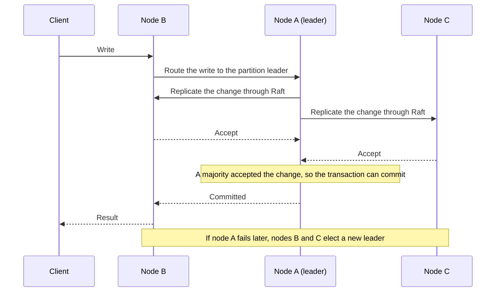

# Cluster mode

CamusDB runs standalone by default: one process on one machine. A standalone
node is simple, but it is a single point of failure. If the machine stops, the
database stops. If the disk fails, the data that is not in a backup is lost.

Cluster mode runs CamusDB on several nodes that act as one database. It keeps a
copy of each write on more than one node, so the database continues to serve
reads and writes when one node fails, and no committed write is lost.

## Why use cluster mode

Use cluster mode when one of these needs applies:

- **High availability.** The application must continue to work when a machine
  fails, restarts for maintenance, or loses its network. A three-node cluster
  continues to commit while one node is down.
- **Durability on more than one machine.** A write must survive the loss of a
  disk or a whole server. CamusDB confirms a commit only after a
  [majority](/docs/concepts#majority) of the nodes holds the change. By default
  every node holds every partition. When you set `kahuna.replication_factor`,
  each partition lives on that many nodes, and the majority is of those
  [replicas](/docs/concepts#replica-and-replication-factor).
- **More capacity.** One machine has a limit on CPU, memory, and disk. A cluster
  spreads the data and the work across several machines. See
  [Key-range sharding](/docs/key-range-sharding) and
  [Distributed queries](/docs/distributed-queries).

You do not need cluster mode for local development, tutorials, or quick tests.
A standalone node is enough, and it starts with one command. SQL and transaction
guarantees are the same in both modes, so an application can move from
standalone to a cluster without changing its queries.

If you expect to grow from one machine, start in cluster mode now. A standalone
node refuses joins; the SQL can stay the same when moving, but the data needs
export and reimport. See [Grow a one-node cluster](/docs/growing-a-one-node-cluster)
for the join sequence and quorum considerations.

## How cluster mode works

In cluster mode, CamusDB:

1. Divides the data across the nodes into
   [partitions](/docs/concepts#partition). A partition is one part of the
   database's [key space](/docs/concepts#key-space).
2. Elects one [leader](/docs/concepts#leader) for each partition. The leader
   coordinates writes to that partition.
3. Replicates each write through the [Raft](/docs/concepts#raft) consensus
   algorithm. Consensus means that a majority of a partition's copies agree on
   each change before CamusDB commits it.

[How distribution works](#how-distribution-works) and
[Multi-active availability](#multi-active-availability) give the details.

To run a cluster on Kubernetes, use the
[Kubernetes Operator](/docs/kubernetes-operator). It creates the nodes and
manages their membership for you.

CamusDB is in production use, but cluster mode is still evolving. Its
APIs and storage formats can change between versions.

## Run a standalone node

Standalone is the default. It needs no cluster configuration:

```bash
dotnet tool install --global CamusDB.Server
camusdb
```

Use standalone mode for local tutorials, quick experiments, and single-node
development.

## Run a local cluster

To try replication on one machine, run three nodes of the `CamusDB.Server`
tool, each in its own terminal. Install the tool as shown in
[Run a standalone node](#run-a-standalone-node).

Nodes connect to each other over TLS, so the Raft port needs a certificate that
the other nodes trust. Without one, the nodes cannot connect and no partition
elects a leader. On a development machine, trust the .NET development
certificate and export it as a PFX file:

```bash
mkdir -p ~/camus-cluster && cd ~/camus-cluster
dotnet dev-certs https --trust
dotnet dev-certs https -ep localhost.pem --format PEM --no-password
openssl pkcs12 -export -in localhost.pem -inkey localhost.key \
  -out localhost.pfx -passout pass:
```

CamusDB loads the PFX file without a password. `dotnet dev-certs` includes the
private key in a PFX file only when you give it a password, so these commands
export PEM and convert it with OpenSSL. On Linux, `--trust` works on some
distributions only. If it fails, add `localhost.pem` to the system trust store.

Start the nodes. Each node has its own name, ID, ports, and data directory, and
lists the other two nodes in `--initial-cluster` and `--http-peers`. Use
absolute paths for the files:

```bash
# Terminal 1
camusdb \
  --mode=cluster \
  --raft-nodename=camus1 --raft-nodeid=1 \
  --raft-host=localhost --raft-port=7070 \
  --raft-certificate=$HOME/camus-cluster/localhost.pfx \
  --http-port=5095 --grpc-port=6095 \
  --https-port=7141 --https-certificate=$HOME/camus-cluster/localhost.pfx \
  --data-dir=$HOME/camus-cluster/node1-data \
  --initial-cluster-partitions=3 \
  --initial-cluster localhost:7072 localhost:7074 \
  --http-peers localhost:5096 localhost:5097

# Terminal 2
camusdb \
  --mode=cluster \
  --raft-nodename=camus2 --raft-nodeid=2 \
  --raft-host=localhost --raft-port=7072 \
  --raft-certificate=$HOME/camus-cluster/localhost.pfx \
  --http-port=5096 --grpc-port=6096 \
  --https-port=7142 --https-certificate=$HOME/camus-cluster/localhost.pfx \
  --data-dir=$HOME/camus-cluster/node2-data \
  --initial-cluster-partitions=3 \
  --initial-cluster localhost:7070 localhost:7074 \
  --http-peers localhost:5095 localhost:5097

# Terminal 3
camusdb \
  --mode=cluster \
  --raft-nodename=camus3 --raft-nodeid=3 \
  --raft-host=localhost --raft-port=7074 \
  --raft-certificate=$HOME/camus-cluster/localhost.pfx \
  --http-port=5097 --grpc-port=6097 \
  --https-port=7143 --https-certificate=$HOME/camus-cluster/localhost.pfx \
  --data-dir=$HOME/camus-cluster/node3-data \
  --initial-cluster-partitions=3 \
  --initial-cluster localhost:7070 localhost:7072 \
  --http-peers localhost:5095 localhost:5096
```

The nodes listen on these ports:

| Node | HTTP SQL endpoint | HTTPS endpoint | gRPC endpoint | Raft port |
| --- | --- | --- | --- | --- |
| `camus1` | `localhost:5095` | `localhost:7141` | `localhost:6095` | `7070` |
| `camus2` | `localhost:5096` | `localhost:7142` | `localhost:6096` | `7072` |
| `camus3` | `localhost:5097` | `localhost:7143` | `localhost:6097` | `7074` |

When each partition has a leader, write through one node and read through
another:

```bash
camus-cli -c "Endpoint=http://localhost:5095" -e "CREATE DATABASE shop"
camus-cli -c "Endpoint=http://localhost:5095;Database=shop" \
  -e "CREATE TABLE orders (id INT64 PRIMARY KEY NOT NULL, total FLOAT64); INSERT INTO orders (id, total) VALUES (1, 42.5)"
camus-cli -c "Endpoint=http://localhost:5097;Database=shop" -e "SELECT * FROM orders"
```

The client gRPC port reuses the Raft certificate, so connect to it with
`https://`, for example
`Endpoint=https://localhost:6096;Database=shop;Protocol=grpc`. Press `Ctrl+C`
in each terminal to stop the nodes.

This layout is for local testing only. Peer HTTP traffic is plaintext, and the
nodes do not authenticate each other. For production, see
[Configuration](/docs/configuration).

## Run a cluster node manually

Each node needs `--mode=cluster`, a unique node name, its Raft host and port,
the partition count, and the Raft address of every other node. List only the
other nodes, never the node itself. Put these values in a `config.yml` file or
pass them as flags.

Nodes connect to each other over TLS, so each node also needs a certificate for
its Raft port. The certificate must name the node's Raft host, and every other
node must trust it, for example because a CA that all nodes trust signed it.
This is the first of three nodes, one per machine:

```bash
camusdb \
  --mode=cluster \
  --raft-nodename=camus-1 \
  --raft-host=192.168.1.10 \
  --raft-port=7070 \
  --raft-certificate=/etc/camusdb/node.pfx \
  --http-port=5095 \
  --initial-cluster-partitions=3 \
  --initial-cluster 192.168.1.11:7070 192.168.1.12:7070 \
  --http-peers 192.168.1.11:5095 192.168.1.12:5095
```

The other two nodes run the same command with their own name and host, listing
the remaining two addresses.

| Flag | Purpose |
| --- | --- |
| `--config` | Explicit YAML configuration file. A missing explicit file is a startup error. |
| `--mode` | `standalone` or `cluster`. |
| `--raft-nodename` | Unique node name in the cluster. |
| `--raft-nodeid` | Numeric Raft node id. |
| `--raft-host` | Host address for Raft communication. |
| `--raft-port` | Port for Raft communication. |
| `--raft-certificate` | PFX certificate for the Raft port, loaded without a password. The client gRPC port also uses it unless `grpc_certificate` is set. |
| `--http-port` | HTTP API listener port. |
| `--grpc-port` | Client gRPC API port. |
| `--initial-cluster` | Raft address of every other node, in `host:port` form. Do not include the node itself. |
| `--initial-cluster-partitions` | Number of Raft partitions to initialize. |
| `--http-peers` | HTTP endpoint of each peer, in the same order as `--initial-cluster`. |

A flag overrides the equivalent YAML value only when you supply it. The same
settings in YAML look like this:

```yaml
data_dir: /data/
mode: cluster
node_name: camus-1
raft_host: 192.168.1.10
raft_port: 7070
raft_certificate: /etc/camusdb/node.pfx
initial_partitions: 3
http_port: 5095
peers:
  - 192.168.1.11:7070
  - 192.168.1.12:7070
http_peers:
  - 192.168.1.11:5095
  - 192.168.1.12:5095
```

Give each node its own persistent `data_dir`.

See [Configuration](/docs/configuration) for every YAML key and every flag.

## How distribution works

- CamusDB divides the data across the Raft partitions.
- Each partition elects its own leader.
- Every node exposes the database API.
- CamusDB routes reads and writes to the partition that owns the target key
  range.
- Reads see only committed row versions. CamusDB keeps several versions of each
  row ([MVCC](/docs/concepts#mvcc)), so a read sees a consistent snapshot.
- Writes use locks, [write intents](/docs/concepts#write-intent) (provisional
  values that become visible only at commit), and atomic commit.
- A write across more than one partition uses
  [two-phase commit](/docs/concepts#two-phase-commit).

Every row of a table lives under the same key prefix, so ordered table scans
still work. The storage layer handles partition ownership and replication.

By default, the node that receives a query executes the whole query, reading
remote pages through the storage locator. Turn on
[distributed queries](/docs/distributed-queries) to change that. CamusDB then
splits an eligible scan into one fragment per partition and runs each fragment
on the node that owns the rows, so filters and aggregates apply before the data
crosses the network.

## Multi-active availability

There is no single active process that can fail. An application talks to any
node it can reach, and CamusDB routes each write to the leader that can commit
it safely.

Compare this with older models:

| Model | Write path | Failure behavior |
| --- | --- | --- |
| Active/standby | One active node | A standby must become active before writes continue |
| Classic active-active | Any node | Needs conflict resolution to prevent a divergent state |
| CamusDB | Any node, routed to the partition leader | The remaining members of the partition elect a new leader |

A write on a three-node cluster with one partition follows these steps:

1. Node A is the partition leader.
2. A client sends a write to node B.
3. CamusDB routes the write to node A.
4. Node A replicates the change through Raft.
5. The transaction can commit after a majority accepts the change.
6. Nodes B and C elect a new leader if node A fails later.



### Consistency before split-brain writes

A partition needs enough healthy members to reach consensus. When it cannot
reach consensus, it stops all commits rather than accept a change that could
conflict with another copy of the same data.

Availability is useful only while the data stays correct, so CamusDB takes the
unavailable side of that trade.

Serializable isolation is the default in a cluster, exactly as on one node. See
[Transactions And Isolation](/docs/serializable-transactions) for the guarantees
and [Distributed Transactions And HLC](/docs/distributed-transactions) for the
cross-partition commit protocol.

Configuration uses the same machinery. CamusDB commits each
[`SET CLUSTER SETTING`](/docs/runtime-cluster-settings) change through Raft on
its own partition, so every node applies settings in the same order, and a node
that was down catches up on replay. There is no rolling restart, and no node
keeps a stale value.

## Transfer partition leadership

Operators and reliability tests can ask a data partition's current leader to
hand leadership to another replica:

```http
POST /v1/cluster/transfer-leadership
Content-Type: application/json

{ "partitionId": 1, "targetEndpoint": "10.0.0.3:7072" }
```

The request is a graceful handoff, not a crash failover. Send it to the node
that currently leads the partition. `targetEndpoint` is the replica's Raft
address (`raft_host:raft_port`), as shown in the placement table. The target
must host the partition as a [voter](/docs/concepts#learner-and-voter), a
replica that takes part in elections and commits.

The response returns `200` when the target is observed as leader before the call
returns. A non-success handoff returns `409` with a body that includes `status`
and `reason`, such as `NodeIsNotLeader`, `LeaderAlreadyElected`, or `Refused`.

With authentication enabled, the endpoint requires a superuser. With
authentication disabled, it is loopback-only, like other cluster mutation
routes.
