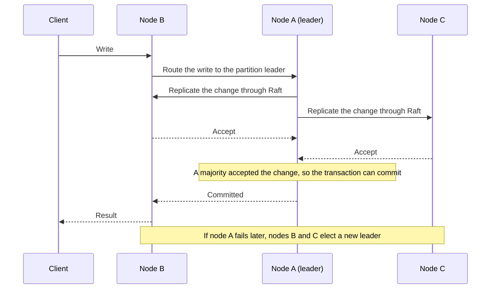

# Cluster mode

CamusDB runs standalone by default: one process on one machine. A standalone
node is simple, but it is a single point of failure. If the machine stops, the
database stops. If the disk fails, the data that is not in a backup is lost.

Cluster mode runs CamusDB on several nodes that act as one database. It keeps a
copy of each write on more than one node. The database therefore continues to
serve reads and writes when one node fails, and no committed write is lost.

## Why use cluster mode

Use cluster mode when one of these needs applies:

- **High availability.** The application must continue to work when a machine
  fails, restarts for maintenance, or loses its network. A three-node cluster
  continues to commit while one node is down.
- **Durability on more than one machine.** A write must survive the loss of a
  disk or a whole server. CamusDB confirms a commit only after a
  [majority](/docs/concepts#majority) of the nodes holds the change. By default
  every node holds every partition. When you set `kahuna.replication_factor`,
  each partition lives on that many nodes, and the majority is of those
  [replicas](/docs/concepts#replica-and-replication-factor).
- **More capacity.** One machine has a limit on CPU, memory, and disk. A cluster
  spreads the data and the work across several machines. See
  [Key-range sharding](/docs/key-range-sharding) and
  [Distributed queries](/docs/distributed-queries).

You do not need cluster mode for local development, for a tutorial, or for a
quick test. A standalone node is enough, and it starts with one command. The SQL
and the transaction guarantees are the same in both modes, so an application
can move from standalone to a cluster without a change to its queries.

## How cluster mode works

Cluster mode does three things:

1. It divides the data across the nodes into
   [partitions](/docs/concepts#partition). A partition is one part of the
   [key space](/docs/concepts#key-space) of the database.
2. It elects one [leader](/docs/concepts#leader) for each partition. The leader
   coordinates the writes to that partition.
3. It replicates each write through the
   [Raft](/docs/concepts#raft) consensus algorithm. Consensus means that a
   majority of the copies of a partition agree on each change before CamusDB
   commits it.

[How distribution works](#how-distribution-works) and
[Multi-active availability](#multi-active-availability) give the details.

To run a cluster on Kubernetes, use the
[Kubernetes Operator](/docs/kubernetes-operator). It creates the nodes and
manages their membership for you.

CamusDB is in production use. Cluster mode is nevertheless an alpha feature. The
APIs and the storage formats can change between versions.

## Run a standalone node

Standalone is the default. It needs no cluster configuration:

```bash
dotnet tool install --global CamusDB.Server
camusdb
```

Use standalone mode for a local tutorial, for a quick experiment, and for
single-node development.

## Run a local cluster

The source repository includes a Docker Compose file for a cluster of three
nodes:

```bash
docker compose -f docker/local.yml up --build
```

The three nodes start on a private bridge network:

| Node | HTTP SQL endpoint | HTTPS endpoint | gRPC endpoint | Raft port |
| --- | --- | --- | --- | --- |
| `camus1` | `localhost:5095` | `localhost:7141` | `localhost:6095` | `7070` |
| `camus2` | `localhost:5096` | `localhost:7142` | `localhost:6096` | `7072` |
| `camus3` | `localhost:5097` | `localhost:7143` | `localhost:6097` | `7074` |

Point `camus-cli` at any one of the three nodes. These are the host ports. Inside
the network, every node listens on the defaults: HTTP `5095`, gRPC `5096`, and
HTTPS `7141`. The gRPC API for clients is on by default. Configure it per node
with `grpc_enabled` and `grpc_port`.

## Run a cluster node manually

Each node needs five values: `--mode=cluster`, a unique node name, its Raft host
and port, the partition count, and the Raft address of every other node. List
only the other nodes, never the node itself. Put these values in a `config.yml`
file, or pass them as flags. This is the first of three nodes, one per machine:

```bash
camusdb \
  --mode=cluster \
  --raft-nodename=camus-1 \
  --raft-host=192.168.1.10 \
  --raft-port=7070 \
  --http-port=5095 \
  --initial-cluster-partitions=3 \
  --initial-cluster 192.168.1.11:7070 192.168.1.12:7070 \
  --http-peers 192.168.1.11:5095 192.168.1.12:5095
```

The other two nodes run the same command with their own name and host, and list
the remaining two addresses.

| Flag | Purpose |
| --- | --- |
| `--config` | Explicit YAML configuration file. A missing explicit file is a startup error. |
| `--mode` | `standalone` or `cluster`. |
| `--raft-nodename` | Unique node name in the cluster. |
| `--raft-nodeid` | Numeric Raft node id. |
| `--raft-host` | Host address for Raft communication. |
| `--raft-port` | Port for Raft communication. |
| `--http-port` | Listener port of the HTTP API. |
| `--initial-cluster` | Raft address of every other node, in `host:port` form. Do not include the node itself. |
| `--initial-cluster-partitions` | Number of Raft partitions to initialize. |
| `--http-peers` | HTTP endpoint of each peer, in the same order as `--initial-cluster`. |

A flag overrides the equivalent YAML value only when you supply the flag. The
same settings in YAML look like this:

```yaml
data_dir: /data/
mode: cluster
node_name: camus-1
raft_host: 192.168.1.10
raft_port: 7070
initial_partitions: 3
http_port: 5095
peers:
  - 192.168.1.11:7070
  - 192.168.1.12:7070
http_peers:
  - 192.168.1.11:5095
  - 192.168.1.12:5095
```

Give each node its own persistent `data_dir`. The Docker Compose setup mounts a
separate volume for each node.

See [Configuration](/docs/configuration) for every YAML key and every flag.

## How distribution works

- CamusDB divides the data across the Raft partitions.
- Each partition elects its own leader.
- Every node exposes the database API.
- CamusDB routes a read and a write to the partition that owns the target key
  range.
- A read sees only committed row versions. CamusDB keeps several versions of
  each row ([MVCC](/docs/concepts#mvcc)), so a read sees a consistent snapshot.
- A write uses locks, [write intents](/docs/concepts#write-intent) (provisional
  values that become visible only at commit), and atomic commit.
- A write across more than one partition uses
  [two-phase commit](/docs/concepts#two-phase-commit).

Every row of a table lives under the same key prefix. An ordered table scan
therefore still works. The storage layer handles the partition ownership and the
replication.

By default, the node that receives a query executes the whole query. It reads a
remote page through the storage locator. Turn
[distributed queries](/docs/distributed-queries) on to change that behavior.
CamusDB then divides an eligible scan into one fragment per partition. It runs
each fragment on the node that owns the rows. It therefore applies the filters
and the aggregates before the data crosses the network.

## Multi-active availability

There is no single active process that can fail. An application talks to any
node that it can reach. CamusDB routes each write to the leader that can commit
it safely.

Two older models make the contrast clear:

| Model | Write path | Failure behavior |
| --- | --- | --- |
| Active/standby | One active node | A standby must become active before writes continue |
| Classic active-active | Any node | Needs conflict resolution to prevent a divergent state |
| CamusDB | Any node, routed to the partition leader | The remaining members of the partition elect a new leader |

A write on a three-node cluster with one partition follows these steps:

1. Node A is the partition leader.
2. A client sends a write to node B.
3. CamusDB routes the write to node A.
4. Node A replicates the change through Raft.
5. The transaction can commit after a majority accepts the change.
6. Nodes B and C elect a new leader if node A fails later.



### Consistency before split-brain writes

A partition needs enough healthy members to reach consensus. It stops all
commits when it cannot reach consensus. It does not accept a change that could
conflict with another copy of the same data.

Availability is useful only while the data stays correct. CamusDB therefore
takes the unavailable side of that trade.

Serializable isolation is the default in a cluster, exactly as it is on one
node. See [Transactions And Isolation](/docs/serializable-transactions) for the
guarantees. See
[Distributed Transactions And HLC](/docs/distributed-transactions) for the
cross-partition commit protocol.

Configuration uses the same machinery. CamusDB commits a setting from
[`SET CLUSTER SETTING`](/docs/runtime-cluster-settings) through Raft, on its own
partition. Every node therefore applies the settings in the same order. A node
that was down catches up on replay. There is no rolling restart, and no node
keeps a stale value.

## Transfer partition leadership

Operators and reliability tests can ask the current leader of a data partition
to hand leadership to another replica:

```http
POST /v1/cluster/transfer-leadership
Content-Type: application/json

{ "partitionId": 1, "targetEndpoint": "10.0.0.3:7072" }
```

The request is a graceful handoff, not a crash failover. Send it to the node
that currently leads the partition. `targetEndpoint` is the replica's Raft
address (`raft_host:raft_port`), as shown in the placement table. The target
must host the partition as a [voter](/docs/concepts#learner-and-voter), a
replica that takes part in elections and commits.

The response returns `200` when the target is observed as leader before the call
returns. A non-success handoff returns `409` with a body that includes `status`
and `reason`, such as `NodeIsNotLeader`, `LeaderAlreadyElected`, or `Refused`.

With authentication enabled, the endpoint requires a superuser. With
authentication disabled, it is loopback-only, like other cluster mutation
routes.
