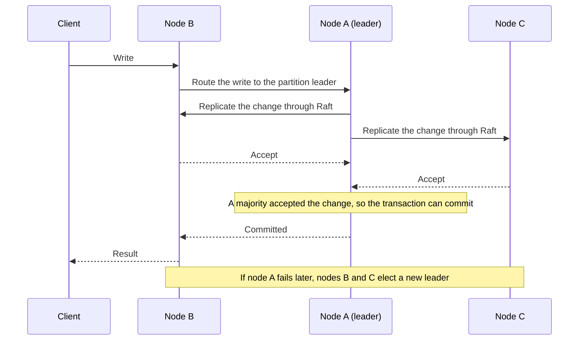

# Cluster mode

In cluster mode, several CamusDB nodes act as one database. Each write is stored
on more than one node. This means that the database continues to serve reads
and writes when one node fails, and no committed write is lost.

By default, CamusDB is standalone: one process on one machine. A standalone
node is simple, but it is a single point of failure. If the machine stops, the
database stops. If the disk fails, the data that is not in a backup is lost.

## When to use cluster mode

Use cluster mode when one of these needs applies:

- **No single point of failure.** With one database server, a failed machine or
  network link stops the application. A cluster has no primary node to
  lose: any node serves requests, and each partition has copies on several
  nodes. When a node fails or restarts for maintenance, the remaining replicas
  elect new leaders for the partitions it led. A three-node cluster continues to
  commit while one node is down.
- **Durability on more than one machine.** A write must survive the loss of a
  disk or a server. A commit is confirmed after a
  [majority](/docs/concepts#majority) of the nodes has the change. By default,
  each node has a copy of all partitions. When you set
  `kahuna.replication_factor`, each partition lives on that many nodes, and the
  majority is of those
  [replicas](/docs/concepts#replica-and-replication-factor).
- **Room to grow.** One machine has a limit on its resources. A cluster
  can grow past three nodes to survive more failures, or to spread the data and
  the work across more machines. See
  [Choose the number of nodes](#choose-the-number-of-nodes).

You don't need cluster mode for local development or tests. A standalone node
is enough, and it starts with one command. SQL and transaction
guarantees are the same in both modes. This means that an application can move
from standalone to a cluster with the same queries.

If you expect to grow from one machine, start in cluster mode now. Other nodes
can't join a standalone node. The SQL doesn't change when you move, but the
data needs an export and a reimport. See [Grow a one-node cluster](/docs/growing-a-one-node-cluster)
for the join sequence and quorum considerations.

### Choose the number of nodes

Three nodes is the smallest cluster that survives a node failure. The number of
nodes isn't limited by a setting. Size the cluster for your workload, and load
test at the size you plan to run.

What more nodes give you depends on `kahuna.replication_factor`. The layouts
below are examples:

| Cluster | Replicas per partition | Nodes that can fail | What you get |
| --- | --- | --- | --- |
| 3 nodes, default | 3 | 1 | The smallest layout with no single point of failure. |
| 5 nodes, default | 5 | 2 | More failures survived. Each node stores all the data, and each write waits for 3 of the 5 replicas. |
| 5 or more nodes, `replication_factor: 3` | 3 | 1. If 2 fail together, only the partitions with 2 replicas on those nodes stop. | Each new node takes a share of the partitions, and each node stores less. |

So choose by goal:

- **To survive more failures, add replicas.** Keep the number odd: four replicas
  tolerate one failure, the same as three.
- **To add capacity, add nodes and set a replication factor below the node
  count.** With the default full replication, a new node is one more copy of
  all data. It doesn't add storage or write capacity.

For a larger cluster with a replication factor, set these keys on each node:

```yaml
kahuna:
  replication_factor: 3
  enable_placement_rebalancer: true
  zone: rack-1
```

- `replication_factor` is the number of replicas of each partition. If you set
  it on a cluster that already uses full replication, the rebalancer reduces the
  existing partitions to that number. If the rebalancer is off, the partitions
  remain on all nodes.
- `enable_placement_rebalancer` moves replicas to new nodes and repairs ranges
  that lost a replica. It is off by default.
- `zone` is the rack or availability zone of the node. CamusDB tries to spread
  the replicas of each range across zones. Then a zone outage leaves a majority.
  The spread is best effort: the balance of replicas between nodes can take
  priority. Check the result with [`SHOW RANGES`](/docs/show-ranges). Use
  three or more zones: with two, one zone must hold a majority of the replicas.

The number of partitions also limits how far a cluster spreads. With a factor of
3, three partitions have nine replicas in total. A tenth node then has no data
to host. `initial_partitions` is fixed when the cluster is created. Plan for the
size that you expect. By default, a table is on one partition. This means that
more nodes don't help a single busy table. See
[Key-range sharding](/docs/key-range-sharding) and
[Distributed queries](/docs/distributed-queries).

Two more points keep a failure from stopping your application:

- Put the nodes on separate machines, and preferably in separate racks or zones.
  Nodes that share a machine or a power supply fail together.
- Give the application more than one way to reach the cluster. List several
  endpoints in the driver's connection string, or use a load balancer. One
  fixed node address is also a single point of failure. A request that was in
  progress on the failed node can fail. Handle that error in the application.
  See [Connection model](/docs/connection-model).

You can add nodes to a running cluster. A new node joins as a
[learner](/docs/concepts#learner-and-voter). When it has caught up, it becomes
a voter. See [Grow a one-node cluster](/docs/growing-a-one-node-cluster), or
[scale with the Kubernetes Operator](/docs/kubernetes-operator#scale-manually).

## How cluster mode works

In cluster mode, CamusDB:

1. Divides the data across the nodes into
   [partitions](/docs/concepts#partition). A partition is one part of the
   database's [key space](/docs/concepts#key-space).
2. Elects one [leader](/docs/concepts#leader) for each partition. The leader
   coordinates writes to that partition.
3. Replicates each write through the [Raft](/docs/concepts#raft) consensus
   algorithm. Consensus means that a majority of a partition's copies agree on
   each change before CamusDB commits it.

[How distribution works](#how-distribution-works) and
[Multi-active availability](#multi-active-availability) give the details.

To run a cluster on Kubernetes, use the
[Kubernetes Operator](/docs/kubernetes-operator). It creates the nodes and
manages their membership for you.

CamusDB is [in production at Bacon Games](/blog/camusdb-in-production-at-bacon-games). Cluster mode continues
to evolve, and APIs and storage formats can change between versions.

## Run a standalone node

Standalone is the default. It needs no cluster configuration:

```bash
dotnet tool install --global CamusDB.Server
camusdb
```

Use standalone mode for tutorials and for development on one node.

## Run a local cluster

### Start with Aspire

For an easy way to try a cluster or develop an application against it, use the
[.NET Aspire integrations](/docs/aspire#run-a-local-cluster). The AppHost starts
three containers with their peers and Raft certificates. It also creates your
database and gives the node endpoints to your service. You can inspect
health and stop or restart nodes from the Aspire dashboard.

The ready-to-run Notes example needs Docker and the .NET 10 SDK:

```bash
git clone https://github.com/camusdb/camusdb-aspire.git
cd camusdb-aspire
dotnet run --project examples/ClusterExample/ClusterExample.AppHost
```

Open the API's **Notes** URL in the dashboard after the resources become
healthy. Add notes, and stop one node. The other two nodes continue to serve
requests. Restart the node to see it catch up. Each node has a separate
persistent volume. However, all nodes are on your machine. Use this setup for
development only. For more information, see the
[Aspire example](/docs/aspire#try-the-three-node-notes-example).

### Run nodes manually

To try replication on one machine, start three nodes of the `CamusDB.Server`
tool, each in a separate terminal. Install the tool as shown in
[Run a standalone node](#run-a-standalone-node).

Nodes connect to each other over TLS. The Raft port needs a certificate that
the other nodes trust. If it's missing, the nodes can't connect, and no
partition elects a leader. On a development machine, trust the .NET development
certificate and export it as a PFX file:

```bash
mkdir -p ~/camus-cluster && cd ~/camus-cluster
dotnet dev-certs https --trust
dotnet dev-certs https -ep localhost.pem --format PEM --no-password
openssl pkcs12 -export -in localhost.pem -inkey localhost.key \
  -out localhost.pfx -passout pass:
```

CamusDB loads the PFX file, which must not have a password. `dotnet dev-certs`
puts the private key in a PFX file if you give it a password. For this reason,
these commands export PEM and convert it with OpenSSL. On Linux, `--trust` works
on some distributions only. If it fails, add `localhost.pem` to the system trust
store.

Start the nodes. Each node has a separate name, ID, port set, and data
directory. It lists the other two nodes in `--initial-cluster` and
`--http-peers`. Use
absolute paths for the files:

```bash
# Terminal 1
camusdb \
  --mode=cluster \
  --raft-nodename=camus1 --raft-nodeid=1 \
  --raft-host=localhost --raft-port=7070 \
  --raft-certificate=$HOME/camus-cluster/localhost.pfx \
  --http-port=5095 --grpc-port=6095 \
  --https-port=7141 --https-certificate=$HOME/camus-cluster/localhost.pfx \
  --data-dir=$HOME/camus-cluster/node1-data \
  --initial-cluster-partitions=3 \
  --initial-cluster localhost:7072 localhost:7074 \
  --http-peers localhost:5096 localhost:5097

# Terminal 2
camusdb \
  --mode=cluster \
  --raft-nodename=camus2 --raft-nodeid=2 \
  --raft-host=localhost --raft-port=7072 \
  --raft-certificate=$HOME/camus-cluster/localhost.pfx \
  --http-port=5096 --grpc-port=6096 \
  --https-port=7142 --https-certificate=$HOME/camus-cluster/localhost.pfx \
  --data-dir=$HOME/camus-cluster/node2-data \
  --initial-cluster-partitions=3 \
  --initial-cluster localhost:7070 localhost:7074 \
  --http-peers localhost:5095 localhost:5097

# Terminal 3
camusdb \
  --mode=cluster \
  --raft-nodename=camus3 --raft-nodeid=3 \
  --raft-host=localhost --raft-port=7074 \
  --raft-certificate=$HOME/camus-cluster/localhost.pfx \
  --http-port=5097 --grpc-port=6097 \
  --https-port=7143 --https-certificate=$HOME/camus-cluster/localhost.pfx \
  --data-dir=$HOME/camus-cluster/node3-data \
  --initial-cluster-partitions=3 \
  --initial-cluster localhost:7070 localhost:7072 \
  --http-peers localhost:5095 localhost:5096
```

The nodes listen on these ports:

| Node | HTTP SQL endpoint | HTTPS endpoint | gRPC endpoint | Raft port |
| --- | --- | --- | --- | --- |
| `camus1` | `localhost:5095` | `localhost:7141` | `localhost:6095` | `7070` |
| `camus2` | `localhost:5096` | `localhost:7142` | `localhost:6096` | `7072` |
| `camus3` | `localhost:5097` | `localhost:7143` | `localhost:6097` | `7074` |

When each partition has a leader, write through one node and read through
another:

```bash
camus-cli -c "Endpoint=http://localhost:5095" -e "CREATE DATABASE shop"
camus-cli -c "Endpoint=http://localhost:5095;Database=shop" \
  -e "CREATE TABLE orders (id INT64 PRIMARY KEY NOT NULL, total FLOAT64); INSERT INTO orders (id, total) VALUES (1, 42.5)"
camus-cli -c "Endpoint=http://localhost:5097;Database=shop" -e "SELECT * FROM orders"
```

The client gRPC port uses the Raft certificate. Connect to it with `https://`,
for example
`Endpoint=https://localhost:6096;Database=shop;Protocol=grpc`. Press `Ctrl+C`
in each terminal to stop the nodes. For a stop from a script, send `SIGTERM`.
See [Graceful shutdown](#graceful-shutdown).

This layout is for local testing only. Peer HTTP traffic is plaintext, and the
nodes do not authenticate each other. For production, see
[Configuration](/docs/configuration).

## Run a cluster node manually

Each node needs the following values, in a `config.yml` file or as flags:

- `--mode=cluster` and a unique node name.
- Its Raft host and port.
- The partition count.
- The Raft address of each other node. Don't list the node itself.

Nodes connect to each other over TLS. This means that each node needs a
certificate for its Raft port. The certificate must name the node's Raft host,
and all other nodes must trust it. For example, use a certificate that a CA
trusted by all nodes signed. This is the first of three nodes, one per machine:

```bash
camusdb \
  --mode=cluster \
  --raft-nodename=camus-1 \
  --raft-host=192.168.1.10 \
  --raft-port=7070 \
  --raft-certificate=/etc/camusdb/node.pfx \
  --http-port=5095 \
  --initial-cluster-partitions=3 \
  --initial-cluster 192.168.1.11:7070 192.168.1.12:7070 \
  --http-peers 192.168.1.11:5095 192.168.1.12:5095
```

The other two nodes run the same command with their own name and host, listing
the remaining two addresses.

| Flag | Purpose |
| --- | --- |
| `--config` | Explicit YAML configuration file. A missing explicit file is a startup error. |
| `--mode` | `standalone` or `cluster`. |
| `--raft-nodename` | Unique node name in the cluster. |
| `--raft-nodeid` | Numeric Raft node id. |
| `--raft-host` | Host address for Raft communication. |
| `--raft-port` | Port for Raft communication. |
| `--raft-certificate` | PFX certificate for the Raft port. It must not have a password. The client gRPC port also uses it unless `grpc_certificate` is set. |
| `--http-port` | HTTP API listener port. |
| `--grpc-port` | Client gRPC API port. |
| `--initial-cluster` | Raft address of each other node, in `host:port` form. Don't include the node itself. |
| `--initial-cluster-partitions` | Number of Raft partitions to initialize. |
| `--http-peers` | HTTP endpoint of each peer, in the same order as `--initial-cluster`. |

A flag that you supply overrides the equivalent YAML value. The same
settings in YAML look like this:

```yaml
data_dir: /data/
mode: cluster
node_name: camus-1
raft_host: 192.168.1.10
raft_port: 7070
raft_certificate: /etc/camusdb/node.pfx
initial_partitions: 3
http_port: 5095
peers:
  - 192.168.1.11:7070
  - 192.168.1.12:7070
http_peers:
  - 192.168.1.11:5095
  - 192.168.1.12:5095
```

Give each node a separate persistent `data_dir`.

For all YAML keys and flags, see [Configuration](/docs/configuration).

## How distribution works

- CamusDB divides the data across the Raft partitions.
- Each partition elects a leader.
- All nodes serve the database API.
- CamusDB routes reads and writes to the partition that owns the target key
  range.
- Reads see committed row versions only. Several versions of each row are
  stored ([MVCC](/docs/concepts#mvcc)). This means that a read sees a
  consistent snapshot.
- Writes use locks, [write intents](/docs/concepts#write-intent) (provisional
  values that become visible only at commit), and atomic commit.
- A write across more than one partition uses
  [two-phase commit](/docs/concepts#two-phase-commit).

All rows of a table are under the same key prefix. This means that ordered
table scans work. The storage layer handles partition ownership and replication.

By default, the node that receives a query executes it, and it reads the remote
pages over the network. With [distributed queries](/docs/distributed-queries)
turned on, an eligible scan is split into one fragment for each partition. Each
fragment is executed on the node that owns the rows. This means that filters
and aggregates are applied before the data crosses the network.

## Multi-active availability

There is no single active process that can fail. An application talks to any
node it can reach, and CamusDB routes each write to the leader that can commit
it safely.

Compare this with older models:

| Model | Write path | Failure behavior |
| --- | --- | --- |
| Active/standby | One active node | A standby must become active before writes continue |
| Classic active-active | Any node | Needs conflict resolution to prevent a divergent state |
| CamusDB | Any node, routed to the partition leader | The remaining members of the partition elect a new leader |

A write on a three-node cluster with one partition follows these steps:

1. Node A is the partition leader.
2. A client sends a write to node B.
3. CamusDB routes the write to node A.
4. Node A replicates the change through Raft.
5. The transaction can commit after a majority has the change.
6. Nodes B and C elect a new leader if node A fails later.



### A partition without a majority stops committing

A partition needs enough healthy members to reach consensus. When it can't
reach consensus, it stops all commits. A change that could conflict with another
copy of the same data is never accepted.

Serializable isolation is the default in a cluster, exactly as on one node. See
[Transactions And Isolation](/docs/serializable-transactions) for the guarantees
and [Distributed Transactions And HLC](/docs/distributed-transactions) for the
cross-partition commit protocol.

Cluster settings use the same mechanism. Each
[`SET CLUSTER SETTING`](/docs/runtime-cluster-settings) change is committed
through Raft on a separate partition. This means that all nodes apply the
settings in the same order, and a node that was down catches up when it
restarts. You don't need a rolling restart.

## Check storage health

Use `GET /v1/cluster/health` to keep a node with detected storage damage out of
service. A reported store or partition storage fault makes `ready` false and
the endpoint returns HTTP 503. Inspect the response body as well as its status.

The response has the following fields:

| Field | Meaning |
| --- | --- |
| `ready`, `initialized` | Whether the node can serve requests. |
| `commitStalled` | `true` when a partition on this node has a replica that can't catch up, through backfill or a snapshot. Use it for alerts. |
| `stalledPartitions` | The partitions with such a replica. |
| `storageFault` | The fault message of the storage engine. |
| `partitionStorageFaults` | The storage faults of the hosted partitions. |

The fault messages can include file paths. With authentication enabled, a user
that isn't a superuser sees `ready`, `initialized`, and `commitStalled` only.

A read that finds damage returns `CADB0837 StorageCorrupted`, with HTTP 500 or
gRPC `DATA_LOSS`. The error isn't retryable. Don't treat it as an empty result.
Detection and reporting cover RocksDB and Solarium; see
[backend limits and recovery policy](/docs/configuration#storage-damage-and-lost-log-entries).
This endpoint does not perform an integrity scan or repair damaged storage.

## Graceful shutdown

When a cluster node stops normally, for example after `Ctrl+C` or `SIGTERM`, it
hands the leadership of its data partitions to other nodes. The peer
connections are open at that time. This means that the partitions don't
wait for an election, and a rolling restart has shorter pauses. The log shows
the result:

```text
info: CamusDB.App.Services.LeadershipHandoffService[0] Handed off leadership of 1 of 1 partitions before stopping
info: CamusDB.App.Services.LeadershipHandoffService[0] Closed 8 peer connections before stopping
```

The handoff has a time limit of 8 seconds. A partition that isn't handed off in
time elects a new leader, as does the system partition. Then the node waits up
to 10 seconds for its client connections to close, and it closes the peer
connections. The full stop has a limit of 15 seconds.

Give the process time to stop normally. Note that a forced stop, such as
`kill -9`, skips the handoff. The partitions then elect new leaders, and the
node uses crash recovery at the next start.

## Transfer partition leadership

Operators and reliability tests can ask a data partition's current leader to
hand leadership to another replica:

```http
POST /v1/cluster/transfer-leadership
Content-Type: application/json

{ "partitionId": 1, "targetEndpoint": "10.0.0.3:7072" }
```

The request asks for a planned handoff. Send it to the node that currently leads
the partition. `GET /v1/cluster/placement` shows `leaderLocal` for each
partition on the node that you ask. `targetEndpoint` is the Raft address
(`raft_host:raft_port`) of a node that hosts the partition as a
[voter](/docs/concepts#learner-and-voter), a replica that takes part in
elections and commits.

The response is `200` when the target is the leader before the call returns:

```json
{"success":true,"status":"Success","partitionId":2,"targetEndpoint":"localhost:7072","reason":null}
```

A handoff that doesn't succeed returns `409`, with a `status` and a `reason`:

| `status` | Cause |
| --- | --- |
| `NodeIsNotLeader` | The node doesn't lead the partition. Send the request to its leader. |
| `LeaderAlreadyElected` | The leadership moved to another replica during the handoff. |
| `Refused`, `Errored` | The target can't take the leadership. For example, it doesn't host the partition. |

With authentication enabled, the endpoint requires a superuser. With
authentication disabled, it is loopback-only, like other cluster mutation
routes.
