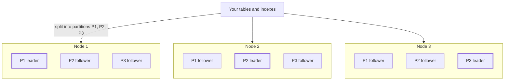

# Key concepts

This page defines the distributed database terms that these docs, error
messages, and [`SHOW RANGES`](/docs/show-ranges) use.
These terms help you predict what happens when a node fails, why a commit takes
the time it does, and when your application must retry.

## How a three-node cluster stores data

A three-node cluster with default settings looks like this:



CamusDB splits the data into three partitions. Each node has a copy of each
partition. This means that each partition has three replicas. Each partition
elects one leader, which orders its writes. Two partitions can elect the same
node as their leader. The diagram shows data partitions only.

## Cluster and replication

### Node and cluster {#node-and-cluster}

A node is one CamusDB process with a data directory. A cluster is a group of
nodes, configured as peers, that act as one database. You can send SQL to any
node of a cluster.

By default, CamusDB starts in standalone mode: one node, one data partition, and
no peers. The SQL and the transaction guarantees are the same in both modes. For
more information, see [Cluster mode](/docs/cluster).

### Partition {#partition}

A partition is a part of the stored data with a separate replicated log and a
separate leader. It is the unit of replication.

You don't declare a partition, as you would a PostgreSQL table partition.
CamusDB places each table on a partition for you. The `initial_partitions`
setting sets the number of data partitions: 3 by default in cluster mode, and 1
in standalone mode. There is also an internal system partition for cluster
metadata. The `partition_id` column of [`SHOW RANGES`](/docs/show-ranges) shows
which partition serves a table or an index.

### Replica and replication factor {#replica-and-replication-factor}

A replica is one node's copy of a partition. The replication factor is the
number of replicas of each partition.

By default, CamusDB uses full replication: when `kahuna.replication_factor`
isn't set, each voting node hosts all partitions. A three-node cluster
therefore stores three copies of all data. If you set
`kahuna.replication_factor: 3` on a five-node cluster, each partition is stored
on three of the five nodes. Each node then stores less data, and a write waits
for a majority of that partition's three replicas. You should use an odd number.

In PostgreSQL, replication copies a full server to its standbys. In CamusDB,
each partition replicates separately. An empty `replicas` column in
[`SHOW RANGES`](/docs/show-ranges) means full replication. For more information,
see [Cluster mode](/docs/cluster) and [Configuration](/docs/configuration).

### Raft {#raft}

Raft is the consensus algorithm that makes the replicas of a partition
identical. Consensus means that the replicas agree on one ordered list of
changes, the log, even when nodes crash or messages are lost.

Each partition has a Raft group. The leader proposes each change, and the
followers store it. The change commits when a majority of the replicas has
persisted it. You don't call Raft directly. You see its effects as leader
changes, as retries during an election, and as commit latency that includes a
network round trip to other replicas. CamusDB uses [Kommander](#kommander) for
Raft.

### Leader {#leader}

The leader is the replica that coordinates the writes of a partition at a given
time. The other replicas are followers. You don't need to know which node is
the leader. You can send SQL to any node, and CamusDB routes each write to the
leader of the partition that owns the key.

PostgreSQL has one primary per server, and failover needs extra tools. In
CamusDB, each partition has a separate leader. When a leader fails, the other
voters of that partition elect a new leader automatically. Writes to that
partition wait during the election. If a statement can't finish within the
internal retries, it returns `CADB0504` `TransactionMustRetry`. Run the
transaction again from `BEGIN`. For more information, see
[Retries and conflicts](/docs/serializable-retries).

By default, CamusDB doesn't move leaders to spread load. To do that, turn on
`kahuna.enable_leader_balancer`, or move one leader with
[a leadership transfer](/docs/cluster#transfer-partition-leadership). The
`leader` column of [`SHOW RANGES`](/docs/show-ranges) is a hint, because the
leader can change after you read it.

### Majority {#majority}

A majority, or quorum, is more than half of the voting replicas of a partition.
A write commits after a majority has persisted it, and a new leader needs votes
from a majority.

| Voting replicas | Majority | Replicas that can fail |
| --- | --- | --- |
| 1 | 1 | 0 |
| 2 | 2 | 0 |
| 3 | 2 | 1 |
| 5 | 3 | 2 |

Two replicas can't survive a failure, and four replicas can survive one, the
same as three. This is why odd numbers work best. A partition that loses its
majority stops committing. This prevents two copies that disagree. With full
replication, if you lose most nodes, all partitions stop. With a replication
factor, the partitions whose replicas you lost stop, and the other partitions
continue. For more information, see
[A partition without a majority stops committing](/docs/cluster#a-partition-without-a-majority-stops-committing).

### Learner and voter {#learner-and-voter}

A voter is a replica that counts toward the majority and votes in elections. A
learner receives the log but doesn't count.

A new node joins the cluster as a learner. It copies the data, and when it has
been up to date for a short time, it becomes a voter. A new replica of a
partition follows the same path. This means that a node that is far behind
can't slow down or block the commits of the other replicas. The
[Kubernetes Operator](/docs/kubernetes-operator) shows each member as `Voter` or
`Learner`. A leadership transfer can target a voter only.

## How data is placed

### Key space {#key-space}

CamusDB stores all data, including rows and indexes, as key/value pairs. A key prefix
groups related keys. The keys of a database start with the database ID, and the
keys of a table start with `{databaseId}:{tableId}`.

A key space is the set of keys that share one prefix up to the last `/`. The
rows of a table form one key space, `{databaseId}:{tableId}|r`. Each secondary
index forms another one, `{databaseId}:{tableId}|i:{indexId}`. You can think of
a key space as the PostgreSQL file of one table or one index. Routing works on
key spaces, and the `key_space` column of `SHOW RANGES` shows them. For the full
layout, see [Storage](/docs/storage#key-layout).

### Ranges and spans {#ranges-and-spans}

A range is a continuous part of a key space, from a start key to an end key,
that one partition serves. With hash routing, a key space is a single range that
covers all its keys. With key-range routing, a key space starts as one range and
can split into child ranges that different partitions serve.

Splits are off by default. To turn them on, set `kahuna.range_split_threshold`
for size, or `kahuna.range_split_load_threshold` for load. While part of a range
moves, writes to it return the retryable error `CADB0504`. For more information,
see [Automatic splits](/docs/key-range-sharding#automatic-splits).

A span is a continuous run of keys between two bounds. A scan reads a span, and
a serializable scan locks the span that it reads. This prevents phantoms (rows
that another transaction inserts into a range that you already read).
[`SHOW RANGES`](/docs/show-ranges) returns one row per span. Its `span` column
is a position, and it can change between two calls. To compare the output of
two calls, use `partition_id`.

### Hash and key-range routing {#hash-and-key-range-routing}

Routing decides which partition serves a key.

- **Hash routing** is the default. CamusDB hashes the table prefix, and the
  rows and indexes of a table are on one partition. Different tables spread
  across partitions, but one table can't.
- **Key-range routing** (`key_range_sharding: true`) divides the rows and each
  eligible index into ranges that can split and move to other partitions. One
  large or busy table can then use several leaders. The setting applies at
  restart, and it must be the same on all nodes.

A query returns the same rows with both modes. The placement and the network
cost change. The `routing` column of [`SHOW RANGES`](/docs/show-ranges) shows
`hash` or `key_range`. For more information, see
[Key-range sharding](/docs/key-range-sharding).

## Time and versions

### Write-ahead log {#wal}

Like PostgreSQL, CamusDB writes each change to a write-ahead log (WAL) before it
applies the change to the stored data. However, each partition has a separate
log, and Raft replicates it.

An entry goes through two states:

- **Proposed.** The leader writes the entry to its log when it proposes it.
- **Committed.** The entry commits when a majority of the partition's replicas
  has persisted it. CamusDB then applies it and confirms the write to the
  client.

After a crash, a node replays the committed entries that weren't applied to the
stored data yet. Standalone mode uses the same log, and the single replica is
the majority. For more information, see [WAL and recovery](/docs/wal-recovery).

### MVCC {#mvcc}

With multiversion concurrency control (MVCC), a write creates a new version of a
key and leaves the old version in place. Kahuna calls these versions revisions.
Each committed revision has the [HLC](#hlc) timestamp of its commit. A read
picks a snapshot timestamp and sees, for each key, the newest committed revision
at that time. A read doesn't see uncommitted data.

PostgreSQL retains old row versions until `VACUUM` removes them. CamusDB removes
old revisions in the background. By default, it retains them for the
point-in-time recovery window, `kahuna.pitr_window_seconds` (3600 seconds). Set
`kahuna.persistent_revision_retention_age_seconds` for a longer age, or
`kahuna.persistent_revision_retention_count` for a maximum number per key. A
snapshot older than the retention isn't guaranteed. This limits
[time-travel reads](/docs/time-travel-reads). For more information, see
[Configuration](/docs/configuration#persistent-mvcc-revision-retention).

### Hybrid logical clock {#hlc}

PostgreSQL orders transactions with one counter on one server. A cluster doesn't
have a single counter, and the wall clocks of different machines drift. CamusDB
orders events with a hybrid logical clock (HLC). An HLC timestamp is close to
wall-clock time, and all nodes agree on the order of the timestamps.

An HLC timestamp has three parts. You can see them in output such as
[`SHOW BRANCHES`](/docs/database-branching):

```text
HLC(1:1795038481949:17)
```

- `N` (here `1`) is the ID of the node that issued it.
- `L` (here `1795038481949`) is the physical wall-clock time in milliseconds.
- `C` (here `17`) is a logical counter for events in the same millisecond.

Timestamps sort by `L`, then `C`, then `N`. Transaction IDs, commit timestamps,
and MVCC revisions all use HLC timestamps. For more information, see
[Distributed transactions and HLC](/docs/distributed-transactions#how-hlc-timestamps-fit-in).

## Transactions

### Two-phase commit {#two-phase-commit}

When a transaction writes to more than one partition, one leader can't commit it
alone. Two-phase commit (2PC) solves this:

1. **Prepare.** The coordinator asks each participant to prepare. Each
   participant stores its changes durably as [prepared intents](#write-intent).
2. **Commit.** If all participants prepared, the coordinator records the commit
   decision, and the participants commit. If one participant failed, they all
   abort.

The coordinator is a Kahuna session that tracks the transaction. A participant
is a partition that has keys that the transaction wrote. The decision record is
stored on one partition, the anchor. When that record says commit, the
transaction commits even if the coordinator's node fails. Recovery completes the
other participants. If the coordinator disappears before a decision exists, the
transaction is aborted when the record's deadline passes. All SQL transactions
that write use this durable path, whatever the value of
`default_decision_durability`.

A transaction whose writes are all on one partition can often commit in a single
replicated round (`kahuna.one_phase_apply_time_validation`, on by default).

PostgreSQL has `PREPARE TRANSACTION` and `COMMIT PREPARED`, but you must run the
coordinator yourself. In CamusDB, `COMMIT` does it. For more information, see
[Distributed transactions and HLC](/docs/distributed-transactions) and
[Transaction internals](/docs/transactions-locking-internals#the-durability-of-a-commit-decision).

### Write intent {#write-intent}

A write intent is the provisional value that a transaction puts on a key that it
writes. It is also an exclusive lock, much like the row lock that PostgreSQL
takes on an updated row. With the default pessimistic locking, a second
transaction that writes the same key waits for at most `lock_wait_deadline_ms`.
After that, it returns a retryable error (`CADB0502` or `CADB0504`). A write
intent is stored in the memory of the partition leader, and it expires. This
means that an abandoned transaction can't lock a key forever.

A prepared intent is the durable form that the prepare phase of
[2PC](#two-phase-commit) writes. It goes through the partition log. This means
that another replica or a restarted node can rebuild it. Its value is
invisible until the decision says commit. A read whose snapshot is older than
the intent's commit timestamp sees the previous revision. A newer read that
finds an undecided intent retries. This prevents a stale value.

### Lease {#lease}

A lease is a claim that expires if its holder doesn't renew it. If the holder
crashes, the claim expires, and no process has to detect the crash first.
CamusDB uses three kinds:

- **Lock lease.** A lock has an expiry that the holder renews while it works. A
  range lock starts with `range_lock_expires_ms` (150000 ms), and the
  coordinator renews it while the transaction is open. Background work such as
  [row-level TTL](/docs/row-level-ttl) also uses leases to claim spans.
- **Session lease.** The coordinator session of each transaction has a timeout,
  `max_serializable_transaction_lifetime_ms` (one hour by default). If a client
  disappears before `COMMIT` or `ROLLBACK`, Kahuna removes the session after
  that timeout plus a short grace period. It then stops renewing the session's
  range locks. For more information, see
  [Transaction internals](/docs/transactions-locking-internals#the-lifetime-and-an-abandoned-transaction).
- **Sequence lease.** A node that caches a block of
  [sequence](/docs/sequences) values checks it against the durable counter when
  its lease of about five seconds expires. This is why `setval` and
  `ALTER SEQUENCE ... RESTART` can take about five seconds.

## Components

### Kahuna {#kahuna}

[Kahuna](https://kahunakv.github.io/) is the transactional key/value store that
CamusDB is built on. It provides MVCC and transactions, and it routes keys to
partitions. CamusDB embeds Kahuna in its process, and you don't
deploy a separate storage service. The SQL layer maps rows and indexes to keys,
and Kahuna stores them. Its settings are under `kahuna:` in `config.yml`. For
more information, see [Architecture](/docs/architecture).

### Kommander {#kommander}

[Kommander](https://kahunakv.github.io/kommander.github.io/) is the
[Raft](#raft) library that Kahuna uses. It elects the leader of each partition
and replicates the WAL. It is also part of the CamusDB process.

### RocksDB {#rocksdb}

[RocksDB](https://rocksdb.org/) is the embedded on-disk key/value engine that
stores the data of each node. It is the default for both the stored key/value
state (`kahuna.storage`) and the WAL (`kahuna.wal_storage`), in standalone and
cluster mode. RocksDB makes the data of one node durable. Replication and
consensus come from Kahuna and Kommander. SQLite and [Solarium](#solarium) are
optional alternative backends. For more information, see
[Storage](/docs/storage#the-rocksdb-backend).

### Solarium {#solarium}

[Solarium](https://solariumdb.github.io/) is an embedded key/value engine
written in C#. You can use it in place of RocksDB or SQLite for the stored
key/value state, the Raft WAL, or both. It doesn't need the native RocksDB
library. Its caches use both native memory and the .NET heap. Count both when
you size the memory of the node. For configuration and migration, see
[Solarium storage](/docs/storage#solarium-backend).

## Related topics

- [Architecture](/docs/architecture)
- [Cluster mode](/docs/cluster)
- [Storage](/docs/storage)
- [WAL and recovery](/docs/wal-recovery)
- [Distributed transactions and HLC](/docs/distributed-transactions)
- [Key-range sharding](/docs/key-range-sharding)
- [Time-travel reads](/docs/time-travel-reads)
- [Transaction internals](/docs/transactions-locking-internals)
