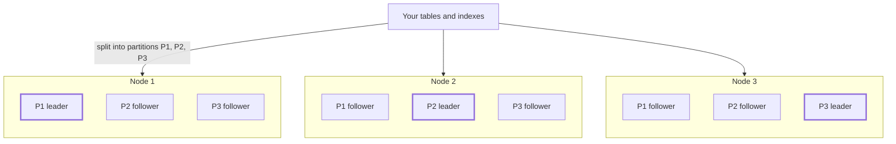

# Key concepts

CamusDB speaks SQL, and under that SQL runs a partitioned, replicated storage
layer. Words such as partition, leader, majority, and write intent appear across
these docs, in error messages, and in the output of
[`SHOW RANGES`](/docs/show-ranges). Knowing them helps you predict what happens
when a node fails, why a commit takes the time it does, and when your
application must retry.

Each term gets a short definition, a comparison with single-node PostgreSQL
where that helps, and a link to the page with the details.

## The big picture

A three-node cluster with default settings looks like this:



CamusDB splits the data into three partitions. Every node holds a copy of every
partition, so each partition has three replicas. Each partition elects one
leader, which orders its writes. An election decides which node leads each
partition, so two partitions can also end up with the same leader node. The
diagram shows data partitions only.

## Cluster and replication

### Node and cluster {#node-and-cluster}

A node is one running CamusDB process with its own data directory. A cluster is
a group of nodes, configured as peers, that act as one database. You can send
SQL to any node of a cluster.

CamusDB runs standalone by default: one node, one data partition, no peers.
Cluster mode (`mode: cluster`) is an alpha feature, so its APIs and storage
formats can change between versions. The SQL and the transaction guarantees are
the same in both modes. See [Cluster mode](/docs/cluster).

### Partition {#partition}

A partition is a slice of the stored data with its own replicated log and its
own leader. It is the unit of replication: CamusDB copies, orders, and recovers
data one partition at a time.

Unlike a PostgreSQL table partition, you never declare one. CamusDB places each
table on a partition for you. The `initial_partitions` setting decides how many
data partitions exist: 3 by default in cluster mode, 1 in standalone mode.
CamusDB also keeps an internal system partition for cluster metadata. The
`partition_id` column of [`SHOW RANGES`](/docs/show-ranges) tells you which
partition serves a table or an index.

### Replica and replication factor {#replica-and-replication-factor}

A replica is one node's copy of a partition. The replication factor is how many
replicas each partition has.

By default, CamusDB uses full replication: with `kahuna.replication_factor`
unset, every voting node hosts every partition. A three-node cluster therefore
keeps three copies of everything. Set `kahuna.replication_factor: 3` on a
five-node cluster, and each partition lives on three of those five nodes. Each
node then stores less, and a write waits for a majority of that partition's
three replicas. Prefer an odd number.

In PostgreSQL, replication copies a whole server to its standbys. In CamusDB,
each partition replicates on its own. An empty `replicas` column in
[`SHOW RANGES`](/docs/show-ranges) means full replication. See
[Cluster mode](/docs/cluster) and
[Configuration](/docs/configuration).

### Raft {#raft}

Raft is the consensus algorithm that keeps the replicas of a partition
identical. Consensus means that the replicas agree on one ordered list of
changes, the log, even when nodes crash or messages get lost.

Each partition runs its own Raft group. The leader proposes each change,
followers store it, and the change commits once a majority of the replicas has
persisted it. You never call Raft yourself. You see its effects as leader
changes, as retries during an election, and as commit latency that includes a
network round trip to other replicas. CamusDB uses
[Kommander](#kommander) for Raft.

### Leader {#leader}

The leader is the replica that currently coordinates the writes of a partition.
The other replicas are followers. You do not need to know which node leads:
any node accepts SQL, and CamusDB routes each write to the leader of the
partition that owns the key.

PostgreSQL has one primary per server, and failover needs extra tooling. In
CamusDB, every partition has its own leader. When a leader fails, the remaining
voters of that partition elect a new one on their own. Writes to that partition
wait during the election. A statement that cannot finish within the internal
retries returns `CADB0504` `TransactionMustRetry`; replay the transaction from
`BEGIN`. See [Retries and conflicts](/docs/serializable-retries).

By default, CamusDB does not move leaders to spread load. Turn on
`kahuna.enable_leader_balancer` for that, or move one leader yourself with
[a leadership transfer](/docs/cluster#transfer-partition-leadership). The
`leader` column of [`SHOW RANGES`](/docs/show-ranges) is a hint, not a promise.

### Majority {#majority}

A majority, or quorum, is more than half of the voting replicas of a partition.
A write commits only after a majority has persisted it, and a new leader needs
votes from a majority.

| Voting replicas | Majority | Replicas that can fail |
| --- | --- | --- |
| 1 | 1 | 0 |
| 2 | 2 | 0 |
| 3 | 2 | 1 |
| 5 | 3 | 2 |

Two replicas tolerate no failure, and four tolerate only one, the same as
three. That is why odd numbers work best. A partition that loses its majority
stops committing instead of risking two diverging copies. With full replication,
losing most nodes stops every partition. With a replication factor, only the
partitions whose replicas you lost stop. See
[Consistency before split-brain writes](/docs/cluster#consistency-before-split-brain-writes).

### Learner and voter {#learner-and-voter}

A voter is a replica that counts toward the majority and votes in elections. A
learner receives the log but does not count.

A new node joins the cluster as a learner. It catches up on the data, and
CamusDB promotes it to voter once it has stayed caught up for a short window.
A new replica of a partition follows the same path. That way, a node that is
still far behind can never slow down or block the commits of the others. The
[Kubernetes Operator](/docs/kubernetes-operator) reports each member as
`Voter` or `Learner`, and a leadership transfer can only target a voter.

## How data is placed

### Key space {#key-space}

CamusDB stores rows, indexes, and metadata as key/value pairs. A key prefix
groups related keys: every key of a database starts with the database id, and
every key of a table starts with `{databaseId}:{tableId}`.

A key space is the set of keys that share one prefix up to the last `/`. The
rows of a table form one key space, `{databaseId}:{tableId}|r`. Each secondary
index forms another, `{databaseId}:{tableId}|i:{indexId}`. Think of a key space
as the PostgreSQL file of one table or one index. Routing works on key spaces,
and `SHOW RANGES` reports them in its `key_space` column. See
[Storage](/docs/storage#key-layout) for the full layout.

### Ranges and spans {#ranges-and-spans}

A range is a contiguous slice of a key space, from a start key to an end key,
that one partition serves. Under hash routing, a key space is a single range
that covers all its keys. Under key-range routing, a key space starts as one
range and can split into child ranges that different partitions serve.

A split is off by default. Turn it on with `kahuna.range_split_threshold`, for
size, or `kahuna.range_split_load_threshold`, for load. While part of a range
moves, writes to it are refused as retryable with `CADB0504`. See
[Automatic splits](/docs/key-range-sharding#automatic-splits).

A span is a contiguous run of keys between two bounds. A scan reads a span, and
a serializable scan locks the span it reads, which prevents phantoms.
[`SHOW RANGES`](/docs/show-ranges) returns one row per span. Its `span` column
is a position, not a stable id, so compare `partition_id` across runs.

### Hash and key-range routing {#hash-and-key-range-routing}

Routing decides which partition serves a key.

- **Hash routing** is the default. CamusDB hashes the table prefix, so a
  table's rows and its indexes land together on one partition. Different tables
  spread across partitions, but one table never does.
- **Key-range routing** (`key_range_sharding: true`) turns the rows and each
  eligible index into ranges that can split and move to other partitions. One
  large or busy table can then use several leaders. The setting applies at
  restart and must match on every node.

A query returns the same rows either way; only placement, concurrency, and
network cost change. The `routing` column of
[`SHOW RANGES`](/docs/show-ranges) shows `hash` or `key_range`. See
[Key-range sharding](/docs/key-range-sharding).

## Time and versions

### Write-ahead log {#wal}

Like PostgreSQL, CamusDB writes each change to a write-ahead log (WAL) before
it applies the change to the stored data. The difference: each partition has its
own log, and Raft replicates it.

An entry goes through two states:

- **Proposed.** The leader writes the entry to its log when it proposes it.
- **Committed.** The entry commits once a majority of the partition's replicas
  has persisted it. Only then does CamusDB apply it and report the write as
  committed.

After a crash, a node replays committed entries that had not reached the stored
data yet. It keeps a durable proposed tail in the log, unapplied, until the
leader commits or replaces those entries. Standalone mode uses the same log: a
single replica is its own majority. See [WAL and recovery](/docs/wal-recovery).

### MVCC {#mvcc}

With multiversion concurrency control (MVCC), a write creates a new version of
a key instead of overwriting the old one. Kahuna calls these versions
revisions, and each committed revision carries the [HLC](#hlc) timestamp of its
commit. A read picks a snapshot timestamp and sees, for each key, the newest
committed revision at that time. It never sees uncommitted data.

PostgreSQL also keeps old row versions until `VACUUM` removes them. CamusDB
prunes old revisions in the background. By default it keeps them for the
point-in-time recovery window, `kahuna.pitr_window_seconds` (3600 seconds). Set
`kahuna.persistent_revision_retention_age_seconds` for a longer age, or
`kahuna.persistent_revision_retention_count` for a cap per key. A snapshot
older than the retention is not guaranteed, which bounds
[time-travel reads](/docs/time-travel-reads). See
[Configuration](/docs/configuration#persistent-mvcc-revision-retention).

### Hybrid logical clock {#hlc}

PostgreSQL orders transactions with one counter on one server. A cluster has no
single counter, and wall clocks on different machines drift. CamusDB orders
events with a hybrid logical clock (HLC) instead. It stays close to wall-clock
time and still gives every node the same order.

An HLC timestamp has three parts, and you can see them in output such as
`SHOW ORPHAN DATABASES`:

```text
HLC(1:1784427365296:2)
```

- `N` (here `1`) is the id of the node that issued it.
- `L` (here `1784427365296`) is the physical wall-clock time in milliseconds.
- `C` (here `2`) is a logical counter for events within the same millisecond.

Timestamps sort by `L`, then `C`, then `N`. Transaction ids, commit timestamps,
and MVCC revisions all use HLC timestamps. See
[Distributed transactions and HLC](/docs/distributed-transactions#how-hlc-timestamps-fit-in).

## Transactions

### Two-phase commit {#two-phase-commit}

When a transaction writes to more than one partition, no single leader can
commit it alone. Two-phase commit (2PC) solves this:

1. **Prepare.** The coordinator asks every participant to prepare. Each one
   stores its changes durably as [prepared intents](#write-intent).
2. **Commit.** If every participant prepared, the coordinator records the
   commit decision and the participants commit. If any one failed, they all
   abort.

The coordinator is a Kahuna session that tracks the writes, locks, and reads of
the transaction. A participant is each partition that holds keys the
transaction wrote. The decision record lives on an anchor partition. Once that
record says commit, the transaction finishes as committed even if the
coordinator's node fails: recovery drives the remaining participants. If the
coordinator disappears before a decision exists, recovery presumes abort once
the record's deadline passes. Every SQL transaction that writes takes this
durable path, whatever `default_decision_durability` is set to.

A transaction whose writes all land on one partition can often commit in a
single replicated round instead (`kahuna.one_phase_apply_time_validation`, on
by default).

PostgreSQL has `PREPARE TRANSACTION` and `COMMIT PREPARED`, but you must run the
coordinator yourself. CamusDB does it inside `COMMIT`. See
[Distributed transactions and HLC](/docs/distributed-transactions) and
[Transaction internals](/docs/transactions-locking-internals#the-durability-of-a-commit-decision).

### Write intent {#write-intent}

A write intent is the provisional value that a transaction places on a key it
writes. It also works as an exclusive lock, much like the row lock PostgreSQL
takes on an updated row. With the default pessimistic locking, a second
transaction that writes the same key waits for at most `lock_wait_deadline_ms`,
then fails with a retryable error (`CADB0502` or `CADB0504`). A write intent
lives in the partition leader's memory, and it expires, so an abandoned
transaction cannot hold a key forever.

A prepared intent is the durable form that the prepare phase of
[2PC](#two-phase-commit) writes. It goes through the partition log, so a
follower, a restarted node, or a new leader rebuilds it. It stays invisible as a
value until the decision says commit. A read whose snapshot is older than the
intent's commit timestamp sees the previous revision. A newer read that meets an
undecided intent retries instead of returning a value that may be stale.

### Lease {#lease}

A lease is a claim that expires unless its holder renews it. If the holder
crashes, the claim lapses on its own, and nobody has to detect the crash first.
CamusDB uses three kinds:

- **Lock lease.** Locks carry an expiry that the holder renews while it works.
  A range lock starts with `range_lock_expires_ms` (150000 ms), and the
  coordinator renews it while the transaction lives. Background work such as
  [row-level TTL](/docs/row-level-ttl) claims its spans with leases too.
- **Session lease.** Each transaction's coordinator session has a timeout,
  `max_serializable_transaction_lifetime_ms` (one hour by default). If a client
  disappears without `COMMIT` or `ROLLBACK`, Kahuna reclaims the session after
  that timeout plus a short grace period, and stops renewing its range locks. See
  [Transaction internals](/docs/transactions-locking-internals#the-lifetime-and-an-abandoned-transaction).
- **Sequence lease.** A node that caches a block of
  [sequence](/docs/sequences) values revalidates it against the durable counter
  once its lease, about five seconds, passes. That is why `setval` and
  `ALTER SEQUENCE ... RESTART` can take about five seconds.

## Components

### Kahuna {#kahuna}

[Kahuna](https://kahunakv.github.io/) is the transactional key/value store that
CamusDB builds on. It provides MVCC, locks, transactions with two-phase commit,
sequences, and the routing of keys to partitions. CamusDB embeds Kahuna in its
own process, so there is no separate storage service to deploy. The SQL layer
maps rows and indexes to keys, and Kahuna stores them. Its settings live under
`kahuna:` in `config.yml`. See [Architecture](/docs/architecture).

### Kommander {#kommander}

[Kommander](https://kahunakv.github.io/kommander.github.io/) is the
[Raft](#raft) library that Kahuna uses. It elects the leader of each partition,
replicates and persists the WAL, manages learners and voters, and sends
snapshots to replicas that fall behind. It also runs inside the CamusDB process.

### RocksDB {#rocksdb}

[RocksDB](https://rocksdb.org/) is the embedded on-disk key/value engine where
each node keeps its data. It is the default for both the stored key/value state
(`kahuna.storage`) and the WAL (`kahuna.wal_storage`), in standalone and cluster
mode. RocksDB makes the data of one node durable. Replication and consensus come
from Kahuna and Kommander. SQLite and [Solarium](#solarium) are optional
alternative backends. See
[Storage](/docs/storage#the-rocksdb-backend).

### Solarium {#solarium}

[Solarium](https://solariumdb.github.io/) is an embedded key/value engine written
in C#. You can use it instead of RocksDB or SQLite for the stored key/value
state, the Raft WAL, or both. It runs inside the CamusDB process without a
native RocksDB dependency. Its caches use the .NET managed heap, so include
them when sizing the node's memory. See
[Solarium storage](/docs/storage#solarium-backend) for configuration and
migration considerations.

## Related topics

- [Architecture](/docs/architecture)
- [Cluster mode](/docs/cluster)
- [Storage](/docs/storage)
- [WAL and recovery](/docs/wal-recovery)
- [Distributed transactions and HLC](/docs/distributed-transactions)
- [Key-range sharding](/docs/key-range-sharding)
- [Time-travel reads](/docs/time-travel-reads)
- [Transaction internals](/docs/transactions-locking-internals)
