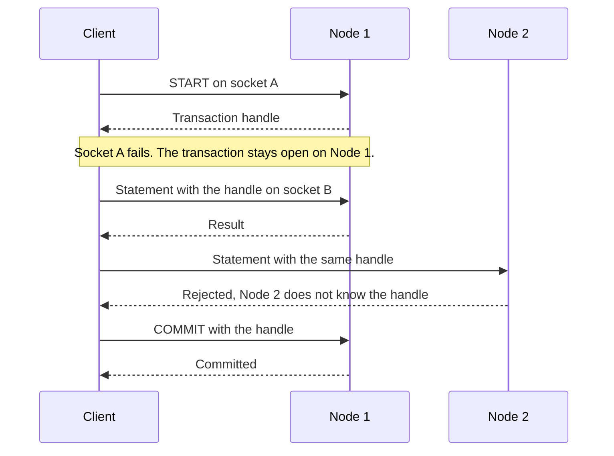

# The connection model

Clients talk to CamusDB through two APIs: REST with JSON over HTTP, and gRPC
over HTTP/2. Neither API gives a connection its own process or thread. A
connection is just a socket, and the server does work per request, not per
connection.

This model matters when many clients connect at the same time. Thousands of
application instances, serverless functions, or small services can connect to
CamusDB without an external connection pooler, because an idle connection costs
only one open socket.

This page compares that model with PostgreSQL's and MySQL's, and also covers
what the CamusDB model costs, because it has trade-offs as well as advantages.

## The short version

| | PostgreSQL | MySQL | CamusDB |
|---|---|---|---|
| Server unit of work | One operating-system process per connection | One thread per connection, by default | One asynchronous request on a shared thread pool |
| Cost of an idle connection | A full process, with its own memory | A full thread, with its stack and buffers | One open socket |
| Where transaction state lives | Inside the connection's process | Inside the thread's session | In memory on the node, under a handle the client holds |
| Usual answer to many clients | An external pooler, such as PgBouncer | A larger `max_connections`, or a thread pool plugin | Nothing extra: many requests share few connections |
| Concurrent statements on one connection | One at a time | One at a time | Many, through HTTP/2 multiplexing |

## How PostgreSQL handles a connection

PostgreSQL uses one process per connection. The `postmaster` process accepts
the socket and forks a backend process, which serves the connection until the
client disconnects.

The design is simple, and a crash in one backend can't corrupt another
backend's memory. But each backend has a real cost:

- Each backend keeps private memory: catalog caches, plan caches, and sort or
  hash memory, up to `work_mem` per operation.
- Starting a connection costs a fork, authentication, and cache warm-up.
- The operating system schedules each backend as a separate process. Many
  hundreds of active backends cause context switches and contention.
- A connection that sits idle inside a transaction keeps its backend, and keeps
  old row versions alive because `VACUUM` cannot remove them.

That is why the default `max_connections` is 100, and why large applications
put a pooler such as PgBouncer in front of the database. A transaction-mode
pooler shares backends between clients but breaks session state: a `SET`, an
advisory lock, a temporary table, or `LISTEN` can reach the wrong client.

## How MySQL handles a connection

By default, MySQL uses one thread per connection. A thread is cheaper than a
process, but the cost still grows with the number of connections:

- Each thread has its own stack, set by `thread_stack`.
- Each session can allocate its own buffers, such as `sort_buffer_size`,
  `join_buffer_size`, and `read_buffer_size`.
- Thousands of threads compete for the CPU, so context switching and lock
  contention grow.

The default `max_connections` is 151. MySQL Enterprise, Percona Server, and
MariaDB offer a thread pool that decouples connections from threads, but the
session still owns its state, so a connection stays tied to one client.

## How CamusDB handles a request

CamusDB runs on ASP.NET Core's Kestrel web server, which uses asynchronous
I/O. A request holds a thread only while it does CPU work. When it waits for
disk, network, or a lock, it releases the thread for another request.

The result is a small shared thread pool that serves many requests. The thread
count doesn't track the number of clients.

### REST

A REST request is self-contained. It names the database, carries the SQL and
parameters, and can carry a transaction id. The server needs nothing from an
earlier request on the same socket.

The client can therefore send each request on any connection in its HTTP pool.
A connection that waits between requests costs the server one open socket. See
[HTTP API](/docs/http-api).

### gRPC

A gRPC client opens one HTTP/2 connection, which gRPC calls a channel. HTTP/2
multiplexing lets that connection carry many concurrent calls, each as a
separate stream.

`CamusSql.BatchExecute` goes further: one bidirectional stream carries many
statements and their responses. Responses can arrive out of order, and the
client matches them by `request_id`. A batch frame can also fit a whole short
transaction into one message. See [gRPC API](/docs/grpc-api).

You can see this in `SHOW CONNECTIONS`: one gRPC channel usually appears as one
row while it carries many concurrent statements. See
[Query activity](/docs/query-activity).

## Where the state lives

A sessionless model still has to keep state somewhere. CamusDB keeps each
kind of state in a place the client can refer to by name.

| State | Where it lives | How a client refers to it |
|---|---|---|
| An explicit transaction | In memory on the node that started it | `txnIdPT` and `txnIdCounter` in REST, or a `TxnHandle` in gRPC |
| A prepared statement in gRPC | The `BatchExecute` stream | A `statement_id` that belongs to that stream |
| A prepared statement in REST | The node, under the principal that prepared it | An opaque string handle |
| Read-your-writes in a cluster | The client | A causal token, which the client sends with the next request |
| User identity | A bearer token | The `authorization` header or metadata |

So a transaction is not tied to a connection. A client can start a transaction
over REST or with the unary gRPC call `StartTransaction`, then commit it on
another socket. A failed socket doesn't end the transaction: the client opens a
new socket and continues with the same handle.

There is one exception. A transaction opened by a `START` inside a
`BatchExecute` stream belongs to that stream. If the stream ends without a
`COMMIT` or `ROLLBACK`, CamusDB rolls the transaction back, so a client crash
can't leave it open.

## What this gives an application

### No external pooler

The number of open connections doesn't drive server cost. An application with
a thousand workers can share a few HTTP/2 connections, and there is no
PgBouncer to deploy, monitor, and configure.

### Short-lived clients

A serverless function, script, or test can send a single HTTPS request
without keeping a warm pool. A new connection costs a TCP and TLS handshake,
with no fork and no new thread on the server. See
[Serverless functions](#serverless-functions) for the limits a burst of
functions can still reach.

### Fewer round trips

`BatchExecute` sends many statements without waiting for each response. Frame
contract version 2 can send `START`, the statements, and `COMMIT_IF_OK` in one
message, so a short transaction needs a single exchange.

### Standard infrastructure

REST and gRPC are ordinary HTTP. Load balancers, proxies, TLS termination,
service meshes, and tracing tools already understand them. A client needs no
database-specific wire protocol.

### No state for a pooler to break

A transaction-mode PostgreSQL pooler can mix two clients' session state.
CamusDB has no hidden session state to mix: transactions, prepared statements,
and causal tokens each have an explicit handle that the request carries.

### Idle clients cost little

An idle socket holds no process, no thread, and no sort buffer. A forgotten
open transaction still holds its locks, and CamusDB rolls it back after
`transaction_idle_timeout_ms` (5 minutes by default).

## Costs of this model

Know these trade-offs before you design a client.

- **A transaction stays on its node.** The node that starts an explicit
  transaction keeps it in memory. Send every statement in that transaction, and
  its `COMMIT` or `ROLLBACK`, to the same node; another node doesn't know the
  handle and rejects it. Autocommit statements can go to any node.
- **Each request repeats some context.** Every REST request carries the
  database name, the token, and a JSON body, and parsing costs CPU each time.
  gRPC with Protobuf and prepared statements reduce that cost. See
  [Prepared statements](/docs/prepared-statements).
- **A pause can end a transaction.** CamusDB treats a pause longer than
  `transaction_idle_timeout_ms` inside a transaction as abandonment and rolls
  the transaction back.
- **There is no session state.** CamusDB has no session-level `SET`, no
  session temporary tables, and no `LISTEN` or `NOTIFY`. `SET TRANSACTION`
  applies to one transaction only. Put other context in the request.
- **A gRPC prepared statement belongs to its stream.** A client that rebuilds
  the stream must prepare the statement again.
- **Cheap connections still need a limit on work.** Connection count no longer
  limits load, so use admission control to cap concurrent work. See
  [Transaction priority](/docs/transaction-priority).

## Serverless functions

A serverless platform such as AWS Lambda can start hundreds of function
instances in a few seconds. With PostgreSQL, each instance opens its own
connection, and the burst can pass `max_connections`. The usual fix is a proxy
such as RDS Proxy or PgBouncer.

CamusDB needs no proxy for this. Each instance can keep its own connection or
send a single HTTPS request, and an idle instance costs one socket. A burst can
still reach three other limits.

### Log in once per instance

A login is expensive by design. The node checks the password with PBKDF2 at
600,000 iterations and runs at most 8 checks at a time. It also allows 20
logins per minute for each account and source address, and 200 per minute for
each source address. Functions in a private network often share one NAT
address, so a cold-start burst under one account can fail with
`CADB0518 TooManyAuthAttempts`.

- Create the client outside the function handler, so a warm instance reuses its
  token. The TypeScript and Python drivers share managed tokens across clients
  with the same nodes and credentials in the process, and renew before expiry.
  Each Python thread still needs its own connection.
- For large bursts, let one small service log in and put the token in your
  secret store. Functions pass it as `accessToken` in TypeScript,
  `AccessToken` in .NET, or `access_token` in Python. A token lasts 15 minutes by default and has no refresh
  token, so the service must replace it before `expiresAtUnixMs`.

See [Authentication and authorization](/docs/sql-authentication#runtime-defaults)
for these limits.

### Finish transactions in one invocation

A platform can freeze or stop a function in the middle of its work. If that
function holds an open REST transaction, or one from the unary gRPC
`StartTransaction` call, the transaction keeps its locks until
`transaction_idle_timeout_ms` passes, 5 minutes by default. Other transactions
that need those rows wait or fail.

- Prefer autocommit statements for single writes.
- Send a short transaction in one gRPC `BatchExecute` frame with
  `COMMIT_IF_OK`, so the client can't stop between its statements. See
  [Batch stream frames](/docs/grpc-api#batch-stream-frames).
- Otherwise, start and commit the transaction in the same invocation, with no
  slow external calls in between.
- Send every statement of a REST transaction to the node that started it. A
  load balancer without node affinity can send a statement to another node,
  which rejects the handle.
- For functions with short timeouts, lower `transaction_idle_timeout_ms`. It
  needs a restart and the same value on every node.

### Limit concurrent work

In PostgreSQL, `max_connections` limits load as a side effect. CamusDB has no
such limit by default: if 1,000 functions run at once, the cluster starts all
of their transactions. Set `kahuna.max_concurrent_sessions` to cap concurrent
transactions on each node. Extra transactions then wait in a queue. Read
[Turn the gate on](/docs/transaction-priority#turn-the-gate-on) before you set
it.

## Settings

| Setting | Default | Purpose |
|---|---|---|
| `grpc_batch_max_in_flight` | `64` | How many operations one `BatchExecute` stream runs concurrently. Beyond that, the server applies back-pressure. |
| `transaction_idle_timeout_ms` | `300000` | The idle time after which CamusDB rolls back an explicit transaction. |
| `transaction_reaper_interval_ms` | `30000` | How often CamusDB looks for idle transactions. |
| `prepared_statement_idle_timeout_ms` | `600000` | The idle time after which CamusDB drops a REST prepared statement. |
| `kahuna.max_concurrent_sessions` | `0`, no gate | The ceiling on concurrent transactions on one node. It limits work, not connections. |

See [Configuration](/docs/configuration) for the full list.

## Related pages

- [HTTP API](/docs/http-api)
- [gRPC API](/docs/grpc-api)
- [Prepared statements](/docs/prepared-statements)
- [Authentication and authorization](/docs/sql-authentication)
- [Query activity](/docs/query-activity)
- [Transaction priority](/docs/transaction-priority)
- [Architecture](/docs/architecture)
