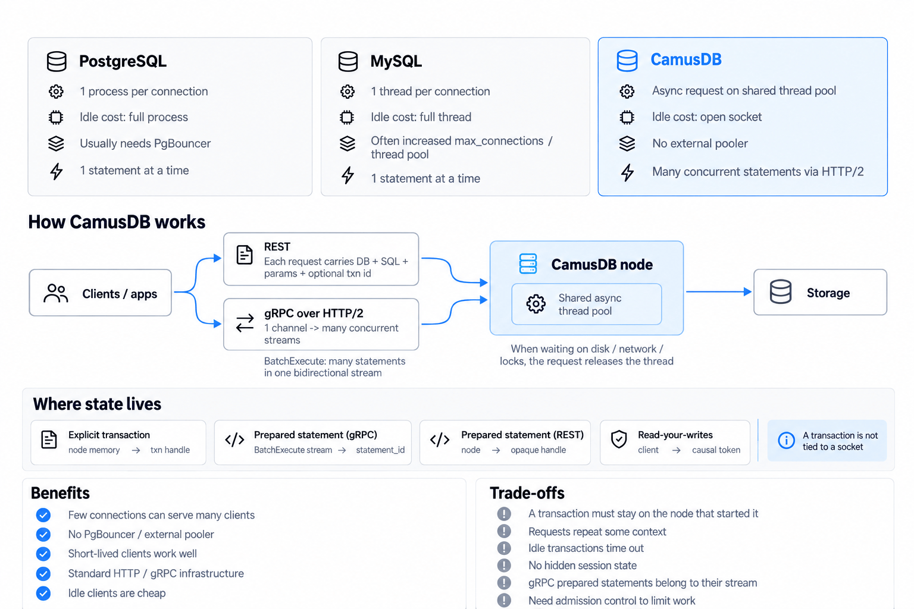
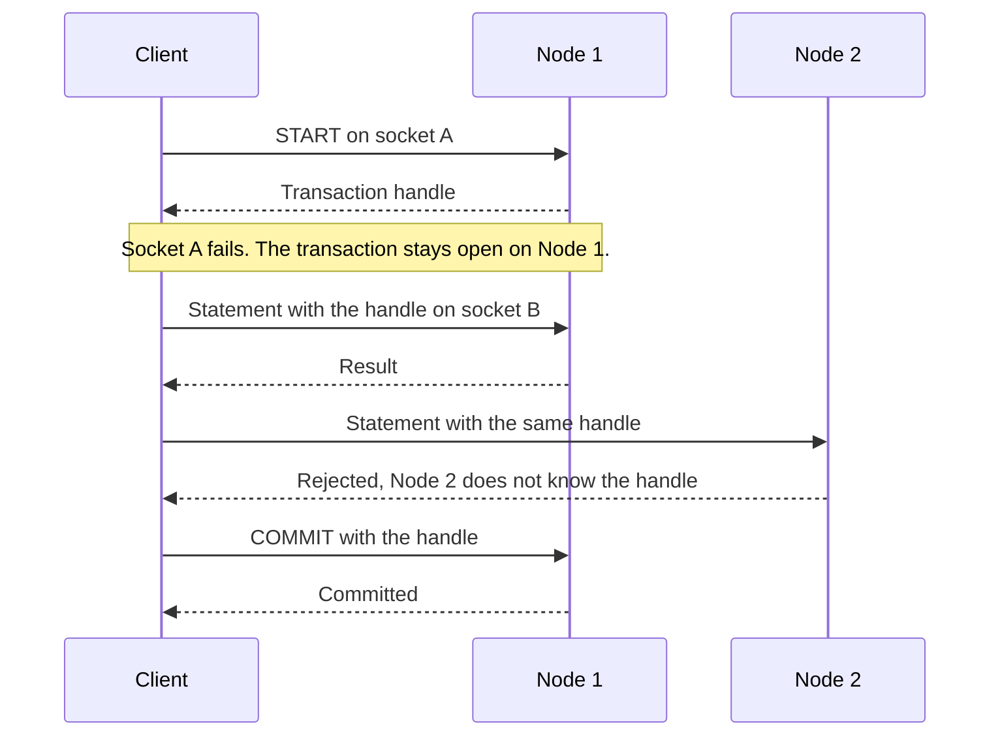

# The connection model

Thousands of application instances, such as serverless functions, can connect
to CamusDB directly. You don't need an external connection pooler. An idle
connection costs only one open socket. This page explains the server model for
capacity planning and deployment. It compares the model with PostgreSQL and
MySQL, and it lists the trade-offs.

Clients use one of two APIs: REST with JSON over HTTP, or gRPC over HTTP/2.
Neither API gives a connection a process or a thread. A connection is a socket,
and the server does work for each request.

Applications usually connect through the [.NET](/docs/dotnet-driver),
[TypeScript](/docs/typescript-connector), or [Python](/docs/python-driver)
driver. The drivers manage requests and transaction handles. You don't need the
wire details on this page to write an application.

## Connection models compared

| | PostgreSQL | MySQL | CamusDB |
|---|---|---|---|
| Server unit of work | One operating-system process per connection | One thread per connection, by default | One asynchronous request on a shared thread pool |
| Cost of an idle connection | A full process, with private memory | A full thread, with its stack and buffers | One open socket |
| Where transaction state lives | In the process of the connection | In the session of the thread | In memory on the node, under a handle that the client sends |
| Usual answer to many clients | An external pooler, such as PgBouncer | A larger `max_connections`, or a thread pool plugin | No extra component: many requests share few connections |
| Concurrent statements on one connection | One at a time | One at a time | Many, through HTTP/2 multiplexing |

In PostgreSQL, each connection has a backend process with private memory, and
the default `max_connections` is 100. Large applications put a pooler such as
PgBouncer in front of the database. A pooler in transaction mode shares
backends between clients, and session state, such as a `SET` or a temporary
table, can reach the wrong client.

In MySQL, each connection has a thread by default, with its stack and session
buffers, and the default `max_connections` is 151. Thread pool plugins separate
connections from threads, but the session owns its state, and a connection
is tied to one client.

## How CamusDB handles a request

CamusDB uses the Kestrel web server of ASP.NET Core, which uses asynchronous
I/O. A request uses a thread only while it does CPU work. When it waits, for
example for the disk or a lock, it releases the thread for another request. A
small shared thread pool serves many requests, and the thread count doesn't
grow with the number of clients.

### REST

A REST request is self-contained. It names the database, contains the SQL and
parameters, and can contain a transaction ID. The server doesn't need anything
from an earlier request on the same socket.

The client can therefore send each request on any connection of its HTTP pool.
A connection that waits between requests costs the server one open socket. See
[HTTP API](/docs/http-api).

### gRPC

A gRPC client opens one HTTP/2 connection, which gRPC calls a channel. With
HTTP/2 multiplexing, that connection carries many concurrent calls, each as a
separate stream.

`CamusSql.BatchExecute` goes further: one bidirectional stream carries many
statements and their responses. Responses can arrive in any order, and the
client matches them by `request_id`. A batch frame can also contain a full short
transaction. See [gRPC API](/docs/grpc-api).

In `SHOW CONNECTIONS`, one gRPC channel usually appears as one row while it
carries many concurrent statements. See [Query activity](/docs/query-activity).

## Where the state lives

CamusDB doesn't have sessions. It stores each kind of state in a place that the
client can refer to.

| State | Where it lives | How a client refers to it |
|---|---|---|
| An explicit transaction | In memory on the node that started it | `txnIdPT` and `txnIdCounter` in REST, or a `TxnHandle` in gRPC |
| A prepared statement in gRPC | The `BatchExecute` stream | A `statement_id` that belongs to that stream |
| A prepared statement in REST | The node, under the principal that prepared it | An opaque string handle |
| Read-your-writes in a cluster | The client | A causal token, which the client sends with the next request |
| User identity | A bearer token | The `authorization` header or metadata |

A transaction therefore isn't tied to a connection. A client can start a
transaction over REST, or with the unary gRPC call `StartTransaction`, and
commit it on another socket. A failed socket doesn't end the transaction. The
client opens a new socket and continues with the same handle.

There is one exception. A transaction started with `START` in a `BatchExecute`
stream belongs to that stream. If the stream ends before a `COMMIT` or
`ROLLBACK`, CamusDB rolls the transaction back. A client crash can't leave the
transaction open.

## Benefits for applications

- **No external pooler.** The number of open connections doesn't set the server
  cost. An application with a thousand workers can share a few HTTP/2
  connections, and you don't need to run a pooler.
- **Short-lived clients.** A short-lived client, such as a serverless function,
  can send one HTTPS request. It doesn't need a warm pool. A new connection costs a TCP and TLS
  handshake, and the server doesn't start a process or a thread. See
  [Serverless functions](#serverless-functions) for the limits that a burst of
  functions can reach.
- **Fewer round trips.** `BatchExecute` sends many statements and doesn't wait
  for each response. Frame contract version 2 can send a complete short
  transaction, from `START` to `COMMIT_IF_OK`, in one message. A short transaction then needs one
  exchange.
- **Standard infrastructure.** REST and gRPC are regular HTTP. Standard tools,
  such as load balancers and tracing tools, support them. A
  client doesn't need a database-specific wire protocol.
- **No session state to mix up.** A PostgreSQL pooler in transaction mode can
  mix the session state of two clients. In CamusDB, each kind of state has an
  explicit handle in the request. See [Where the state lives](#where-the-state-lives).
- **Low cost for idle clients.** An idle socket doesn't use a process or a
  thread. An open transaction that a client forgot has locks, and
  CamusDB rolls it back after `transaction_idle_timeout_ms` (5 minutes by
  default).

## Costs of this model

The model has trade-offs that you should know before you design a client.

- **A transaction belongs to its node.** The node that starts an explicit
  transaction stores it in memory. Send each statement of the transaction, and
  its `COMMIT` or `ROLLBACK`, to the same node. Another node doesn't know the
  handle and returns an error. Autocommit statements can go to any node.
- **Each request repeats some context.** Each REST request contains its context,
  such as the database name and the token. The parsing costs CPU each time. gRPC
  with Protobuf and prepared statements reduces that cost. See
  [Prepared statements](/docs/prepared-statements).
- **A pause can end a transaction.** CamusDB treats a pause longer than
  `transaction_idle_timeout_ms` in a transaction as abandonment, and it rolls
  the transaction back.
- **There is no session state.** CamusDB doesn't have session features, such as
  a session-level `SET` or session temporary tables. `LISTEN` and `NOTIFY`
  aren't available either. `SET TRANSACTION` applies to
  one transaction. Put other context in the request.
- **A gRPC prepared statement belongs to its stream.** A client that opens a new
  stream must prepare the statement again.
- **Cheap connections need a limit on work.** The connection count doesn't limit
  the load. Use admission control to limit concurrent work. See
  [Transaction priority](/docs/transaction-priority).

## Serverless functions

A serverless platform such as AWS Lambda can start hundreds of function
instances in a few seconds. With PostgreSQL, each instance opens a connection,
and the burst can pass `max_connections`. The usual fix is a proxy such as RDS
Proxy or PgBouncer.

CamusDB doesn't need a proxy for this. Each instance can keep a connection or
send one HTTPS request, and an idle instance costs one socket. A burst can reach
three other limits.

### Log in once per instance

A login is expensive on purpose. The node checks the password with PBKDF2 at
600,000 iterations, and it does at most 8 checks at a time. It also allows 20
logins per minute for each account and source address, and 200 per minute for
each source address. Functions in a private network often share one NAT
address, and a burst of cold starts under one account can fail with
`CADB0518 TooManyAuthAttempts`.

- Create the client outside the function handler. A warm instance then reuses
  its token. The TypeScript and Python drivers share managed tokens between
  clients in the process with the same nodes and credentials, and they renew
  the tokens before they expire. Each Python thread needs a separate
  connection.
- For large bursts, let one small service log in and put the token in your
  secret store. Functions pass it as `accessToken` in TypeScript, `AccessToken`
  in .NET, or `access_token` in Python. A token lasts 15 minutes by default,
  and there is no refresh token. The service must replace the token before
  `expiresAtUnixMs`.

See [Authentication and authorization](/docs/sql-authentication#runtime-defaults)
for these limits.

### Finish transactions in one invocation

A platform can freeze or stop a function during its work. If the function has
an open REST transaction, or one from the unary gRPC call `StartTransaction`,
the transaction has its locks until `transaction_idle_timeout_ms` passes, 5
minutes by default. Other transactions that need those rows wait or fail.

- Use autocommit statements for single writes.
- Use the driver's [transaction and retry helpers](/docs/serializable-retries)
  to finish the work in the same invocation. Don't make slow external calls
  during the transaction. The .NET and TypeScript clients also have pipeline APIs that reduce
  round trips.
- Let the driver send an explicit transaction to the node that started it.
  Custom protocol clients must do this themselves.
- For functions with short timeouts, lower `transaction_idle_timeout_ms`. A
  change needs a restart, and all nodes must have the same value.

### Limit concurrent work

In PostgreSQL, `max_connections` also limits the load. CamusDB doesn't limit
the load by default: if 1,000 functions run at once, the cluster starts all their
transactions. Set `kahuna.max_concurrent_sessions` to limit concurrent
transactions on each node. Extra transactions then wait in a queue. Read
[Turn the gate on](/docs/transaction-priority#turn-the-gate-on) before you set
it.

## Settings

| Setting | Default | Purpose |
|---|---|---|
| `grpc_batch_max_in_flight` | `64` | How many operations one `BatchExecute` stream executes at the same time. Above that number, the server applies back-pressure. |
| `transaction_idle_timeout_ms` | `300000` | The idle time after which CamusDB rolls back an explicit transaction. |
| `transaction_reaper_interval_ms` | `30000` | How often CamusDB looks for idle transactions. |
| `prepared_statement_idle_timeout_ms` | `600000` | The idle time after which CamusDB drops a REST prepared statement. |
| `kahuna.max_concurrent_sessions` | `0`, no gate | The maximum number of concurrent transactions on one node. It limits work. It doesn't limit connections. |

See [Configuration](/docs/configuration) for all settings.

## Related pages

- [HTTP API](/docs/http-api)
- [gRPC API](/docs/grpc-api)
- [Prepared statements](/docs/prepared-statements)
- [Authentication and authorization](/docs/sql-authentication)
- [Query activity](/docs/query-activity)
- [Transaction priority](/docs/transaction-priority)
- [Architecture](/docs/architecture)
