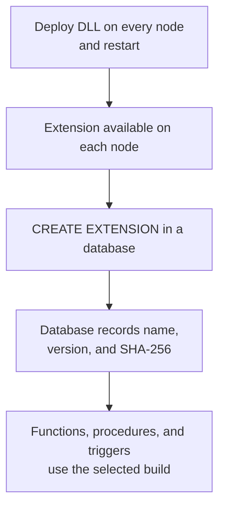
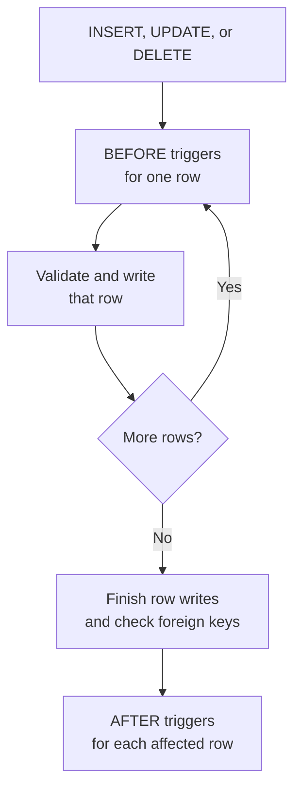

# C# extensions

C# extensions let you add application-specific behavior to CamusDB without
adding another network service or repeating a multi-step rule in every client.
Expose C# code as scalar functions, table functions, or aggregates; run it
automatically when rows change; or call a transactional procedure from SQL.

Use extensions for:

- **Reusable SQL expressions.** Expose C# calculations as scalar functions for
  projections, filters, defaults, and checks.
- **Rules that every writer follows.** Use triggers for normalization,
  validation, derived values, and transactional audit rows, including writes
  made outside your primary application.
- **One atomic server-side operation.** Use a procedure to package several SQL
  statements behind one `CALL`, reducing client orchestration while keeping all
  database changes in one transaction.

Extensions are best for small, reviewed pieces of domain logic that benefit
from running with the data. They execute inside the CamusDB server process, so
they are an operator-managed deployment feature, not arbitrary code uploaded by
database users.

| Extension | SQL surface | Best use |
| --- | --- | --- |
| Scalar function | `SELECT my_function(...)` | Calculate or transform one value. |
| Table function | `SELECT word FROM split_words(...)` | Produce rows for a query. |
| Aggregate function | `SELECT geomean(price) FROM items` | Summarize rows with domain-specific logic. |
| Trigger | `CREATE TRIGGER ... EXTERNAL NAME ...` | React automatically to each inserted, updated, or deleted row. |
| Procedure | `CALL my_procedure(...)` | Run a named, multi-statement transactional operation. |

## Create an extension project

Create a class library and reference `CamusDB.Extensions.Abstractions`. Target
`netstandard2.0` or `net10.0`:

```xml
<Project Sdk="Microsoft.NET.Sdk">
  <PropertyGroup>
    <TargetFramework>netstandard2.0</TargetFramework>
    <LangVersion>latest</LangVersion>
    <Nullable>enable</Nullable>
  </PropertyGroup>
  <ItemGroup>
    <PackageReference Include="CamusDB.Extensions.Abstractions" Version="0.16.*" />
  </ItemGroup>
</Project>
```

Use the package version that matches the CamusDB servers where the assembly
will run. A server can load an extension built against the same or an older
contract, but refuses one built against a newer contract with `CADB0803`. While
CamusDB is in the `0.x` series, pin the matching minor version, such as
`0.16.*`, because a minor release may change the contract.

The package provides the attributes, interfaces, contexts, and row types that
extension code can use. CamusDB supplies its own copy at runtime. You do not
need to deploy the contract DLL beside the extension; a bundled copy is ignored.

## Declare the extension

Every assembly must declare a name and version at assembly level:

```csharp
using CamusDB.Extensions;

[assembly: CamusExtension("text_utils", "1.0.0")]
```

The name is case-insensitive and must start with a letter or underscore,
followed by letters, digits, or underscores. The version uses SemVer
(`major.minor.patch`, optionally with a `-prerelease` suffix, without `+build`
metadata). A missing or invalid manifest prevents startup with `CADB0827`.

If your extension needs another extension installed first, declare it with
`Requires = new[] { "other_extension" }` on the attribute.

## Install an extension in a database

Loading a DLL makes its extension **available** on that node. Install it in
each database where you want to use its functions, procedures, or triggers:

```camussql
CREATE EXTENSION text_utils;                  -- highest loaded version
-- Or select an exact version instead:
-- CREATE EXTENSION text_utils VERSION '1.0.0';

SELECT text_utils.greet('ann');
```

The database records the extension's name, version, and DLL SHA-256. Each node
must load that exact build to run statements that use it. Different databases
can select different versions loaded side by side on the same node.



Only a superuser can create, update, or drop an extension. These statements
persist across restarts and replicate through the schema log. In a cluster,
run them on the database's schema leader, which coordinates schema changes.

```camussql
ALTER EXTENSION text_utils UPDATE;            -- highest loaded version
ALTER EXTENSION text_utils UPDATE TO '2.0.0'; -- exact version
DROP EXTENSION text_utils;
```

Install extensions listed in the manifest's `Requires` before installing the
extension. An update also checks its target version's requirements. You cannot
drop an extension while another installed extension requires it.

A drop is also refused while column defaults, `CHECK` constraints, views,
materialized views, or triggers depend on the extension. An update is refused
if its target version lacks a member those objects use. The error lists the
dependents; remove them first when necessary. There is no `CASCADE`.

Updating switches scalar and table functions, aggregates, procedures, and
triggers to the selected build together; triggers do not need to be recreated. Query results, bound
statements, and cached plans are keyed on installed extensions, so an install,
update, or drop cannot reuse caches from the previous extension selection.

## Scalar functions

Mark a public static method with `[CamusFunction]`. Include the assembly
manifest once in the project:

```csharp
using CamusDB.Extensions;

[assembly: CamusExtension("text_utils", "1.0.0")]

public static class TextFunctions
{
    [CamusFunction("slugify")]
    public static string Slugify(string value)
        => System.Text.RegularExpressions.Regex.Replace(
            value.Trim().ToLowerInvariant(), "[^a-z0-9]+", "-").Trim('-');

    [CamusFunction("greet", Aliases = new[] { "hello" })]
    public static string Greet(string? name, string greeting = "hello")
        => greeting + " " + (name ?? "stranger");

    [CamusFunction("random_token", IsVolatile = true)]
    public static string RandomToken() => System.Guid.NewGuid().ToString("N");
}
```

After deployment and `CREATE EXTENSION text_utils`, the methods become SQL
scalar functions:

```camussql
SELECT slugify(title)
FROM posts
WHERE slugify(title) = 'hello-world';

SELECT greet(NULL), hello('ann', 'hi');
SELECT text_utils.greet('ann'); -- extension-qualified name
```

Names and aliases are case-insensitive. A collision with a built-in function,
aggregate, or table function prevents startup, as does a duplicate member
within one extension. Different extensions may load members with the same
name, but installing both in one database is refused with `CADB0832`.
Unqualified names resolve against the current database's installed extensions;
use `text_utils.greet(...)` to qualify a function with its extension name.

### Nulls and optional arguments

A nullable value type such as `long?`, or a nullable reference parameter such
as `string?`, receives SQL `NULL` as C# `null`. For a non-nullable parameter,
any `NULL` argument makes the SQL result `NULL` without calling the method.
Returning C# `null` returns SQL `NULL`.

Optional C# parameters define the accepted argument-count range. A missing SQL
argument receives the parameter's default value.

### Deterministic and volatile functions

Functions are deterministic by default. Set `IsVolatile = true` when the same
arguments can produce a different result, for example a random token or a value
from the clock.

This distinction affects SQL behavior:

- A volatile function bypasses the query result cache.
- A volatile function cannot be used in a `CHECK` constraint.
- A deterministic function used as a column `DEFAULT` is evaluated when the
  table is created and stored as a constant.
- A volatile default is evaluated separately for every inserted row.

An exception from a function fails the statement with `CADB0809`. Concurrent
statements can call the method at the same time, so function code must be
thread-safe. Calls run on the node coordinating the statement; expressions that
use an extension function are not pushed to peer nodes during a distributed
scan.

## Table functions

A table function exposes a C# sequence as a queryable relation. Use it to turn
text or application-specific input into rows you can filter or join.
In your manifested extension, mark a public static method returning
`IEnumerable<T>` with `[CamusTableFunction]`:

```csharp
using System;
using System.Collections.Generic;
using CamusDB.Extensions;

public static class TextTables
{
    [CamusTableFunction("split_words", Column = "word")]
    public static IEnumerable<string> SplitWords(string text)
    {
        foreach (string word in text.Split(
            new[] { ' ' }, StringSplitOptions.RemoveEmptyEntries))
            yield return word;
    }
}
```

After installing its extension:

```camussql
SELECT word FROM split_words('inventory low stock');
SELECT w.word, d.weight
FROM split_words(@text) AS w JOIN dictionary d ON d.term = w.word;
```

The output has one column of a supported scalar or array type. `Column` names
it; otherwise the function name or relation alias supplies the name. Multiple
output columns and `LATERAL` references to another relation's columns are not
supported.

Arguments follow scalar-function null and conversion rules. A non-nullable
parameter receiving NULL produces zero rows; a null sequence also produces
zero rows. A null element produces a row with a NULL value.

The server consumes the sequence lazily and disposes its enumerator when it
stops, including for `LIMIT`, cancellation, or an error. Check cancellation
between expensive steps: the server checks between yielded values and cannot
interrupt code that never yields. There is no built-in output row cap.

A join may reread the function. Non-volatile functions run again on each read
and must reproduce their output. An `IsVolatile = true` function's rows are
retained for the statement, spilling if needed, so rereads see the same output.
The next statement evaluates it again.

For a better planner estimate, `CountRowsMethod` can name a public static
method on the same class with identical parameters and return type `long?`.
The planner calls it for constant arguments; keep it cheap and free of side
effects. `EXPLAIN` shows the estimate on the `function-scan` node.
Table functions run on the coordinator. Method or enumeration failures use
`CADB0809`.

## Aggregate functions

A custom aggregate summarizes rows without sending them back to application
code. Implement `ICamusAggregate<TState>` in a public class marked
`[CamusAggregate]`. For example, a geometric mean of positive prices:

```csharp
using System;
using CamusDB.Extensions;

[CamusAggregate("geomean")]
public sealed class GeoMean : ICamusAggregate<GeoMean.State>
{
    public sealed class State { public double LogSum; public long Count; }

    public State Create() => new State();

    public void Accumulate(State state, double price)
    {
        if (price > 0) { state.LogSum += Math.Log(price); state.Count++; }
    }

    public double? Finish(State state)
        => state.Count == 0 ? null : Math.Exp(state.LogSum / state.Count);
}
```

```camussql
SELECT category, geomean(price) AS typical_price
FROM items GROUP BY category HAVING geomean(price) > 10;
```

`Create` allocates one state per group. `Accumulate` returns void and takes the
SQL arguments after that state; there must be one public method of this name.
`Finish` returns a supported value type, including arrays. For a global
aggregate over zero rows, `Create` and `Finish` still run; an empty `GROUP BY`
has no groups. Non-nullable arguments skip NULL rows; nullable arguments
receive null.

One aggregate instance is shared by concurrent statements. Keep group data in
the state object, which is used by one thread at a time. Set `StateSizeHint`
on the attribute when state needs more than the default 64-byte estimate.
Grouping charges that hint against the memory budget; spilling writes input
rows, rather than serializing your state.

Use aggregates in projections and `HAVING`, including inside expressions.
They are refused in `WHERE`, `JOIN ON`, `GROUP BY`, defaults, and checks.
Window functions and `DISTINCT` arguments are unsupported. Aggregation runs on
the coordinator after gathering rows; optional `Merge` methods are not called
in this version. Errors from the lifecycle methods use `CADB0809`.

## Triggers

A trigger is a public class with a public parameterless constructor that
implements `ICamusTrigger`:

```csharp
using CamusDB.Extensions;

public sealed class AuditTrigger : ICamusTrigger
{
    public Task FireAsync(ITriggerContext context)
    {
        IRow? row = (IRow?)context.New ?? context.Old;

        return context.Sql.ExecuteAsync(
            "INSERT INTO audit_log (op, tbl, name) VALUES (@op, @tbl, @name)",
            new Dictionary<string, object?>
            {
                ["op"] = context.Operation.ToString(),
                ["tbl"] = context.TableName,
                ["name"] = row?.GetString("name"),
            });
    }
}
```

Install the extension that defines the CLR type, then register it on a table
with SQL:

```camussql
CREATE TRIGGER audit ON orders
AFTER INSERT, UPDATE, DELETE
EXTERNAL NAME 'MyCompany.Ext.AuditTrigger';

CREATE TRIGGER normalize ON orders
BEFORE INSERT, UPDATE
EXTERNAL NAME 'MyCompany.Ext.NormalizeTrigger';

DROP TRIGGER audit ON orders;
```

`EXTERNAL NAME` is the full CLR type name. Creating or dropping a trigger
requires the table's `ALTER` privilege. In a cluster, run trigger DDL on the
database's schema leader: the node that currently
[leads](/docs/concepts#leader) schema changes for that database. Other nodes
reject trigger DDL instead of forwarding it, and the error names the current
schema leader.

### Before and after triggers

A trigger fires once for every affected row, in creation order, inside the
statement's transaction:



SQL issued by either trigger type shares the statement's transaction.

- A `BEFORE` trigger runs before validation and storage. On `INSERT` and
  `UPDATE`, it may modify `context.New`; the final row must still pass type,
  `NOT NULL`, length, foreign-key, and `CHECK` constraints. A `BEFORE DELETE`
  trigger cannot change the row, but it can reject the deletion by throwing.
- An `AFTER` trigger runs after the complete statement has written its rows and
  passed foreign-key checks. It sees the final rows and cannot change them.

`context.Old` and `context.New` contain every column, including large values.
One trigger instance is shared by concurrent statements in an engine, so do not
keep per-statement state in instance or static fields.

Triggers fire for SQL `INSERT`, `UPDATE`, and `DELETE`, including `RETURNING`
and `INSERT ... SELECT`; for DML issued by procedures and triggers; and for the
typed HTTP and gRPC write APIs. They do not fire for internal maintenance such
as `TRUNCATE`, TTL expiration, schema backfills and rewrites, materialized-view
refresh, restore, or dropped-table recovery.

For `INSERT ... ON CONFLICT` and `UPSERT`, BEFORE INSERT also runs on proposed
rows that will be skipped or updated. A conflict update then fires the UPDATE
triggers; a skipped row fires no further row trigger. See
[conflict handling](/docs/sql-writes#on-conflict) for the complete order.

A `BEFORE` trigger must not use its SQL session to change another row that the
outer statement has already read and is still writing. CamusDB rejects that
stale-row hazard with `CADB0825`.

Triggers can be created only on plain tables. A recovered dropped table has
no triggers; recreate them after recovery. Each trigger follows the version
selected by its database's installed extension.

### Typed trigger rows

Implement `ICamusTrigger<TRow>` to work with named C# properties instead of
reading columns through `IRow`. A row class can model only the columns your
trigger needs:

```csharp
using System.Threading.Tasks;
using CamusDB.Extensions;

namespace MyCompany.Ext;

public sealed class OrderRow
{
    [CamusColumn("customer_name")]
    public string? CustomerName { get; set; }
}

public sealed class TrimCustomerName : ICamusTrigger<OrderRow>
{
    public Task FireAsync(ITriggerContext<OrderRow> context)
    {
        if (context.New is { } row)
            row.CustomerName = row.CustomerName?.Trim();
        return Task.CompletedTask;
    }
}
```

```camussql
CREATE TRIGGER trim_customer ON orders BEFORE INSERT, UPDATE
EXTERNAL NAME 'MyCompany.Ext.TrimCustomerName';
```

Public properties with public getters and setters map by case-insensitive name
or `[CamusColumn]`. Fields, indexers, and init-only properties are not mapped.
Property types must match the table's mapped CLR types exactly. Missing columns
or mismatched types fail `CREATE TRIGGER` with `CADB0836` and a list of problems.

Use nullable properties for SQL NULL or values unavailable when the trigger
fires, such as an omitted column or a row id in BEFORE INSERT. An unexpected
NULL in a non-nullable property fails the statement with `CADB0818`.

BEFORE triggers write back only changed NEW properties, comparing arrays and
byte buffers by content; normal row validation still applies. Changes to AFTER
trigger objects are ignored. Cast to `ITriggerContext` for the untyped rows.

Mapped columns cannot be dropped or renamed while the trigger exists
(`CADB0530`). Drop the trigger first. If an extension update changes the row
class incompatibly, the first DML firing it fails with `CADB0836` on each node.

Typed triggers allocate an object per row image and convert mapped columns.
Use untyped triggers when that cost matters. Both forms use the same retained
row memory budget for AFTER triggers.

## Procedures

A procedure is a public class with a public parameterless constructor, marked
with `[CamusProcedure]`, that implements `ICamusProcedure`:

```csharp
using CamusDB.Extensions;

[CamusProcedure("transfer", MinArguments = 3, MaxArguments = 3)]
public sealed class Transfer : ICamusProcedure
{
    public async Task ExecuteAsync(IProcedureContext context)
    {
        string from = (string)context.Arguments[0]!;
        string to = (string)context.Arguments[1]!;
        long amount = (long)context.Arguments[2]!;

        await context.Sql.ExecuteAsync(
            "UPDATE accounts SET balance = balance - @amount WHERE name = @name",
            new Dictionary<string, object?> { ["amount"] = amount, ["name"] = from });

        await context.Sql.ExecuteAsync(
            "UPDATE accounts SET balance = balance + @amount WHERE name = @name",
            new Dictionary<string, object?> { ["amount"] = amount, ["name"] = to });
    }
}
```

After installing its extension, call it with values, parameters, expressions,
or functions:

```camussql
CALL transfer('alice', 'bob', 30);
CALL transfer(@from, @to, 10 * 3);
```

Arguments are evaluated before the procedure runs. A call outside
`MinArguments` through `MaxArguments` is rejected first. The procedure runs in
the `CALL` transaction: all its SQL commits together, and an exception rolls it
all back with `CADB0822`.

`CALL` reports the total rows changed and returns no result set. Send it through
an execute/non-query client API. It is not preparable. Calling a procedure
currently requires a superuser because procedure-specific grants are not yet
available.

## SQL inside a trigger or procedure

`context.Sql` runs statements in the same transaction and with the same user
privileges as the statement that invoked the extension:

- `ExecuteAsync` runs `INSERT`, `UPDATE`, or `DELETE` and returns the changed-row
  count.
- `QueryAsync` runs `SELECT` and returns row copies that remain valid after the
  call.
- DDL and transaction control such as `BEGIN`, `COMMIT`, and `ROLLBACK` are
  rejected with `CADB0820`.
- Parameters use a dictionary key with or without the leading `@`.
- Nested writes count against `max_mutations_per_transaction` and fire the
  target tables' triggers.

An error from nested SQL makes the transaction rollback-only even when the
extension catches the exception. There are no savepoints. Returning after such
an error fails the statement with `CADB0823`, and attempting to commit the
transaction fails with `CADB0824`.

## Supported values

| CamusDB type | C# type |
| --- | --- |
| `INT64` | `long` |
| `FLOAT64` | `double` |
| `FLOAT32` | `float` |
| `BOOL` | `bool` |
| `STRING` | `string` |
| `OID` | `string` containing the ObjectId text |
| `UUID` | `Guid` |
| `BYTES`, including vectors | `byte[]` |
| `DATE`, `DATETIME` | UTC `DateTime`; a returned `DateTime` is `DATETIME` |
| `NUMERIC` | `decimal` |
| `ARRAY(E)` | `IReadOnlyList<T>` for the element's mapped type |

An `INT64` argument can convert to `double` or `decimal`, and a UUID-formatted
`STRING` can convert to `Guid`. JSON is represented as `STRING`.

### Arrays

Use `IReadOnlyList<T>` in function signatures; CLR array signatures such as
`long[]` are refused. You may return an array from a method declared to return
`IReadOnlyList<long>`:

```csharp
[CamusFunction("sum_list")]
public static long SumList(IReadOnlyList<long> values)
{
    long total = 0;
    foreach (long value in values) total += value;
    return total;
}
```

NULL arrays follow the parameter's nullability. NULL elements require nullable
value elements such as `IReadOnlyList<long?>`; reference elements can receive
null. Element conversions follow scalar rules. Nested arrays and arrays of
`byte[]` are unsupported.

Arguments are copied to read-only lists and returned lists are copied back.
The return declaration preserves the SQL array element type in derived tables
and `CREATE TABLE ... AS SELECT`. Boxed arrays in procedure arguments or
`IRow.GetValue` use lists with nullable elements. Use `IRow.GetArray<T>` and
`IWritableRow.SetArray<T>` for typed row access; SQL session parameters may use
CLR arrays or lists of mapped elements.

### Decimal precision

CamusDB `NUMERIC` can hold more significant digits than .NET `decimal`. A value
that does not fit fails with `CADB0810` instead of being truncated. Returned
decimals with more than nine fractional digits use CamusDB's normal
half-away-from-zero rounding.

Byte arrays are copied across the contract. Mutating an array received from a
row or argument does not change stored data.

## Deploy extensions

Build the class library, copy its DLL to every CamusDB node, and list the
absolute path in the server configuration:

```yaml
extension_assemblies:
  - /opt/camusdb/extensions/MyCompany.Ext.dll

unsafe_extension_assemblies:
  - /opt/camusdb/extensions/MyCompany.Reviewed.dll
```

Each node loads its local DLL into the CamusDB server process. SQL calls and
supported write APIs invoke extension code through that server:

<ArchDiagram
  sources={[
    {label: 'SQL calls', icon: 'log'},
    {label: 'Typed write APIs', icon: 'log'},
  ]}
  group="CamusDB node"
  hub={{label: 'CamusDB server', icon: 'server'}}
  targets={[{label: 'C# extension DLL', sub: 'Functions, triggers, procedures', icon: 'chip'}]}
  title="SQL calls and typed write APIs reach a CamusDB server. The server loads and invokes a C# extension DLL inside its own process. Each node needs its own copy of the DLL."
/>

The equivalent command-line flags are `--extension-assemblies` and
`--unsafe-extension-assemblies`, with space-separated paths. Both settings are
restart-class: replace the file and restart the node to load a new build.

The DLL is not stored in the database or replicated. Every node must receive
the same files. Invalid paths, missing files, missing manifests, and duplicate
extension name/version pairs prevent startup. See
[configuration](/docs/configuration) for the assembly settings.

The installed record's SHA-256 covers only the extension DLL. Private
dependencies of unsafe extensions are not hashed, so deploy the whole folder
as one unit to keep behavior consistent across nodes.

### Rolling upgrade

1. Deploy the new DLL beside the old one on every node. Add both paths to
   `extension_assemblies` (or the unsafe list as appropriate) and restart nodes
   one at a time. Databases continue using their installed version.
2. Run `ALTER EXTENSION text_utils UPDATE TO '2.0.0'` in each database to
   select the new build through the replicated schema log.
3. Remove the old path and file after no database uses that version, then
   restart the nodes again.

Before an install or update, the coordinating node checks the target name,
version, and SHA-256 on other cluster nodes. A responding node without the
build causes `CADB0835`, naming the affected nodes. Nodes that do not respond
are skipped; this check does not guarantee that an offline node has the build.

### Missing builds

A node without the installed name/version, or with a different DLL hash, still
starts and serves statements that do not use that extension. It logs the
missing build when opening the database. Function and procedure calls, and
writes to tables with that extension's triggers, fail with `CADB0834`.
`SHOW EXTENSIONS` reports the installed build as `missing`. Deploy the exact
build and restart the node to restore those operations.

The browser playground cannot load extensions. Logical dumps include
`CREATE EXTENSION name VERSION 'version'` for installed extensions, but no DLLs
or trigger definitions. Deploy the files before reimporting and recreate
triggers after loading rows. See
[logical dump and reimport](/docs/logical-dump-and-reimport).

## Safe and unsafe assemblies

Files in `extension_assemblies` are **safe extensions**. Before loading one,
CamusDB inspects its metadata and rejects APIs that can access files, processes,
networking, native code, dynamic assembly loading, or other dangerous runtime
facilities. Runtime dependency loading is restricted to the same allow-list.

Files in `unsafe_extension_assemblies` skip those checks. They can load private
dependencies from their own directory, and the server logs their trust level at
startup.

Safe mode is a review guardrail, not a sandbox. Extension code runs inside the
database process with its permissions. It can consume unbounded CPU or memory,
and a stack overflow can terminate the server. Deploy only reviewed code; the
operator-controlled assembly lists are the security boundary.

## Transactions, retries, and side effects

Database writes made through `context.Sql` commit and roll back with their outer
statement. CamusDB may retry a statement after a serializable conflict or
schema transition. Rolled-back attempts do not leave database changes, but an
effect outside the database, such as a network call, file write, or in-memory
counter, can occur more than once.

Keep extension behavior inside the database where possible. Any unavoidable
external effect must be idempotent or performed after the transaction commits.
A trigger or procedure failure inside an explicit transaction rolls back that
whole transaction.

## Limits

- Triggers and procedures may nest up to 16 levels. Deeper recursion fails with
  `CADB0819`.
- Trigger and procedure writes count against
  `max_mutations_per_transaction`.
- Rows retained for `AFTER` triggers count against `spill_threshold_bytes`; an
  oversized statement fails with `CADB0826`.
- Cancellation is cooperative, and a write is not cancellable after writing
  begins in this version.
- CamusDB cannot stop an extension method that never returns.
- Table functions return one column and do not support `LATERAL`.
- Window functions, `DISTINCT` aggregate arguments, and distributed partial
  aggregation for extension aggregates are unsupported.

## Inspect loaded extensions

Use `SHOW EXTENSIONS` to check both node deployment and database installation:

```camussql
SHOW EXTENSIONS;
```

The result includes `name`, `version`, `status`, `path`, `sha256`, `trust`,
`requires`, registered `functions`, `triggers`, `procedures`, `aggregates`, and
`table_functions`, plus `signatures` for scalar, aggregate, and table functions.
Signatures are separated by `; ` and include array types, optional parameters,
and table outputs such as `split_words(STRING) -> SETOF STRING`.

| Status | Meaning in the current database |
| --- | --- |
| `available` | The node loaded the build, but this database does not use it. |
| `installed` | This database uses this build and the node loaded it. |
| `missing` | This database selected a build the node cannot run; `path` and `trust` are null. |

The statement is node-local and requires a superuser. Compare `sha256` across
nodes to find inconsistent deployments. With no loaded or installed
extensions, it returns no rows. CamusDB also logs loaded extensions and their
members at startup.

## Try the sample extension

The [sample extension repository](https://github.com/camusdb/camusdb-extension-sample)
walks through a small bookstore: scalar functions validate ISBNs and calculate
prices, triggers normalize book rows and record price changes, and a procedure
places an order in one transaction.

It includes an assembly manifest, SQL demo scripts, unit tests that run without
a server, and scripts to build the DLL and start CamusDB. Follow the repository's
quick start with .NET SDK 10 or later and CamusDB 0.16.1 or later.

## Common errors

| Code | Meaning |
| --- | --- |
| `CADB0800`-`CADB0804` | Invalid, missing, unloadable, incompatible, or duplicate extension assembly. |
| `CADB0805` | A member collides with a built-in or is defined twice in one extension. |
| `CADB0806`, `CADB0807` | A safe assembly failed inspection or attempted a disallowed runtime load. |
| `CADB0808` | An extension member has a signature CamusDB cannot bind. |
| `CADB0809`, `CADB0810` | A scalar, table, or aggregate function threw, or a `NUMERIC` value did not fit a .NET `decimal`. |
| `CADB0811`-`CADB0816` | A trigger type or trigger DDL target is invalid. |
| `CADB0817` | The installed version of a trigger's extension lacks its CLR type. |
| `CADB0818` | A trigger threw and the statement rolled back. |
| `CADB0819` | Trigger and procedure nesting exceeded 16 levels. |
| `CADB0820` | Extension SQL attempted unsupported DDL or transaction control. |
| `CADB0821`, `CADB0822` | A procedure is missing, or it threw and rolled back. |
| `CADB0823`, `CADB0824` | Nested SQL failed and left the transaction rollback-only. |
| `CADB0825` | A `BEFORE` trigger changed a row the outer statement was still writing. |
| `CADB0826` | Rows retained for `AFTER` triggers exceeded the memory threshold. |
| `CADB0827` | The assembly manifest is missing or invalid. |
| `CADB0828` | The requested extension or version is not loaded on this node. |
| `CADB0829` | The extension is already installed in the database. |
| `CADB0830` | The extension is not installed, including when creating a trigger from a loaded but uninstalled extension. |
| `CADB0831` | A required extension is not installed. |
| `CADB0832` | Another installed extension defines the same function, procedure, aggregate, or table-function name. |
| `CADB0833` | Dependent objects prevent dropping the extension or removing a member during an update. |
| `CADB0834` | This node does not load the database's installed extension build. |
| `CADB0835` | A responding cluster node does not load the target build for an install or update. |
| `CADB0836` | A typed trigger row class does not fit its table. |
