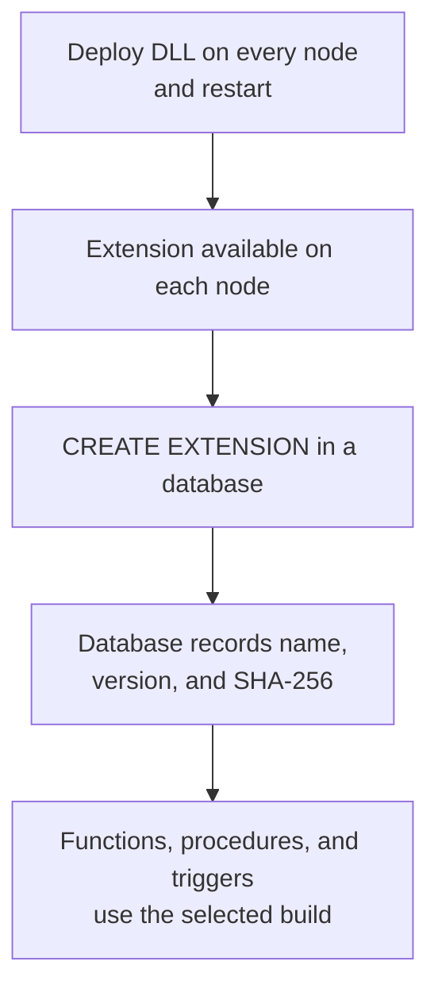
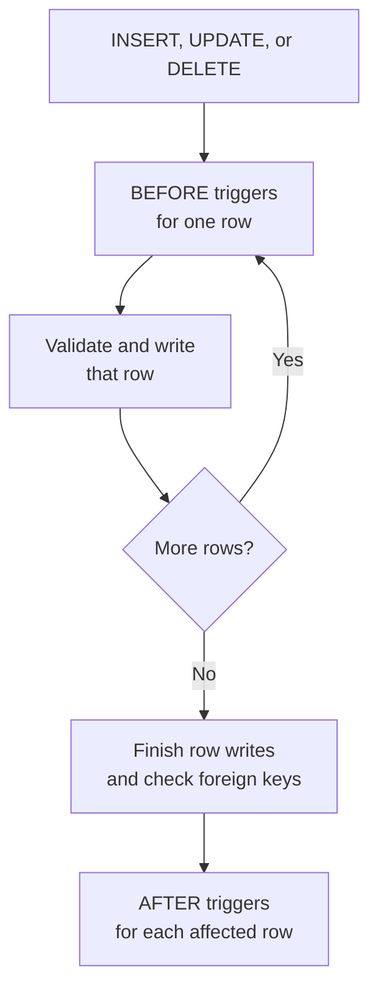

# C# extensions

C# extensions add your own logic to CamusDB SQL. Your validation rules and
multi-step writes can live in the database. You don't need another network
service, and each client doesn't need a copy of the rule.

| Extension | SQL | Use it to |
| --- | --- | --- |
| Scalar function | `SELECT slugify(title) FROM posts` | Calculate or transform one value. |
| Table function | `SELECT word FROM split_words('a b')` | Produce rows for a query. |
| Aggregate function | `SELECT geomean(price) FROM items` | Summarize rows with your own logic. |
| Trigger | `CREATE TRIGGER audit ON orders ...` | Validate or audit each changed row, also for writes from other applications. |
| Procedure | `CALL transfer('alice', 'bob', 30)` | Execute several SQL statements as one transactional operation. |

You can supply the C# code in two ways:

| | Inline code | DLL extension |
| --- | --- | --- |
| Kinds | Scalar functions and triggers. | All the kinds above. |
| Where the code is | In the `CREATE FUNCTION` or `CREATE TRIGGER` statement. | In a .NET class library that the operator copies to each node. |
| Who creates it | A user with `CREATE` on the database (functions) or `ALTER` on the table (triggers), after the operator enables the feature. | The operator deploys the DLL. A superuser installs it in a database. |
| Code checks | An allowlist of types and members, and a time and memory budget for each call. | A safe-assembly check when the DLL loads, or none for a reviewed unsafe assembly. |
| Privileges of trigger SQL | The trigger owner's. | The privileges of the user whose statement fired the trigger. |

## Inline functions

An inline function is a scalar function with its C# body in the SQL
statement. There is no file to build or deploy. To allow
`CREATE FUNCTION`, set the following in `config.yml` on each node, and restart
the nodes:

```yaml
inline_functions_enabled: true
```

Then create and call a function in a database:

```camussql
CREATE FUNCTION slugify(s STRING) RETURNS STRING LANGUAGE csharp AS $$
    return s.Trim().ToLowerInvariant().Replace(' ', '-');
$$;

SELECT slugify('  New Book  '); -- 'new-book'
SHOW FUNCTIONS;
SHOW CREATE FUNCTION slugify;
```

The body is the statements of one C# 12 method. It uses the parameter names
from the declaration, with the same case. Common namespaces, such as
`System.Linq` and `System.Text.RegularExpressions`, are imported.

Dollar quotes keep the body text as written, with its semicolons and quotes. If
the body contains `$$`, use a tag, such as `$body$ ... $body$`. You can also
use the new keywords, such as `LANGUAGE` and `RETURNS`, as table and column
names. The [browser playground](/docs/browser-playground) doesn't include the
inline compiler.

### Types and NULLs

Parameters and the result can use the types in
[Supported values](#supported-values), except `OID` and `DATE`. The elements of
an `ARRAY` can't be `BYTES`. In the body, an array is an `IReadOnlyList<T?>`
with nullable elements. Other types, such as `JSONB`, return an error.

By default, a function is `RETURNS NULL ON NULL INPUT`. If an argument is
`NULL`, the body isn't called, and the result is `NULL`. With
`CALLED ON NULL INPUT`, the body is called with nullable C# arguments. A body
can return `null` in both cases:

```camussql
CREATE FUNCTION display_label(s STRING) RETURNS STRING
CALLED ON NULL INPUT LANGUAGE csharp AS $$
    return s ?? "untitled";
$$;
```

### Manage a function

```camussql
CREATE OR REPLACE FUNCTION slugify(s STRING) RETURNS STRING LANGUAGE csharp AS $$
    return s.Trim().ToLowerInvariant().Replace(' ', '_');
$$;

ALTER FUNCTION slugify OWNER TO app_owner;
DROP FUNCTION IF EXISTS slugify;
```

Function names are case-insensitive. Overloads and default arguments aren't
supported. An inline function can't use the name of a built-in function. It
also can't use the name of a function from an extension that the node loads,
even if the database doesn't install that extension. A name that is in use
returns `CADB0842`.

| Statement | Requires |
| --- | --- |
| `CREATE FUNCTION` | `CREATE` on the database, or a superuser. The creator owns the function. |
| `CREATE OR REPLACE FUNCTION` for an existing function | `CREATE` and ownership, or a superuser. |
| `DROP FUNCTION`, `ALTER FUNCTION ... OWNER TO` | Ownership, or a superuser. |
| `SHOW FUNCTIONS`, `SHOW CREATE FUNCTION` | `SELECT` or `CREATE` on the database. |
| A call | A grant in the database. |

A function body can't execute SQL. This means that a call doesn't use the
owner's privileges. If the owner is dropped, only a superuser can change the
function.

While another object calls the function, for example a view or a `CHECK`
constraint, `DROP FUNCTION` returns `CADB0844`. A replacement that changes the
parameter or result types returns the same error. The message lists the
objects.

A replacement that changes only the body doesn't change the owner or the
dependent objects. These objects use the new body in later statements.
However, a materialized view returns its stored rows until the next refresh. A
column default that calls a deterministic function is evaluated once, when the
table is created. A later replacement doesn't change that default.

### Allowed code and resource budgets

Inline functions are deterministic SQL functions. The body can use most of the
C# language, for example lambdas and LINQ. The following aren't allowed:

- I/O, such as files and the network.
- Reflection and unsafe code.
- Threads, tasks, and `async` code.
- SQL statements, and calls to other SQL functions.
- The clock, `Random`, and `Guid.NewGuid()`.
- A regex call that doesn't set a match timeout.
- Custom sort comparisons such as `List<T>.Sort((a, b) => ...)` and
  `Comparer<T>.Create(...)`. Use a key with `OrderBy`, or a built-in comparer
  such as `StringComparer.Ordinal`. Stored functions and triggers that use a
  custom sort comparison return `CADB0845` until you replace the body.
- A LINQ query kept in a local variable. End the query with `ToList()` or
  `ToArray()`.

Some allocations and formatting calls are also restricted. `CREATE FUNCTION`
returns `CADB0839` with the position of each construct that isn't allowed. A
compile error returns `CADB0838` with the line and column.

Each call has the following budgets. You can change them in the
[settings](/docs/settings-reference#inline-c-functions-and-triggers):

| Limit | Default | Setting |
| --- | --- | --- |
| Time for each call or trigger fire | 1 second | `inline_function_call_timeout_ms` |
| Memory allocated by each call or fire | 16 MiB | `inline_function_allocation_limit_bytes` |
| Elements in one `new T[n]` | 1,048,576 | `inline_function_array_limit` |
| Source size | 64 KiB of UTF-8 | `inline_function_source_limit_bytes` |
| Compile time, with the wait for a compile slot | 10 seconds | `inline_function_compile_timeout_ms` |
| Compiles at the same time on one node | 2 | `inline_function_compile_concurrency` |
| Inline functions in one database | 256 | `max_inline_functions_per_database` |

A call over a budget returns `CADB0840`, and the message names the setting.
Recursion that is too deep for the stack returns the same error. The checks are
made between calls to .NET methods. This means that one .NET operation can
finish before the call stops. A budget error skips pending `finally` blocks in
the function or trigger body.

`CANCEL QUERY` doesn't stop a running inline call. The call budget stops it. A
statement that calls a function for each row of a large table can take a long
time, even when each call is in its budget. To limit the statement, set the
`statement_timeout_ms` [runtime cluster setting](/docs/settings-reference#statement-timeout).
A statement over that limit returns `CADB0562`.

The code executes in the server process. Set a
[process heap limit](/docs/configuration#cache-defaults-proportional-to-memory)
as the memory limit for the node.

You should use ordinal string comparisons when a result must be the same on
each node. Culture-sensitive comparisons and the last bits of some
floating-point math can differ between platforms. Use the same server build and
globalization mode on all nodes. A replacement of the body clears the cached
query results that use the function.

### Compile rate limit

Each `CREATE [OR REPLACE] FUNCTION` and each
`CREATE TRIGGER ... LANGUAGE csharp` compiles C# on the node.
`max_inline_definitions_per_user_per_minute` (default `60`) limits how many of
these statements one user can execute in a minute. The next statement returns
`CADB0848` (HTTP 429), and the message tells you when to try again.

- A user can execute that many statements at once, and then one statement each
  `60 / value` seconds.
- A statement counts when it gets to the compiler, also if the body doesn't
  compile. A statement that fails earlier, for example for a missing privilege,
  doesn't count. Functions and triggers share one count.
- The limit doesn't apply to superusers, or to any user when authentication is
  off.
- Each node counts separately. A change of schema leader starts a new count.
- It's a runtime cluster setting. `0` or less turns off the limit.

To load a dump with many functions, load it as a superuser, or raise the
setting during the load.

### Compilation across nodes

In a cluster, execute function DDL on the database's schema leader. This is
the node that [leads](/docs/concepts#leader) schema changes for that database.
Another node returns `CADB0099`, and the message names the leader.

The schema leader compiles the body to check it. The schema log replicates the
source text and its hash. Each node compiles a function at its first call and
caches the compiled code. A node that doesn't call a function doesn't compile
it.

`SHOW FUNCTIONS` lists the inline functions of the current database, with
their signatures and owners. It doesn't list the functions of DLL extensions.
The `state` column shows the compile state on the node that executes the
statement: `not compiled`, `compiled`, or `failed:` with a reason. An
`unloading` row is the code of a replaced or dropped function that a running
statement uses.

A node that can't compile a function returns `CADB0845` for the statements
that call it. This can happen in a rolling upgrade, when a body uses a member
that only the newer server build allows. Upgrade all the nodes before you
create such a function.

If you set `inline_functions_enabled` to `false`, `CREATE FUNCTION` returns
`CADB0841`. The existing functions can be called as before.

## Create an extension project

A DLL extension is a .NET class library. Reference the
`CamusDB.Extensions.Abstractions` package, and target `netstandard2.0` or
`net10.0`:

```xml
<Project Sdk="Microsoft.NET.Sdk">
  <PropertyGroup>
    <TargetFramework>netstandard2.0</TargetFramework>
    <LangVersion>latest</LangVersion>
    <Nullable>enable</Nullable>
  </PropertyGroup>
  <ItemGroup>
    <PackageReference Include="CamusDB.Extensions.Abstractions" Version="0.17.*" />
  </ItemGroup>
</Project>
```

The package is the contract between the extension and the server. A server
can load an extension built against the same contract version or an older one.
A DLL built against a newer contract returns `CADB0803`, and the server doesn't
start. While CamusDB is in the `0.x` series, a newer minor version counts as
newer. You should pin a minor version that isn't newer than your servers. For
example, `0.17.*` works with 0.17 and 0.18 servers.

The server supplies the contract DLL at runtime. You don't need to deploy it
with the extension.

## Declare the extension

Each assembly must declare a name and a version at the assembly level:

```csharp
using CamusDB.Extensions;

[assembly: CamusExtension("text_utils", "1.0.0")]
```

The name is case-insensitive, and it must match `[A-Za-z_][A-Za-z0-9_]*`. The
version uses SemVer (`major.minor.patch`). A `-prerelease` suffix is allowed,
and `+build` metadata isn't. A missing or invalid declaration returns
`CADB0827`, and the server doesn't start.

If your extension needs another extension, declare it with
`Requires = new[] { "other_extension" }` on the attribute.

## Install an extension in a database

When a node loads a DLL, its extension is **available** on that node. To use
its members in a database, install it there:

```camussql
CREATE EXTENSION text_utils;                  -- highest loaded version
-- Or select an exact version:
-- CREATE EXTENSION text_utils VERSION '1.0.0';

SELECT text_utils.greet('ann');
```

Before the install, a call returns `CADB0407 Function not found`. The database
records the version and the SHA-256 of the DLL. Each node must load that exact
build to execute statements that use it. Different databases on the same node
can use different versions, loaded side by side.



Extension DDL needs a superuser, and the schema log replicates it. In a
cluster, execute it on the database's schema leader.

```camussql
ALTER EXTENSION text_utils UPDATE;            -- highest loaded version
ALTER EXTENSION text_utils UPDATE TO '2.0.0'; -- exact version
DROP EXTENSION text_utils;
```

Install the extensions in the `Requires` list first. An update also checks the
requirements of the target version. You can't drop an extension while another
installed extension requires it.

While objects in the database use an extension, for example a column default
or a trigger, `DROP EXTENSION` returns `CADB0833`. An update returns the same
error if the target version doesn't have a member that these objects use. The
message lists the objects. Remove or change them first. `CASCADE` isn't
supported.

An update moves all the members to the new build at the same time. You don't
need to recreate the triggers.

## Scalar functions

Mark a public static method with `[CamusFunction]`. Include the assembly
declaration once in the project:

```csharp
using CamusDB.Extensions;

[assembly: CamusExtension("text_utils", "1.0.0")]

public static class TextFunctions
{
    [CamusFunction("slugify")]
    public static string Slugify(string value)
        => System.Text.RegularExpressions.Regex.Replace(
            value.Trim().ToLowerInvariant(), "[^a-z0-9]+", "-").Trim('-');

    [CamusFunction("greet", Aliases = new[] { "hello" })]
    public static string Greet(string? name, string greeting = "hello")
        => greeting + " " + (name ?? "stranger");

    [CamusFunction("random_token", IsVolatile = true)]
    public static string RandomToken() => System.Guid.NewGuid().ToString("N");
}
```

After you deploy the DLL and execute `CREATE EXTENSION text_utils`, the methods
are SQL scalar functions:

```camussql
SELECT slugify(title)
FROM posts
WHERE slugify(title) = 'hello-world';

SELECT greet(NULL), hello('ann', 'hi');  -- 'hello stranger', 'hi ann'
SELECT text_utils.greet('ann');          -- extension-qualified name
```

Names and aliases are case-insensitive. The server doesn't start if a member
has the name of a built-in, or if one extension defines a name twice. Two
extensions can have members with the same name. However, a database can't
install both extensions (`CADB0832`).

A name without a qualifier is found in the extensions that the current database
installs. To name the extension, write `text_utils.greet(...)`.

### Nulls and optional arguments

A nullable parameter, such as `long?` or `string?`, receives SQL `NULL` as C#
`null`. If a parameter isn't nullable, a `NULL` argument makes the result
`NULL`, and the method isn't called. A method that returns C# `null` returns
SQL `NULL`.

Optional C# parameters set the range of argument counts. A missing argument
gets the default value of its parameter. A call with too few or too many
arguments returns `CADB0400`.

### Deterministic and volatile functions

Functions are deterministic by default. Set `IsVolatile = true` when the same
arguments can give a different result, for example for a random token or a
value from the clock.

Volatility changes the following SQL behavior:

- The [query result cache](/docs/query-result-cache) doesn't store the results
  of a query that calls a volatile function.
- A volatile function can't be used in a `CHECK` constraint.
- A deterministic function in a column `DEFAULT` is evaluated when the table
  is created. `SHOW CREATE TABLE` shows the resulting constant.
- A volatile default is evaluated for each inserted row.

An exception in a function returns `CADB0809` with the exception message.
Concurrent statements can call the method at the same time. This means that
function code must be thread-safe.

A call executes on the node that coordinates the statement. In a
[distributed scan](/docs/distributed-queries), a filter that calls an
extension function isn't sent to peer nodes. It's evaluated on the
coordinator, because a peer may not load the same DLL.

## Table functions

A table function returns a C# sequence as rows. Use it to turn text or other
input into rows that you can filter or join. Mark a public static method that
returns `IEnumerable<T>` with `[CamusTableFunction]`:

```csharp
using System;
using System.Collections.Generic;
using CamusDB.Extensions;

public static class TextTables
{
    [CamusTableFunction("split_words", Column = "word")]
    public static IEnumerable<string> SplitWords(string text)
    {
        foreach (string word in text.Split(
            new[] { ' ' }, StringSplitOptions.RemoveEmptyEntries))
            yield return word;
    }
}
```

After you install the extension:

```camussql
SELECT word FROM split_words('inventory low stock');

SELECT w.word, d.weight
FROM split_words(@text) AS w JOIN dictionary d ON d.term = w.word;
```

The output has one column of a supported scalar or array type. `Column` names
the column. If you don't set it, the column has the name of the function or of
the alias. Arguments can use the columns of earlier `FROM` items, as an
implicit [LATERAL](/docs/joins-and-subqueries#lateral) reference.

Arguments follow the null and conversion rules of scalar functions. A `NULL`
argument for a parameter that isn't nullable gives zero rows. A `null`
sequence also gives zero rows. A `null` element gives a row with a `NULL`
value.

The server reads the sequence one row at a time. It disposes the enumerator
when the read stops, also after a `LIMIT` or an error. The server checks for
cancellation between rows. Code that takes a long time before it yields a row
can't be interrupted.

One read of a table function can return at most `max_table_function_rows` rows
(default 5,000,000). The next row returns `CADB0561`. For more information, see
[Row limit](/docs/functions-set-returning#row-limit).

A join can read the function more than once. A function that isn't volatile is
called again for each read, and it must return the same rows. The rows of a
volatile function are kept for the statement, and they spill to disk if
needed. A second read then returns the same rows.

To give the planner a row estimate, set `CountRowsMethod` to the name of a
public static method on the same class. The method has the same parameters and
returns `long?`. The planner calls it for constant arguments. Keep it fast, and
don't make changes in it. `EXPLAIN` shows the estimate on the `function-scan`
node. Without `CountRowsMethod`, the estimate is 10,000 rows.

Table functions execute on the coordinator. An exception in the method or in
the enumeration returns `CADB0809`.

## Aggregate functions

A custom aggregate summarizes rows in the database. The application doesn't
need to read the rows. Implement `ICamusAggregate<TState>` in a public class
that has the `[CamusAggregate]` attribute. For example, a geometric mean of
positive prices:

```csharp
using System;
using CamusDB.Extensions;

[CamusAggregate("geomean")]
public sealed class GeoMean : ICamusAggregate<GeoMean.State>
{
    public sealed class State { public double LogSum; public long Count; }

    public State Create() => new State();

    public void Accumulate(State state, double price)
    {
        if (price > 0) { state.LogSum += Math.Log(price); state.Count++; }
    }

    public double? Finish(State state)
        => state.Count == 0 ? null : Math.Exp(state.LogSum / state.Count);
}
```

```camussql
SELECT category, geomean(price) AS typical_price
FROM items GROUP BY category HAVING geomean(price) > 10;
```

- `Create` makes one state for each group.
- `Accumulate` returns `void`, and takes the state followed by the SQL
  arguments. The class must have one public method with this name. A parameter
  that isn't nullable skips rows with `NULL`.
- `Finish` returns the result, in a supported type.

An aggregate over zero rows without `GROUP BY` calls `Create` and `Finish`. A
`GROUP BY` over zero rows has no groups.

One aggregate instance is shared by concurrent statements. Put the group data
in the state object, which one thread uses at a time. If a state needs more
than the default estimate of 64 bytes, set `StateSizeHint` on the attribute.
The estimate counts against the memory budget of the grouping. The state
doesn't need to be serializable, because a spill writes the input rows.

You can use an aggregate in the select list and in `HAVING`, also in
expressions. In other places, such as `WHERE` and `GROUP BY`, it returns
`CADB0400`. A window call (`OVER`) and a `DISTINCT` argument aren't supported.
Aggregation executes on the coordinator after it gathers the rows. An
exception returns `CADB0809`.

## Triggers

A DLL trigger is a public class that implements `ICamusTrigger`. It must have
a public constructor without parameters:

```csharp
using System.Collections.Generic;
using System.Threading.Tasks;
using CamusDB.Extensions;

namespace MyCompany.Ext;

public sealed class AuditTrigger : ICamusTrigger
{
    public Task FireAsync(ITriggerContext context)
    {
        IRow? row = (IRow?)context.New ?? context.Old;

        return context.Sql.ExecuteAsync(
            "INSERT INTO audit_log (op, tbl, name) VALUES (@op, @tbl, @name)",
            new Dictionary<string, object?>
            {
                ["op"] = context.Operation.ToString(),
                ["tbl"] = context.TableName,
                ["name"] = row?.GetString("name"),
            });
    }
}
```

Install the extension that defines the class. Then register the trigger on a
table:

```camussql
CREATE TRIGGER audit ON orders
AFTER INSERT, UPDATE, DELETE
EXTERNAL NAME 'MyCompany.Ext.AuditTrigger';

CREATE TRIGGER normalize ON orders
BEFORE INSERT, UPDATE
EXTERNAL NAME 'MyCompany.Ext.NormalizeTrigger';

DROP TRIGGER audit ON orders;
```

`EXTERNAL NAME` is the full name of the class, with its namespace. A name that
no installed extension defines returns `CADB0811`. For a trigger with a C#
body in SQL, see [Inline triggers](#inline-triggers).

`CREATE TRIGGER` needs `ALTER` on the table. `DROP TRIGGER` needs `ALTER` on
the table, or a superuser. The owner of an inline trigger can also drop it. In
a cluster, execute trigger DDL on the database's schema leader. Another node
returns `CADB0099`.

### Before and after triggers

A trigger fires once for each affected row, in the transaction of the
statement. Triggers on the same table fire in the order of creation:



SQL from both trigger types is part of the statement's transaction.

- A `BEFORE` trigger fires before the row is validated and stored. On `INSERT`
  and `UPDATE`, it can change `context.New`. The final row must pass all the
  constraints. A `BEFORE DELETE` trigger can't change the row. However, it can
  stop the delete with an exception.
- An `AFTER` trigger fires after the statement writes all its rows and passes
  the foreign-key checks. It sees the final rows, and it can't change them.

`context.Old` and `context.New` contain all the columns, also large values. One
DLL trigger instance is shared by concurrent statements. Don't keep the state
of a statement in instance or static fields.

| Triggers fire for | Triggers don't fire for |
| --- | --- |
| SQL writes, including `RETURNING` and `INSERT ... SELECT` | `TRUNCATE` |
| Writes from procedures and other triggers | TTL expiration |
| The typed write APIs of HTTP and gRPC | Schema backfills and table rewrites |
| | `REFRESH MATERIALIZED VIEW` |
| | Restore and dropped-table recovery |

This means that an audit trigger can't record all changes to a table. Use
[privileges](/docs/sql-authentication) to control who can change the table.

For `INSERT ... ON CONFLICT` and `UPSERT`, `BEFORE INSERT` triggers also fire
for proposed rows that are then skipped or updated. A conflict update then
fires the `UPDATE` triggers. A skipped row fires no more triggers. For the full
order, see [Conflict handling](/docs/sql-writes#on-conflict).

A `BEFORE` trigger's SQL must not change another row that the outer statement
already read and is about to write. Such a change returns `CADB0825`.

You can create triggers on base tables only. A recovered dropped table doesn't
get its triggers back. Recreate them after the recovery.

### Inline triggers

An inline trigger has its C# body in the `CREATE TRIGGER` statement. There is
no extension DLL to deploy. Inline triggers have a separate setting. Set it in
`config.yml` on each node, and restart the nodes:

```yaml
inline_triggers_enabled: true
```

With the `slugify` function from [Inline functions](#inline-functions), create
a table for posts and an audit table:

```camussql
CREATE TABLE posts (id INT64 PRIMARY KEY, title STRING, slug STRING);
CREATE TABLE post_audit (
  id OID PRIMARY KEY DEFAULT (gen_id()), op STRING, post_id INT64
);

CREATE TRIGGER normalize ON posts BEFORE INSERT, UPDATE LANGUAGE csharp AS $$
    if (NEW!.title is { } title)
        NEW.slug = slugify(title);
$$;

CREATE TRIGGER audit ON posts AFTER INSERT, UPDATE, DELETE LANGUAGE csharp AS $$
    await Sql.Set("op", Operation.ToString()).Set("id", (OLD ?? NEW)!.id)
        .ExecuteAsync("INSERT INTO post_audit (op, post_id) VALUES (@op, @id)");
$$;

INSERT INTO posts (id, title) VALUES (1, 'New Book');
SELECT slug FROM posts WHERE id = 1;   -- 'new-book'
SELECT op, post_id FROM post_audit;    -- 'Insert', 1
```

Inline and DLL triggers follow the same rules for timing and order. Only a
`BEFORE INSERT` or `BEFORE UPDATE` trigger can change `NEW`. `OLD` is
read-only. A change to `NEW` in an `AFTER` trigger returns `CADB0818` when the
trigger fires.

| Name in the body | Use |
| --- | --- |
| `NEW`, `OLD` | Nullable row objects with a property for each column, typed from the table. `NEW` is null for `DELETE`. `OLD` is null for `INSERT`. |
| `Operation`, `Timing`, `TableName`, `TriggerName` | The event and the trigger. |
| `Sql` | Bind typed parameters with `Set`. Then await `ExecuteAsync` or `QueryAsync` with constant SQL text. The parameters are cleared after each SQL operation. |
| `Context` | The `ITriggerContext` row API, also for columns that don't have a property. |
| Inline function names | Call an inline function of the database as a C# method, with that function's NULL rule and budget. |

A column with the name of a C# keyword uses a verbatim property, such as
`NEW.@class`. Some columns don't get a property, for example a column named
`Timing`. Use the row API for these columns, such as
`Context.New!.GetString("Timing")` or `Context.New!.Set("Timing", "x")`.

The SQL text for `Sql.ExecuteAsync` or `Sql.QueryAsync` must be a compile-time
constant, such as a literal or literals joined with `+`. Text built from row
values returns `CADB0839`. Pass values with `Sql.Set`:

```csharp
await Sql.Set("note", NEW!.note)
    .ExecuteAsync("UPDATE audit_notes SET note = @note WHERE id = 1");
```

The SQL executes with the privileges of the trigger owner. If untrusted text
were part of the SQL, a writer could use those privileges.

A trigger can await `Sql` operations only. Other awaits, such as
`Task.Delay`, return `CADB0839`. Triggers can use `DateTime.UtcNow` and
`Guid.NewGuid()`, which functions can't use. The other rules for inline code
apply.

Each fire of a trigger for one row has the budgets of an inline function call.
The time and memory of nested SQL don't count against these budgets. The SQL
resource limits and the transaction mutation limit apply to the nested SQL. An
exception in the body returns `CADB0818`. If the body catches the error of a
nested SQL statement and returns, the statement returns `CADB0823`.

If you set `inline_triggers_enabled` to `false`,
`CREATE TRIGGER ... LANGUAGE csharp` returns `CADB0841`. The existing triggers
fire as before. Inline `CREATE TRIGGER` statements count against the
[compile rate limit](#compile-rate-limit).

### Trigger recompilation and ownership

The first fire after a change to the table or to a called inline function
compiles the body again on each node. An added column and a replaced function
body are picked up automatically.

| Change | Result |
| --- | --- |
| Drop or rename a column that the body names | `CADB0530`. Drop or rewrite the trigger first. |
| Drop a called inline function, or change its parameter or result types | `CADB0844`. Drop or rewrite the trigger first. |
| Change a column type | Not checked. If the body doesn't compile after the change, writes that fire the trigger return `CADB0845` until you replace the trigger. |

The check for column names is cautious. A local variable or a string with the
same text as a column name also counts as a reference.

The SQL of an inline trigger executes with the privileges of its owner, the
user who created it. The writer doesn't need the owner's grants. For example,
a writer with `INSERT` on `posts` only can fire an audit trigger that writes to
`post_audit`. The owner needs `INSERT` on `post_audit`. Changes to `NEW` in a
`BEFORE` trigger are part of the writer's own write.

If the owner is dropped, each inline trigger of that owner returns `CADB0846`
when it fires. A new user with the same name doesn't become the owner. To fix
the trigger, a superuser drops it and creates it again as a user with the
required grants. The owner can also drop an inline trigger after losing
`ALTER`, if the owner has a grant that makes the database visible.

A trigger created while authentication is off doesn't have an owner, and
`SHOW TRIGGERS` shows no owner for it. After authentication is turned on, each
SQL statement in its body returns `CADB0846`, also when a superuser fires it.
However, a `BEFORE` trigger that only changes `NEW` works as before.

DLL triggers use the writer's privileges. If a DLL trigger inserts audit rows,
writers need `INSERT` on the audit table, or the write returns `CADB0517`.
Don't grant `UPDATE` or `DELETE` on that table when the audit history must be
protected. An inline trigger can get the `INSERT` privilege from its owner.

```camussql
SHOW TRIGGERS ON posts;
SHOW CREATE TRIGGER normalize ON posts;
DROP TRIGGER normalize ON posts;
```

Without `ON`, `SHOW TRIGGERS` lists the triggers of all tables. It shows both
forms, with the owner and the source hash. `SHOW CREATE TRIGGER` returns
`EXTERNAL NAME` for a DLL trigger, or the C# body in dollar quotes for an
inline trigger. Both statements need `SELECT` or `ALTER` on the database.

### Typed trigger rows

Implement `ICamusTrigger<TRow>` to use named C# properties in place of `IRow`
calls. The row class can have only the columns that your trigger needs:

```csharp
using System.Threading.Tasks;
using CamusDB.Extensions;

namespace MyCompany.Ext;

public sealed class OrderRow
{
    [CamusColumn("customer_name")]
    public string? CustomerName { get; set; }
}

public sealed class TrimCustomerName : ICamusTrigger<OrderRow>
{
    public Task FireAsync(ITriggerContext<OrderRow> context)
    {
        if (context.New is { } row)
            row.CustomerName = row.CustomerName?.Trim();
        return Task.CompletedTask;
    }
}
```

```camussql
CREATE TRIGGER trim_customer ON orders BEFORE INSERT, UPDATE
EXTERNAL NAME 'MyCompany.Ext.TrimCustomerName';
```

A public property with a public getter and setter maps to the column with the
same name, or to the column in `[CamusColumn]`. Names are case-insensitive.
Other members, such as fields and init-only properties, aren't mapped. A
property type must be the exact mapped C# type of its column. A missing column
or a type mismatch returns `CADB0836` from `CREATE TRIGGER`, with a list of the
problems.

Use nullable properties for columns that can be `NULL` or missing when the
trigger fires, for example the row id in `BEFORE INSERT`. An unexpected `NULL`
for a property that isn't nullable returns `CADB0818`.

A `BEFORE` trigger writes back only the properties of `NEW` that changed.
Changes to the objects of an `AFTER` trigger are ignored. To get the untyped
rows, cast the context to `ITriggerContext`.

While the trigger exists, a mapped column can't be dropped or renamed
(`CADB0530`). If an extension update changes the row class so that it doesn't
fit the table, the first write that fires the trigger returns `CADB0836`.

A typed trigger creates an object for each row image. Use an untyped trigger
when that cost matters.

## Procedures

A procedure is a public class with the `[CamusProcedure]` attribute that
implements `ICamusProcedure`. It must have a public constructor without
parameters:

```csharp
using System.Collections.Generic;
using System.Threading.Tasks;
using CamusDB.Extensions;

[CamusProcedure("transfer", MinArguments = 3, MaxArguments = 3)]
public sealed class Transfer : ICamusProcedure
{
    public async Task ExecuteAsync(IProcedureContext context)
    {
        string from = (string)context.Arguments[0]!;
        string to = (string)context.Arguments[1]!;
        long amount = (long)context.Arguments[2]!;

        await context.Sql.ExecuteAsync(
            "UPDATE accounts SET balance = balance - @amount WHERE name = @name",
            new Dictionary<string, object?> { ["amount"] = amount, ["name"] = from });

        await context.Sql.ExecuteAsync(
            "UPDATE accounts SET balance = balance + @amount WHERE name = @name",
            new Dictionary<string, object?> { ["amount"] = amount, ["name"] = to });
    }
}
```

After you install the extension, call the procedure with values or
expressions:

```camussql
CALL transfer('alice', 'bob', 30);
CALL transfer(@from, @to, 10 * 3);
```

The arguments are evaluated before the procedure starts. A call with an
argument count outside `MinArguments` to `MaxArguments` returns `CADB0400`. The
procedure executes in the transaction of the `CALL`. Its SQL commits as one
unit. An exception rolls back all its changes and returns `CADB0822`.

`CALL` returns the total count of changed rows, and no result set. Send it
through the non-query API of your client, such as `execute-sql-non-query` in
the HTTP API. You can't prepare a `CALL`. In this version, only a superuser can
call a procedure, because grants for procedures aren't available yet.

## SQL in a trigger or procedure

`context.Sql` executes statements in the same transaction as the statement that
called the extension, and with the same user's privileges:

- `ExecuteAsync` executes a write statement, and returns the count of changed
  rows.
- `QueryAsync` executes `SELECT`, and returns copies of the rows. The copies
  are valid after the call.
- DDL and transaction control, such as `BEGIN` and `COMMIT`, return
  `CADB0820`.
- A parameter key can have the leading `@` or not.
- Nested writes count against `max_mutations_per_transaction`, and they fire
  the triggers of their tables.

Inline triggers use the `Sql.Set(...)` form that
[Inline triggers](#inline-triggers) describes, with the owner's privileges.

An error in nested SQL makes the transaction rollback-only, also when the
extension catches the exception. There are no savepoints. A return after such
an error returns `CADB0823`. A commit of the transaction rolls it back and
returns `CADB0824`. Later statements in the transaction also return an error,
as described in [Failed statements](/docs/sql-transactions#failed-statements).

## Supported values

| CamusDB type | C# type |
| --- | --- |
| `INT64` | `long` |
| `FLOAT64` | `double` |
| `FLOAT32` | `float` |
| `BOOL` | `bool` |
| `STRING` | `string` |
| `OID` | `string` with the ObjectId text |
| `UUID` | `Guid` |
| `BYTES`, including vectors | `byte[]` |
| `DATE`, `DATETIME` | UTC `DateTime`. A returned `DateTime` is a `DATETIME`. |
| `NUMERIC` | `decimal` |
| `ARRAY(E)` | `IReadOnlyList<T>` for the mapped type of the element |

An `INT64` argument can convert to `double` or `decimal`. A `STRING` with a
UUID in it can convert to `Guid`. JSON is passed as `STRING`.

Byte arrays are copied between the server and the extension. A change to an
array that you receive doesn't change the stored data.

### Arrays

Use `IReadOnlyList<T>` in signatures. A signature with a CLR array, such as
`long[]`, returns an error. A method declared to return `IReadOnlyList<long>`
can return an array:

```csharp
[CamusFunction("sum_list")]
public static long SumList(IReadOnlyList<long> values)
{
    long total = 0;
    foreach (long value in values) total += value;
    return total;
}
```

A `NULL` array follows the nullability of the parameter. For value types, a
`NULL` element needs a nullable element type, such as `IReadOnlyList<long?>`.
With `IReadOnlyList<long>`, `sum_list(ARRAY[1, NULL, 3])` returns `CADB0400`.
Nested arrays and arrays of `byte[]` aren't supported.

In procedure arguments and `IRow.GetValue`, an array is a list with nullable
elements. For typed access to row arrays, use `IRow.GetArray<T>` and
`IWritableRow.SetArray<T>`.

### Decimal precision

CamusDB `NUMERIC` can hold more significant digits than .NET `decimal`. A
value that doesn't fit returns `CADB0810`, and it isn't truncated. For example,
`99999999999999999999999999999` (29 digits) doesn't fit. A returned `decimal`
with more than nine fractional digits is rounded half away from zero, the same
as other `NUMERIC` values. For example, a function that returns `2m / 3m`
gives `0.666666667`.

## Deploy extensions

Build the class library and copy the DLL to each CamusDB node. Then list the
absolute path in the server configuration:

```yaml
extension_assemblies:
  - /opt/camusdb/extensions/MyCompany.Ext.dll

unsafe_extension_assemblies:
  - /opt/camusdb/extensions/MyCompany.Reviewed.dll
```

Each node loads its local copy of the DLL into the CamusDB server process. SQL
calls and the typed write APIs call the extension code in that process:

<ArchDiagram
  sources={[
    {label: 'SQL calls', icon: 'log'},
    {label: 'Typed write APIs', icon: 'log'},
  ]}
  group="CamusDB node"
  hub={{label: 'CamusDB server', icon: 'server'}}
  targets={[{label: 'C# extension DLL', sub: 'Functions, triggers, procedures', icon: 'chip'}]}
  title="SQL calls and typed write APIs reach a CamusDB server. The server loads and calls a C# extension DLL in its process. Each node needs a copy of the DLL."
/>

The command-line flags are `--extension-assemblies` and
`--unsafe-extension-assemblies`, with paths separated by spaces. A change to
either setting needs a restart. To load a new build, replace the file and
restart the node. At startup, the server logs each extension that it loads,
with its trust level, SHA-256, and members.

The DLL isn't stored in the database, and it isn't replicated. You must copy
the same files to each node. The server doesn't start if a configured file is
missing or two files declare the same name and version. For more information
about the settings, see [Configuration](/docs/configuration).

An installed extension records the SHA-256 of its DLL and a dependency hash.
For an unsafe extension, the dependency hash covers the other files in its
folder and subfolders, also native libraries and `.pdb` files. Give each
unsafe extension a separate folder, and deploy the folder as one unit on each
node. Safe extensions can't load private dependencies.

Dependencies are checked again when they are first loaded. A file that was
added or changed after startup returns an error. Restart the nodes after you
change files. To accept changed dependencies at the same version, deploy the
folder to all nodes and restart them. Then execute
`ALTER EXTENSION name UPDATE TO 'same version'`. `SHOW EXTENSIONS` shows the
hash in `dependencies_sha256`. Only the operator account should have write
access to the extension folders.

Without `VERSION`, `CREATE EXTENSION` selects the highest version that the
node loads. You should pin the version in deployment scripts, especially
during rolling upgrades.

### Rolling upgrade

1. Copy the new DLL to each node, next to the old one. Add both paths to
   `extension_assemblies`, or to the unsafe list. Restart the nodes one at a
   time. The databases use their installed version until you update them.
2. In each database, execute `ALTER EXTENSION text_utils UPDATE TO '2.0.0'`.
   The schema log replicates the change to all nodes.
3. When no database uses the old version, remove its path and file. Then
   restart the nodes again.

Before an install or an update, the node that executes it checks the other
cluster nodes for the target build. A node that answers and doesn't load the
build makes the statement return `CADB0835`, with the names of those nodes.
Nodes that don't answer are skipped. This means that the check doesn't prove
that an offline node has the build.

### Missing builds

A node can be without the installed version, or have a different DLL hash.
This node starts and serves the statements that don't use the extension. When
it opens the database, it logs the problem:

```text
Database shop has extension text_utils installed, but this node loads extension 'text_utils' versions 1.0.0, not the installed version 2.0.0; statements that use it fail on this node until the same file is deployed
```

On this node, function calls and procedure calls return `CADB0834`. Writes to
tables with the extension's triggers return the same error. `SHOW EXTENSIONS`
shows the installed build as `missing`. To fix the node, deploy the exact build
and restart the node.

The browser playground can't load extensions. `camus-dump` 0.18.0 and later
includes the extension installs and the triggers in a dump. The DLL files
aren't in the dump. Deploy them before you load the dump. For more
information, see [Logical dump and reimport](/docs/logical-dump-and-reimport).

## Safe and unsafe assemblies

Files in `extension_assemblies` are **safe extensions**. Before the server
loads one, it inspects the metadata for APIs that aren't allowed, such as file
access and dynamic assembly loading. A finding stops the startup, and the error
names it:

```text
Extension '/opt/camusdb/extensions/Bad.Ext.dll' failed the SAFE check (1 finding(s)): type System.IO.File. Review the code, then list it under unsafe_extension_assemblies if it must load.
```

Dependencies that a safe extension loads at runtime must also be on the
allowlist.

Files in `unsafe_extension_assemblies` skip these checks. They can load private
dependencies from their folder. The server logs a warning at startup for each
unsafe extension.

Safe mode is a review check. It isn't a sandbox. Extension code executes in the
database process, with the permissions of that process. It can use unbounded
CPU or memory, and a stack overflow can stop the server. Deploy only reviewed
code. The assembly lists that the operator controls are the security boundary.

## Transactions, retries, and side effects

Database writes through `context.Sql` commit and roll back with the outer
statement. CamusDB can execute a statement again after a serializable conflict
or during a schema change. A rolled-back attempt leaves no database changes.
However, an effect outside the database, such as a network call or a file
write, can occur more than once.

You should keep extension behavior in the database where possible. An external
effect must be idempotent, or it must happen after the transaction commits.
A trigger or procedure failure in an explicit transaction rolls back the
transaction.

## Limits

- Triggers and procedures can nest up to 16 levels. A deeper call returns
  `CADB0819`. For example, a trigger that writes to the table it's on reaches
  this limit.
- Trigger and procedure writes count against `max_mutations_per_transaction`.
- The rows kept for `AFTER` triggers count against `spill_threshold_bytes`.
  A statement over that limit returns `CADB0826`.
- Cancellation is cooperative. In this version, a write can't be cancelled
  after it starts to write.
- CamusDB can't stop a DLL method that doesn't return. Inline code has the
  budgets described in [Allowed code and resource budgets](#allowed-code-and-resource-budgets).

## Inspect loaded extensions

Use `SHOW EXTENSIONS` to check the DLLs that a node loads, and the extensions
that the current database installs:

```camussql
SHOW EXTENSIONS;
```

| Column | Meaning |
| --- | --- |
| `name`, `version`, `status` | The extension, its version, and its status in the current database. |
| `path`, `trust` | The DLL file, and `safe` or `unsafe`. Both are null for a `missing` build. |
| `sha256`, `dependencies_sha256` | The hash of the DLL, and the hash of its dependencies. |
| `requires` | The extensions that this one needs. |
| `functions`, `triggers`, `procedures`, `aggregates`, `table_functions` | The members, separated by commas. |
| `signatures` | The function signatures, separated by `; `, such as `greet(STRING, [STRING]) -> STRING`. Optional parameters are in brackets. |

| Status | Meaning in the current database |
| --- | --- |
| `available` | The node loads the build, and this database doesn't use it. |
| `installed` | This database uses this build, and the node loads it. |
| `missing` | This database uses a build that the node can't execute. |

The statement shows the state of one node, and it needs a superuser. To find
inconsistent deployments, compare `sha256` across the nodes. With no loaded or
installed extensions, it returns no rows.

## Try the sample extension

The [sample extension repository](https://github.com/camusdb/camusdb-extension-sample)
builds a small bookstore. Scalar functions check ISBNs and calculate prices.
Triggers normalize book rows and record price changes. A procedure places an
order in one transaction.

The repository includes SQL demo scripts, unit tests that don't need a server,
and scripts to build the DLL and start CamusDB. Follow its quick start with
.NET SDK 10 or later and CamusDB 0.16.1 or later.

## Error codes

For the error codes of extensions and inline code, see
[C# extension errors](/docs/error-codes#c-extension-errors) and
[Inline C# errors](/docs/error-codes#inline-c-errors).
