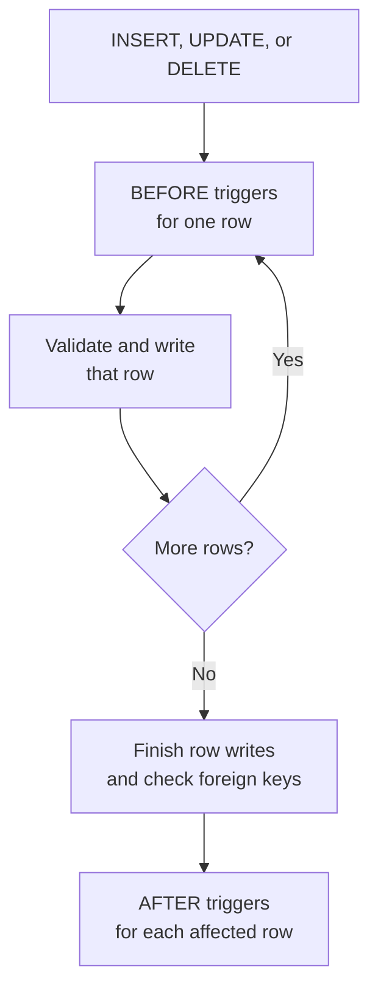

# C# extensions

C# extensions let you add application-specific behavior to CamusDB without
adding another network service or repeating a multi-step rule in every client.
You can make C# code available as a SQL scalar function, run it automatically
when rows change, or call a transactional procedure from SQL.

Use extensions to gain one of these outcomes:

- **Reusable SQL expressions.** Expose C# calculations as scalar functions for
  projections, filters, defaults, and checks.
- **Rules that every writer follows.** Use triggers for normalization,
  validation, derived values, and transactional audit rows, including writes
  made outside your primary application.
- **One atomic server-side operation.** Use a procedure to package several SQL
  statements behind one `CALL`, reducing client orchestration while keeping all
  database changes in one transaction.

Extensions are best for small, reviewed pieces of domain logic that benefit
from running with the data. They execute inside the CamusDB server process, so
they are an operator-managed deployment feature, not arbitrary code uploaded by
database users.

| Extension | SQL surface | Best use |
| --- | --- | --- |
| Scalar function | `SELECT my_function(...)` | Calculate or transform one value. |
| Trigger | `CREATE TRIGGER ... EXTERNAL NAME ...` | React automatically to each inserted, updated, or deleted row. |
| Procedure | `CALL my_procedure(...)` | Run a named, multi-statement transactional operation. |

## Create an extension project

Create a class library and reference `CamusDB.Extensions.Abstractions`. Target
`netstandard2.0` or `net10.0`:

```xml
<Project Sdk="Microsoft.NET.Sdk">
  <PropertyGroup>
    <TargetFramework>netstandard2.0</TargetFramework>
    <LangVersion>latest</LangVersion>
    <Nullable>enable</Nullable>
  </PropertyGroup>
  <ItemGroup>
    <PackageReference Include="CamusDB.Extensions.Abstractions" Version="0.16.*" />
  </ItemGroup>
</Project>
```

Use the package version that matches the CamusDB servers where the assembly
will run. A server can load an extension built against the same or an older
contract, but refuses one built against a newer contract with `CADB0803`. While
CamusDB is in the `0.x` series, pin the matching minor version, such as
`0.16.*`, because a minor release may change the contract.

The package provides the attributes, interfaces, contexts, and row types that
extension code can use. CamusDB supplies its own copy at runtime, so do not
deploy the contract DLL beside the extension.

## Scalar functions

Mark a public static method with `[CamusFunction]`:

```csharp
using CamusDB.Extensions;

public static class TextFunctions
{
    [CamusFunction("slugify")]
    public static string Slugify(string value) => /* ... */;

    [CamusFunction("greet", Aliases = new[] { "hello" })]
    public static string Greet(string? name, string greeting = "hello")
        => greeting + " " + (name ?? "stranger");

    [CamusFunction("random_token", IsVolatile = true)]
    public static string RandomToken() => Guid.NewGuid().ToString("N");
}
```

The methods become ordinary SQL scalar functions:

```camussql
SELECT slugify(title)
FROM posts
WHERE slugify(title) = 'hello-world';

SELECT greet(NULL), hello('ann', 'hi');
```

Names and aliases are case-insensitive. An extension cannot replace a built-in
function, aggregate, table function, or another extension function; a collision
prevents the server from starting.

### Nulls and optional arguments

A nullable value type such as `long?`, or a nullable reference parameter such
as `string?`, receives SQL `NULL` as C# `null`. For a non-nullable parameter,
any `NULL` argument makes the SQL result `NULL` without calling the method.
Returning C# `null` returns SQL `NULL`.

Optional C# parameters define the accepted argument-count range. A missing SQL
argument receives the parameter's default value.

### Deterministic and volatile functions

Functions are deterministic by default. Set `IsVolatile = true` when the same
arguments can produce a different result, for example a random token or a value
from the clock.

This distinction affects SQL behavior:

- A volatile function bypasses the query result cache.
- A volatile function cannot be used in a `CHECK` constraint.
- A deterministic function used as a column `DEFAULT` is evaluated when the
  table is created and stored as a constant.
- A volatile default is evaluated separately for every inserted row.

An exception from a function fails the statement with `CADB0809`. Concurrent
statements can call the method at the same time, so function code must be
thread-safe. Calls run on the node coordinating the statement; expressions that
use an extension function are not pushed to peer nodes during a distributed
scan.

## Triggers

A trigger is a public class with a public parameterless constructor that
implements `ICamusTrigger`:

```csharp
using CamusDB.Extensions;

public sealed class AuditTrigger : ICamusTrigger
{
    public Task FireAsync(ITriggerContext context)
    {
        IRow? row = (IRow?)context.New ?? context.Old;

        return context.Sql.ExecuteAsync(
            "INSERT INTO audit_log (op, tbl, name) VALUES (@op, @tbl, @name)",
            new Dictionary<string, object?>
            {
                ["op"] = context.Operation.ToString(),
                ["tbl"] = context.TableName,
                ["name"] = row?.GetString("name"),
            });
    }
}
```

Register the CLR type on a table with SQL:

```camussql
CREATE TRIGGER audit ON orders
AFTER INSERT, UPDATE, DELETE
EXTERNAL NAME 'MyCompany.Ext.AuditTrigger';

CREATE TRIGGER normalize ON orders
BEFORE INSERT, UPDATE
EXTERNAL NAME 'MyCompany.Ext.NormalizeTrigger';

DROP TRIGGER audit ON orders;
```

`EXTERNAL NAME` is the full CLR type name. Creating or dropping a trigger
requires the table's `ALTER` privilege. In a cluster, run trigger DDL on the
database's schema leader: the node that currently
[leads](/docs/concepts#leader) schema changes for that database. Other nodes
reject trigger DDL instead of forwarding it, and the error names the current
schema leader.

### Before and after triggers

A trigger fires once for every affected row, in creation order, inside the
statement's transaction:



SQL issued by either trigger type shares the statement's transaction.

- A `BEFORE` trigger runs before validation and storage. On `INSERT` and
  `UPDATE`, it may modify `context.New`; the final row must still pass type,
  `NOT NULL`, length, foreign-key, and `CHECK` constraints. A `BEFORE DELETE`
  trigger cannot change the row, but it can reject the deletion by throwing.
- An `AFTER` trigger runs after the complete statement has written its rows and
  passed foreign-key checks. It sees the final rows and cannot change them.

`context.Old` and `context.New` contain every column, including large values.
One trigger instance is shared by concurrent statements in an engine, so do not
keep per-statement state in instance or static fields.

Triggers fire for SQL `INSERT`, `UPDATE`, and `DELETE`, including `RETURNING`
and `INSERT ... SELECT`; for DML issued by procedures and triggers; and for the
typed HTTP and gRPC write APIs. They do not fire for internal maintenance such
as `TRUNCATE`, TTL expiration, schema backfills and rewrites, materialized-view
refresh, restore, or dropped-table recovery.

A `BEFORE` trigger must not use its SQL session to change another row that the
outer statement has already read and is still writing. CamusDB rejects that
stale-row hazard with `CADB0825`.

## Procedures

A procedure is a public class with a public parameterless constructor, marked
with `[CamusProcedure]`, that implements `ICamusProcedure`:

```csharp
using CamusDB.Extensions;

[CamusProcedure("transfer", MinArguments = 3, MaxArguments = 3)]
public sealed class Transfer : ICamusProcedure
{
    public async Task ExecuteAsync(IProcedureContext context)
    {
        string from = (string)context.Arguments[0]!;
        string to = (string)context.Arguments[1]!;
        long amount = (long)context.Arguments[2]!;

        await context.Sql.ExecuteAsync(
            "UPDATE accounts SET balance = balance - @amount WHERE name = @name",
            new Dictionary<string, object?> { ["amount"] = amount, ["name"] = from });

        await context.Sql.ExecuteAsync(
            "UPDATE accounts SET balance = balance + @amount WHERE name = @name",
            new Dictionary<string, object?> { ["amount"] = amount, ["name"] = to });
    }
}
```

Call it with values, parameters, expressions, or functions:

```camussql
CALL transfer('alice', 'bob', 30);
CALL transfer(@from, @to, 10 * 3);
```

Arguments are evaluated before the procedure runs. A call outside
`MinArguments` through `MaxArguments` is rejected first. The procedure runs in
the `CALL` transaction: all its SQL commits together, and an exception rolls it
all back with `CADB0822`.

`CALL` reports the total rows changed and returns no result set. Send it through
an execute/non-query client API. It is not preparable. Calling a procedure
currently requires a superuser because procedure-specific grants are not yet
available.

## SQL inside a trigger or procedure

`context.Sql` runs statements in the same transaction and with the same user
privileges as the statement that invoked the extension:

- `ExecuteAsync` runs `INSERT`, `UPDATE`, or `DELETE` and returns the changed-row
  count.
- `QueryAsync` runs `SELECT` and returns row copies that remain valid after the
  call.
- DDL and transaction control such as `BEGIN`, `COMMIT`, and `ROLLBACK` are
  rejected with `CADB0820`.
- Parameters use a dictionary key with or without the leading `@`.
- Nested writes count against `max_mutations_per_transaction` and fire the
  target tables' triggers.

An error from nested SQL makes the transaction rollback-only even when the
extension catches the exception. There are no savepoints. Returning after such
an error fails the statement with `CADB0823`, and attempting to commit the
transaction fails with `CADB0824`.

## Supported values

| CamusDB type | C# type |
| --- | --- |
| `INT64` | `long` |
| `FLOAT64` | `double` |
| `FLOAT32` | `float` |
| `BOOL` | `bool` |
| `STRING` | `string` |
| `OID` | `string` containing the ObjectId text |
| `UUID` | `Guid` |
| `BYTES`, including vectors | `byte[]` |
| `DATE`, `DATETIME` | UTC `DateTime`; a returned `DateTime` is `DATETIME` |
| `NUMERIC` | `decimal` |

An `INT64` argument can convert to `double` or `decimal`, and a UUID-formatted
`STRING` can convert to `Guid`. JSON is represented as `STRING`. Arrays are not
supported by the extension contract in this version.

CamusDB `NUMERIC` can hold more significant digits than .NET `decimal`. A value
that does not fit fails with `CADB0810` instead of being truncated. Returned
decimals with more than nine fractional digits use CamusDB's normal half-away-
from-zero rounding.

Byte arrays are copied across the contract. Mutating an array received from a
row or argument does not change stored data.

## Deploy extensions

Build the class library, copy its DLL to every CamusDB node, and list the
absolute path in the server configuration:

```yaml
extension_assemblies:
  - /opt/camusdb/extensions/MyCompany.Ext.dll

unsafe_extension_assemblies:
  - /opt/camusdb/extensions/MyCompany.Reviewed.dll
```

Each node loads its local DLL into the CamusDB server process. SQL calls and
supported write APIs invoke extension code through that server:

<ArchDiagram
  sources={[
    {label: 'SQL calls', icon: 'log'},
    {label: 'Typed write APIs', icon: 'log'},
  ]}
  group="CamusDB node"
  hub={{label: 'CamusDB server', icon: 'server'}}
  targets={[{label: 'C# extension DLL', sub: 'Functions, triggers, procedures', icon: 'chip'}]}
  title="SQL calls and typed write APIs reach a CamusDB server. The server loads and invokes a C# extension DLL inside its own process. Each node needs its own copy of the DLL."
/>

The equivalent command-line flags are `--extension-assemblies` and
`--unsafe-extension-assemblies`, with space-separated paths. Both settings are
restart-class: replace the file and restart the node to load a new build.

The DLL is not stored in the database or replicated. Every cluster node must
receive the same deployment. Trigger definitions record the defining DLL's
SHA-256 hash; a node missing that type or loading a different build refuses DML
with `CADB0817` instead of running inconsistent trigger code.

Deploy an extension and its private dependencies as one unit. To update a
trigger extension, deploy the new files everywhere, restart every node, then
drop and recreate the trigger so its recorded hash matches. Function and
procedure definitions do not currently have the same cross-node hash check.

The browser playground cannot load extensions. Logical dumps do not include
trigger definitions, so recreate them after a
[logical dump and reimport](/docs/logical-dump-and-reimport).

## Safe and unsafe assemblies

Files in `extension_assemblies` are **safe extensions**. Before loading one,
CamusDB inspects its metadata and rejects APIs that can access files, processes,
networking, native code, dynamic assembly loading, or other dangerous runtime
facilities. Runtime dependency loading is restricted to the same allow-list.

Files in `unsafe_extension_assemblies` skip those checks. They can load private
dependencies from their own directory, and the server logs their trust level at
startup.

Safe mode is a review guardrail, not a sandbox. Extension code runs inside the
database process with its permissions. It can consume unbounded CPU or memory,
and a stack overflow can terminate the server. Deploy only reviewed code; the
operator-controlled assembly lists are the security boundary.

## Transactions, retries, and side effects

Database writes made through `context.Sql` commit and roll back with their outer
statement. CamusDB may retry a statement after a serializable conflict or
schema transition. Rolled-back attempts do not leave database changes, but an
effect outside the database, such as a network call, file write, or in-memory
counter, can occur more than once.

Keep extension behavior inside the database where possible. Any unavoidable
external effect must be idempotent or performed after the transaction commits.
A trigger or procedure failure inside an explicit transaction rolls back that
whole transaction.

## Limits

- Triggers and procedures may nest up to 16 levels. Deeper recursion fails with
  `CADB0819`.
- Trigger and procedure writes count against
  `max_mutations_per_transaction`.
- Rows retained for `AFTER` triggers count against `spill_threshold_bytes`; an
  oversized statement fails with `CADB0826`.
- Cancellation is cooperative, and a write is not cancellable after writing
  begins in this version.
- CamusDB cannot stop an extension method that never returns.
- Extension aggregates, table functions, and array parameters or results are
  not supported yet.

## Inspect loaded extensions

`SHOW EXTENSIONS` returns one row for each assembly loaded by the node:

```camussql
SHOW EXTENSIONS;
```

The result includes the assembly name, version, path, SHA-256, trust level, and
registered functions, triggers, and procedures. The statement is node-local and
requires a superuser. Compare `sha256` across nodes to find inconsistent
deployments. CamusDB also logs each loaded extension and its members at startup.

## Common errors

| Code | Meaning |
| --- | --- |
| `CADB0800`-`CADB0804` | Invalid, missing, unloadable, incompatible, or duplicate extension assembly. |
| `CADB0805` | A function or procedure name collides with another registered name. |
| `CADB0806`, `CADB0807` | A safe assembly failed inspection or attempted a disallowed runtime load. |
| `CADB0808` | An extension member has a signature CamusDB cannot bind. |
| `CADB0809`, `CADB0810` | A function threw, or a `NUMERIC` value did not fit a .NET `decimal`. |
| `CADB0811`-`CADB0816` | A trigger type or trigger DDL target is invalid. |
| `CADB0817` | A node is missing the trigger assembly or has a different build. |
| `CADB0818` | A trigger threw and the statement rolled back. |
| `CADB0819` | Trigger and procedure nesting exceeded 16 levels. |
| `CADB0820` | Extension SQL attempted unsupported DDL or transaction control. |
| `CADB0821`, `CADB0822` | A procedure is missing, or it threw and rolled back. |
| `CADB0823`, `CADB0824` | Nested SQL failed and left the transaction rollback-only. |
| `CADB0825` | A `BEFORE` trigger changed a row the outer statement was still writing. |
| `CADB0826` | Rows retained for `AFTER` triggers exceeded the memory threshold. |
