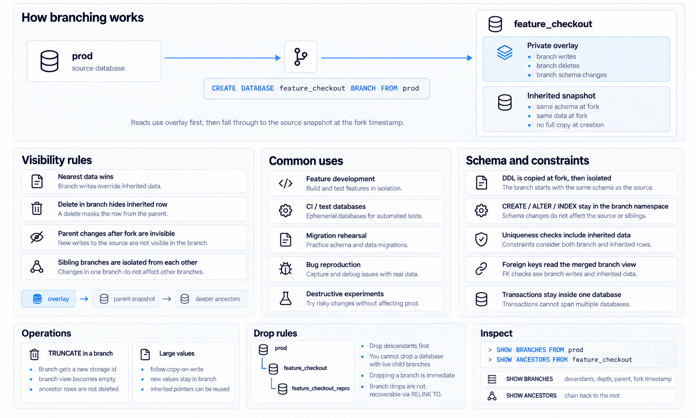
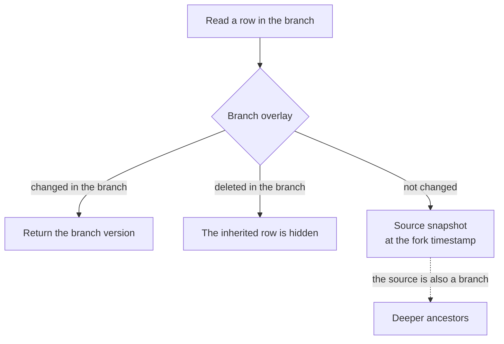
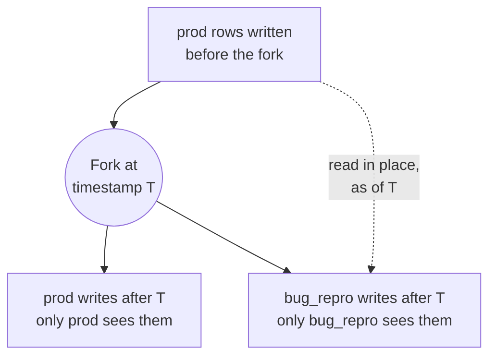

# Database branching

A database branch is an isolated clone of a database at a point in time. Use it
to test a schema migration, reproduce a production bug, or try a risky data fix
on realistic data. Your changes in the branch don't reach the source database.
When you finish, you keep the branch or drop it.

In PostgreSQL, the closest tool is `CREATE DATABASE ... TEMPLATE`, which copies
all the files of the template. A CamusDB branch copies no rows when you create
it:

```camussql
CREATE DATABASE bug_repro BRANCH FROM prod;
USE bug_repro;

-- This write is in bug_repro only. prod doesn't change.
UPDATE orders SET status = 'refunded' WHERE status = 'paid';
```

The branch starts with the schema and the data of the source at the fork.
Branches are copy-on-write: reads of inherited rows come from the source
snapshot, and writes and schema changes go into a private overlay of the
branch.

You can use branches in the following ways:

- A database for each feature, for development and CI.
- A test of a schema migration on production-like data.
- A reproduction of a production bug, with no writes to production.
- A destructive experiment that you discard.
- An isolated database for each developer or test run.



## Create a branch

Create the source database first:

```camussql
CREATE DATABASE prod;
USE prod;

CREATE TABLE orders (
  id OID PRIMARY KEY,
  status STRING,
  total FLOAT64
);
```

Then create a branch from it:

```camussql
CREATE DATABASE feature_checkout BRANCH FROM prod;
USE feature_checkout;
```

For a setup script that must be safe to repeat, use `IF NOT EXISTS`:

```camussql
CREATE DATABASE IF NOT EXISTS feature_checkout BRANCH FROM prod;
```

Without `IF NOT EXISTS`, an existing name returns `CADB0012`. The source must
exist, and it can't have a schema change in progress.

## What a branch sees

A branch reads through a chain:

1. Its private overlay.
2. The source database, as of the fork timestamp.
3. The deeper ancestors, if the source is also a branch.

The nearest data wins:

- After you change a row in the branch, reads see the version of the branch.
- A delete in the branch hides the inherited row.
- A row that the branch didn't change is read from the source snapshot.



```camussql
USE prod;
INSERT INTO orders VALUES (GEN_ID(), 'paid', 120.50);

CREATE DATABASE bug_repro BRANCH FROM prod;
USE bug_repro;

-- Reads the rows of prod at the fork.
SELECT * FROM orders;
```

```text
┌──────────────────────────┬────────┬───────┐
│ id                       │ status │ total │
├──────────────────────────┼────────┼───────┤
│ 6afe1d173bd8878b74cf9bf8 │ paid   │ 120.5 │
└──────────────────────────┴────────┴───────┘
1 rows in set (00:00:00.0146317)
```

```camussql
-- This write is private to bug_repro.
UPDATE orders SET status = 'refunded' WHERE status = 'paid';
SELECT * FROM orders;
```

```text
┌──────────────────────────┬──────────┬───────┐
│ id                       │ status   │ total │
├──────────────────────────┼──────────┼───────┤
│ 6afe1d173bd8878b74cf9bf8 │ refunded │ 120.5 │
└──────────────────────────┴──────────┴───────┘
1 rows in set (00:00:00.0047559)
```

```camussql
-- prod doesn't change.
USE prod;
SELECT * FROM orders;
```

```text
┌──────────────────────────┬────────┬───────┐
│ id                       │ status │ total │
├──────────────────────────┼────────┼───────┤
│ 6afe1d173bd8878b74cf9bf8 │ paid   │ 120.5 │
└──────────────────────────┴────────┴───────┘
1 rows in set (00:00:00.0003449)
```

The row is `refunded` in `bug_repro` and `paid` in `prod`.

The branch doesn't see the changes that the parent makes after the fork. The
parent and the other branches don't see the changes of the branch. Both sides
share the rows written before the fork, and none of them is copied:



## Schema isolation

A new branch gets a copy of the schema metadata of the source at the fork.
After that, DDL on the parent and DDL on the branch don't affect each other.
`DROP TABLE` and `DROP INDEX` in a branch remove the metadata and the overlay
data of the branch. They don't delete inherited rows.

This means that you can try a migration on a realistic starting point:

```camussql
CREATE DATABASE migration_test BRANCH FROM prod;
USE migration_test;

ALTER TABLE orders ADD COLUMN audit_note STRING;
CREATE INDEX orders_status_idx ON orders (status);
```

If the migration is wrong, drop the branch and create a new one.

If the source is refreshing a materialized view when you create the branch,
the branch doesn't inherit that refresh. It sees the contents of the view that
were published at the fork timestamp.

## Constraints and writes

A write in a branch affects that branch only. However, constraints apply to the
branch and its inherited rows together, as if the branch were a full copy:

- A primary key or unique value that an inherited row has returns `CADB0300` on
  an insert in the branch. Delete the inherited row first.
- A foreign-key check reads the rows of the branch, merged with its ancestors as
  of the fork. A parent row that the source inserts after the fork doesn't
  satisfy a check in the branch, and the check returns `CADB0304`.

A branch can't reference a table in its source database. If a foreign key is
being added in the source, a new branch returns an error. The branch would
inherit a constraint that isn't validated yet.

A transaction applies to one database. It can change `prod` or
`feature_checkout`, but not both.

## Large values in a branch

A row can point to a large value that is stored outside the row. In a branch,
the value follows the copy-on-write rule of the row:

- An inherited row reads its large values from the parent, at the fork
  timestamp.
- A write in the branch stores new large values in the branch.
- An update of a small column can keep the inherited pointer, and it doesn't
  write the large value again.
- A delete, or a smaller value, writes a tombstone for the value key in the
  branch.

`ALTER TABLE ... REWRITE STORAGE` on the parent writes new row versions. A
branch that forked before the rewrite reads the old versions at its fork
timestamp. See [Large values](/docs/storage-layout).

## Truncate in a branch

The rows of a table in a branch are the branch overlay merged with the rows of
its ancestors. This means that a [`TRUNCATE`](/docs/truncate-table) in a branch
applies to the merged view:

| Action | Effect |
| --- | --- |
| Truncate in a branch | The table in the branch becomes empty: its overlay and its inherited rows. The ancestors don't change. |
| Recover in a branch | The merged view from before the truncate is rebuilt, under a new table name. |
| Reclamation | Reclamation is limited to the branch database. It doesn't delete keys of an ancestor. |
| Truncate the source | A truncate of the source after the fork doesn't change the branch. The branch keeps its forked contents. |

A truncate in a branch doesn't delete data at once. The overlay becomes retired
contents, which you can recover.

## Drop a branch

Drop a branch like a database:

```camussql
DROP DATABASE feature_checkout;
```

You can't drop a database that has a live branch. It returns `CADB0508`. Drop
the branches first, from the leaves to the root:

```camussql
DROP DATABASE feature_checkout_repro;
DROP DATABASE feature_checkout;
DROP DATABASE prod;
```

A drop of a branch releases its retention hold. The hold prevents the reclamation
of the older row versions ([MVCC](/docs/concepts#mvcc)) of the source, which the
branch reads as of the fork.

A drop of a branch is permanent. `CREATE DATABASE ... RELINK TO` can't recover
it. Recoverable drops apply to root databases and to tables in root databases.
See [Recover dropped objects](/docs/recover-dropped-objects).

## Inspect branches {#inspect-the-branches}

`SHOW BRANCHES` and `SHOW ANCESTORS` show the branch relationships. They are
server-level statements, and they don't need a current database:

```camussql
SHOW BRANCHES FROM prod;
SHOW ANCESTORS FROM feature_checkout;
```

`SHOW BRANCHES FROM <database>` returns all the descendants of the database. A
direct branch has depth `1`, and a branch of that branch has depth `2`. The rows
are ordered by depth, then by name.

| Column | Meaning |
| --- | --- |
| `database` | The name of the descendant. |
| `id` | The stable internal id of the descendant. |
| `depth` | The distance from the source database. |
| `parent` | The name of the immediate parent. |
| `fork_timestamp` | The cluster timestamp ([HLC](/docs/concepts#hlc)) of the fork from the parent. |

`SHOW ANCESTORS FROM <database>` returns the chain of ancestors, from the
immediate parent to the root. A root database returns no rows.

| Column | Meaning |
| --- | --- |
| `database` | The name of the ancestor. |
| `id` | The stable internal id of the ancestor. |
| `depth` | The distance from the queried database. |
| `fork_timestamp` | The HLC timestamp of the fork below this ancestor. |

For example:

```camussql
CREATE DATABASE prod;
CREATE DATABASE feature_checkout BRANCH FROM prod;
CREATE DATABASE checkout_repro BRANCH FROM feature_checkout;

SHOW BRANCHES FROM prod;
```

```text
┌──────────────────┬─────┬───────┬──────────────────┬─────────────────────────┐
│ database         │ id  │ depth │ parent           │ fork_timestamp          │
├──────────────────┼─────┼───────┼──────────────────┼─────────────────────────┤
│ feature_checkout │ 1Is │ 1     │ prod             │ HLC(1:1795038481890:1)  │
│ checkout_repro   │ 1It │ 2     │ feature_checkout │ HLC(1:1795038481949:17) │
└──────────────────┴─────┴───────┴──────────────────┴─────────────────────────┘
2 rows in set (00:00:00.0237001)
```

```camussql
SHOW ANCESTORS FROM checkout_repro;
```

```text
┌──────────────────┬─────┬───────┬─────────────────────────┐
│ database         │ id  │ depth │ fork_timestamp          │
├──────────────────┼─────┼───────┼─────────────────────────┤
│ feature_checkout │ 1Is │ 1     │ HLC(1:1795038481949:17) │
│ prod             │ 1Ir │ 2     │ HLC(1:1795038481890:1)  │
└──────────────────┴─────┴───────┴─────────────────────────┘
2 rows in set (00:00:00.0014279)
```

The `feature_checkout` row has the timestamp of the fork that created
`checkout_repro`. Use these statements to find the leaf branches before you drop
a parent, and to see the snapshot that a branch depends on.

## How it works

Each database has a stable internal id. A branch also records the id of its
source and the HLC timestamp of its fork. When you create a branch, CamusDB:

1. Creates a new database id for the branch.
2. Records the ancestors of the branch.
3. Pins the source snapshot, so that inherited reads stay valid.
4. Copies the schema metadata as of the fork timestamp.
5. Publishes the branch as an ordinary database name.

No rows or index entries are copied. Reads merge the branch overlay with the
snapshots of its ancestors. Writes, deletes, and new schema objects go into the
branch.

## Operator notes

Snapshot retention is the main operational cost. A live branch makes the source
keep its history from the fork. This means that many long-lived branches over a
busy source can delay storage reclamation.

Each live branch has a hold on the snapshot of its parent, and the hold is
renewed in the background. The renewal reads the persistent branch registry.
This means that any node can renew a branch that another node created. A rename
of a branch keeps the hold, and a drop releases it.

`branch_snapshot_hold_lease_ms` (default 300,000 ms, 5 minutes) sets how long a
hold lasts between renewals (its [lease](/docs/concepts#lease)). See the
[settings reference](/docs/settings-reference).

A short renewal gap can recover while the hold is registered. However, after a
hold is removed from the replicated registry, the inherited history can already
be reclaimed. Then reads and writes that use the ancestry of the branch return
`CADB0539` `BranchSnapshotProtectionLost` (HTTP 410). Create the branch again
from the parent. Don't trust a partial inherited view.

In cluster mode, a drop of a parent is fenced against a concurrent branch
creation. If the fence can't be taken, or its state is unknown, the drop returns
a retryable error.

With many branches, you should watch the snapshot floor metrics of
[Kahuna](/docs/concepts#kahuna), the storage layer, in
[`SHOW ENGINE STATS`](/docs/engine-stats). The snapshot floor is the oldest
point in history that a hold pins:

| Metric | Meaning |
| --- | --- |
| `kahuna.snapshot_floor.live_holds` | The number of live snapshot holds. A steady increase usually means that branches aren't dropped. |
| `kahuna.snapshot_floor.effective_floor_ms` | The snapshot floor, as a Unix timestamp in milliseconds. |
| `kahuna.snapshot_floor.missing_protected_version_total` | Must be `0`. A value above zero means that protected history was reclaimed. It appears after its first event. |

A deep branch chain also adds work to reads. A read can look at one level for
each ancestor. You should prefer short-lived branches for development, tests,
and debugging.

### What a drop costs

`DROP DATABASE` purges the private overlay of the branch in limited batches,
and it returns after the purge finishes. A larger overlay takes longer to drop.
This also applies to indexes built on inherited rows. The purge isn't limited
by the mutation limit of a transaction.

A temporary failure to read the registry is retried three times, and then it
returns the retryable `CADB0504`. An incomplete purge keeps its recovery
markers, and the node continues the purge at startup.

## Current limits

Database branches don't support these features yet:

- A merge into the parent.
- Transactions across two branches.
- Automatic branch compaction or rebase.
- A new parent for a branch whose parent was dropped.
- A maximum branch depth.

## Error codes

| Code | Name | Typical cause |
| --- | --- | --- |
| `CADB0010` | `DatabaseDoesntExist` | The source database doesn't exist, or it was dropped while the branch was created. |
| `CADB0012` | `DatabaseAlreadyExists` | The name of the branch exists, and the statement doesn't have `IF NOT EXISTS`. |
| `CADB0400` | `InvalidInput` | The source has a schema change in progress, the snapshot hold can't be taken, or another precondition fails. |
| `CADB0508` | `DatabaseHasLiveDescendants` | A `DROP DATABASE` of a database that has a live branch. |
| `CADB0539` | `BranchSnapshotProtectionLost` | The snapshot hold of the branch was removed. Reads of the ancestors return this error, and not a result that can be incomplete. |

## Related pages

- [Databases](/docs/databases)
- [SQL](/docs/sql)
- [Transactions and isolation](/docs/serializable-transactions)
- [Storage](/docs/storage)
- [Error codes](/docs/error-codes)
