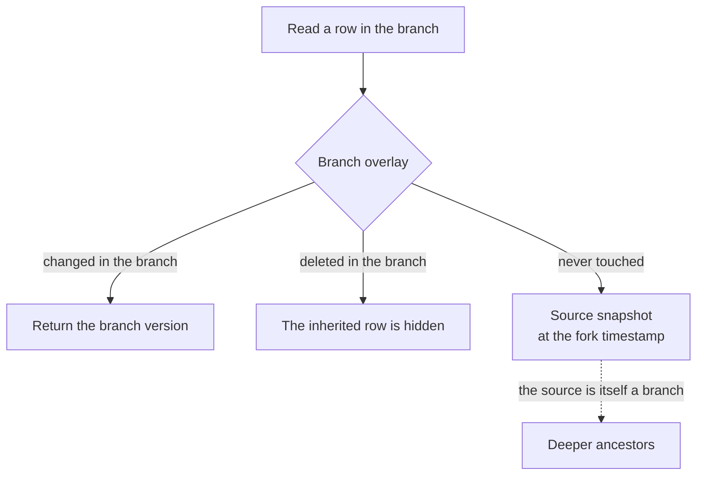
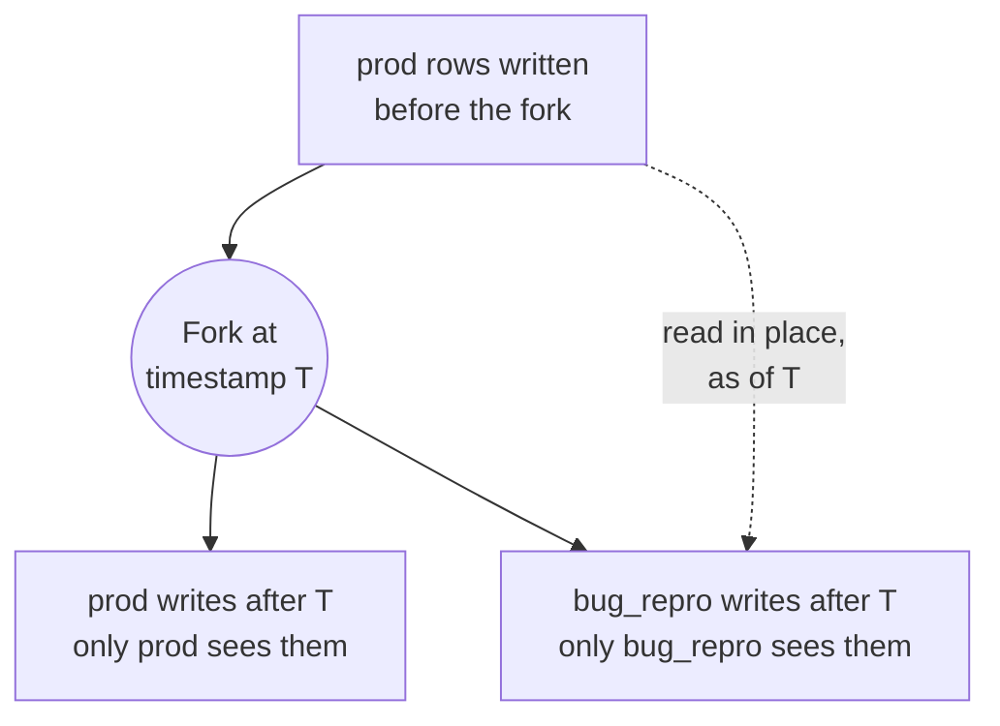

# Database branching

You want to test a schema migration, reproduce a production bug, or try a risky
data fix on realistic data, without any chance of touching production. A
database branch gives you that: an isolated clone of an existing database at a
point in time. You work in the branch, then keep it or drop it. Nothing you do
there reaches the source database.

In PostgreSQL, the closest tool is `CREATE DATABASE ... TEMPLATE`, which copies
every file of the template. A CamusDB branch copies no rows when you create it:

```camussql
CREATE DATABASE bug_repro BRANCH FROM prod;
USE bug_repro;

-- This write stays in bug_repro. prod is unchanged.
UPDATE orders SET status = 'refunded' WHERE status = 'paid';
```

The branch starts with the same schema and the same view of the data as the
source database had at the fork.

Branches are copy-on-write over the existing storage layer. Inherited reads come
from the source snapshot, while writes and schema changes go into the branch's
private overlay.

Common uses:

- One database per feature, for development and CI.
- Testing a schema migration against production-like data.
- Reproducing a production-only bug without writing anything to production.
- Running a destructive experiment, then discarding the branch.
- Giving each developer and each test run its own isolated database clone.


CamusDB is in production use, but branching is still an alpha feature. Its APIs
and storage formats can change between versions.

## Create a branch

Create the source database first:

```camussql
CREATE DATABASE prod;
USE prod;

CREATE TABLE orders (
  id OID PRIMARY KEY,
  status STRING,
  total FLOAT64
);
```

Then create a branch from it:

```camussql
CREATE DATABASE feature_checkout BRANCH FROM prod;
USE feature_checkout;
```

Use `IF NOT EXISTS` when a setup script must be safe to repeat:

```camussql
CREATE DATABASE IF NOT EXISTS feature_checkout BRANCH FROM prod;
```

Without `IF NOT EXISTS`, the target name must not already exist.

The source database must exist, and it must have no schema change in flight
when you create the branch.

## What a branch sees

A branch reads through a chain of ancestors:

1. Its own private overlay.
2. The source database, as of the fork timestamp.
3. Every deeper ancestor, when the source was itself a branch.

The nearest data wins:

- After you change a row in the branch, reads see the branch's version.
- A delete in the branch hides the inherited source row.
- For a row the branch never touched, the read falls through to the source
  snapshot.



```camussql
USE prod;
INSERT INTO orders VALUES (GEN_ID(), 'paid', 120.50);

CREATE DATABASE bug_repro BRANCH FROM prod;
USE bug_repro;

-- Reads inherited rows from prod at the fork point.
SELECT * FROM orders;

-- This write is private to bug_repro.
UPDATE orders SET status = 'refunded' WHERE status = 'paid';

-- prod is unchanged.
USE prod;
SELECT * FROM orders;
```

The branch does not see changes made to the parent after the fork. The parent
and sibling branches do not see changes made in the branch.

After the fork, both databases share the rows written before it, and CamusDB
copies none of them. Each side keeps its later writes to itself:



## Schema isolation

Creating a branch copies the source's schema metadata as of the fork. After
that:

- DDL on the parent is invisible to the branch.
- DDL on the branch is invisible to the parent and to sibling branches.
- `CREATE TABLE`, `ALTER TABLE`, and `CREATE INDEX` in the branch operate in the
  branch's namespace.
- `DROP TABLE` and `DROP INDEX` in the branch remove the local metadata and the
  overlay data. Neither one scans for and deletes inherited source rows.

So you can try a migration, or a table for a new feature, against a realistic
starting point:

```camussql
CREATE DATABASE migration_test BRANCH FROM prod;
USE migration_test;

ALTER TABLE orders ADD COLUMN audit_note STRING;
CREATE INDEX orders_status_idx ON orders (status);
```

If the migration is wrong, drop the branch and create a fresh one.

If the source is refreshing a materialized view when you create the branch, the
branch does not inherit that in-flight job. It sees the view contents that were
published at the fork timestamp. The parent's refresh finishes or fails on the
parent only.

## Constraints and writes

A write in a branch affects only that branch. Uniqueness checks, however, cover
the branch together with its inherited data.

If the source snapshot holds a primary key or unique index value, inserting the
same value in the branch conflicts. The branch must delete that inherited row
first.

This keeps a branch close to a true database clone. CamusDB does not treat the
source as loose seed data.

Foreign keys are inherited too. A check stays inside the branch: it reads the
branch's own rows merged with its ancestors as of the fork point. A write in the
source database after the fork does not satisfy or break a foreign-key check in
the branch, and a write in the branch does not affect the source. A branch
cannot reference a table in its source database.

Creating a branch while a foreign key is still being added is refused, because
the branch would inherit a constraint that has not finished validation.

A transaction still runs inside one database. It can operate on `prod` or on
`feature_checkout`, but not on both.

## Large values in a branch

A row can point at a large value stored outside the row. In a branch, that value
follows the same copy-on-write rule as the row:

- An inherited row reads its inherited out-of-line values from the parent at the
  fork timestamp.
- A write in the branch stores new large values in the branch only.
- Updating a small column can keep the inherited pointer without rewriting the
  large value.
- A delete or a shrink writes the branch's own tombstone for the value key.

`ALTER TABLE ... REWRITE STORAGE` on the parent writes new row versions. A
branch forked before that rewrite still reads the old versions at its fork
timestamp. See [Large Values](/docs/storage-layout).

## Truncate in a branch

A table's rows in a branch are the branch overlay merged with its ancestors'
rows, and every level uses the same storage id. So a
[`TRUNCATE`](/docs/truncate-table) in a branch applies to the whole merged view.

| Action | Effect |
| --- | --- |
| Truncate in a branch | CamusDB gives the branch a new storage id. The branch's view becomes empty: both its overlay and its inherited rows disappear from that branch. |
| Recover in a branch | CamusDB rebuilds the branch's whole merged view from before the truncate, under a new table name. |
| Reclamation | CamusDB scopes reclamation to the branch's database id. It never deletes an ancestor's key. |
| Truncate the source | Truncating the source after a fork does not rewrite the descendant's copied schema. The descendant keeps its forked contents. |

A truncate in a branch deletes nothing immediately. The overlay becomes retired
contents, and CamusDB never touches the ancestor's rows.

## Drop a branch

Drop a branch like any other database:

```camussql
DROP DATABASE feature_checkout;
```

You cannot drop a database that has a live descendant branch. Drop the
descendants first, from the leaves back toward the root:

```camussql
DROP DATABASE feature_checkout_repro;
DROP DATABASE feature_checkout;
DROP DATABASE prod;
```

Dropping a branch releases its retention hold: the pin that kept the source's
older row versions ([MVCC](/docs/concepts#mvcc)) from being reclaimed, so the
branch could still read the source as of the fork.

Dropping a branch is immediate, and `CREATE DATABASE ... RELINK TO` cannot
recover it. Recoverable drops cover root databases and tables in root databases.
See [Recover Dropped Objects](/docs/recover-dropped-objects).

## Inspect branches {#inspect-the-branches}

Use `SHOW BRANCHES` and `SHOW ANCESTORS` to inspect branch relationships from
SQL. Both are server-level statements, so neither needs a current database.

```camussql
SHOW BRANCHES FROM prod;
SHOW ANCESTORS FROM feature_checkout;
```

`SHOW BRANCHES FROM <database>` returns every descendant of the named database.
A direct branch has depth `1`, a branch of that branch has depth `2`, and so
on. CamusDB orders the result by depth, then by database name.

| Column | Meaning |
| --- | --- |
| `database` | The descendant database's name. |
| `id` | The descendant database's stable internal id. |
| `depth` | The distance from the source database. |
| `parent` | The immediate parent database's name. |
| `fork_timestamp` | The cluster timestamp ([HLC](/docs/concepts#hlc)) when the descendant forked from its parent. |

`SHOW ANCESTORS FROM <database>` returns the named database's ancestor chain,
starting with the immediate parent and walking back toward the root. A root
database returns an empty result.

| Column | Meaning |
| --- | --- |
| `database` | The ancestor database's name. |
| `id` | The ancestor database's stable internal id. |
| `depth` | The distance from the queried database. |
| `fork_timestamp` | The hybrid logical clock timestamp of the fork below this ancestor. |

For example:

```camussql
CREATE DATABASE prod;
CREATE DATABASE feature_checkout BRANCH FROM prod;
CREATE DATABASE checkout_repro BRANCH FROM feature_checkout;

SHOW BRANCHES FROM prod;
SHOW ANCESTORS FROM checkout_repro;
```

These statements help you find the leaf branches before you drop a parent, see
how deep a branch chain is, and confirm which source snapshot a branch depends
on.

## How it works

Every database has a stable internal storage id. A root database has no
ancestor. A branch records two values: the source database's id and the hybrid
logical clock timestamp of its fork.

When you create a branch, CamusDB:

1. Creates a new database id for the branch.
2. Records the branch's ancestors.
3. Pins the source snapshot, so inherited reads stay valid.
4. Copies the schema metadata as of the fork timestamp.
5. Publishes the branch as an ordinary database name.

Creating a branch copies no rows and no index entries. Reads merge the branch
overlay with its ancestors' snapshots. Writes, deletes, and new schema objects
all go into the branch's namespace only.

## Operator notes

Snapshot retention is the main operational cost. A live branch keeps its
source's history readable from the fork onward, so many long-lived branches over
a busy source can hold back storage reclamation.

CamusDB renews each live branch's hold on its parent snapshot in the background.
The renewer scans the persistent branch registry, so one node can renew a branch
that another node created. The renewer is whichever node owns the registry work
at that moment.

Renaming a branch preserves the hold. Dropping the branch releases it.

`branch_snapshot_hold_lease_ms` controls how long the hold lasts between
renewals (its [lease](/docs/concepts#lease)). See
[Configuration](/docs/configuration). The default is 300,000 milliseconds (5
minutes).

A temporary renewal lapse can recover while the hold remains registered. Once a
hold is removed from the replicated registry, however, CamusDB treats the branch
as permanently unprotected because inherited history may already have been
reclaimed. Reads and writes that would consult the branch's ancestry fail closed
with `CADB0539` `BranchSnapshotProtectionLost` (HTTP 410). Recreate the branch
from the parent instead of trusting a partial inherited view.

In cluster mode, CamusDB fences dropping a parent against concurrent branch
creation. If the fence cannot be acquired, or its state is indeterminate, the
drop fails closed with a retryable error. CamusDB does not purge a parent while
another node may publish a branch.

When your workload uses many branches, watch the snapshot floor metrics of
[Kahuna](/docs/concepts#kahuna), the storage layer. The snapshot floor is the
oldest point in history that a hold still pins:

| Metric | Meaning |
| --- | --- |
| `kahuna.snapshot_floor.live_holds` | The number of live snapshot holds. A steady increase usually means nobody is dropping branches. |
| `kahuna.snapshot_floor.effective_floor_ms` | How far into the past the oldest hold pins history. |
| `kahuna.snapshot_floor.missing_protected_version_total` | Must stay at `0`. A value above zero means CamusDB reclaimed protected history. |

A deep branch chain also adds work to reads, because CamusDB may probe one level
per ancestor. Until compaction or rebase exists, prefer short-lived branches for
development, testing, and debugging.

### Dropping a branch

`DROP DATABASE` purges the branch's private overlay in bounded batches and
returns after the purge finishes. Each batch uses one delete-many call,
sharing a Raft round instead of issuing a separate round trip per key. Larger
overlays, including indexes built on inherited rows, therefore add drop work.
This paged purge is not subject to the single-transaction mutation cap.

A transient registry-scan failure is retried internally up to three times,
then reported as retryable `CADB0504`. An incomplete purge retains its recovery
markers so startup can resume it. Drop descendants before their parents.

## Current limits

Database branches do not support these features today:

- Merging back into the parent.
- Transactions across two branches.
- Automatic branch compaction or rebase.
- Reparenting a descendant after its parent is dropped.
- A hard maximum branch depth.

Branching serves isolated development, testing, migration rehearsal, and problem
reproduction. You can drop any of these branches when you no longer need it.

## Error codes

| Code | Name | Typical cause |
| --- | --- | --- |
| `CADB0010` | `DatabaseDoesntExist` | The source database does not exist, or it was dropped while the branch was being created. |
| `CADB0012` | `DatabaseAlreadyExists` | The target branch name already exists, and the statement has no `IF NOT EXISTS`. |
| `CADB0400` | `InvalidInput` | The source has a schema change in flight, CamusDB cannot acquire the snapshot hold, or another branch or drop precondition fails. |
| `CADB0508` | `DatabaseHasLiveDescendants` | A `DROP DATABASE` targets a database with a live descendant branch. |
| `CADB0539` | `BranchSnapshotProtectionLost` | The snapshot hold that protected inherited branch data was removed, so CamusDB refuses ancestor reads instead of returning a possibly incomplete result. |

## Related pages

- [Databases](/docs/databases)
- [SQL](/docs/sql)
- [Transactions And Isolation](/docs/serializable-transactions)
- [Storage](/docs/storage)
- [Error Codes](/docs/error-codes)
