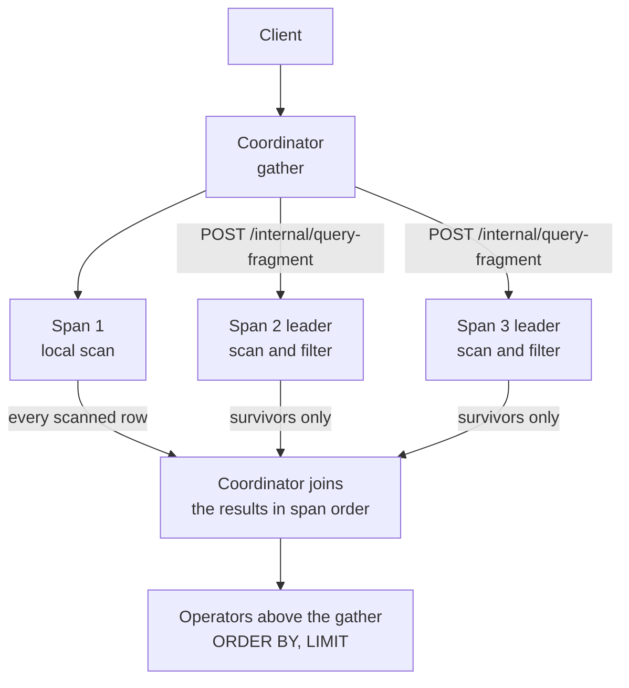
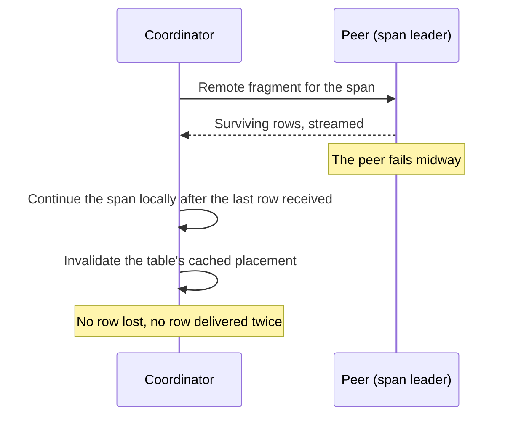
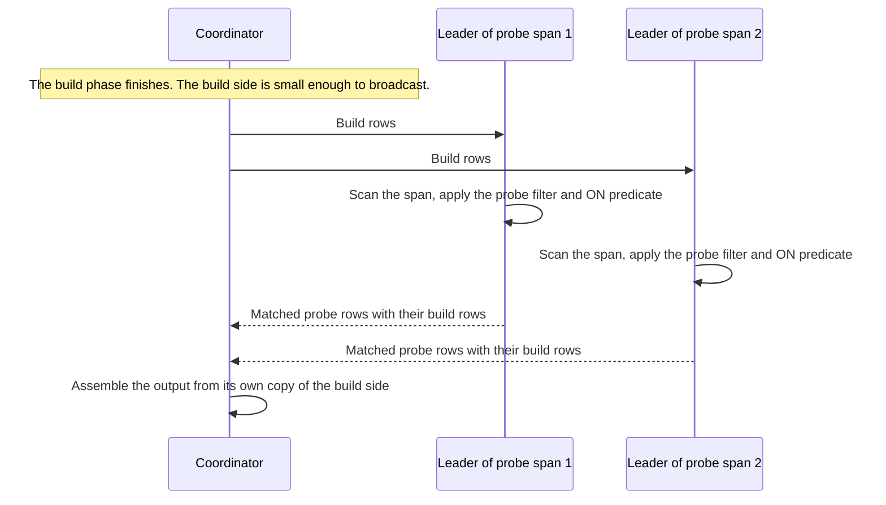

# Distributed queries

Distributed query execution makes large scans and aggregates faster in a
cluster. CamusDB sends each part of an eligible scan to the node that stores
those rows. Filters and aggregates run where the data is, the parts run at the
same time, and only the results come back. One node doesn't have to read all
rows across the network and do all the work. The query results are the same
with the feature on or off.

In a cluster, CamusDB spreads the rows of a table across
[partitions](/docs/concepts#partition). Each partition has a
[leader](/docs/concepts#leader), and that leader stores the data of the
partition.

```yaml
key_range_sharding: true
distributed_query_execution: true
```

The feature is off by default. When it is off, planning and execution are the
same as on a single node.

When it is on, CamusDB splits an eligible scan into one fragment for each
[span](/docs/concepts#ranges-and-spans) of the table. A span is a contiguous
range of the table's keys, and the placement of the table says which partition
serves each span. A fragment for data on another node is executed on that node. The
coordinator, the node that received the query, then combines the results.

If a part of the distributed execution fails, CamusDB executes it locally, and
the query doesn't fail.

## Where the savings come from

- **Filters run at the data.** A peer applies the filter before it sends rows.
  A scan that matches one row in a thousand sends one row in a thousand over
  the network.
- **Spans run at the same time.** A table with four spans is scanned on four
  leaders at once. The time of a full scan depends on the largest span.
- **Aggregates are combined before they travel.** CamusDB computes `COUNT`,
  `SUM`, `MIN`, `MAX`, and `AVG` for each span and merges them on the
  coordinator. A rollup over one hundred million rows sends one row per group
  per span.
- **The coordinator uses less memory.** It merges the result streams. It doesn't
  decode each row of the table.
- **Results stay correct when placement changes or a peer fails.** The spans
  always cover the full key space, and a failed fragment continues locally. A
  stale placement or a failed peer costs only a retry.

## Turn it on

| Setting | Default | Scope | Meaning |
| --- | --- | --- | --- |
| `key_range_sharding` | `false` | cluster | Required. Distribution splits a table by key range, and the table must use key-range routing. |
| `distributed_query_execution` | `false` | cluster | Turns on query fragments and sends them to peers. |
| `max_query_parallelism` | `1` | node | The number of concurrent row-decoding workers for each full scan. It applies with or without distribution, also on a standalone node. |
| `broadcast_join_max_build_rows` | `10000` | node | The largest hash-join build side, in rows, that CamusDB can send to the remote spans of the other table. See [Broadcast hash joins](#broadcast-hash-joins). `0` turns off broadcast joins. |

`distributed_query_execution` is a `restart` setting with `cluster` scope, and
all nodes must have the same value. Set it in `config.yml`, then restart the
node.

`max_query_parallelism` and `broadcast_join_max_build_rows` are `runtime`
settings with `node` scope. You can change them while a node is up.
`SET CLUSTER SETTING` applies the new value on all nodes and overrides each
node's `config.yml`:

```camussql
SET CLUSTER SETTING max_query_parallelism = 4;
SET CLUSTER SETTING broadcast_join_max_build_rows = 50000;
```

See [Runtime cluster settings](/docs/runtime-cluster-settings) for how a live
change reaches the nodes, and [`SHOW VARIABLES`](/docs/show-variables) for the
value that a node uses.

In a cluster deployment, set `http_peers` together with `peers`. Fragments
travel over HTTP, and CamusDB uses the two parallel lists to map the internal
cluster address of each peer to its HTTP address. If you omit `http_peers`,
CamusDB assumes that all nodes use the HTTP port of the current node. This is
true for the Docker Compose setup, but it is often false for a cluster that you
set up by hand. See [Cluster mode](/docs/cluster).

## Which queries are distributed

The planner adds a `gather` above a scan when all of these conditions are true:

- The statement is a full scan of the primary rows. Index lookups, index range
  scans, and forced-index scans aren't distributed.
- The node is in cluster mode, with key-range sharding on.
- The current placement of the table has more than one span.
- The transaction doesn't validate its reads at commit. Two kinds of
  transaction do: optimistic transactions, and pessimistic transactions with the
  read validation `track_and_validate` (see `default_read_validation`). CamusDB
  must build the read set of such a transaction from one session stream.
- The statement isn't the read part of an `UPDATE` or `DELETE`, which takes
  exclusive predicate locks.

Other statements are planned as if the feature were off.

CamusDB decides for each statement, with the current placement. A distributed
plan doesn't go into the plan cache. When a table splits into more spans, the
next query uses them.

## How a fragment is executed

A `gather` executes its scan once for each span, in the row ID range of that span.
Then it combines the results in span order. The spans are contiguous and in
ascending order, and together they cover the full key space. The combined
stream is the same as the rows of a regular full scan. `ORDER BY`, `LIMIT`, and
the other operators above the gather work as usual.

CamusDB sends a span to a peer when two conditions are true: another node leads
the span, and the peer can evaluate the filter of the query.

A filter can go to a peer only if it depends on the row alone. These filters
stay on the coordinator:

| Filter | Reason |
| --- | --- |
| Subqueries and `EXISTS` | The peer would need the coordinator's executor. |
| Parameter placeholders | The values are on the coordinator. |
| Volatile functions such as `NOW()` | CamusDB evaluates them once, in one place, and two nodes could disagree. |

These queries also stay on the local node:

- A query with no filter. A peer has no filter to apply, and the local scan
  already streams the pages of a remote span.
- A query that can use the [result cache](/docs/query-result-cache). The cache
  needs to record each row that the query scanned.

A span that isn't sent to a peer is scanned locally, in the same gather and at
the same time as the remote spans.



With a `LIMIT`, the gather takes at most `limit + offset` matching rows from
each span. A remote fragment stops sending rows when it reaches that number.

### When a peer fails

A remote fragment can fail during the scan. The coordinator then continues that
span locally, after the last row it received. No row is lost, and no row is
returned twice.

CamusDB also clears the cached placement of the table, and the next query looks
it up again. The event is counted in `distributed.fragment_fallbacks`.



If the coordinator cancels the query or stops, its remote fragments stop too.

## Aggregates

An aggregate directly above a gather can run as a partial result for each span.
Each fragment aggregates its span and sends one row per group, and the
coordinator merges those rows into the final result.

`COUNT` merges by addition. `SUM`, `MIN`, and `MAX` merge with the same
function. `AVG` is sent as a sum and a count, and CamusDB divides after the
merge. An average of an integer column is therefore correct, and it isn't an
integer division. `NULL` values and empty inputs give the same results as
without distribution.

The split applies to a simple aggregate with an alias, where the group keys are
column names in the select list. CamusDB aggregates the gathered rows in these
cases:

- A `HAVING` clause.
- An expression as a group key.
- A global aggregate with more than one select item, or a global `AVG`.
- `EXPLAIN (ANALYZE)`, which shows the plan that it measured.
- A query that can use the result cache.

## Broadcast hash joins

A hash join first loads one input, the build side, into a hash table in memory.
Then it reads the other input, the probe side, and looks up each row in the
hash table. When the build side is small, it's cheaper to send it to the data
than to send the probe side to the coordinator.

After the build phase, CamusDB sends a build side of at most
`broadcast_join_max_build_rows` rows to the leaders of the probe table's spans.
Each peer scans its span and applies the probe filter and the `ON` condition
with the build rows. It returns only the probe rows that matched, with their
matching build rows. The coordinator then builds the output with its copy of
the build side.



CamusDB decides at execution time, after the build hash table exists. The
decision uses the real build row count. A join that the optimizer expected to
be small, but that is large, uses the local probe.

CamusDB uses a broadcast when all of these conditions are true:

1. Distributed execution is on, and `broadcast_join_max_build_rows` is above
   `0`.
2. The build side has at least one row and at most
   `broadcast_join_max_build_rows` rows.
3. The probe side is a base table read by its primary rows. Its placement has
   several spans, and at least one span leader is on another node.
4. The transaction allows fragments. For example, CamusDB doesn't broadcast
   while a query collects result cache dependencies, reads through one session
   stream, or takes exclusive predicate locks.
5. The `ON` condition can go to a peer, by the rules above.
6. The probe filter can go to a peer too.

If a condition is false, CamusDB uses the local probe. After a remote failure during
the join, CamusDB also uses the local probe. The output is the same in all
cases.

To turn off broadcast joins, set `broadcast_join_max_build_rows` to `0`. The
rest of distributed execution isn't affected.

## See it in EXPLAIN

With distribution on, each `EXPLAIN` has a `distribution` row. It shows whether
CamusDB split the plan into fragments, and the reason when it didn't:

```camussql
EXPLAIN SELECT * FROM orders WHERE status = 'open';
```

```text
physical  distribution  distributed=yes
physical  gather        gather(spans: 4, remote_leader_fraction: 0.75)
physical  table-scan    table=orders
```

A plan that stayed local names the condition that wasn't met:

```text
physical  distribution  distributed=no (placement has a single span)
```

The reasons match the conditions in
[Which queries are distributed](#which-queries-are-distributed):

- `key-range sharding is off`
- `not a primary-row full scan`
- `standalone node`
- `placement has a single span`
- `transaction folds reads (optimistic read-set needs one session stream)`
- `exclusive predicate locks (DML write path)`

`EXPLAIN (ANALYZE)` adds one `gather-span` row for each span. The row shows the
partition and node that produced the rows:

```text
analyze  gather-span  partition 1: mode=local, rows_delivered=25000
analyze  gather-span  partition 2: mode=remote, node=10.0.0.2:7070, rows_delivered=31, rows_shipped=31, remote_rows_scanned=24180
analyze  gather-span  partition 3: mode=remote-fallback, node=10.0.0.3:7070, rows_delivered=24903, rows_shipped=12
```

Read `mode` first:

- A `local` span returns each row that it scanned. Its filter is applied above
  the gather, on the coordinator.
- A `remote` span returns only the matching rows. `remote_rows_scanned` is the
  number of rows that the peer read. The difference between the two numbers is
  the traffic that the remote filter saved.
- `remote-fallback` means that the peer failed after it sent `rows_shipped`
  rows, and the coordinator finished the span.

The `actual_rows` column of the row contains `rows_delivered`, and its
`rows_read` column contains `remote_rows_scanned`. You can read the numbers
from these columns and skip the detail text.

See [EXPLAIN](/docs/explain) for the rest of the output format.

## Counters

`SHOW ENGINE STATS` shows these counters under the source `camusdb`. Each
counter covers the life of the process. The counters appear only while
distributed execution is on.

```camussql
SHOW ENGINE STATS LIKE 'distributed.%';
```

| Metric | Meaning |
| --- | --- |
| `distributed.fragments_dispatched` | Remote fragments that this node started as a coordinator. |
| `distributed.fragment_fallbacks` | Remote fragments that failed and that this node finished locally. |
| `distributed.fragments_served` | Fragments that this node ran for a peer. |
| `distributed.partial_aggregate_gathers` | Aggregations that ran as partial results for each span, merged on the coordinator. |
| `distributed.rows_shipped_in` | Rows that this node received from peers: matching rows, plus the groups of partial aggregates. |
| `distributed.rows_shipped_out` | Rows that this node sent to peers. |

Each node is both a coordinator and a server for its peers. Collect the
counters from all nodes and compare them. A large difference between
dispatched and served fragments shows two patterns: one node that serves all
others, and fallbacks that occur on one peer.

The counters only grow. To get a rate, run the statement twice and subtract.
With the feature off, the rows don't appear at all. An empty result means that
distribution is off.

## Node-to-node traffic {#the-traffic-between-two-nodes}

A fragment travels over an internal HTTP route,
`POST /internal/query-fragment`. The peer streams the matching rows back as
they pass its filter, in one of two formats:

- NDJSON, one JSON object per line, with the row bytes in base64.
- Binary fragment frames, with the row bytes as they are.

The coordinator asks for the binary format when it supports it. An older peer
can answer with NDJSON, and an older coordinator doesn't ask for binary frames.
This means that a rolling upgrade is safe. The binary format removes the base64
overhead on scans that return many rows.

The node secret authenticates the route. Client tokens don't work on it. With
authentication enabled, set `CAMUSDB_NODE_SECRET` to the same value on all
nodes. See [Authentication and authorization](/docs/sql-authentication).

The route is for nodes only. It isn't a client API, and it can change in any
release.

## Parallel scans on one node

`max_query_parallelism` is a separate setting. It doesn't need a cluster or
key-range sharding.

Above `1`, a full scan of the primary rows reads the rows once, and it decodes
them in fixed-size chunks on the thread pool. The consumer takes the chunks in
the order they were dispatched:

```camussql
SET CLUSTER SETTING max_query_parallelism = 4;
```

The row order is the same as in a sequential scan for all plan shapes. The
filter and the records stay on one consumer thread.

The setting increases decode throughput on wide rows. It uses one bounded
buffer per worker and more concurrent storage reads. The default, `1`, uses the
sequential scan.

## Limits

- Only full scans of the primary rows are split into fragments. Index scans,
  point lookups, and forced-index scans run locally.
- Writes aren't split into fragments. `UPDATE` and `DELETE` read with exclusive
  predicate locks, and these reads stay on the coordinator.
- Optimistic transactions aren't split into fragments. CamusDB must build their
  read set from one session stream.
- Queries that can use the result cache stay local.
- `EXPLAIN (ANALYZE)` turns off partial aggregation. The plan it shows is the
  plan it measured.
- Distributed plans don't go into the plan cache, because their shape depends
  on the current placement.

## Related pages

- [Cluster mode](/docs/cluster) for how nodes find each other.
- [Query planning](/docs/query-planning) for plan selection in general.
- [EXPLAIN](/docs/explain) for how to read a plan.
- [Engine stats](/docs/engine-stats) for the other metrics.
- [Configuration](/docs/configuration) for all the settings on this page.
