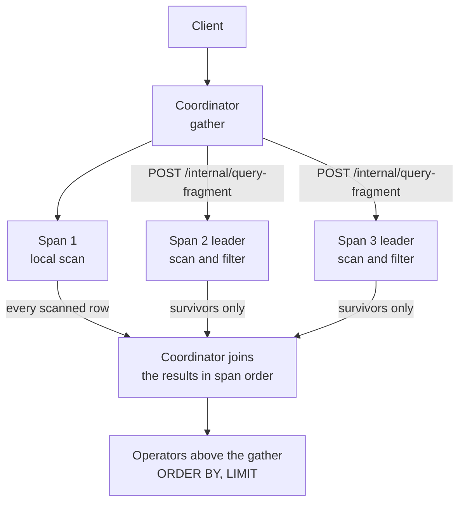
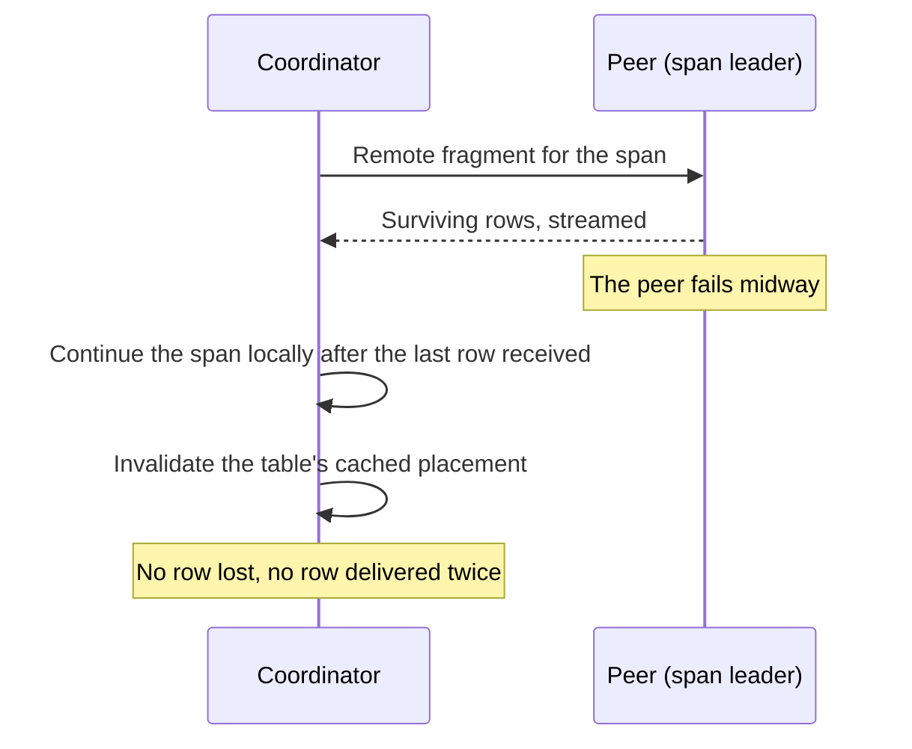
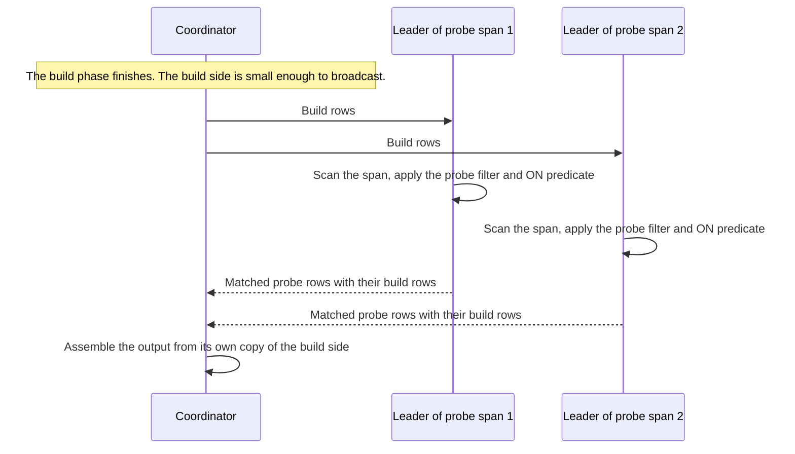

# Distributed queries

A large scan or aggregate in a cluster is slow if one node pulls every row
across the network and does all the work alone. Distributed query execution
sends each part of an eligible scan to the node that already holds those rows.
Filters and aggregates run there, the parts run at the same time, and only the
results travel back. Query results are identical with the feature on or off. It
changes only where the work runs.

In a cluster, CamusDB spreads the rows of a table across
[partitions](/docs/concepts#partition). Each partition has a
[leader](/docs/concepts#leader), and that leader already holds its data.

Distributed execution lets a scan run where the rows are, instead of having the
node that received the statement pull every page to itself.

```yaml
key_range_sharding: true
distributed_query_execution: true
```

The feature is off by default. While it is off, planning and execution are
exactly the same as on a single node today.

While it is on, CamusDB splits an eligible scan into one fragment for each
[span](/docs/concepts#ranges-and-spans) of the placement, where a span is one
contiguous slice of the table's keys and the placement says which partition
serves each span. A fragment whose data lives elsewhere runs on the node that
owns that data. The coordinator then joins the results together.

This is a performance feature. Every part of it falls back to local execution
rather than failing.

## Why use it

- Filters run at the data. A peer that executes a fragment applies the residual
  predicate before it ships anything, so a scan that keeps one row in a
  thousand moves one row in a thousand across the network, not the whole
  table.
- Spans run at the same time. A table with four spans scans on four leaders at
  once, so the wall-clock cost of a full scan follows the largest span, not the
  sum of all spans.
- Aggregates collapse before they travel. CamusDB computes `COUNT`, `SUM`,
  `MIN`, `MAX`, and `AVG` per span and merges them on the coordinator, so a
  rollup over one hundred million rows ships one row per group per span.
- The coordinator keeps less in memory. It merges the streams instead of
  decoding every row of the table itself.
- Correctness depends on none of this. Placement snapshots are advisory, the
  spans always cover the whole key space, and a failed fragment continues
  locally. A stale view or a dead peer costs a retry, never a wrong answer.

## Turn it on

| Setting | Default | Scope | Meaning |
| --- | --- | --- | --- |
| `key_range_sharding` | `false` | cluster | Required. Distribution splits a table by key range, so the table must use key-range routing. |
| `distributed_query_execution` | `false` | cluster | Enables planner fragments and sending fragments to peers. |
| `max_query_parallelism` | `1` | node | The number of concurrent row-decoding workers for each full scan. It applies with or without distribution, including on a standalone node. |
| `broadcast_join_max_build_rows` | `10000` | node | The largest hash-join build side, in rows, that CamusDB may send to the remote spans of the other table. See [Broadcast hash joins](#broadcast-hash-joins). `0` disables broadcast joins. |

`distributed_query_execution` is a `restart` class setting with `cluster`
scope, and every node must agree on it. A node that plans a statement assumes
an execution model, and CamusDB asks that node's peers to honor it. Set the
value in `config.yml`, then restart the node.

`max_query_parallelism` and `broadcast_join_max_build_rows` are `runtime` class
settings with `node` scope, so you can change them while a node runs.
`SET CLUSTER SETTING` applies the new value on every node and overrides each
node's `config.yml`. Without a cluster override, nodes can differ only through
their own `config.yml` files:

```camussql
SET CLUSTER SETTING max_query_parallelism = 4;
SET CLUSTER SETTING broadcast_join_max_build_rows = 50000;
```

See [Runtime Cluster Settings](/docs/runtime-cluster-settings) for how a live
change propagates, and [`SHOW VARIABLES`](/docs/show-variables) for the value a
node is running.

A cluster deployment must fill in `http_peers` alongside `peers`. Fragments
travel over HTTP, and CamusDB maps each peer's internal cluster address to its
HTTP address through those two parallel lists.

Without those lists, CamusDB assumes that every node uses the same HTTP port as
this node. That holds for the Docker Compose topology, but is often false for a
topology you build by hand. See [Cluster Mode](/docs/cluster).

## What becomes eligible

The planner wraps a scan in a `gather` when all of these conditions hold:

- The statement is a full scan of the primary rows, not an index point lookup,
  an index range scan, or a forced-index scan.
- The node is in cluster mode with key-range sharding on.
- The table's current placement reports more than one span.
- The transaction does not validate its reads at commit. Two kinds do:
  optimistic transactions, and pessimistic ones whose read validation is
  `track_and_validate` (see `default_read_validation`). CamusDB must build the
  read set of such a transaction from a single session stream.
- The statement is not the read half of an `UPDATE` or `DELETE`, which takes
  exclusive predicate locks.

Every other statement plans exactly as it does with the feature off.

CamusDB decides eligibility per statement, against the live placement, so it
never serves a fragmented plan from the plan cache. A table that splits into
more spans starts using them on the next query.

## How a fragment runs

A `gather` runs its scan once per span, and each run stays inside that span's
row id range. The `gather` then joins the results in span order.

The spans are contiguous and ascending, and together they cover the whole key
space, so the joined stream is exactly the row stream of an unbounded scan.
`ORDER BY`, `LIMIT`, and every streaming operator above the gather behave as
they always did.

CamusDB sends a span to a peer when two conditions hold: another node leads the
span, and a peer can evaluate the query's residual filter.

A shippable filter is a pure function of the row. That rule excludes:

| Not shippable | Why |
| --- | --- |
| Subqueries and `EXISTS` | Evaluating them would make the peer re-enter the coordinator's executor. |
| Parameter placeholders | The bound values live in the coordinator's ticket, not on the peer. |
| Volatile functions such as `NOW()` | CamusDB must evaluate them once, in one place, or two nodes would disagree. |

CamusDB also keeps a query with no filter at all on the local node. There is
nothing to push down, and the storage locator already streams the pages of a
remote span.

A query that is a candidate for the [result cache](/docs/query-result-cache)
also stays local. The coordinator records cache dependencies for each scanned
row, and a remote filter would drop the rows it rejected. A later update to one
of those rows would then fail to invalidate the entry.

A span that CamusDB does not ship scans locally through the ordinary routed
read path, inside the same gather and at the same time as the remote spans.



With a `LIMIT`, the gather caps each span at `limit + offset` surviving rows.
Span order matches the global row order, so the final cut can never need more
than that many rows from one span. A remote fragment stops shipping when it
reaches the cap.

### When a peer fails

A remote fragment can fail midway, for any reason. The coordinator then
continues that span locally, starting after the last row it received. CamusDB
loses no row and delivers no row twice.

CamusDB also invalidates the table's cached placement, so the next query
resolves it again, and counts the event in `distributed.fragment_fallbacks`.



If the coordinator cancels or dies, its fragments go with it. A remote
execution is bound to the lifetime of the request that started it, so no
fragment outlives its caller.

## Aggregates

An aggregate directly above a gather can run as a partial result per span,
merged on the coordinator. Each fragment aggregates its own span and ships one
row per group, and the coordinator aggregates those rows again into the final
answer.

`COUNT` merges by summing. `SUM`, `MIN`, and `MAX` each merge with themselves.
`AVG` travels as an internal sum and count pair, which CamusDB divides after
the merge, so an average over an integer column does not silently become
integer division.

Both halves run through the engine's own aggregator. That keeps `NULL` and
empty-input semantics identical to sequential execution.

The split applies to a simple aliased aggregate whose group keys are plain
column names in the projection.

CamusDB does not split the aggregate in these cases, and runs it over the
gathered rows instead:

- A `HAVING` clause. Its hidden aggregate expansion needs the original rows.
- An expression, instead of a plain column, as a group key.
- A global aggregate with more than one projection, or a global `AVG`.
- `EXPLAIN (ANALYZE)`, which reports the row-gather strategy it measured.
- Result cache dependency collection.

## Broadcast hash joins

A hash join first loads one input, the build side, into an in-memory hash
table. It then streams the other input, the probe side, and looks up each row
in that table. When the build side is small, sending it to the data is cheaper
than moving the probe side to the coordinator.

After the build phase finishes, CamusDB sends a build side of at most
`broadcast_join_max_build_rows` rows to the leaders of the probe table's spans. Each
peer scans its span and applies the probe-side filter and the `ON` predicate
against the build rows it received. It returns only the probe rows that
matched, together with the build rows they matched. The coordinator then
assembles the output from its own copy of the build side.



CamusDB decides at execution time, after the build hash table exists, so the
decision uses the true build row count rather than an estimate. A join that the
optimizer expected to be small, but is not, simply probes locally.

CamusDB uses a broadcast when all of these hold:

1. Distributed execution is on, and `broadcast_join_max_build_rows` is above
   `0`.
2. The actual build side has at least one row and no more than
   `broadcast_join_max_build_rows` rows.
3. The probe side is a plain base table of primary rows, with a placement of
   several spans and at least one leader that is not local.
4. The transaction shape is safe to split into fragments. For example, CamusDB
   does not broadcast a probe while a query is collecting result-cache
   dependencies, folding reads through one session, or taking exclusive
   predicate locks.
5. The `ON` predicate is shippable under the rules above.
6. The probe filter is shippable too.

If any condition fails, CamusDB uses the ordinary local probe, and a remote
failure midway falls back to it as well. The output is identical in every case.

Set `broadcast_join_max_build_rows` to `0` to turn off broadcast joins. The
rest of distributed execution stays on.

## See it in EXPLAIN

With distribution enabled, every `EXPLAIN` gains a `distribution` row. It says
whether CamusDB split the plan into fragments, and gives the reason when it did
not:

```camussql
EXPLAIN SELECT * FROM orders WHERE status = 'open';
```

```text
physical  distribution  distributed=yes
physical  gather        gather(spans: 4, remote_leader_fraction: 0.75)
physical  table-scan    table=orders
```

A plan that stayed local names the condition it missed:

```text
physical  distribution  distributed=no (placement has a single span)
```

The reasons map directly to the eligibility list:

- `key-range sharding is off`
- `not a primary-row full scan`
- `standalone node`
- `placement has a single span`
- `transaction folds reads (optimistic read-set needs one session stream)`
- `exclusive predicate locks (DML write path)`

`EXPLAIN (ANALYZE)` adds one `gather-span` row per span, which attributes its
rows to the partition and node that produced them:

```text
analyze  gather-span  partition 1: mode=local, rows_delivered=25000
analyze  gather-span  partition 2: mode=remote, node=10.0.0.2:7070, rows_delivered=31, rows_shipped=31, remote_rows_scanned=24180
analyze  gather-span  partition 3: mode=remote-fallback, node=10.0.0.3:7070, rows_delivered=24903, rows_shipped=12
```

Read `mode` first.

A `local` span delivers every row it scanned, and its filter runs above the
gather, on the coordinator.

A `remote` span delivers only the survivors. `remote_rows_scanned` is the
number of rows the peer read to find them, and the difference between those
two numbers is what shipping the filter saved.

`remote-fallback` means the peer failed after shipping `rows_shipped` rows, and
the coordinator finished the span itself.

The row's `actual_rows` column carries `rows_delivered`, and its `rows_read`
column carries `remote_rows_scanned`, so you can get the numbers without
parsing the detail text.

See [EXPLAIN](/docs/explain) for the rest of the output format.

## Counters

`SHOW ENGINE STATS` reports these counters under the source `camusdb`. Each one
accumulates over the life of the process, and they appear only while
distributed execution is enabled:

```camussql
SHOW ENGINE STATS LIKE 'distributed.%';
```

| Metric | Meaning |
| --- | --- |
| `distributed.fragments_dispatched` | Remote fragments that this node started as a coordinator. |
| `distributed.fragment_fallbacks` | Remote fragments that failed and that this node finished locally. |
| `distributed.fragments_served` | Fragments that this node executed for a peer. |
| `distributed.partial_aggregate_gathers` | Aggregations that ran as per-span partial results, merged on the coordinator. |
| `distributed.rows_shipped_in` | Rows that this node received from peers: the survivors, plus the groups of partial aggregates. |
| `distributed.rows_shipped_out` | Rows that this node returned to peers. |

Every node is both a coordinator and a server, so the useful readings are
comparative. Collect all of these counters from every node.

An asymmetry between dispatched and served fragments then reveals two
patterns: one node that serves everybody, and fallbacks that concentrate on one
peer.

Because the counters are cumulative, run the statement twice and subtract to
get a rate. With the feature disabled, the rows are absent rather than zero, so
an empty result means distribution is off, not that the node is idle.

## Node-to-node traffic {#the-traffic-between-two-nodes}

A fragment travels over an internal HTTP route,
`POST /internal/query-fragment`. The peer streams the surviving rows back as
they pass its filter, in one of two formats:

- NDJSON, one JSON object per line, with the row bytes encoded as base64.
- Binary fragment frames, with the row bytes carried directly.

The coordinator asks for the binary format when it supports it. An older peer
can ignore that request and answer with NDJSON, and an older coordinator never
asks for binary frames, so a rolling upgrade is safe. The binary format only
removes the base64 overhead on scans that return many rows.

The node secret authenticates the route, never a client token. While
authentication is enabled, the route therefore needs `CAMUSDB_NODE_SECRET`, set
to the same value across the fleet. See
[Authentication And Authorization](/docs/sql-authentication).

The route is internal machinery, not a client API, and it carries no
compatibility promise.

## Parallel scans without a cluster

`max_query_parallelism` is a separate setting that needs neither a cluster nor
key-range sharding.

Above `1`, a full scan of the primary rows still streams once, but it decodes
the rows in fixed-size chunks on the thread pool. The consumer takes the chunks
in dispatch order:

```camussql
SET CLUSTER SETTING max_query_parallelism = 4;
```

Row order is identical to a sequential scan for every plan shape: the producer
reads in scan order, and the consumer waits for the chunks in that same order.

The filter and every record stay on the consumer's single thread.

The setting buys decode throughput on wide rows. It costs one bounded buffer
per worker, and more concurrent storage reads. The default of `1` keeps the
sequential pipeline.

## Limits

- Only full scans of the primary rows split into fragments. Index scans, point
  lookups, and forced-index scans all plan locally.
- Writes never split into fragments. `UPDATE` and `DELETE` read under exclusive
  predicate locks, and those reads stay on the coordinator.
- Optimistic transactions never split into fragments, because CamusDB must
  build their read set from a single session stream.
- Result cache candidates stay local, so their dependencies stay complete.
- `EXPLAIN (ANALYZE)` disables partial aggregation, so the plan it reports is
  the plan it measured, not the plan of a run without measurement.
- Fragmented plans bypass the plan cache, because their shape depends on the
  live placement.
- Distribution is an alpha feature, like [cluster mode](/docs/cluster) itself.
  APIs and behavior can change between versions.

## Related pages

- [Cluster Mode](/docs/cluster) for how nodes find each other.
- [Query Planning](/docs/query-planning) for plan selection in general.
- [EXPLAIN](/docs/explain) for reading a plan.
- [Engine Stats](/docs/engine-stats) for the rest of the metrics.
- [Configuration](/docs/configuration) for every setting on this page.
