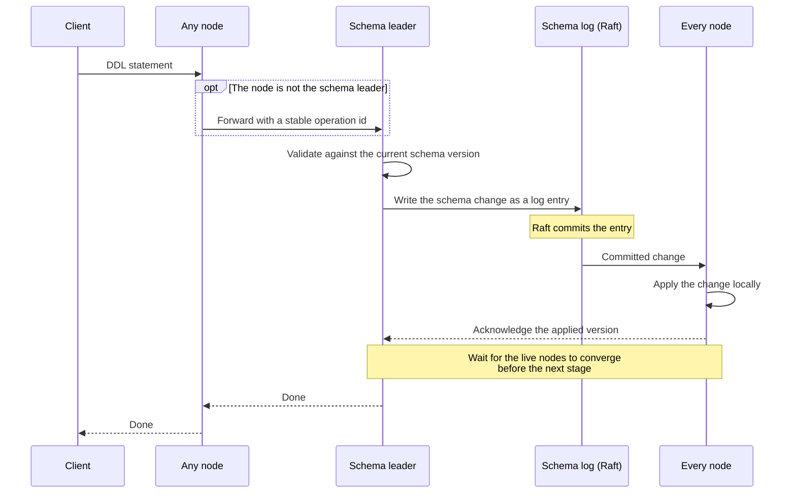
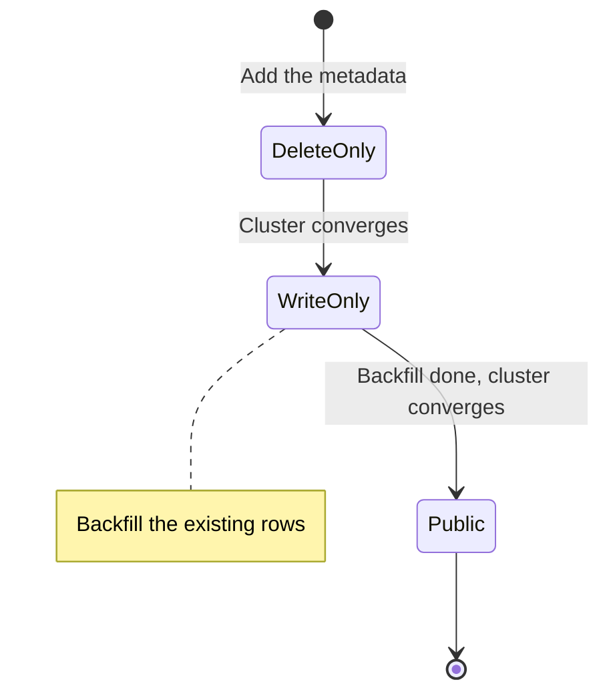

# Distributed schema changes

In a cluster, a schema change reaches the nodes at different times. Without
coordination, one node could write rows with a new table layout while another
still reads them with the old one. On a single PostgreSQL or MySQL server this
cannot happen, because DDL updates one catalog that every session reads.
CamusDB gives a cluster the same property: every node applies the same schema
changes in the same order, and an online change never lets readers and writers
see two incompatible layouts.

CamusDB treats the schema as distributed state. The schema is not a local side
table that each node updates on its own. In cluster mode, a change to a table, a
column, or an index flows through the same replicated system that protects the
data writes.

For an operator of a cluster, these properties follow. Each section below
explains one of them:

1. A schema change has one ordered source of truth. No node invents its own
   local schema history.
2. Every node converges on the same schema version. A slow node does not block
   DDL forever.
3. CamusDB stages an online change. A reader and a writer therefore never jump
   between two incompatible layouts.
4. A node forwards DDL to the schema leader, the node that currently
   [leads](/docs/concepts#leader) the database's schema log. A retried DDL
   statement does not apply twice.
5. A restart and a change of leader lose no committed schema work.
6. A rename changes metadata only. It does not rewrite rows.

CamusDB is in production use. Cluster mode is nevertheless an alpha feature. The
APIs and the storage formats can change between versions.

## Why this exists

In a distributed database, a schema change is harder than a DDL statement on one
node. Two nodes can receive a request at different times. A node can be slower,
it can restart during a change, or it can lose its leadership.

A schema in local metadata alone would create a risk. One node could accept a
write with a newer definition, while another node still reads with an older
one.

CamusDB avoids that risk. It treats the schema as a replicated state machine.
The cluster first agrees on the order of the schema changes. Each node then
applies the same committed changes, in that order. The schema and the data use
the same replicated storage model.

## The source of truth

For a database in cluster mode, the source of truth is the committed schema log
in [Kommander](/docs/concepts#kommander), the [Raft](/docs/concepts#raft)
library that replicates CamusDB's logs. Raft is the consensus protocol that
makes the nodes agree on one order of entries. The source of truth is not a
local metadata file.

CamusDB stores each schema change as a small record of the change:

- Create a table, or drop one.
- Add a column, or drop one.
- Add an index, or drop one.
- Advance a column or an index from one state of visibility to the next.

Every node applies a schema entry in the same order, after Raft commits that
entry. The persisted metadata in the KV storage is a checkpoint for a faster
restart. After a restart, a node loads that checkpoint and replays the
committed schema log entries to restore its in-memory schema. The committed
schema log remains the authoritative history, so a restart or a change of
leader loses no committed schema work.

## Versions and convergence

CamusDB gives a schema change a version, and the versions only increase:

- The schema of a database has a counter of the version.
- Each table also carries its own version.
- A stored row keeps the schema version of its write.

Those versions let the cluster answer two questions precisely:

1. Which schema does a transaction use?
2. Did every live node reach the same schema yet?

CamusDB uses an acknowledgement from each live node. It therefore knows when
every node applied a committed schema version. It waits for the convergence of
the current stage across the live cluster, before it advances to the next stage
of an online change.

The gate waits for every node that the current schema leader considers live,
based on the live Raft membership, not on a static list of peers. A node that
is dead, or fully inactive, therefore does not block a DDL statement forever.

The leader both receives pushed acknowledgements and probes peers for their
applied version. This matters with partial
[replica](/docs/concepts#replica-and-replication-factor) placement, where each
[partition](/docs/concepts#partition) keeps copies on only some of the nodes.
Two nodes may then share no data partition and may not appear together in one
local Raft membership view. A lost or redirected acknowledgement does not let a
DDL return early: the probe discovers nodes that hold the database open and
waits for their applied schema version. A peer reporting that the database is closed
removes its stale acknowledgement record.

The design uses a safety model of two versions during a staged DDL statement.
Before it proposes the next schema version, the cluster tries to confirm that
enough nodes applied the previous version already. The spread of the schema
versions across the nodes therefore stays bounded, and a transaction and the
encoding of a row always have a coherent view of the schema in force. When one
node is too slow to acknowledge, see
[A slow node](#a-slow-node-and-bounded-progress-of-a-ddl-statement).

## How a schema change flows

At a high level, a DDL request in a cluster follows this path:

1. A client sends `CREATE TABLE`, `ALTER TABLE`, or a DDL statement for an index
   to any CamusDB node.
2. That node forwards the request to the schema leader, if it is not the leader
   itself.
3. The leader validates the change against the current schema version.
4. CamusDB writes the schema change as a replicated log entry.
5. Raft commits the entry.
6. Each node applies the committed change locally.
7. The cluster waits for the acknowledgement of the applied version from the
   live nodes. It does so before it advances the next stage, where a next stage
   exists.

A DDL statement therefore behaves like a distributed workflow. It does not
behave like a local mutation of metadata.

A forwarded DDL request carries a stable identifier of the operation. A retry
after a lost response therefore does not apply the same schema change twice.

## A slow node, and bounded progress of a DDL statement

A distributed DDL statement must select one of two modes of failure:

- It waits forever for the slowest node.
- It lets the cluster continue, and it protects a node that lags in another way.

CamusDB uses the second mode.

After the commit of a schema step, the leader first waits for every live node
to acknowledge it. A node can be slow, or unreachable for a time. After a
bounded delay, the leader then treats a step that a
[majority](/docs/concepts#majority) (more than half) applied as sufficient
progress, and it continues the staged change. One slow node therefore does
not turn every schema change into a long stall.

The safety side of that decision matters as much. A node that falls more than
one schema version behind the committed schema head rejects reads and DML for
that database with `CADB0503 SchemaCatchingUp`, until it catches up. Treat that
state as a temporary condition for a retry. It is not a silent mode of stale
reads.

## Schema freshness reconciliation

Cluster nodes can miss a schema delta when a database is not open on that node,
or during the brief gap between loading a schema checkpoint and subscribing to
future schema entries. CamusDB repairs that case by comparing the in-memory
schema version with the durable checkpoint version and reloading the schema when
memory is behind.

The repair runs in three places:

- When a database opens, after the schema subscription is registered.
- Before a `TableDoesntExist` error is returned, because a missed `CREATE
  TABLE` can look like a missing table on one node.
- On a periodic background sweep in cluster mode.

The sweep interval is `schema_freshness_check_interval_ms`, default `10000`.
Each tick costs one small KV read per open database when nothing is stale. Set
the value to `0` or below to disable the sweep.

## The states of an online schema change

CamusDB does not expose every schema change at one time. It uses staged online
states. A column or an index therefore becomes visible in steps:

| State | Meaning |
| --- | --- |
| `DeleteOnly` | The new element exists in the metadata. It is not part of a normal read or a normal write yet. |
| `WriteOnly` | A new write maintains the element. A normal read does not depend on it yet. |
| `Public` | The element is fully visible to a normal query execution. |

A new column and a new index therefore do not jump from "absent" to "fully
active" in one step. CamusDB can take four steps:

1. It adds the metadata, in an internal state.
2. It lets a new write maintain the element.
3. It backfills the existing rows.
4. It publishes the element for the normal plan and the normal read.

That staged model is what keeps an online schema change compatible with live
traffic.

The number of stages differs by operation:

- CamusDB stages the addition of a column, and the addition of an index.
- CamusDB can stage the removal of a column, in the reverse order.
- The removal of an index is one replicated schema change today. It is not a
  staged rollout in reverse.

## A rename changes the metadata only

A rename of a table, of a column, or of an index needs no rewrite of the stored
rows.

CamusDB stores a row and an index with stable internal identifiers, and with a
row layout by position. It does not put a readable name in the payload of every
row. A rename of a column or of a table therefore updates the metadata and the
rules of the visibility. It forces no rewrite of the data across the cluster.

For a new table, the stable identifier is a short value in base62. CamusDB
allocates it from a persistent monotonic sequence, before it commits the DDL
statement. The replicated schema change carries the allocated id. A follower
therefore applies the same identity for the table. It does not generate its own.
An existing table with an older id of 24 characters stays valid.

The practical benefit for a user is clear. A rename is much lighter than an
operation that copies and rebuilds everything.

## The backfill, and its safety

CamusDB can add a column or an index that needs the existing data. It then uses
a coordinator that can resume. It does not assume that one short process
finishes the whole job.

That coordinator has four responsibilities:

- It moves the element one state at a time.
- It waits for the convergence of the cluster at each step.
- It runs the backfill before the element becomes fully public.
- It resumes the work after a restart, and after a change of leader.

One property matters most to a user. CamusDB does not forget partly completed
online work, and a move of the leadership or a restart of a node does not change
that.

For a new column with a default, CamusDB backfills the existing rows before the
column becomes fully public. For a new index, CamusDB backfills the index
entries before it publishes the index for the normal plan.

CamusDB writes a checkpoint of the progress of a backfill. The leadership can
change during the build of an online column or index. The next schema leader
then continues from the recorded progress. It does not start the whole job
again.

## Reads, writes, and compatibility

CamusDB expresses each schema change as a move from one version to the next. It
does not express the change as a mutation of a state without a version. The
readers, the writers, the replication, and the backfill all use that one model
of the versions.

A transaction also pins the schema versions while it runs. A later DDL statement
can invalidate the schema of a transaction. CamusDB then rejects the commit of
that transaction. A long query and a long write therefore see one coherent view
of the schema. Neither one blends an old layout with a new one.

## The trade-off

A distributed DDL statement needs more coordination than a DDL statement on one
node, and it can make a lagging node reject table work for a time. CamusDB
prefers explicit convergence and recovery. The design does not make a schema
change free. It makes the behavior of a schema change explicit and recoverable.

## Related pages

- [Architecture](/docs/architecture) for the wider layout of the system.
- [Storage](/docs/storage) for the details of the KV mapping.
- [WAL And Recovery](/docs/wal-recovery) for the replay and the durability.
- [Cluster Mode](/docs/cluster) for the setup of a node.
