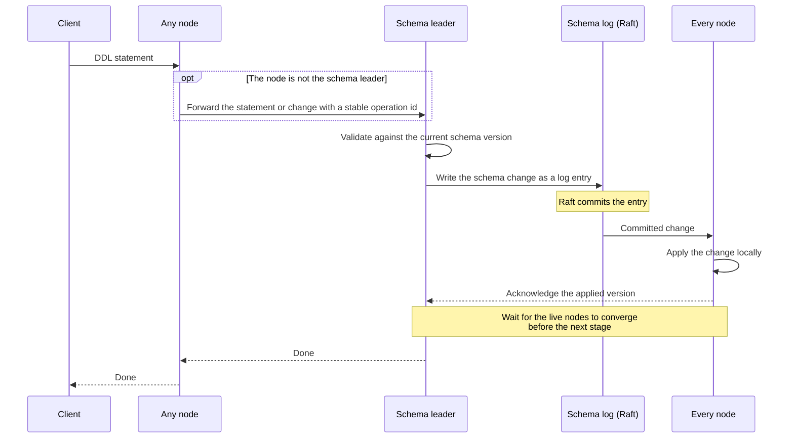
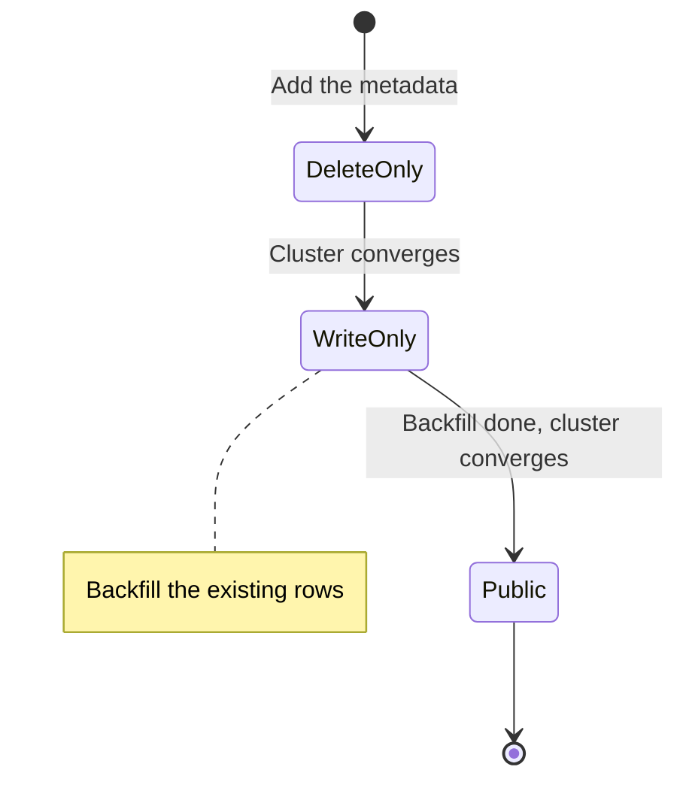

# Distributed schema changes

In a CamusDB cluster, all the nodes apply the same schema changes in the same
order. An online change doesn't let readers and writers see two incompatible
table layouts. A single PostgreSQL or MySQL server gets this property from one
catalog that all sessions read. In a cluster, a schema change reaches the nodes
at different times. If the nodes didn't coordinate, one node could write rows
with a new layout while another node reads them with the old one.

CamusDB replicates the schema in the same way as the data. In cluster mode,
schema changes go through the replicated log that protects data writes. This gives you the following properties:

1. Schema changes have one ordered source of truth.
2. All the nodes reach the same schema version, and a slow node doesn't block
   DDL for long.
3. Online changes are staged. Readers and writers don't switch between two
   incompatible layouts.
4. Table and index DDL can be sent to any node. A retried DDL statement isn't
   applied twice.
5. Restarts and leader changes don't lose committed schema changes.
6. A rename changes metadata only, and it doesn't rewrite rows.

## The source of truth

For a database in cluster mode, the source of truth is the committed schema log
in [Kommander](/docs/concepts#kommander). Kommander is the
[Raft](/docs/concepts#raft) library that replicates the logs of CamusDB. Raft
is the consensus protocol that makes the nodes agree on one order of entries.

Each schema change is a small record in the log, for example "add a column" or
"advance an index to its next state". All the nodes apply the committed entries
in the same order. The metadata in the key/value store is a checkpoint for
faster restarts. After a restart, a node loads the checkpoint and replays the
committed log entries after it. This means that a restart or a leader change
doesn't lose committed schema work.

## Versions and convergence

Each schema change gets a version, and versions only increase. A database has
a schema version, and so do its tables and its stored rows. The versions answer two
questions:

1. Which schema does a transaction use?
2. Did all the live nodes reach the same schema?

Each live node acknowledges the schema versions that it applies. Before an
online change moves to its next stage, the schema leader waits for the live
nodes to apply the current stage. The schema leader is the node that
[leads](/docs/concepts#leader) the schema log of the database. It waits for the
nodes that are live in the Raft membership. A node that is down or inactive
doesn't block a DDL statement.

The schema leader also asks the nodes that have the database open for their
applied version. This matters with partial
[replica](/docs/concepts#replica-and-replication-factor) placement, where each
[partition](/docs/concepts#partition) has copies on some of the nodes only. A
lost acknowledgement can't make a DDL statement return early.

As a result, the schema versions on the nodes are close to each other. A transaction
and the row encoding always see a coherent schema.

## How a schema change flows

A DDL request that supports forwarding follows this path in a cluster:

1. A client sends a DDL statement to a node.
2. A follower forwards the statement or the resulting change to the leader.
3. The leader validates the change against the current schema version.
4. The leader writes the change to the schema log, and Raft commits it.
5. Each node applies the committed change.
6. If the change has a next stage, the leader waits for the live nodes to
   acknowledge the applied version before the next stage.

A forwarded request has a stable operation id. This means that a retry after a
lost response doesn't apply the change twice.

### DDL that isn't forwarded

The following table shows where to send schema statements in a cluster.

| Statement | Where to send it |
| --- | --- |
| Tables, columns, indexes, constraints, renames, `TRUNCATE`, and `COMMENT ON` | Any node. |
| View and materialized-view DDL, including `REFRESH MATERIALIZED VIEW` | Any node. A follower forwards the schema change for publication. |
| `ALTER TABLE ... SET` and `ALTER TABLE ... RESET` | Any node. |
| Functions, triggers, and extensions | The database's schema leader. Another node returns `CADB0099` and names the leader. |
| Sequence DDL | The database's schema leader. Another node returns `CADB0504`. |

## A slow node and bounded DDL progress {#a-slow-node-and-bounded-progress-of-a-ddl-statement}

The wait for the slowest node is bounded. After a schema
step commits, the leader waits for all the live nodes to acknowledge it. A node
can be slow, or unreachable for a while. After a bounded delay, the leader
continues the staged change if a [majority](/docs/concepts#majority) of the
nodes applied the step. This means that one slow node doesn't stall the
schema changes.

A node that falls more than one schema version behind the committed schema
returns `CADB0503 SchemaCatchingUp` for reads and DML on that database, until it
catches up. This is a temporary error, and you can retry the statement. The
node doesn't serve reads from a stale schema.

## Schema freshness reconciliation

A node can miss a schema change, for example when the database isn't open on
that node. To repair this, the node compares the schema version in memory with
the version of the durable checkpoint. If memory is behind, it reloads the
schema. The check happens:

- When a database opens.
- Before a `CADB0011` (table doesn't exist) error. A missed `CREATE TABLE` can
  look like a missing table on one node.
- In a periodic background check in cluster mode.

The interval of the background check is `schema_freshness_check_interval_ms`,
default `10000`. When the schema is current, each check costs one small
key/value read for each open database. A value of `0` or less turns off the check.

## Online schema change states

A new column or index becomes visible in steps:

| State | Meaning |
| --- | --- |
| `DeleteOnly` | The new element is in the metadata, but reads and writes don't use it yet. |
| `WriteOnly` | New writes maintain the element, but reads don't depend on it yet. |
| `Public` | The element is visible to queries. |

Adding a column or an index is staged in this way. Dropping a column can be
staged, in the reverse order. Dropping an index is one schema change, and it
isn't staged.

## Backfill

When a new column with a default or a new index needs the existing rows, a
coordinator moves the element one state at a time. It waits for the cluster to
converge at each step, and it backfills the existing rows before the element
becomes `Public`. The coordinator records the progress of the backfill. If the
schema leader changes during the backfill, the new leader continues from the
recorded progress. It doesn't restart the job.

## Renames change metadata only

A rename of a schema object doesn't rewrite the stored rows. Rows and
index entries use stable internal ids, and they don't contain names. This means
that a rename changes the metadata only.

A new table gets a short base62 id, allocated before the DDL commits. The
replicated change has the allocated id. This means that all the nodes use the
same table identity. Tables with older 24-character ids remain valid.

## Transactions and schema changes

A transaction pins the schema versions that it uses. If a later DDL statement
makes that schema incompatible, the commit of the transaction returns an error.
This means that a long query or a long write sees one coherent schema, and it
doesn't mix an old layout with a new one.

Distributed DDL needs more coordination than DDL on a single node, and a node
that lags can return `CADB0503` for a while. In exchange, schema changes are
explicit and recoverable.

## Related pages

- [Architecture](/docs/architecture) for the overall system layout.
- [Storage](/docs/storage) for the key/value mapping.
- [WAL and recovery](/docs/wal-recovery) for replay and durability.
- [Cluster mode](/docs/cluster) for node setup.
