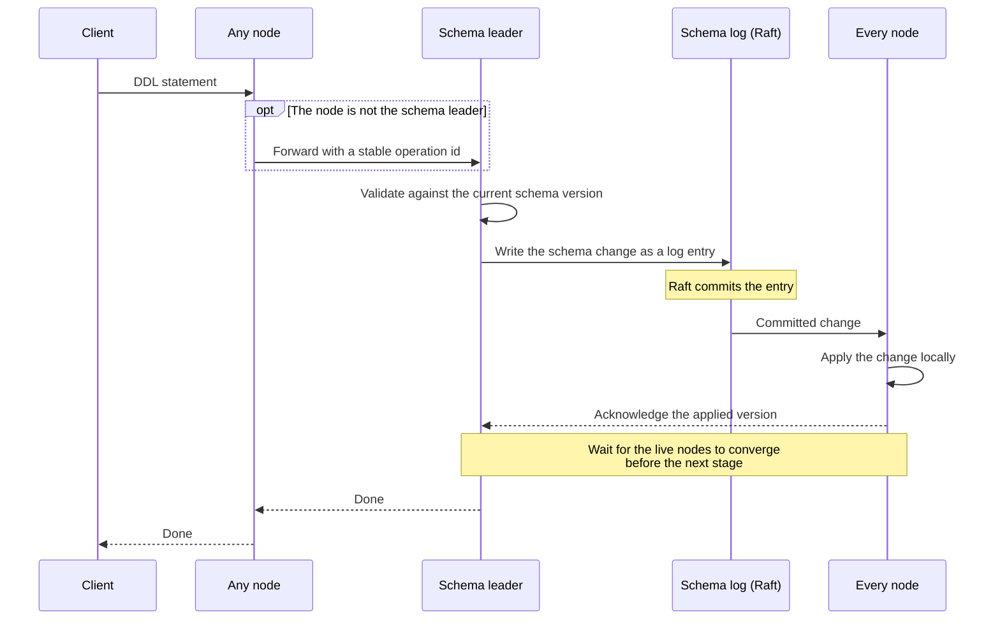
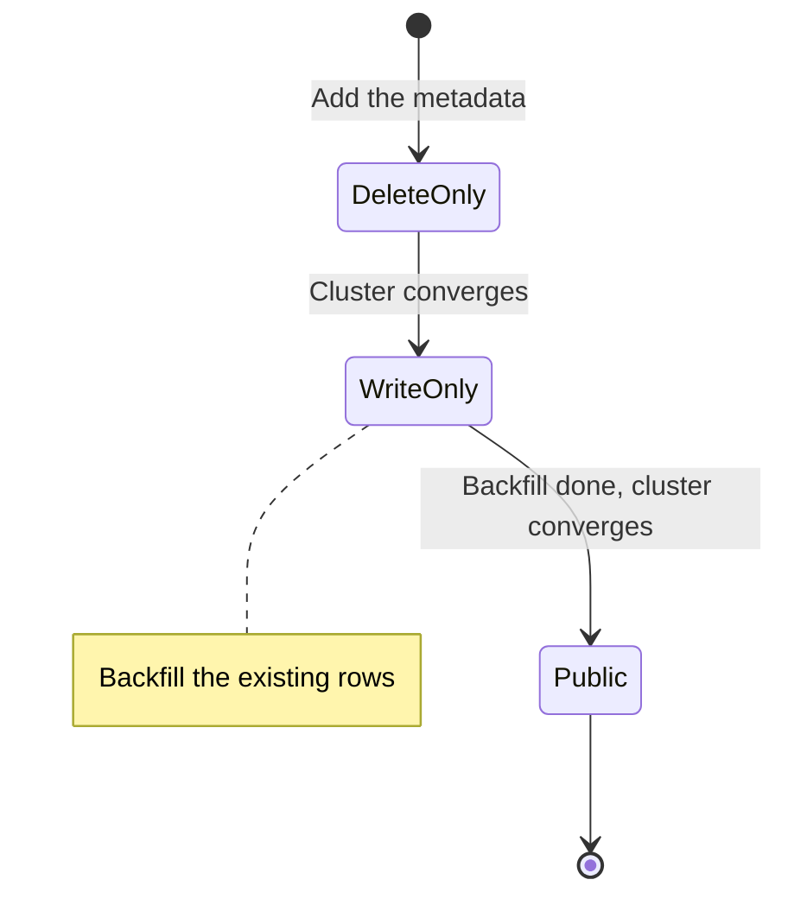

# Distributed schema changes

In a cluster, a schema change reaches the nodes at different times. Without
coordination, one node could write rows with a new table layout while another
still reads them with the old one. On a single PostgreSQL or MySQL server this
cannot happen, because DDL updates one catalog that every session reads.
CamusDB gives a cluster the same property: every node applies the same schema
changes in the same order, and an online change never lets readers and writers
see two incompatible layouts.

CamusDB treats the schema as distributed state, not as a local side table that
each node updates on its own. In cluster mode, changes to tables, columns, and
indexes flow through the same replicated system that protects data writes.

If you operate a cluster, you get these properties (each section below explains
one of them):

1. Schema changes have one ordered source of truth. No node invents its own
   local schema history.
2. Every node converges on the same schema version, and a slow node does not
   block DDL forever.
3. CamusDB stages online changes, so readers and writers never jump between two
   incompatible layouts.
4. Nodes forward DDL to the schema leader, the node that currently
   [leads](/docs/concepts#leader) the database's schema log. A retried DDL
   statement does not apply twice.
5. Restarts and leader changes lose no committed schema work.
6. A rename changes metadata only. It does not rewrite rows.

CamusDB is in production use, but cluster mode is still an alpha feature. Its
APIs and storage formats can change between versions.

## Why this exists

Schema changes are harder in a distributed database than on a single node. Two
nodes can receive a request at different times. A node can be slow, restart in
the middle of a change, or lose its leadership.

If the schema lived only in each node's local metadata, one node could accept a
write with a newer definition while another still reads with an older one.

CamusDB avoids that by treating the schema as a replicated state machine. The
cluster first agrees on the order of schema changes, and then each node applies
the same committed changes in that order. The schema and the data use the same
replicated storage model.

## The source of truth

For a database in cluster mode, the source of truth is the committed schema log
in [Kommander](/docs/concepts#kommander), not a local metadata file. Kommander
is the [Raft](/docs/concepts#raft) library that replicates CamusDB's logs, and
Raft is the consensus protocol that makes the nodes agree on one order of
entries.

CamusDB stores each schema change as a small record:

- Create or drop a table.
- Add or drop a column.
- Add or drop an index.
- Advance a column or an index to its next visibility state.

Every node applies schema entries in the same order, after Raft commits them.
The metadata persisted in KV storage is a checkpoint for faster restarts: after
a restart, a node loads that checkpoint and replays the committed schema log
entries to rebuild its in-memory schema. The committed schema log remains the
authoritative history, so a restart or a leader change loses no committed
schema work.

## Versions and convergence

Every schema change gets a version, and versions only increase:

- Each database's schema has a version counter.
- Each table also carries its own version.
- Each stored row keeps the schema version it was written with.

These versions let the cluster answer two questions precisely:

1. Which schema does a transaction use?
2. Has every live node reached the same schema yet?

Each live node acknowledges the schema versions it applies, so CamusDB knows
when every node has applied a committed version. Before it advances an online
change to its next stage, it waits for the live cluster to converge on the
current stage.

The gate waits for every node that the current schema leader considers live,
based on the live Raft membership rather than a static peer list. A dead or
fully inactive node therefore does not block a DDL statement forever.

The leader both receives pushed acknowledgements and probes peers for their
applied version. This matters with partial
[replica](/docs/concepts#replica-and-replication-factor) placement, where each
[partition](/docs/concepts#partition) keeps copies on only some of the nodes.
Two nodes may then share no data partition and may not appear together in any
local Raft membership view. A lost or redirected acknowledgement cannot make a
DDL statement return early: the probe finds the nodes that hold the database
open and waits for their applied schema version. When a peer reports that the
database is closed, the leader removes its stale acknowledgement record.

During a staged DDL statement, the design follows a two-version safety model.
Before proposing the next schema version, the cluster tries to confirm that
enough nodes have already applied the previous one. This keeps the spread of
schema versions across nodes bounded, so transactions and row encoding always
see a coherent schema. For what happens when one node is too slow to
acknowledge, see
[A slow node](#a-slow-node-and-bounded-progress-of-a-ddl-statement).

## How a schema change flows

A DDL request in a cluster follows this path:

1. A client sends `CREATE TABLE`, `ALTER TABLE`, or an index DDL statement to
   any CamusDB node.
2. If that node is not the schema leader, it forwards the request to the
   leader.
3. The leader validates the change against the current schema version.
4. CamusDB writes the schema change as a replicated log entry.
5. Raft commits the entry.
6. Each node applies the committed change locally.
7. If the change has a next stage, the cluster waits for the live nodes to
   acknowledge the applied version before advancing to it.

So a DDL statement behaves like a distributed workflow, not a local metadata
update.

A forwarded DDL request carries a stable operation id, so retrying after a lost
response does not apply the same schema change twice.

## A slow node and bounded DDL progress {#a-slow-node-and-bounded-progress-of-a-ddl-statement}

A distributed DDL statement has to choose how it fails:

- Wait forever for the slowest node.
- Let the cluster continue, and protect lagging nodes some other way.

CamusDB takes the second option.

After a schema step commits, the leader first waits for every live node to
acknowledge it. A node can be slow, or unreachable for a while. After a bounded
delay, the leader treats a step that a [majority](/docs/concepts#majority)
(more than half) of nodes applied as enough progress, and continues the staged
change. One slow node therefore does not turn every schema change into a long
stall.

The safety side matters just as much. A node that falls more than one schema
version behind the committed schema head rejects reads and DML for that
database with `CADB0503 SchemaCatchingUp` until it catches up. Treat this as a
temporary, retryable condition. It is never a silent stale-read mode.

## Schema freshness reconciliation

A cluster node can miss a schema change when the database is not open on that
node, or during the brief gap between loading a schema checkpoint and
subscribing to future schema entries. CamusDB repairs this by comparing the
in-memory schema version with the durable checkpoint version, and reloading the
schema when memory is behind.

The repair runs in three places:

- When a database opens, after the schema subscription is registered.
- Before a `TableDoesntExist` error is returned, because a missed `CREATE
  TABLE` can look like a missing table on one node.
- On a periodic background sweep in cluster mode.

The sweep interval is `schema_freshness_check_interval_ms`, default `10000`.
When nothing is stale, each tick costs one small KV read per open database. Set
the value to `0` or below to disable the sweep.

## Online schema change states

CamusDB does not expose a schema change all at once. It uses staged online
states, so a column or an index becomes visible in steps:

| State | Meaning |
| --- | --- |
| `DeleteOnly` | The new element exists in the metadata, but normal reads and writes do not use it yet. |
| `WriteOnly` | New writes maintain the element, but normal reads do not depend on it yet. |
| `Public` | The element is fully visible to normal query execution. |

A new column or index does not jump from "absent" to "fully active" in one
step. CamusDB can take four steps:

1. Add the metadata in an internal state.
2. Let new writes maintain the element.
3. Backfill the existing rows.
4. Publish the element for normal plans and reads.

This staged model is what keeps online schema changes compatible with live
traffic.

The number of stages depends on the operation:

- Adding a column and adding an index are staged.
- Dropping a column can be staged, in reverse order.
- Dropping an index is a single replicated schema change today, not a staged
  rollout in reverse.

## Renames change metadata only

Renaming a table, column, or index does not rewrite stored rows.

CamusDB stores rows and index entries with stable internal ids and a positional
row layout. It does not put readable names in every row's payload. Renaming a
column or table therefore updates the metadata and the visibility rules, and
forces no data rewrite across the cluster.

A new table's stable id is a short base62 value. CamusDB allocates it from a
persistent monotonic sequence before it commits the DDL statement. The
replicated schema change carries the allocated id, so followers apply the same
table identity instead of generating their own. Existing tables with older
24-character ids stay valid.

In practice, a rename is far cheaper than an operation that copies and rebuilds
everything.

## Backfill safety

When you add a column or an index that needs the existing data, CamusDB runs a
resumable coordinator instead of assuming that one short process will finish
the whole job.

The coordinator:

- Moves the element one state at a time.
- Waits for the cluster to converge at each step.
- Runs the backfill before the element becomes fully public.
- Resumes the work after a restart or a leader change.

The property that matters most: CamusDB does not forget partly completed online
work, even when leadership moves or a node restarts.

For a new column with a default, CamusDB backfills the existing rows before the
column becomes fully public. For a new index, it backfills the index entries
before publishing the index for normal plans.

CamusDB checkpoints backfill progress. If leadership changes while an online
column or index is being built, the next schema leader continues from the
recorded progress instead of restarting the whole job.

## Reads, writes, and compatibility

CamusDB expresses each schema change as a move from one version to the next,
not as an unversioned state mutation. Readers, writers, replication, and
backfill all share that one version model.

A transaction also pins the schema versions it uses while it runs. If a later
DDL statement invalidates that schema, CamusDB rejects the transaction's
commit. Long queries and long writes therefore see one coherent schema, and
never blend an old layout with a new one.

## The trade-off

Distributed DDL needs more coordination than DDL on a single node, and it can
make a lagging node reject table work for a while. CamusDB prefers explicit
convergence and recovery. The design does not make schema changes free; it
makes their behavior explicit and recoverable.

## Related pages

- [Architecture](/docs/architecture) for the overall system layout.
- [Storage](/docs/storage) for details of the KV mapping.
- [WAL And Recovery](/docs/wal-recovery) for replay and durability.
- [Cluster Mode](/docs/cluster) for node setup.
