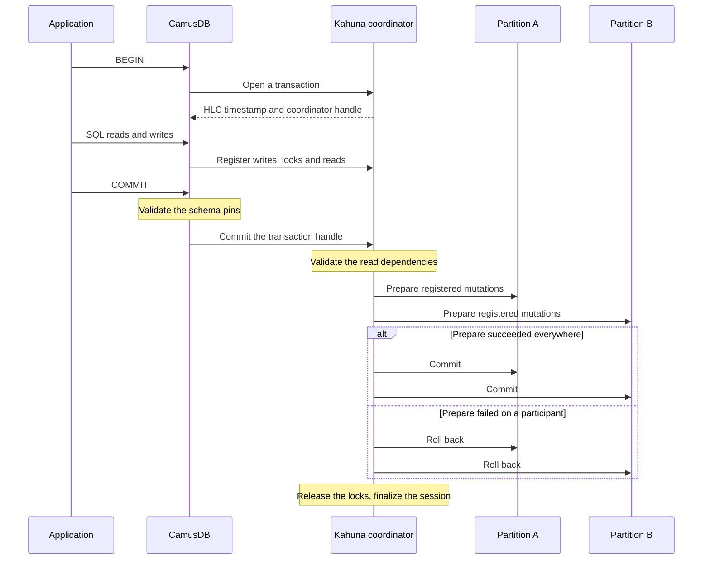

# Distributed transactions and HLC

A transaction can touch data on more than one
[partition](/docs/concepts#partition) (a slice of data that one group of nodes
replicates together). The storage layer then coordinates the work with
[two-phase commit](/docs/concepts#two-phase-commit) (2PC), so the transaction
either commits on every partition or aborts on every partition.

For your application, this means a transaction in a cluster behaves like a
transaction on one node. You do not need to know which partition holds a row,
and you never write compensation code for a transfer that succeeded on one
partition and failed on another, because that cannot happen. You use `BEGIN`
and `COMMIT` as usual. The only addition is a retry loop for conflicts, which
serializable transactions need on a single node too. See
[Retries and conflicts](/docs/serializable-retries).

You do not need this page to write correct application code. Read it when you
want to know what happens below `COMMIT` in a cluster, or when you are
diagnosing a slow cross-partition commit.

The HLC in the title is a [hybrid logical clock](/docs/concepts#hlc). It gives
each transaction a timestamp that all nodes order the same way, even when their
clocks differ slightly. See
[How HLC timestamps fit in](#how-hlc-timestamps-fit-in).

CamusDB uses two components for this work:

- [Kahuna](/docs/concepts#kahuna) executes transactional key/value work.
- [Kommander](/docs/concepts#kommander) replicates each partition with the
  [Raft](/docs/concepts#raft) consensus algorithm, which commits a write once a
  [majority](/docs/concepts#majority) of the partition's copies have it.

This page states the guarantee first, then describes the flow behind it.

## What you get

A distributed transaction in CamusDB keeps the guarantees you expect from a
local SQL transaction:

- `BEGIN` and `COMMIT` span several statements.
- Writes stay atomic even when the rows live on different partitions.
- A committed write never becomes partly visible across partitions.
- CamusDB reports a conflicting write as a failure or a retry. It never
  silently merges the two writes.
- A serializable transaction keeps either a stable snapshot or read-write lock
  semantics across partitions, depending on the transaction mode.

This includes a lock-free serializable read-only snapshot path, which a client
can resume across requests with the transaction id.

So CamusDB can run work such as:

1. Inserting into two different tables in one transaction.
2. Updating rows whose keys route to different partitions.
3. A consistent serializable read-only report across several partitions.
4. Indexed point writes together with range reads in one serializable
   read-write unit.

## How a commit works

In PostgreSQL, one server decides whether a transaction committed. In a
cluster, two keys can belong to partitions with different
[leaders](/docs/concepts#leader) (the node that accepts writes for a
partition). No single node can mark the whole transaction committed until every
partition it touched is ready. Two-phase commit solves this: first every
participant prepares, then every participant commits, or every participant
rolls back.

A read-write transaction follows this path:

1. `BEGIN` asks Kahuna to start a transaction. Kahuna returns an HLC
   transaction id (the start timestamp) and a handle to a coordinator session,
   the server-side record that tracks the transaction until it ends.
2. The SQL statements read and write rows, maintain indexes, and acquire locks.
   Each successful operation registers its confirmed writes, locks, and tracked
   reads with the coordinator.
3. CamusDB pins the schema version of each table the work touches.
4. At `COMMIT`, CamusDB validates the schema pins, so the transaction cannot
   commit against a table definition that became incompatible while it ran.
   Then it sends the transaction handle to Kahuna.
5. Kahuna validates the read dependencies, if the transaction needs that check.
6. Kahuna prepares the registered mutations, with a fresh commit timestamp, on
   every partition the transaction touched. These partitions are the
   participants.
7. If the execution path requires it, Kahuna checks the read keys for a
   conflicting [write intent](/docs/concepts#write-intent) (an uncommitted
   write from another transaction).
8. If every participant prepared, Kahuna commits the prepared mutations on all
   of them. If any participant failed to prepare, Kahuna rolls the prepared work
   back on all of them.
9. The coordinator releases the registered locks and finalizes the session.

The result is an atomic commit across partitions, without requiring the data
to live on one leader. CamusDB's cluster tests exercise this cross-partition
path. For the order in which Kahuna commits the participants and makes the
decision durable, see
[Transaction internals](/docs/transactions-locking-internals#the-durability-of-a-commit-decision).

## Durability across a leader change

CamusDB stores committed transactional writes through the same replicated
partition log as ordinary writes: the partition's
[write-ahead log](/docs/concepts#wal). A participant is not durably committed
until both of these hold: its partition accepted the commit through Kommander,
and Kahuna can restore the committed entry.

That matters during failures:

- If a node restarts after CamusDB acknowledged a commit, CamusDB restores the
  committed partition log entries and applies them back into the KV store as
  needed.
- If a partition leader changes, the new leader continues from a log state that
  Raft made safe, and keeps serving the partition.
- Once a transaction installs a durable commit decision, the partition that
  stores it (the decision anchor) can drive the remaining participant commits,
  even after the original live coordinator disappears.
- If a failure happens before CamusDB installs a durable commit decision,
  CamusDB does not report the transaction as a committed SQL result. Your
  application must replay the business operation from `BEGIN` if it still wants
  the change.

The practical guarantee: CamusDB never exposes a half-committed SQL
transaction. A transaction either commits through the storage layer's
replicated commit path, or it stays retryable or aborted, and in that case
CamusDB never reports it as a committed result.

## Idempotent internal retries

The storage layer can retry one piece of a transaction without applying the
same effect twice.

Every registered operation carries a transaction operation id, which the
coordinator uses to tell apart:

- A duplicate delivery of the same logical operation.
- A new operation that must run separately.
- A retry of the commit or rollback for the same transaction handle.

A write can reach a participant while the acknowledgement back to the
coordinator is lost. A retry with the same operation id then replays the
recorded completion instead of writing the row or index entry a second time.
Commit and rollback use the transaction handle, and CamusDB can retry them when
Kahuna returns `MustRetry`.

This idempotency is an internal engine guarantee. Your application must still
treat a failed explicit serializable transaction as a failed unit and replay
the whole transaction from `BEGIN`. The business logic may see different data
on the next attempt.

## Conflict detection

The current implementation combines these mechanisms:

- Exclusive key locks for writes.
- Prefix or range locks that protect scans in the relevant execution modes.
- Modified keys that the coordinator registers, for coordination at commit
  time.
- Transaction timestamps from the HLC.
- Read dependency validation and write intent checks in the Kahuna transaction
  coordinator.

### Write-write conflicts

When two transactions try to update the same key, one of them must wait,
abort, or fail to prepare. They cannot both commit conflicting writes to the
same key.

### Phantom protection

Every scan in a serializable read-write transaction takes a shared range lock
over the [span](/docs/concepts#ranges-and-spans) (the contiguous run of keys)
that it reads. This happens under both
[hash routing and key-range routing](/docs/concepts#hash-and-key-range-routing).
Under key-range routing, a Read Committed read-write transaction also takes the
scan lock, so that pages served by several ranges form one consistent read.

A concurrent transaction cannot insert, change, or delete a row inside a locked
range until the lock holder commits or rolls back. This prevents phantoms,
while concurrent readers can still proceed.

The same predicate protection applies to the rest of a serializable read-write
transaction: it protects the read set that the transaction must preserve until
commit.

### Read-write conflicts

The Kahuna coordinator also checks the read set, looking for data the
transaction read that no longer matches the state at commit.

The advanced optimistic locking path validates the read dependencies and also
checks for a concurrent write intent before the final commit. You can select
it with `SET TRANSACTION LOCKING OPTIMISTIC`, with the `locking` field over
HTTP or gRPC, or with `default_transaction_locking`.

The practical rule for your application: a serialization failure is a signal
to retry, not a silent correctness bug.

## How HLC timestamps fit in

Every distributed transaction needs an order that works across nodes. CamusDB
gets it from Hybrid Logical Clock (HLC) timestamps, through Kahuna.

An HLC timestamp has three parts:

- `N` is the id of the node that issued the timestamp.
- `L` is the physical time in milliseconds.
- `C` is a counter that CamusDB uses when physical time alone cannot preserve
  the order.

Timestamps sort by `L`, then `C`, then `N`. The node id breaks ties, so two
nodes never produce equal timestamps.

## Why HLC instead of plain wall-clock time

Plain wall-clock time is not enough in a distributed system:

1. Clocks on different nodes are never perfectly in sync.
2. Several events can happen within one clock tick.
3. A node can receive an event whose timestamp is ahead of its own physical
   time.

An HLC solves this by combining physical time with a logical counter. The
result stays close to real time while still giving a stable causal order
across nodes.

## The transaction start timestamp

When CamusDB begins a transaction, Kahuna allocates an HLC transaction ID.

That timestamp is the transaction's identity for the rest of the commit path.
It is also the reference point for locks, read tracking, and write
coordination.

## The commit timestamp

At commit time, Kahuna does not simply reuse the start timestamp. It computes a
commit timestamp that is at least as new as both:

- The transaction's start timestamp.
- The newest timestamp of any value the transaction modified or depended on.

The Kahuna coordinator takes the highest modified time it observed and feeds it
back into the node's HLC before the prepare step. The result is a fresh commit
timestamp that preserves the order even when the transaction spans several
nodes and races with a concurrent writer.

What this means for you: if transaction B depends on effects newer than
transaction A's start time, B's commit timestamp advances to match. CamusDB
never commits B with an older timestamp, because that would break the serial
order.

## Retryable failures

A conflict, a failed prepare, or a passed lifetime deadline aborts the
transaction with nothing committed. Replay the whole transaction from `BEGIN`.
These failures are how CamusDB preserves correctness; they are not partial
commits.

`CADB0509 TransactionFinalizeUnresolved` is the exception: the outcome is not
final yet. Send the same `COMMIT` or `ROLLBACK` again on the same transaction,
and do not run the business operation again.

[Retries and conflicts](/docs/serializable-retries) lists every retry cause and
error code, with the action for each. To choose an isolation level for a job,
see
[Transactions and isolation](/docs/serializable-transactions#isolation-levels).

## Limits and scope

This page describes CamusDB's current transaction model over Kahuna:

- Cross-partition writes use 2PC.
- Committed writes survive node restarts and leader changes through the
  replicated partition log.
- The decision-anchor partition can recover a durable commit decision after the
  live coordinator disappears.
- Registered transaction operations, commits, and rollbacks are idempotent
  across engine retries.
- HLC timestamps order transactions across nodes.
- Lock and write intent tracking protects the atomic distributed commit.
- Serializable is the default isolation level.
- Read Committed is available as an explicit opt-out.

CamusDB is in production use, but distributed transaction support is still an
alpha feature. Its APIs and behavior can change between versions.

## See also

- [Transactions And Isolation](/docs/serializable-transactions)
- [Retries And Conflicts](/docs/serializable-retries)
- [Architecture](/docs/architecture)
- [Cluster Mode](/docs/cluster)
- [WAL And Recovery](/docs/wal-recovery)
