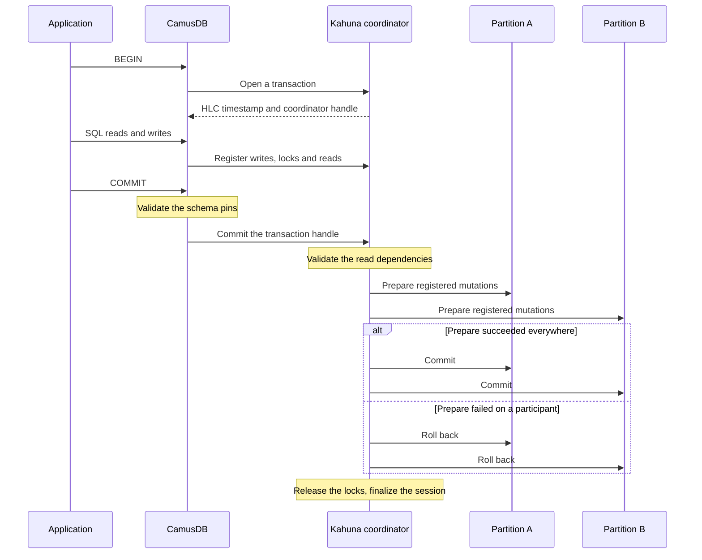

# Distributed transactions and HLC

In a CamusDB cluster, a transaction behaves like a transaction on one node,
also when it changes data on more than one
[partition](/docs/concepts#partition). A partition is a slice of the data that
one group of nodes replicates together. The storage layer coordinates the work
with [two-phase commit](/docs/concepts#two-phase-commit) (2PC). This means that
the transaction commits on all its partitions, or on none of them.

```camussql
BEGIN;
UPDATE accounts SET balance = balance - 30 WHERE id = 1;
INSERT INTO ledger (account_id, amount) VALUES (1, -30);
COMMIT;
```

The two tables can be on different partitions, with different leader nodes.
You don't need to know where a row is. You also don't need compensation code
for a transfer that succeeded on one partition and failed on another, because
that can't happen. You use `BEGIN` and `COMMIT` as usual. The only addition is
a retry loop for conflicts, which serializable transactions need on a single
node too. For more information, see
[Retries and conflicts](/docs/serializable-retries).

You don't need this page to write correct application code. Read it when you
want to know what happens below `COMMIT` in a cluster, or when you diagnose a
slow commit across partitions.

The HLC in the title is a [hybrid logical clock](/docs/concepts#hlc). It gives
each transaction a timestamp that all nodes order in the same way, even when
their clocks differ a little. See
[How HLC timestamps fit in](#how-hlc-timestamps-fit-in).

Two components do this work:

- [Kahuna](/docs/concepts#kahuna) executes the transactional key/value work.
- [Kommander](/docs/concepts#kommander) replicates each partition with the
  [Raft](/docs/concepts#raft) consensus algorithm. Raft commits a write when a
  [majority](/docs/concepts#majority) of the copies of the partition have it.

## Guarantees across partitions

A distributed transaction has the guarantees of a local SQL transaction:

- `BEGIN` and `COMMIT` can include many statements.
- Writes are atomic, also when the rows are on different partitions. If a
  statement fails, the writes on all the partitions are rolled back.
- A committed write doesn't become visible on one partition before another.
- A conflicting write returns an error or waits. Two conflicting writes aren't
  merged.
- A serializable transaction has a stable snapshot or read-write locks across
  partitions, depending on the transaction mode.

A serializable read-only transaction reads one snapshot and takes no locks. A
client can continue it across requests with the transaction id. This is the
best way to get a consistent report across partitions. For more information,
see [Serializable read-only transactions](/docs/transactions-locking-internals#serializable-read-only-transactions).

## How a commit works

In PostgreSQL, one server decides whether a transaction committed. In a
cluster, two keys can belong to partitions with different
[leaders](/docs/concepts#leader). A leader is the node that accepts the writes
of a partition. No single node can mark the transaction committed until all
the partitions that it changed are ready. Two-phase commit solves this. First,
each participant prepares. Then all the participants commit, or all of them
roll back.

A read-write transaction follows this path:

1. `BEGIN` asks Kahuna to start a transaction. Kahuna returns an HLC
   transaction id, which is the start timestamp. It also returns a handle to a
   coordinator session, the record on the server that tracks the transaction
   until it ends.
2. The SQL statements read and write rows, and they take locks. Each operation
   registers its writes, locks, and tracked reads with the coordinator.
3. CamusDB pins the schema version of each table that the work uses.
4. At `COMMIT`, CamusDB checks the schema pins. A transaction can't commit
   against a table definition that changed in an incompatible way while it
   executed. Then CamusDB sends the transaction handle to Kahuna.
5. Kahuna checks the read dependencies, if the transaction needs that check.
6. Kahuna prepares the registered writes on each partition that the
   transaction changed, with a new commit timestamp. These partitions are the
   participants.
7. If the transaction mode needs it, Kahuna checks the keys that the
   transaction read for a [write intent](/docs/concepts#write-intent), an
   uncommitted write from another transaction.
8. If all the participants prepared, Kahuna commits the prepared writes on all
   of them. If a participant failed to prepare, Kahuna rolls back the prepared
   work on all of them.
9. The coordinator releases the locks and ends the session.



The result is an atomic commit across partitions. The data doesn't need to be
on one leader. The CamusDB cluster tests cover this path. For the order in
which Kahuna commits the participants and makes the decision durable, see
[Transaction internals](/docs/transactions-locking-internals#the-durability-of-a-commit-decision).

## Durability across a leader change

Committed transactional writes go through the same replicated log as other
writes: the [write-ahead log](/docs/concepts#wal) of the partition. A
participant is durably committed when its partition accepted the commit through
Kommander, and Kahuna can restore the committed entry.

This protects commits during failures:

- If a node restarts after a commit was acknowledged, the node restores the
  committed log entries and applies them to the key/value store.
- If the leader of a partition changes, the new leader continues from a log
  state that Raft made safe.
- When a transaction has a durable commit decision, the partition that stores
  the decision can finish the commit on the other participants. This works
  also when the original coordinator is gone.
- If a failure happens before the commit decision is durable, the transaction
  isn't reported as committed. To make the change, your application must
  execute the operation again from `BEGIN`.

This means that a SQL transaction can't be partly committed. It commits
through the replicated commit path, or it fails and can be retried.

## Internal retries

The storage layer can retry one part of a transaction without applying it
twice. Each registered operation has an operation id. If a write reaches a
participant but the acknowledgement is lost, a retry with the same id returns
the recorded result, and the row isn't written a second time. Commit and
rollback can also be retried with the same transaction handle.

These retries are internal. If an explicit serializable transaction fails, your
application must execute it again from `BEGIN`. The next attempt can see
different data.

## Conflict detection

The current implementation uses the following mechanisms:

- Exclusive key locks for writes, with the default pessimistic locking.
- Range locks that protect the scans of serializable read-write transactions.
- The keys that the transaction changed, registered with the coordinator for
  the commit.
- Transaction timestamps from the HLC.
- Read dependency checks and write intent checks in the Kahuna coordinator.

### Write-write conflicts

When two transactions update the same key, one of them must wait, abort, or
fail to prepare. They can't both commit conflicting writes to the same key.
With the default pessimistic locking, the second update waits until the first
transaction commits or rolls back. Then it applies its change to the new value.

### Phantom protection

Each scan in a serializable read-write transaction takes a shared range lock
over the [span](/docs/concepts#ranges-and-spans) that it reads. A span is a
contiguous run of keys. This is true with
[hash routing and key-range routing](/docs/concepts#hash-and-key-range-routing),
and with both locking modes. Read Committed transactions don't take scan locks.

A concurrent transaction can't insert, change, or delete a row in a locked
range until the lock holder commits or rolls back. This prevents phantoms.
Other readers can continue.

### Read-write conflicts

The Kahuna coordinator also checks the read set. It looks for data that the
transaction read and that changed before the commit.

The optimistic locking mode checks the read dependencies, and it also checks
for a concurrent write intent before the final commit. To select it, use
`SET TRANSACTION LOCKING OPTIMISTIC`, the `locking` field over HTTP or gRPC, or
the `default_transaction_locking` setting. For more information, see
[Locking strategy](/docs/sql-transactions#locking-strategy).

When your application gets a serialization failure, retry the transaction.

## How HLC timestamps fit in

A distributed transaction needs an order that is the same on all nodes. CamusDB
gets this order from Hybrid Logical Clock (HLC) timestamps, through Kahuna.

The wall clock alone isn't enough:

- Clocks on different nodes differ a little.
- Several events can happen in one clock tick.
- A node can receive a timestamp that is ahead of its clock.

An HLC combines the physical time with a
logical counter. The result is close to real time, and it gives a stable causal
order across nodes.

An HLC timestamp has three parts:

| Part | Meaning |
| --- | --- |
| `L` | The physical time in milliseconds. |
| `C` | A counter for events that physical time alone can't order. |
| `N` | The id of the node that issued the timestamp. |

Timestamps sort by `L`, then `C`, then `N`. The node id breaks ties. This means
that timestamps from two nodes can't be equal. The HTTP API returns a
timestamp in this form, for example `"causalToken": {"n": 1, "l": 1795120912682, "c": 8}`.

When a transaction starts, Kahuna gives it an HLC transaction id. This start
timestamp identifies the transaction until it ends.

At commit, Kahuna computes a new commit timestamp. It is at least as new as the
start timestamp, and as new as each value that the transaction changed or
depended on. This means that if transaction B depends on effects newer than the
start of transaction A, the commit timestamp of B moves forward to match. B
can't commit with an older timestamp, because that would break the serial
order.

## Retryable failures

Most failures abort the transaction with no committed changes. Examples are
a conflict and a failed prepare. Execute the transaction again from `BEGIN`.

`CADB0509 TransactionFinalizeUnresolved` is the exception. The outcome isn't
final yet. Send the same `COMMIT` or `ROLLBACK` again for the same transaction.
Don't execute the business operation again.

For each retry cause and error code, and the action for each, see
[Retries and conflicts](/docs/serializable-retries). To choose an isolation
level, see
[Transactions and isolation](/docs/serializable-transactions#isolation-levels).
Serializable is the default. Read Committed is available if you select it.

## See also

- [Transactions and isolation](/docs/serializable-transactions)
- [Retries and conflicts](/docs/serializable-retries)
- [Architecture](/docs/architecture)
- [Cluster mode](/docs/cluster)
- [WAL and recovery](/docs/wal-recovery)
