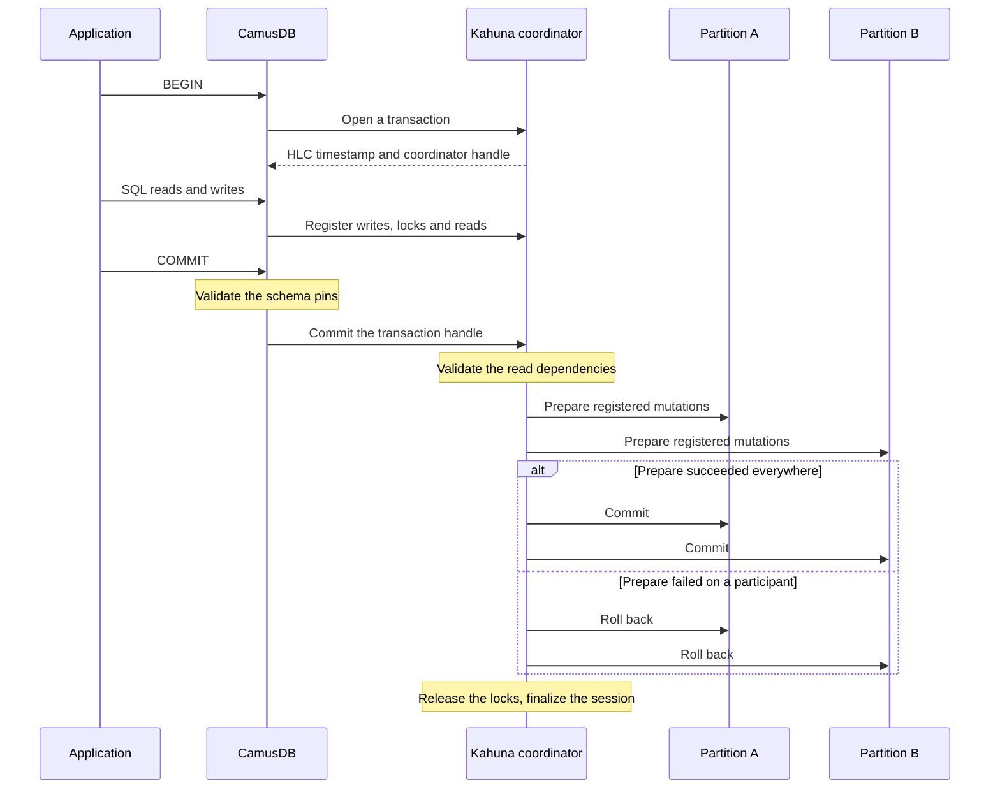

# Distributed transactions and HLC

A transaction can touch data on more than one
[partition](/docs/concepts#partition), the slice of data that one group of nodes
replicates together. The storage layer then coordinates the work with
[two-phase commit](/docs/concepts#two-phase-commit), or 2PC. The transaction
commits on every partition, or it aborts on every partition.

For your application, this means that a transaction in a cluster behaves like a
transaction on one node. You do not need to know which partition holds a row.
You do not write compensation code for a transfer that succeeds on one
partition and fails on another, because that case cannot occur. You use
`BEGIN` and `COMMIT` as usual. The only addition is a retry loop for a
conflict, which a serializable transaction needs on one node too. See
[Retries and conflicts](/docs/serializable-retries).

You do not need this page to write correct application code. Read it when you
want to know what happens below `COMMIT` in a cluster, or when you diagnose a
slow commit across partitions.

The HLC in the title is a [hybrid logical clock](/docs/concepts#hlc). It gives each transaction a
timestamp that all nodes order the same way, even when their clocks differ a
little. See [How HLC timestamps fit in](#how-hlc-timestamps-fit-in).

CamusDB uses two components for this work:

- [Kahuna](/docs/concepts#kahuna) executes transactional key/value work.
- [Kommander](/docs/concepts#kommander) replicates each partition with the
  [Raft](/docs/concepts#raft) consensus algorithm, which commits a write once a
  [majority](/docs/concepts#majority) of the partition's copies has it.

This page gives the guarantee first. It then describes the flow under the
guarantee.

## What users get

A distributed transaction in CamusDB keeps the same guarantees that you expect
from a local SQL transaction:

- `BEGIN` and `COMMIT` span several statements.
- A write stays atomic even when the rows live on different partitions.
- A committed write never becomes partly visible across the partitions.
- CamusDB reports a conflicting write as a failure or as a retry. It never
  merges the two writes in silence.
- A serializable transaction keeps either a stable snapshot or read-write lock
  semantics across the partitions. The transaction mode decides which one.

That set includes a serializable read-only snapshot path. The path needs no
lock, and a client can resume it across requests with the transaction id.

CamusDB can therefore run work of these four kinds:

1. An insert into two different tables in one transaction.
2. An update of rows whose keys route to different partitions.
3. A consistent serializable read-only report across several partitions.
4. Indexed point writes together with range reads, in one serializable
   read-write unit.

## How a commit works

In PostgreSQL, one server decides whether a transaction committed. In a
cluster, two keys can belong to partitions with different
[leaders](/docs/concepts#leader), the node that accepts writes for a partition.
No single node can mark the whole transaction committed until every partition
that the transaction touched is ready. Two-phase commit solves this: first every
participant prepares, then every participant commits, or every participant
rolls back.

A read-write transaction follows this path:

1. `BEGIN` asks Kahuna to start a transaction. Kahuna returns an HLC
   transaction id, which is the start timestamp, and a handle to a coordinator
   session. The coordinator session is the server-side record that tracks the
   transaction until it ends.
2. The SQL statements read rows, write rows, maintain the indexes, and acquire
   locks. Each successful operation registers its confirmed writes, its locks,
   and its tracked reads with the coordinator.
3. CamusDB pins the schema version of each table that the work touches.
4. At `COMMIT`, CamusDB validates the schema pins, so the transaction cannot
   commit against a table definition that became incompatible while it ran. It
   then sends the transaction handle to Kahuna.
5. Kahuna validates the read dependencies, when the transaction needs that
   check.
6. Kahuna prepares the registered mutations on every partition that the
   transaction touched, with a fresh commit timestamp. These partitions are the
   participants.
7. Kahuna checks for a conflicting [write intent](/docs/concepts#write-intent)
   (an uncommitted write from another transaction) on the read keys, when the
   execution path requires that check.
8. If every participant prepared, Kahuna commits the prepared mutations on all
   of them. If any participant failed to prepare, Kahuna rolls the prepared work
   back on all of them.
9. The coordinator releases the registered locks and finalizes the session.

The result is an atomic commit across partitions. The data does not have to
live on one leader. The cluster tests of CamusDB exercise this path for a
transaction across partitions. For the order in which Kahuna commits the
participants and makes the decision durable, see
[Transaction internals](/docs/transactions-locking-internals#the-durability-of-a-commit-decision).

## Durability across a leader change

CamusDB stores a committed transactional write through the same replicated
partition log, the partition's [write-ahead log](/docs/concepts#wal), as an
ordinary write. A participant is not durably committed until
two conditions hold. Its partition accepted the commit through Kommander, and
Kahuna can restore the committed entry.

That matters during a failure:

- A node can restart after CamusDB acknowledged a commit. CamusDB then restores
  the committed partition log entries. It applies them back into the KV store as
  needed.
- A partition leader can change. The new leader continues from a log state that
  Raft made safe. It can continue to serve the partition.
- A transaction can install a durable commit decision. The partition that stores
  that decision, called the decision anchor, can then drive the remaining
  participant commits. It does so even after the original live coordinator
  disappears.
- A failure can happen before CamusDB installs a durable commit decision.
  CamusDB then does not report the transaction as a committed SQL result. Your
  application must replay the business operation from `BEGIN` if it still wants
  the change.

The practical guarantee is this: CamusDB never exposes a half-committed SQL
transaction. A transaction either commits through the replicated commit path of
the storage layer, or it stays retryable or aborted. CamusDB never reports it as
a committed result in the second case.

## Idempotent internal retries

The storage layer can retry one piece of a transaction. It does not apply the
same effect twice.

Every registered operation carries a transaction operation id. The coordinator
uses that id to distinguish three cases:

- A duplicate delivery of the same logical operation.
- A new operation that must run separately.
- A retry of the commit or of the rollback, for the same transaction handle.

A write can reach a participant while the acknowledgement back to the
coordinator is lost. A retry with the same operation id then replays the
recorded completion. It does not write the row or the index entry a second time.
The commit and the rollback use the transaction handle. CamusDB can retry them
when Kahuna returns `MustRetry`.

This idempotency is an internal guarantee of the engine. Application code must
still treat a failed explicit serializable transaction as a failed unit. Replay
the whole transaction from `BEGIN`. The business logic may observe different data
on the next attempt.

## Conflict detection

The current implementation uses a combination of five mechanisms:

- Exclusive key locks for a write.
- Prefix locks or range locks, to protect a scan in the relevant execution
  modes.
- Modified keys that the coordinator registers, for coordination at commit time.
- Transaction timestamps from the HLC.
- Validation of the read dependencies, and checks of the write intents, in the
  Kahuna transaction coordinator.

### Write-write conflicts

Two transactions can try to update the same key. One of them must then wait,
abort, or fail to prepare. Both cannot commit a conflicting write to the same
key.

### Phantom protection

Every scan in a serializable read-write transaction takes a shared range lock
over the [span](/docs/concepts#ranges-and-spans), the contiguous run of keys,
that it reads. This happens under both
[hash routing and key-range routing](/docs/concepts#hash-and-key-range-routing).
Under key-range routing, a Read Committed read-write transaction also takes the
scan lock, so that pages served by several ranges form one consistent read.

A concurrent transaction cannot insert, change, or delete a row inside a locked
range until the lock holder commits or rolls back. This prevents phantoms.
Concurrent readers can still continue.

The same idea of predicate protection also applies to a serializable read-write
transaction. It protects the read set that the transaction must preserve until
the commit.

### Read-write conflicts

The Kahuna coordinator also checks the read set. It looks for data that the
transaction read and that no longer agrees with the state at commit.

The advanced optimistic locking path validates the read dependencies. It also
checks for a concurrent write intent before the final commit. You can select
that path in three ways: with `SET TRANSACTION LOCKING OPTIMISTIC`, with the
`locking` field over HTTP or gRPC, or with `default_transaction_locking`.

The practical rule for an application is simple. A serialization failure is a
signal to retry. It is not a silent defect in correctness.

## How HLC timestamps fit in

Every distributed transaction needs an order that works across nodes. CamusDB
uses Hybrid Logical Clock timestamps, or HLC timestamps, through Kahuna.

An HLC timestamp has three parts:

- `N` is the id of the node that issued the timestamp.
- `L` is the physical time in milliseconds.
- `C` is a counter. CamusDB uses it when physical time alone cannot preserve the
  order.

Timestamps sort by `L`, then by `C`, then by `N`. The node id breaks ties, so two
nodes never produce equal timestamps.

## Why HLC instead of plain wall-clock time

Plain wall-clock time is not enough in a distributed system, for three reasons:

1. The clocks on two nodes are never perfectly synchronous.
2. Several events can happen inside one clock tick.
3. A node can receive an event whose timestamp is ahead of its own physical
   time.

An HLC solves this problem. It combines physical time with a logical counter.
The result stays close to real time. It still gives a stable causal order across
the nodes.

## The transaction start timestamp

Kahuna allocates an HLC transaction ID when CamusDB begins a transaction.

That timestamp becomes the identity of the transaction for the rest of the
commit path. It is also the reference point for the locks, for the record of the
reads, and for the coordination of the writes.

## The commit timestamp

At commit time, Kahuna does not reuse the start timestamp without a change. It
computes a commit timestamp that is at least as new as both of these values:

- The start timestamp of the transaction.
- The newest timestamp of any value that the transaction modified or depended
  on.

The Kahuna coordinator takes the highest modified time that it observed. It
feeds that value back into the HLC of the node before the prepare step. The
result is a fresh commit timestamp. That timestamp preserves the order even when
the transaction spans several nodes, and even when it races with a concurrent
writer.

One property matters to a user. Transaction B can depend on effects that are
newer than the start time of transaction A. The commit timestamp of B then
advances by the same amount. CamusDB does not commit B with an older timestamp,
because that timestamp would break the serial order.

## Retryable failures

A conflict, a failed prepare, or a passed lifetime deadline aborts the
transaction with nothing committed. Replay the whole transaction from `BEGIN`.
These failures are how CamusDB preserves correctness. They are not partial
commits.

`CADB0509 TransactionFinalizeUnresolved` is the exception: the outcome is not
final yet. Send the same `COMMIT` or `ROLLBACK` again on the same transaction,
and do not run the business operation again.

[Retries and conflicts](/docs/serializable-retries) lists every retry cause and
error code, and the action for each. To choose an isolation level for a job, see
[Transactions and isolation](/docs/serializable-transactions#isolation-levels).

## Limits and scope

This page describes the current transaction model of CamusDB over Kahuna:

- A cross-partition write uses 2PC.
- A committed write survives a node restart and a leader change, through the
  replicated partition log.
- The decision-anchor partition can recover a durable commit decision after the
  live coordinator disappears.
- A registered transaction operation, a commit, and a rollback are idempotent
  across the retries of the engine.
- HLC timestamps give the transaction order across nodes.
- The record of locks and write intents protects the atomic distributed commit.
- Serializable is the default isolation level.
- Read Committed is available as an explicit opt-out.

CamusDB is in production use. Distributed transaction support is nevertheless an
alpha feature. The APIs and the behavior can change between versions.

## See also

- [Transactions And Isolation](/docs/serializable-transactions)
- [Retries And Conflicts](/docs/serializable-retries)
- [Architecture](/docs/architecture)
- [Cluster Mode](/docs/cluster)
- [WAL And Recovery](/docs/wal-recovery)
