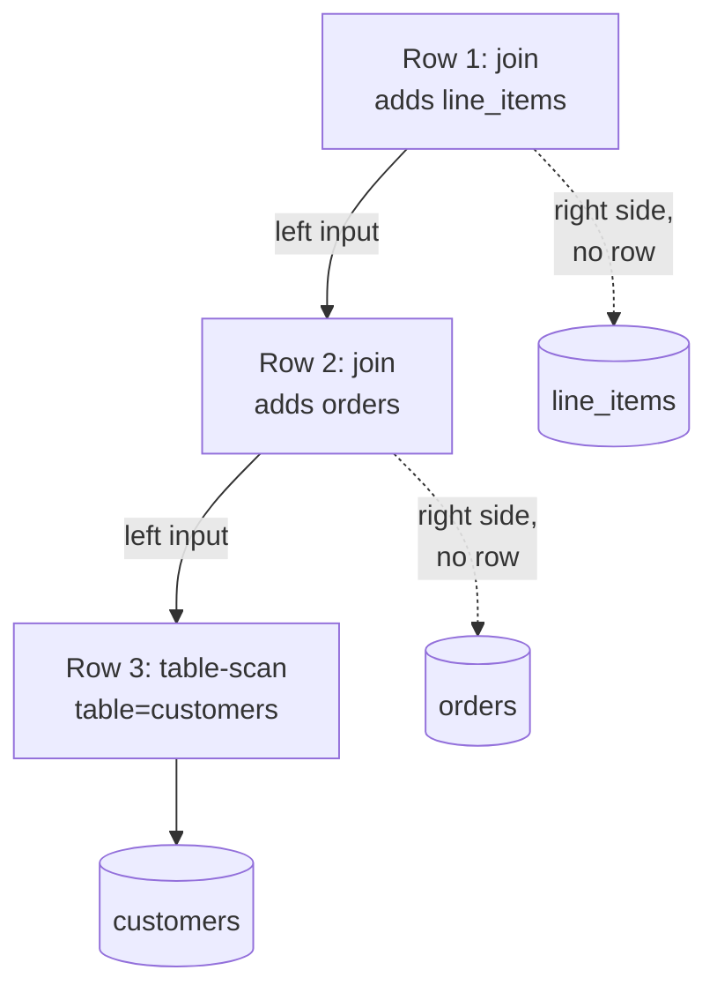

# EXPLAIN

`EXPLAIN` shows how CamusDB plans to run a query. Put it in front of a `SELECT`,
and CamusDB returns the plan instead of the rows: the tables it reads, the
indexes it uses, the join method, and the estimated number of rows at each step.

```camussql
EXPLAIN SELECT * FROM robots WHERE year = 2023;
```

```text
stage     node               detail
physical  index-range-scan   index=year_idx, from>=2023, to<2024
```

The example assumes an index `year_idx` on the `year` column. The plan reads
that index instead of scanning the whole table.

## Why use EXPLAIN

The [query planner](/docs/query-planning) decides how CamusDB runs each query.
Two queries that look alike can do very different amounts of work. `EXPLAIN`
shows you that work before it becomes a problem in production.

Use `EXPLAIN` when:

- A query is slow, and you want to know why.
- You added an index, and you want to confirm that a query uses it.
- A query reads many more rows than it returns. A full table scan for a filter
  on one value is a common example.
- You want to compare two ways to write the same query.

Use `EXPLAIN (ANALYZE)` when the estimates are not enough. It runs the query and
adds the real counts beside the estimates. A large gap between the two often
means the table's [statistics](/docs/show-statistics) are missing or old.

You do not need `EXPLAIN` for a query that is already fast enough. If you are
new to query plans, start with [Query planning](/docs/query-planning), then use
this page as the reference for each node and output column.

:::note Stability

`EXPLAIN` output is diagnostic only, and it can change while the query planner
is an alpha feature. The node names, column names, and detail formats on this
page are stable within a minor version, and the changelog names any change that
breaks them. Do not build production logic that parses this output.

:::

## Syntax

```camussql
EXPLAIN SELECT ...
EXPLAIN (PHYSICAL) SELECT ...   -- identical to plain EXPLAIN
EXPLAIN (LOGICAL)  SELECT ...   -- same plan, stage column = "logical"
EXPLAIN (ANALYZE)  SELECT ...   -- executes the query and adds actual counters
```

`EXPLAIN` without `ANALYZE` builds the physical plan. It opens no table cursor
and reads no row data.

`EXPLAIN (ANALYZE)` executes the full query and drains the result, then reports
the true runtime counters beside the estimate columns.

CamusDB rejects option words it does not know, such as `EXPLAIN (VERBOSE) ...`,
with an error. It does not silently treat the statement as a plain `EXPLAIN`.

Note:

- **Subqueries.** Planning a statement with an uncorrelated subquery executes
  that subquery once and materializes it. `EXPLAIN` on such a statement
  therefore reads storage for the inner query. A plain `EXPLAIN` never executes
  the outer query.
- **`SELECT` without `FROM`.** Such a [statement](/docs/sql-fromless-select)
  has no plan tree, so a plain `EXPLAIN` renders a fixed shape: a
  `constant-source`, then a `project`, then a `limit` if there is one. It
  renders no costed plan. CamusDB rejects `EXPLAIN (ANALYZE)` for it, because
  there is no table access to measure; use the plain form. Unlike running the
  real query, `EXPLAIN` on such a statement does not materialize the subqueries
  in its projection first. They appear only as their output column names.

All EXPLAIN forms use the query's read view. In a Read Committed transaction,
storage reads during planning or execution use one statement timestamp.

## Locking reads

Every form accepts `SELECT ... FOR UPDATE`, including `NOWAIT` and
`SKIP LOCKED`. Plain EXPLAIN takes no row locks and works in read-only or
optimistic transactions; it still requires SELECT and UPDATE privileges.
EXPLAIN ANALYZE executes the locking read, applies its transaction restrictions,
and holds acquired locks until the transaction ends.

The plan contains a `lock_rows` step above sorting and below pagination.
Under ANALYZE its detail includes:

| Counter | Meaning |
| --- | --- |
| `locked` | Row locks acquired, including rows later dropped by rechecking. |
| `skipped-held` | Rows omitted because SKIP LOCKED found another holder; zero for other policies. |
| `recheck-dropped` | Locked rows deleted or changed out of the predicate before the locked reread. |

The step's `actual_rows` is `locked − recheck-dropped`, before a later OFFSET
removes rows. See [row-locking SELECT](/docs/sql-queries#for-update) for semantics.

## Result columns

### Plain EXPLAIN

| Column           | Type      | Description |
|------------------|-----------|-------------|
| `stage`          | `STRING`  | `"physical"` for `EXPLAIN` and `EXPLAIN (PHYSICAL)`. `"logical"` for `EXPLAIN (LOGICAL)`. |
| `node`           | `STRING`  | The canonical node name. See the table below. |
| `detail`         | `STRING`  | The node's key facts. See the table below. |
| `estimated_rows` | `INT64`   | The cost model's estimate of the node's output cardinality. `NULL` when CamusDB did not cost the plan. |
| `estimated_cost` | `FLOAT64` | The node's weighted cost from the cost model. It has no unit, and lower is cheaper. `NULL` when there is no cost. |

`estimated_rows` and `estimated_cost` come from the cost model. Estimates use
the table's statistics where they are available:

- The row count.
- Each column's minimum and maximum.
- Equi-depth histograms, after `ANALYZE`.
- Distinct-value counts, after `ANALYZE`.

Without them, an estimate falls back to a fixed default. The exact numbers
therefore depend on the statistics CamusDB has collected, and they differ
between deployments.

When an estimate looks wrong,
[`SHOW STATISTICS FOR <table>`](/docs/show-statistics) shows its inputs and
whether CamusDB collected them at all.

`estimated_cost` also includes a network term, the `NetworkFactor`. It applies
to deployments with
[key-range sharding](/docs/concepts#hash-and-key-range-routing), and is 0 on a
single node.

These are predictions, not accuracy guarantees. Missing statistics, skew, and
correlated values can make an estimate differ substantially from execution.

`(LOGICAL)` and `(PHYSICAL)` currently render the same physical tree; only the
`stage` label differs. See
[the query planner guide](/docs/query-planner-internals#statistics-and-cost) for
the cost model itself.

### EXPLAIN (ANALYZE)

The result has every column of a plain `EXPLAIN`, plus the columns below. The
`stage` column is `"analyze"` on every row.

| Column            | Type       | Description |
|-------------------|------------|-------------|
| `actual_rows`     | `INT64`    | The rows this operator passed to its parent. |
| `rows_read`       | `INT64`    | The rows a scan operator fetched and decoded from storage, before any filter. `0` for pipeline operators, because they read from a cursor, not from storage. |
| `actual_time_ms`  | `FLOAT64`  | Total wall-clock milliseconds for the whole plan. Only the root node carries it; it is `NULL` on every other node. |
| `kv_lookups`      | `INT64`    | Point lookups CamusDB issued to the key/value storage layer, for unique index lookups. |
| `kv_scan_entries` | `INT64`    | Key/value storage entries a scan visited, for table scans and index range scans. |
| `estimate_trace` | `STRING` | JSON explaining the row estimate: formula, dominant rule, input rows, and factors with their statistics. Null when no estimate exists. |

On a scan node, `actual_rows` is at or below `rows_read`. `rows_read` counts the
rows CamusDB decoded from storage before evaluating any predicate; `actual_rows`
counts the rows that passed every filter and that the node passed upward.

Use `estimate_trace` when estimated and actual rows differ. It identifies
which selectivity rules and statistics contributed to the estimate, including
distinct-value counts and join column groups. It explains the estimate rather
than measuring execution. See [plan quality testing](/docs/plan-quality-testing)
for repeatable estimate comparisons.

### Runtime counters for a join

`EXPLAIN (ANALYZE)` supports join plans. A join plan is rendered as a chain:
each join node has one visible input, its left side, and names the right side in
the detail of the join row. The right side does not get a separate scan row
([Reading a join plan](#reading-a-join-plan) shows which row owns which table).
For that reason, a join row's storage counters describe the work done on its
right side:

- `nested-loop-join` counts every reread of the right side. Four left rows over
  seven right rows therefore report 28 rows read.
- `index-nested-loop-join` probes a page of outer rows at a time. The distinct
  keys in the page share a batched index read and a batched row read. A
  unique-index probe increments `kv_lookups`; a non-unique index walk increments
  `kv_scan_entries`. A non-unique key wider than one probe page is streamed on
  its own, page by page. Repeated keys can be answered from the join memo, so
  the storage counters describe distinct probes rather than outer rows.
- `hash-join` counts one read of the right side, whether that side becomes the
  build side (loaded into the in-memory hash table) or the probe side (streamed
  and looked up in that table).
- `merge-join` adds the reads of its ordered right input to the join row,
  because that input is not rendered as its own plan row.

The root row of a join plan is the last join. Work that happens after the last
join, such as grouping, ordering, a final filter, projection, or a `LIMIT`, is
not rendered as a separate join-plan node.

A join row can append runtime-only detail:

| Suffix | Meaning |
| --- | --- |
| `ran=grace-hash` | A hash join spilled and ran as a Grace hash join. |
| `ran=nested-loop-fallback` | A hash join exceeded its build limit while spilling was disabled, so execution used a nested-loop fallback. |
| `ran=broadcast` | A distributed hash join sent the small build side to the nodes that hold the probe table's [ranges](/docs/concepts#ranges-and-spans), and probed there. |
| `probe-memo-hits=<n>` | The indexed nested-loop join answered `n` repeated keys from its memo, without another storage read. |
| `probe-batches=<n>` | The indexed nested-loop join issued `n` batches that reached the index. A page answered entirely from the memo is not counted. |
| `join-order-est-rows=<n>` | The row estimate used by the join-order search, shown beside the plan annotation and the actual rows. |

`estimated_rows` still comes from the rendered plan annotation. The
`join-order-est-rows` suffix comes from the join-order search that chose the
order. They can differ. Seeing both beside `actual_rows` helps diagnose whether
the planner's search estimate or the final plan annotation was closer. See
[cost model boundaries](/docs/query-planner-internals#cost-model-boundaries)
for why the two are computed separately.

The `plan-info` row of `EXPLAIN (ANALYZE)` also reports deterministic planning
facts. Plain `EXPLAIN` leaves these fields out:

| Suffix | Meaning |
| --- | --- |
| `planning-ms=<ms>` | Time spent binding and planning, including subqueries folded into literals. It is diagnostic and can vary between runs. |
| `join-order=cost-based` | Cost-based search selected the join order. |
| `join-order=heuristic` | The heuristic selected or repaired the order because search was disabled or unavailable. |
| `join-order=cached` | The plan cache replayed an earlier join-order decision. |
| `join-steps-costed=<n>` | Join steps evaluated by cost-based search. It is deterministic for the same query and statistics; cache replay and a skipped search report `0`. |

## Node names

CamusDB emits one row per physical plan node, in depth-first order with each
parent before its children.

| Node name                | When it appears | Key detail fields |
|--------------------------|-----------------|-------------------|
| `table-scan`             | A full table scan, or a forced index scan | `table=<name>`. A forced index adds `, forced-index=<name>`. |
| `index-lookup`           | An equality on a unique index | `index=<name>, key=<value>` |
| `index-range-scan`       | A range predicate with `<`, `>`, or `BETWEEN`, or an equality on a non-unique index | `index=<name>, from>=<val>, to<<val>` |
| `index-in-list`          | `x IN (v1, v2, …)` on an indexed column. CamusDB seeks the index once per distinct value and unions the results. | `index=<name>, values=<n>`, where `n` is the number of values sought |
| `filter`                 | A residual predicate that the chosen index does not satisfy | `<expr>` |
| `aggregate`              | A `GROUP BY` or an aggregate function | `group=[<exprs>], aggs=[<calls>]` |
| `having-filter`          | A `HAVING` clause, after aggregation | `<expr>` |
| `sort`                   | An `ORDER BY` that the scan order does not satisfy | `<col> ASC/DESC, ...` |
| `topk`                   | An `ORDER BY` bounded by a `LIMIT`. It keeps only `offset + limit` rows and never spills. See [Vector search](/docs/vector-search). | `k: <n>, <col> ASC/DESC, ...` |
| `limit`                  | A `LIMIT` or `OFFSET` | `<n>`, or `<n> offset <m>` |
| `project`                | Column projection, after the other pipeline stages | (no detail) |
| `distinct`               | A `SELECT DISTINCT` | `streaming: true` for the ordered form, which needs constant memory. Otherwise `hash`. |
| `semi-join`              | An `IN (subquery)` over an indexed inner column, rewritten as a semi-join, which keeps each outer row that has a match | `outer=<col>, inner=<table>.<col>, index=<name>` |
| `anti-join`              | A `NOT IN (subquery)` over an indexed `NOT NULL` inner column. An anti-join keeps each outer row that has no match. | `outer=<col>, inner=<table>.<col>, index=<name>` |
| `null-aware-anti-join`   | A `NOT IN (subquery)` over an indexed nullable inner column. It follows SQL's three-valued semantics. | `outer=<col>, inner=<table>.<col>, index=<name>` |
| `nested-loop-join`       | A join with no usable index on the right side | `on=<expr>, right=<alias>` |
| `index-nested-loop-join` | A join where an index covers the right side's join key | `on=<expr>, index=<name>, left=<col>, right=<col>` |
| `hash-join`              | An equi-join using an in-memory hash table. CamusDB chooses it over an indexed nested loop when the outer side is large relative to the inner side. | `on=<left>=<right>, build=<alias>`. A pushed-down filter is appended to the detail. |
| `merge-join`             | An equi-join over ordered inputs. | `on=<left>=<right>, right-order=forced-index=<name>` or `right-order=sort`. A right-side filter is appended to the detail. |
| `derived-table-scan`     | A subquery in the `FROM` clause | `alias=<alias>` |
| `function-scan`          | A set-returning function in `FROM` | `function=<name>, alias=<alias>` |
| `constant-source`        | The single synthetic row of a `SELECT` without `FROM`. It touches no table. | `1 row` |
| `union` | A `UNION` or `UNION ALL`. | `distinct: hash` or `all`. |
| `intersect`, `except` | An `INTERSECT` or `EXCEPT`, with optional `ALL`. | `hash` or `all, hash`. |
| `operand` | Left or right input to a set operation; its plan follows this row. | `left` or `right`. |
| `lock_rows` | Locks and rereads rows for SELECT FOR UPDATE. | `for update`, optionally `nowait` or `skip locked`; runtime lock counters under ANALYZE. |

More details:

- [Set operations](/docs/sql-queries#set-operations) show both input plans under `operand`
  rows. Under `ANALYZE`, an operand's `actual_rows` is its output count; the
  parent operation reports the combined count. `, spill` in a hash detail means
  spill is enabled, rather than proving a spill occurred.

- An uncorrelated `IN` or `NOT IN` over an indexed inner column becomes a
  `semi-join`, `anti-join`, or `null-aware-anti-join`. If the inner column has
  no index, CamusDB materializes the subquery instead, and no join node appears.
- A `distinct` row reports `streaming: true` when the input arrives in an index
  order that covers every `DISTINCT` column, and those columns are all
  `NOT NULL`. Otherwise it reports `hash`.
- A `hash-join`'s `build=<alias>` names the side CamusDB materialized into the
  in-memory hash table. For an inner join, the planner picks the side with the
  smaller estimate as the build side, to keep memory low. For a left outer join,
  the build side is always the right table, so the preserved side can be probed
  and padded in stream order.
- A join node appends `kind=left-outer` for a `LEFT [OUTER] JOIN`. A
  `RIGHT JOIN` is executed as a left join with the operands swapped. An inner
  join renders no kind.
- A `merge-join` streams both inputs when both already arrive in order, either
  from a forced index scan or from a sort above. The join buffers only the
  current run of equal keys, so it needs memory for one run, not for both
  inputs.

The plan reflects the planner's active configuration. A table's access path and
the order of join nodes both depend on the cost-based optimizer.

The same query can show a different index or join order depending on the
[cost-based flags](/docs/query-planning#what-the-planner-can-do) and the
statistics available. The output is correct for the configuration that produced
it.

The examples below show the `stage`, `node`, and `detail` columns, which are the
stable part of the output. Every row also carries `estimated_rows` and
`estimated_cost`, as described above. The `EXPLAIN ANALYZE` examples show the
full set of columns.

## Reading a join plan

A join plan is a compact view of execution, not a reproduction of the SQL text.
Read the scan near the bottom as the starting input, then follow the joins
upward. The result rows are emitted parent first. The `node` field itself has
no indentation or parent identifier.

The renderer follows a join's **left input**. Its right source does not get a
separate scan row.

The diagram shows the three rows for
`customers c JOIN orders o ON o.customer_id = c.id JOIN line_items li ON li.order_id = o.id`,
when the planner keeps the written order. Only the first table has a scan row.
Each join row owns the reads of the table it adds.



Details on the join describe parts of that work:

- `index=...` identifies the right-side probe index for an indexed nested loop.
- `build=...` identifies the hash build side.
- `right-order=forced-index=...` identifies the right merge input's ordering
  index; `right-order=sort` means it needs sorting instead.

### Why a predicate moved or seems absent

When the planner rebuilds an eligible inner join through its predicate graph,
each movable condition runs where its last referenced source enters the tree.
A condition from a later `ON`, or an eligible cross-table `WHERE` condition,
can therefore appear at an earlier join.

Suppose an equality `a.z = b.z` is written in the `ON` clause that adds `c`.
If `a` and `b` join first, the planner can evaluate that equality there. A hash
join may show it as an additional key pair. This is predicate placement, even
when the source order itself stays unchanged.

How much of a join condition EXPLAIN shows depends on the operator:

| Operator or stage | What EXPLAIN shows |
| --- | --- |
| Nested loop and indexed nested loop | The full `on=` expression. |
| Hash join and merge join | The equality key pairs. Other ON conditions still execute but are not all rendered. |
| Final post-join filter | It is stored outside the physical node chain and has no separate plan row. |

An absent condition in this output does not prove that execution skipped it.
See [predicate graph internals](/docs/query-planner-internals#the-join-predicate-graph)
for movement rules and safeguards.

A `nested-loop-join` with `on=true` is a Cartesian-product step. It can be
necessary for an unconnected query, or remain when the graph cannot safely
rebuild the query. Eligible connected graphs receive cross-product repair even
when cost-based join-order enumeration is off.

## Informational rows

`EXPLAIN` can add a few informational rows after the node rows. These rows are
not plan operators: their `estimated_rows` and `estimated_cost` are both `NULL`,
and each reports a plan-level fact.

| Node name   | When it appears | Detail |
|-------------|-----------------|--------|
| `plan-info` | The plan carries query-shape and planner metadata. `EXPLAIN (ANALYZE)` adds planning and join-search facts. | `shape=<id>, schema-deps=[table@version, ...]`; analyzed joins can add `planning-ms`, `join-order`, and `join-steps-costed`. |
| `cache`     | The query carries a result cache hint, in the form `{cache=…}` or `@{cache=…}`. | `family=<name>, eligible=<true\|false>[, reason=<why>], ttl=<n>ms\|default, strict=<true\|false>` |

The `cache` row answers one question: will CamusDB cache this result? The answer
is a static property of the plan.

The row does not probe the cache, and it does not report whether a live entry
exists at that moment, because such a report would inherently be a race. The
authoritative runtime outcome is the `cacheStatus` in the query response.

`eligible=true` means the query shape is cacheable and the feature is on.

`eligible=false` gives the reason the hint has no effect:

- `reason=join` means the query is a join. CamusDB caches only single-table
  results, so the hint is inert.
- `reason=cache-disabled` means the result cache is off
  (`query_result_cache_enabled: false`).

`ttl` and `strict` repeat the hint's options. `ttl=default` appears when you
gave no `ttl=`.

This eligibility is the plan-level view. At runtime, the cache also applies only
to reads in autocommit mode; an explicit transaction always reads live storage.
A query without a `{cache=…}` hint emits no `cache` row. See the
[query result cache](/docs/query-result-cache) for the whole feature.

## Worked examples

### Full table scan

```camussql
EXPLAIN SELECT * FROM robots;
```

```text
stage     node        detail
physical  table-scan  table=robots
```

The planner chose a full table scan. The `WHERE` clause is empty, so no index is
usable.

### Equality on a non-unique index

```camussql
EXPLAIN SELECT * FROM robots WHERE year = 2023;
```

The example assumes a non-unique index `year_idx` on the `year` column.

```text
stage     node               detail
physical  index-range-scan   index=year_idx, from>=2023, to<2024
```

For a non-unique index, CamusDB rewrites an equality predicate into a range
scan.

For numeric and other ordinal types, the range is half-open: it covers
`>= value` and `< successor(value)`, as above.

For `String` and `Id` columns, there is no successor to compute, so CamusDB uses
an inclusive range from `value` to `value`, and the detail reads
`from>=value, to<=value`. The scan engine appends a high sentinel internally, so
it captures every index entry of the form `encode(value)+rowId`, then trims the
result to exact key matches.

Both forms return the same rows; only the rendering of the bounds differs.

The `index-lookup` node appears only for an equality on a unique index (a
primary key or a `UNIQUE` constraint), where at most one row can match.

### Equality on a primary key

```camussql
EXPLAIN SELECT * FROM robots WHERE id = '507f1f77bcf86cd799439011';
```

```text
stage     node          detail
physical  index-lookup  index=~pk, key='507f1f77bcf86cd799439011'
```

`~pk` is unique, so the planner issues a single point lookup instead of a range
scan.

### Range scan with a residual filter

```camussql
EXPLAIN SELECT * FROM robots WHERE year >= 2020 AND name = 'Bishop';
```

```text
stage     node               detail
physical  filter             name = 'Bishop'
physical  index-range-scan   index=year_idx, from>=2020
```

The predicate `year >= 2020` drives the index range scan. CamusDB cannot push
`name = 'Bishop'` into the index, so that predicate appears as a residual
`filter` above the scan.

The `node` column holds the bare node name, with no leading spaces. Row order
carries the tree depth, with each parent before its child; the real result set
has no indentation.

### Aggregate with GROUP BY

```camussql
EXPLAIN SELECT year, COUNT(*) FROM robots GROUP BY year;
```

```text
stage     node        detail
physical  aggregate   group=[year], aggs=[count(*)]
physical  table-scan  table=robots
```

### SELECT DISTINCT: streaming and hash

```camussql
EXPLAIN SELECT DISTINCT code FROM teams;   -- code is NOT NULL with an index
```

```text
stage     node              detail
physical  distinct          streaming: true
physical  index-range-scan  index=code_idx
```

When the `DISTINCT` columns form a prefix of an index's columns and all of them
are `NOT NULL`, the scan emits rows in index order and the `distinct` node
removes adjacent duplicates with constant memory. Otherwise the `distinct` row
shows `hash`, and CamusDB uses a hash set.

### Hash join for an equi-join without a join-key index

```camussql
EXPLAIN SELECT o.name, li.product
        FROM orders o
        JOIN line_items li ON li.order_id = o.id;
-- orders.id is the PK; line_items.order_id has no secondary index
```

```text
stage     node        detail
physical  hash-join   on=o.id=order_id, build=li
physical  table-scan  table=orders
```

`build=li` means CamusDB materializes `line_items` into the in-memory hash table
and streams `orders` as the probe side. The planner chose `li` as the build
side because its estimate had fewer rows than `orders`.

The right input has no separate scan row; the join detail identifies the build
side here. If it exceeds `HashJoinMaxBuildRows` (default 1,000,000), execution
can use [spill to disk](/docs/spill-to-disk) when enabled. With spill disabled,
it falls back to nested-loop execution for that query.

### Merge join with join-key indexes on both sides

```camussql
EXPLAIN SELECT o.name, li.product
        FROM orders o
        JOIN line_items li ON li.order_id = o.ext_key;
-- orders has index orders_ext_key_idx on (ext_key)
-- line_items has index li_order_id_idx on (order_id)
-- illustrative plan: compatible ordering and left estimate > 100 rows
```

```text
stage     node              detail
physical  merge-join        on=o.ext_key=order_id, right-order=forced-index=li_order_id_idx
physical  table-scan        table=orders, forced-index=orders_ext_key_idx
```

Both inputs use a forced index. The left scan has its own row; the right scan
is described by `right-order` on the join. Their rows arrive in join-key order,
so the executor streams both sides together, buffering only the current run of
equal keys and materializing neither side in full.

### IN subquery rewritten as a semi-join

```camussql
EXPLAIN SELECT * FROM robots WHERE owner_id IN (SELECT id FROM owners);
```

```text
stage     node        detail
physical  semi-join   outer=owner_id, inner=owners.id, index=~pk
physical  table-scan  table=robots
```

An index covers the inner column `owners.id`, so CamusDB runs the `IN` as a
semi-join that probes that index instead of materializing the subquery.

### ORDER BY satisfied by an index

```camussql
EXPLAIN SELECT * FROM robots ORDER BY year;
```

```text
stage     node              detail
physical  index-range-scan  index=year_idx
```

No `sort` node appears: the index scan already guarantees the requested order,
so CamusDB skips the sort.

### LIMIT pushdown

```camussql
EXPLAIN SELECT * FROM robots LIMIT 10;
```

```text
stage     node        detail
physical  limit       10
physical  table-scan  table=robots
```

The scan stops after the first 10 rows instead of scanning the whole table.

### EXPLAIN ANALYZE on a full table scan

```camussql
EXPLAIN (ANALYZE) SELECT * FROM robots;
```

```text
stage    node        detail        estimated_rows  estimated_cost  actual_rows  rows_read  actual_time_ms  kv_lookups  kv_scan_entries
analyze  table-scan  table=robots  42              42.0            42           42         3.1             0           42
```

The table has 42 rows and there is no filter, so `actual_rows`, `rows_read`,
and `kv_scan_entries` are all 42. Only the root node (the outermost operator)
carries `actual_time_ms`.

### EXPLAIN ANALYZE on a non-unique index range scan with LIMIT

```camussql
EXPLAIN (ANALYZE) SELECT * FROM robots WHERE year = 2022 LIMIT 5;
```

The example assumes a non-unique index `year_idx` on `year`, and three robots
with `year = 2022`.

```text
stage    node               detail                                estimated_rows  estimated_cost  actual_rows  rows_read  actual_time_ms  kv_scan_entries  kv_lookups
analyze  limit              5                                     5               6.0             3            0          14.2             0                0
analyze  index-range-scan   index=year_idx, from>=2022, to<2023   ...             ...             3            3          NULL             3                0
```

- The `limit` node emits 3 rows, below its cap of 5. Its `actual_time_ms` of
  14.2 ms is the total plan time, reported on the root node only.
- The `index-range-scan` node reports 3 `kv_scan_entries` (the index entries in
  the range from 2022 to 2023), 3 `rows_read` (the rows it fetched), and 3
  `actual_rows`, because every row passed. There is no residual predicate.

The `estimated_*` columns are cost model estimates and vary with the statistics
CamusDB has collected.

### EXPLAIN ANALYZE on a join

```camussql
EXPLAIN (ANALYZE)
SELECT c.name, o.total
FROM customers c
JOIN orders o ON o.customer_id = c.id;
```

One possible plan, with an index on `orders(customer_id)`, looks like this:

```text
stage    node                    detail                                      actual_rows  rows_read  kv_lookups  kv_scan_entries
analyze  index-nested-loop-join  on=o.customer_id=c.id, index=orders_idx     6            6          0           10
analyze  table-scan              table=customers                             4            4          0           4
```

Read the rows from the bottom upward. The leaf scan reads the four customers.
The join probes the right-side index for those customers and emits six matching
orders. The join row owns those right-side reads because the right input is not
rendered as a separate node.

## Filter rows in EXPLAIN ANALYZE

During execution, CamusDB folds a `filter` into the scan: it evaluates the
predicate inside the scan loop rather than as a separate pipeline stage. As a
result:

- A `filter` row in `EXPLAIN ANALYZE` shows an `actual_rows` equal to the number
  of rows the scan emitted after filtering, which is the number of rows that
  passed the predicate.
- A filter row's `kv_lookups` and `kv_scan_entries` are `0`. CamusDB attributes
  all storage cost directly to the scan node below it.
- `actual_time_ms` is `NULL`. CamusDB does not time the filter separately; that
  time is part of the scan's wall-clock time, which CamusDB reports on the root
  node only. When the filter itself is the root node, it carries the whole plan's
  time like any other root node.
