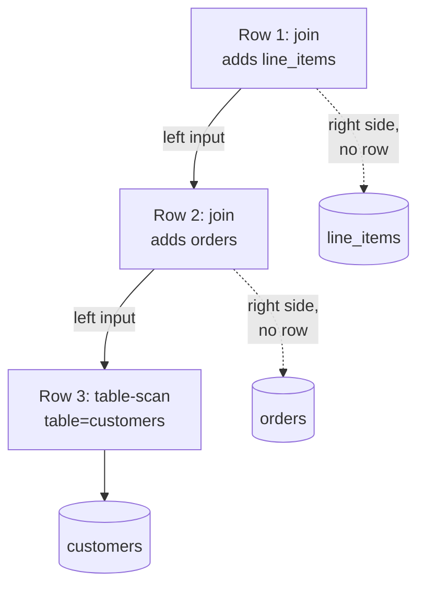

# EXPLAIN

`EXPLAIN` shows how CamusDB plans to execute a query. Put it in front of a
`SELECT`, and CamusDB returns the plan in place of the rows. The plan shows the
tables and indexes that the query reads, and the estimated rows at each step.

```camussql
EXPLAIN SELECT * FROM robots WHERE year = 2023;
```

```text
stage     node               detail
physical  index-range-scan   index=year_idx, from>=2023, to<2024
```

The example assumes an index `year_idx` on the `year` column. The plan reads
that index, and it doesn't scan the full table.

## When to use EXPLAIN

The [query planner](/docs/query-planning) decides how CamusDB executes each
query. Two queries that look alike can do very different amounts of work.
`EXPLAIN` shows you that work before it becomes a problem in production.

Use `EXPLAIN` when:

- A query is slow, and you want to know why.
- You added an index, and you want to confirm that a query uses it.
- A query reads many more rows than it returns. A full table scan for a filter
  on one value is a common example.
- You want to compare two ways to write the same query.

Use `EXPLAIN (ANALYZE)` when the estimates aren't enough. It executes the query
and adds the actual counts next to the estimates. A large difference between
the two often means that the [statistics](/docs/show-statistics) of the table
are missing or old.

If you are new to query plans, start with [Query planning](/docs/query-planning).
Then use this page as the reference for each node and output column.

## Syntax

```camussql
EXPLAIN SELECT ...
EXPLAIN (PHYSICAL) SELECT ...   -- the same as plain EXPLAIN
EXPLAIN (LOGICAL)  SELECT ...   -- the same plan, with stage = "logical"
EXPLAIN (ANALYZE)  SELECT ...   -- executes the query and adds actual counters
```

A plain `EXPLAIN` builds the physical plan, and it doesn't execute the outer
query. `EXPLAIN (ANALYZE)` executes the full query and reads all its
rows. Then it shows the actual counters next to the estimates. An unknown
option, such as `EXPLAIN (VERBOSE)`, returns `CADB0400`.

Note the following:

- **Subqueries.** The planner executes an uncorrelated subquery once, and it
  uses the result as a value. This means that `EXPLAIN` on such a statement reads
  storage for the subquery.
- **`SELECT` with no `FROM` or `WHERE`.** Such a
  [statement](/docs/sql-fromless-select) doesn't have a plan tree. `EXPLAIN`
  shows a fixed shape: a `project` over a `constant-source`, with a `limit` if
  there is one. `EXPLAIN (ANALYZE)` returns `CADB0400` for it. There is no table
  access to measure. With a `WHERE`, the plan is a `function-scan` of
  `*single_row*`, and `EXPLAIN (ANALYZE)` works.

All the `EXPLAIN` forms use the read view of the query. In a Read Committed
transaction, the storage reads use one statement timestamp.

## Locking reads

All the forms accept `SELECT ... FOR UPDATE`, also with `NOWAIT` and
`SKIP LOCKED`. `EXPLAIN` takes no row locks, and it works in read-only or
optimistic transactions. It needs the `SELECT` and `UPDATE` privileges.
`EXPLAIN (ANALYZE)` executes the locking read with its transaction rules. Its
locks last until the transaction ends.

The plan has a `lock_rows` step above the sort and below the pagination. Under
`ANALYZE`, its detail has the following counters:

| Counter | Meaning |
| --- | --- |
| `locked` | Row locks taken, also for rows that the recheck drops later. |
| `skipped-held` | Rows skipped because `SKIP LOCKED` found another holder. Zero for the other policies. |
| `recheck-dropped` | Locked rows that were deleted, or changed so that they no longer match, before the locked reread. |

The `actual_rows` of the step is `locked − recheck-dropped`, before a later
`OFFSET` removes rows. For the rules, see
[Row-locking SELECT](/docs/sql-queries#for-update).

## Window functions

[Window queries](/docs/sql-queries#window-functions) show one `window` node,
with an entry for each distinct partition and ordering. Functions that read a
frame include it in the detail. For example:

```camussql
EXPLAIN (ANALYZE)
SELECT customer_id, id,
       sum(total) OVER (
         PARTITION BY customer_id ORDER BY id
         ROWS BETWEEN UNBOUNDED PRECEDING AND CURRENT ROW
       ) AS running_total
FROM orders;
```

```text
node    detail
window  partition=[customer_id] order=[id] functions=[sum(total) rows between unbounded preceding and current row] partitions=4 rows=6 spilled=0
```

| Counter | Meaning |
| --- | --- |
| `partitions` | Partitions computed, added up across the window specifications. These are SQL window groups, and not storage partitions. |
| `rows` | Rows processed, added up across the specifications. A row can count more than once. |
| `spilled` | Partition buffers moved to disk. |

The window step executes on the node that executes the statement. It comes
after its input query and before the final steps, such as the ordering. Its
input can use distributed scans and partial aggregates.

## Result columns

### EXPLAIN without ANALYZE

| Column | Type | Description |
| --- | --- | --- |
| `stage` | `STRING` | `"physical"` for `EXPLAIN` and `EXPLAIN (PHYSICAL)`. `"logical"` for `EXPLAIN (LOGICAL)`. |
| `node` | `STRING` | The node name. See [Node names](#node-names). |
| `detail` | `STRING` | The main facts of the node. |
| `estimated_rows` | `INT64` | The estimated output rows of the node. `NULL` when the plan isn't costed. |
| `estimated_cost` | `FLOAT64` | The weighted cost of the node from the cost model. Lower is cheaper. `NULL` when the plan isn't costed. |
| `depth` | `INT64` | The level in the tree: `0` for the root, and one more for each level down. `NULL` for informational rows. |

The estimates use the statistics of the table when they are available, such as
the row count and the minimum and maximum of each column. After `ANALYZE`, they
also use histograms and distinct-value counts. If there are no statistics, an
estimate uses a fixed default. This means that the numbers depend on the statistics that
CamusDB collected, and they differ between deployments. When an estimate looks
wrong, [`SHOW STATISTICS FOR <table>`](/docs/show-statistics) shows its inputs.

With [key-range sharding](/docs/concepts#hash-and-key-range-routing),
`estimated_cost` also has a network cost. On a single node, that cost is 0.

Estimates are predictions. Missing statistics or skewed data, for example, can
make an estimate very different from the execution.

`(LOGICAL)` and `(PHYSICAL)` show the same physical tree. Only the `stage`
label is different. For the cost model, see
[Query planner internals](/docs/query-planner-internals#statistics-and-cost).

### EXPLAIN (ANALYZE)

The result has all the columns of `EXPLAIN`, and the following columns.
The `stage` column is `"analyze"` on all rows.

| Column | Type | Description |
| --- | --- | --- |
| `actual_rows` | `INT64` | The rows that this operator passed to its parent. |
| `rows_read` | `INT64` | The rows that a scan fetched and decoded from storage, before a filter. `0` for pipeline operators, which read from a cursor. |
| `actual_time_ms` | `FLOAT64` | The wall-clock milliseconds of the operator, with its inputs. On the root row, it is the time of the full plan. See [Operator times](#operator-times). |
| `kv_lookups` | `INT64` | Point lookups in the key/value store, for unique index lookups. |
| `kv_scan_entries` | `INT64` | Key/value entries that a scan visited, for table scans and index range scans. |
| `estimate_trace` | `STRING` | JSON that explains the row estimate, such as the formula and the statistics that it used. `NULL` when there is no estimate. |

On a scan node, `actual_rows` is at most `rows_read`. `rows_read` counts the
rows decoded from storage before the predicates. `actual_rows` counts the rows
that passed the filters.

Use `estimate_trace` when the estimated and actual rows differ. It shows the
selectivity rules and the statistics behind the estimate, such as
distinct-value counts. It explains the estimate, and it doesn't measure the
execution. For repeatable estimate comparisons, see
[Plan quality testing](/docs/plan-quality-testing).

### Operator times

Each operator has a timer under `EXPLAIN (ANALYZE)`. Other queries don't have
timers.

- The time includes the inputs of the operator. It doesn't include the work of
  the parent between two rows. This means that a row doesn't show more time
  than its parent.
- The root row shows the time of the full plan.
- A `filter` row executes in the scan below it, and it shows the time of that
  scan.
- An operator that executes more than once, such as the build input of a hash
  join fallback, shows the total time of all its executions.

The timers cost about 18 ns for each row at each operator. For most queries,
this is less than 1% of the execution time. A query whose operators do almost
no work for each row can be about 4% slower under `ANALYZE`.

### Runtime counters for a join

A join plan is shown as a chain. Each join node has one visible input, which is
its left side. Its detail names the right side. A stored table on the right side
doesn't get a separate scan row. For more information, see
[Reading a join plan](#reading-a-join-plan). This means that the storage
counters of a join row describe the work on its right side:

- `nested-loop-join` counts each reread of the right side. For example, four
  left rows over seven right rows report 28 rows read.
- `index-nested-loop-join` probes a page of outer rows at a time. The distinct
  keys of a page share one batched index read and one batched row read. A
  unique-index probe adds to `kv_lookups`. A non-unique index walk adds to
  `kv_scan_entries`. Repeated keys can be answered from the join memo. This
  means that the counters describe distinct probes, and not outer rows.
- `hash-join` counts one read of the right side, whether that side is the build
  side or the probe side.
- `merge-join` adds the reads of its ordered right input to the join row.

The root row of a join plan is the last join. The work after the last join,
such as grouping or a `LIMIT`, isn't shown as a separate row.

A join row can have the following runtime detail:

| Suffix | Meaning |
| --- | --- |
| `ran=grace-hash` | A hash join spilled to disk and executed as a Grace hash join. |
| `ran=nested-loop-fallback` | With spill to disk off, the hash build was larger than `hash_join_max_build_rows` or `hash_join_max_build_bytes`. The join executed as a nested loop. |
| `ran=nested-loop-rescan` | The nested-loop join read its right side again for each left row. |
| `ran=broadcast` | A distributed hash join sent the small build side to the nodes that have the [ranges](/docs/concepts#ranges-and-spans) of the probe table, and it probed there. |
| `probe-memo-hits=<n>` | The indexed nested-loop join answered `n` repeated keys from its memo, and it didn't read storage for them. |
| `probe-batches=<n>` | The indexed nested-loop join sent `n` batches to the index. A page that the memo answered isn't counted. |
| `join-order-est-rows=<n>` | The row estimate of the join-order search, next to the estimate of the plan and the actual rows. |
| `lateral-runs=<n>` | The left rows for which a `nested-loop-join` executed its `LATERAL` body. |
| `lateral-kept-reads=<n>` | The left rows that read the kept rows of an earlier run with the same left values. Shown when it is above zero. |
| `lateral-ms=<ms>` | The total time of the `LATERAL` body. It is part of the `actual_time_ms` of the join. |

`estimated_rows` comes from the plan, and `join-order-est-rows` comes from the
join-order search that chose the order. They can be different. With both of
them next to `actual_rows`, you can see which estimate was closer. For the
reason, see
[Cost model boundaries](/docs/query-planner-internals#cost-model-boundaries).

The `plan-info` row of `EXPLAIN (ANALYZE)` also has planning facts:

| Suffix | Meaning |
| --- | --- |
| `planning-ms=<ms>` | The time to bind and plan the query, including subqueries that were folded into literals. It varies between executions. |
| `join-order=cost-based` | The cost-based search selected the join order. |
| `join-order=heuristic` | The heuristic selected or repaired the order. The search was off or unavailable. |
| `join-order=cached` | The plan cache used an earlier join-order decision. |
| `join-steps-costed=<n>` | The join steps that the cost-based search evaluated. It is the same for the same query and statistics. It is `0` for a cached plan or a skipped search. |

## Node names

The result has one row for each physical plan node, in depth-first order, with
each parent before its children.

| Node name | When it appears | Detail |
| --- | --- | --- |
| `table-scan` | A full table scan, or a forced index scan | `table=<name>`. A forced index adds `, forced-index=<name>`. |
| `index-lookup` | An equality on a unique index | `index=<name>, key=<value>` |
| `index-range-scan` | A range predicate, such as `<` or `BETWEEN`, or an equality on a non-unique index | `index=<name>, from>=<val>, to<<val>` |
| `index-in-list` | `x IN (v1, v2, …)` on an indexed column. The index is read once for each distinct value. | `index=<name>, values=<n>` |
| `gin-scan` | A `JSONB` filter that a [GIN index](/docs/json#gin-indexes) serves. A `filter` node above it checks each candidate row. | `index=<name>, groups=<n>, entries=<m>`, where `entries` is the count of index lookups |
| `filter` | A predicate that the index doesn't satisfy | `<expr>` |
| `aggregate` | A `GROUP BY` or an aggregate function | `group=[<exprs>], aggs=[<calls>]` |
| `window` | Window functions with an `OVER` clause | The window specifications, with runtime counters under `ANALYZE` |
| `having-filter` | A `HAVING` clause, after aggregation | `<expr>` |
| `sort` | An `ORDER BY` that the scan order doesn't satisfy | `<col> ASC/DESC, ...` |
| `topk` | An `ORDER BY` with a `LIMIT`. It retains `offset + limit` candidates, and it can sort on disk at the spill limit. | `k: <n>, <col> ASC/DESC, ...` |
| `limit` | A `LIMIT` or `OFFSET` | `<n>`, or `<n> offset <m>` |
| `project` | The column projection, after the other stages | Usually empty |
| `distinct` | A `SELECT DISTINCT` | `streaming: true` for the ordered form, which needs constant memory. Otherwise `hash`. |
| `semi-join` | An `IN (subquery)` over an indexed inner column. It returns each outer row that has a match. | `outer=<col>, inner=<table>.<col>, index=<name>` |
| `anti-join` | A `NOT IN (subquery)` over an indexed `NOT NULL` inner column. It returns each outer row that doesn't have a match. | `outer=<col>, inner=<table>.<col>, index=<name>` |
| `null-aware-anti-join` | A `NOT IN (subquery)` over an indexed nullable inner column. It follows the three-valued logic of SQL. | `outer=<col>, inner=<table>.<col>, index=<name>` |
| `nested-loop-join` | A join that can't use an index on the right side | `on=<expr>, right=<alias>`. A `LATERAL` right side adds `lateral`. |
| `index-nested-loop-join` | A join where an index covers the join key of the right side | `on=<expr>, index=<name>, left=<col>, right=<col>` |
| `hash-join` | An equi-join with an in-memory hash table. It is selected over an indexed nested loop when the outer side is large compared with the inner side. | `on=<left>=<right>, build=<alias>`. A pushed-down filter is added to the detail. |
| `merge-join` | An equi-join over ordered inputs | `on=<left>=<right>, right-order=forced-index=<name>` or `right-order=sort` |
| `recursive-union` | A recursive CTE reader | The CTE name and reader alias, followed by the seed and recursive-term plans |
| `work-table-scan` | The rows of the previous recursive step | The CTE work table |
| `values` | A `VALUES` list as the only source | `alias=<name>, rows=<n>` |
| `derived-table-scan` | A subquery in `FROM`, including an expanded CTE | `alias=<alias>`, with `computed_once=<name>` for a shared CTE result |
| `function-scan` | A set-returning function in `FROM` | `function=<name>, alias=<alias>` |
| `constant-source` | The one row of a `SELECT` with no `FROM`. It reads no table. | `1 row` |
| `union` | A `UNION` or `UNION ALL` | `distinct: hash` or `all` |
| `intersect`, `except` | An `INTERSECT` or `EXCEPT`, with optional `ALL` | `hash` or `all, hash` |
| `operand` | The left or right input of a set operation. Its plan follows this row. | `left` or `right` |
| `lock_rows` | Locks and rereads rows for `SELECT FOR UPDATE` | `for update`, optionally with `nowait` or `skip locked` |

More details:

- [Set operations](/docs/sql-queries#set-operations) show both input plans
  under `operand` rows. Under `ANALYZE`, the `actual_rows` of an operand is its
  output count, and the parent operation shows the combined count. `, spill` in
  a hash detail means that spill to disk is on. It doesn't mean that a spill
  happened.
- An uncorrelated `IN` or `NOT IN` over an indexed inner column becomes one of
  the join nodes above. If the inner column doesn't have an index, the subquery
  is materialized. No join node appears then.
- A `distinct` row shows `streaming: true` when the input arrives in an index
  order that covers all the `DISTINCT` columns, and those columns are all
  `NOT NULL`. Otherwise, it shows `hash`.
- In a `hash-join`, `build=<alias>` names the side that is loaded into the hash
  table. For an inner join, the planner selects the side with the smaller
  estimate, which uses less memory. For a left outer join, the build side is
  the right table. This means that the preserved side can be probed in stream
  order.
- A join node adds `kind=left-outer` for a `LEFT [OUTER] JOIN`. A `RIGHT JOIN`
  executes as a left join with the operands swapped. An inner join shows no
  kind.
- A `merge-join` streams both inputs when both arrive in order, from a forced
  index scan or from a sort. The join buffers the current run of equal keys
  only. This means that it needs memory for one run, and not for its inputs.

An ordered scan that uses an [expression index](/docs/sql-indexes#expression-indexes)
lists its key expressions as `expressions=[...]` in the `detail` column.

The plan depends on the configuration of the planner. The same query can show
a different index or join order, depending on the
[cost-based flags](/docs/query-planning#what-the-planner-can-do) and on the
statistics. The output is correct for the configuration that produced it.

The examples below show the columns that are the stable part of the output,
such as `node` and `detail`. The `EXPLAIN (ANALYZE)` examples show more columns.
The examples leave out the `plan-info` row.

## Reading a join plan

A join plan is a compact view of the execution, and its order can differ from
the SQL text. Read the scan near the bottom as the first input, and then follow
the joins upward. The rows are returned parent first. The `node` column isn't
indented. Use `depth` to find each subtree.

A stored table on the right side of a join doesn't have a separate scan row. A
derived table on the right side gets a `derived-table-scan` row, with its inner
plan.

The diagram shows the three rows for
`customers c JOIN orders o ON o.customer_id = c.id JOIN line_items li ON li.order_id = o.id`,
when the planner uses the written order. Only the first table has a scan row.
Each join row includes the reads of the table that it adds.



The join details describe parts of that work:

- `index=...` names the probe index of an indexed nested loop.
- `build=...` names the build side of a hash join.
- `right-order=forced-index=...` names the index that orders the right input of
  a merge join. `right-order=sort` means that the right input needs a sort.

### Where join conditions appear in the plan

When the planner rebuilds an eligible inner join through its predicate graph,
each condition that can move is evaluated where its last referenced table
enters the tree. This means that a condition from a later `ON`, or a
cross-table `WHERE` condition, can appear at an earlier join.

For example, an equality `a.z = b.z` can be in the `ON` clause that adds `c`.
If `a` and `b` join first, the planner can evaluate that equality there. A hash
join can show it as an extra key pair.

How much of a join condition `EXPLAIN` shows depends on the operator:

| Operator or stage | What EXPLAIN shows |
| --- | --- |
| Nested loop and indexed nested loop | The full `on=` expression. |
| Hash join and merge join | The equality key pairs. Other `ON` conditions are evaluated, but they aren't all shown. |
| Final filter after the joins | It doesn't have a separate plan row. |

A condition that isn't shown can be evaluated. For the rules, see
[The join predicate graph](/docs/query-planner-internals#the-join-predicate-graph).

A `nested-loop-join` with `on=true` is a Cartesian-product step. A query whose
tables aren't connected needs it. It can also remain when the planner can't
safely rebuild the query.

## Derived tables and CTEs

`EXPLAIN` shows the inner operators of a derived table below its
`derived-table-scan` row, also in joins and for inlined CTEs. The inner root is
one level deeper than its wrapper. A derived input on the right side appears
under its join, before the left input. Use `depth` to tell siblings apart.

With `ANALYZE`, the inner operators show the counters of their execution. The
`rows_read` of the wrapper is zero, and the inner scan shows the storage reads.
The wrapper and the inner root show the time of the requests to that query. A
CTE that is computed once shows its inner plan under its first reader. Later
readers show the time of their reads of the kept rows. A `LATERAL` source shows
its `lateral` marker, and not an inner plan for each left row.

## Informational rows

`EXPLAIN` can add informational rows after the node rows. They aren't plan
operators: their `estimated_rows` and `estimated_cost` are `NULL`, and each one
shows a fact about the plan.

| Node name | When it appears | Detail |
| --- | --- | --- |
| `plan-info` | On most plans | `shape=<id>, schema-deps=[table@version, ...]`. `EXPLAIN (ANALYZE)` adds the planning facts above. |
| `cache` | The query has a result cache hint, such as `{cache=…}` | `family=<name>, eligible=<true\|false>[, reason=<why>], ttl=<n>ms\|default, strict=<true\|false>` |

The `cache` row shows whether CamusDB can cache this result. It is a property of
the plan. It doesn't check the cache, and it doesn't show whether an entry
exists now. The runtime result is the `cacheStatus` in the query response.

`eligible=true` means that the query shape can be cached, and the feature is
on. `eligible=false` gives the reason that the hint doesn't apply:

- `reason=join` means that the query is a join. Only single-table results are
  cached.
- `reason=cache-disabled` means that the result cache is off
  (`query_result_cache_enabled: false`).

`ttl` and `strict` repeat the options of the hint. `ttl=default` means that the
hint doesn't set `ttl=`. At runtime, the cache applies only to reads in
autocommit mode. An explicit transaction reads live storage. The `cache` row
appears for a query with a hint only. For more information, see
[Query result cache](/docs/query-result-cache).

## Worked examples

### Full table scan

```camussql
EXPLAIN SELECT * FROM robots;
```

```text
stage     node        detail
physical  table-scan  table=robots
```

The query doesn't have a `WHERE` clause. This means that no index is useful.

### Equality on a non-unique index

```camussql
EXPLAIN SELECT * FROM robots WHERE year = 2023;
```

The example assumes a non-unique index `year_idx` on the `year` column.

```text
stage     node               detail
physical  index-range-scan   index=year_idx, from>=2023, to<2024
```

For a non-unique index, an equality becomes a range scan. For numbers and other
ordinal types, the range is half-open: it covers `>= value` and
`< successor(value)`. For `STRING` and `OID` columns, the range is inclusive:
`from>=value, to<=value`. Both forms return the same rows.

The `index-lookup` node appears only for an equality on a unique index, such as
a primary key, where at most one row can match.

### Equality on a primary key

```camussql
EXPLAIN SELECT * FROM robots WHERE id = '507f1f77bcf86cd799439011';
```

```text
stage     node          detail
physical  index-lookup  index=~pk, key=507f1f77bcf86cd799439011
```

`~pk` is unique. This means that the planner reads one key, and it doesn't
scan a range.

### Range scan with a residual filter

```camussql
EXPLAIN SELECT * FROM robots WHERE year >= 2020 AND name = 'Bishop';
```

When the range on `year` is selective, the plan can look like this:

```text
stage     node               detail
physical  filter             name = 'Bishop'
physical  index-range-scan   index=year_idx, from>=2020
```

`year >= 2020` drives the index range scan. The index can't serve
`name = 'Bishop'`. This means that the predicate appears as a `filter` above the
scan. If the range matches most rows, the planner can select a `table-scan`
with both predicates in the `filter`.

### Aggregate with GROUP BY

```camussql
EXPLAIN SELECT year, COUNT(*) FROM robots GROUP BY year;
```

```text
stage     node        detail
physical  project
physical  aggregate   group=[year], aggs=[count(*)]
physical  table-scan  table=robots
```

### Top-k grouped results

A grouped query ordered by one aggregate alias, with a `LIMIT`, can add
`top_k` to the aggregate detail. `k` is `OFFSET + LIMIT`:

```camussql
EXPLAIN SELECT customer_id, MAX(total) AS largest_order
FROM orders GROUP BY customer_id
ORDER BY largest_order DESC LIMIT 5;
```

The aggregate detail includes `top_k=[largest_order DESC, k: 5]`. The eligible
shapes are a descending `COUNT` or `MAX`, or an ascending `MIN`, on a
`NOT NULL` column. A `HAVING` clause makes the query ineligible.

For `MAX DESC` or `MIN ASC` with only grouped columns and the ordered aggregate
in the select list, each cluster span sends only its local top k groups,
including ties. A spilled `COUNT DESC` grouping can skip spill partitions that
can't beat the current k-th count. These optimizations don't change the result.
If you need a deterministic order for tied rows, add more `ORDER BY` keys.

### SELECT DISTINCT: streaming and hash

```camussql
EXPLAIN SELECT DISTINCT code FROM teams;   -- code is NOT NULL with an index
```

```text
stage     node        detail
physical  distinct    streaming: true
physical  project
physical  table-scan  table=teams, forced-index=code_idx
```

When the `DISTINCT` columns are a prefix of the columns of an index, and they
are all `NOT NULL`, the scan returns rows in index order. The `distinct` node
then removes adjacent duplicates with constant memory. Otherwise, the
`distinct` row shows `hash`, and CamusDB uses a hash set.

### Hash join for an equi-join with no join-key index

```camussql
EXPLAIN SELECT o.name, li.product
        FROM orders o
        JOIN line_items li ON li.order_id = o.id;
-- orders.id is the PK; line_items.order_id has no secondary index
```

```text
stage     node        detail
physical  hash-join   on=o.id=order_id, build=o
physical  table-scan  table=orders
```

`build=o` means that CamusDB loads `orders` into the hash table. Its estimate
has fewer rows than the estimate of `line_items`. The planner selects the build side
from the estimates. The right input doesn't have a separate scan row.

If the build side is larger than `hash_join_max_build_rows` (default 1,000,000)
or `hash_join_max_build_bytes`, the join uses
[spill to disk](/docs/spill-to-disk). With spill to disk off, it executes as a
nested loop for that query.

### Merge join with join-key indexes on both sides

```camussql
EXPLAIN SELECT o.name, li.product
        FROM orders o
        JOIN line_items li ON li.order_id = o.ext_key;
-- orders has index orders_ext_key_idx on (ext_key)
-- line_items has index li_order_id_idx on (order_id)
-- example plan: compatible ordering, and a left estimate over 100 rows
```

```text
stage     node              detail
physical  merge-join        on=o.ext_key=order_id, right-order=forced-index=li_order_id_idx
physical  table-scan        table=orders, forced-index=orders_ext_key_idx
```

Both inputs use a forced index. The left scan has a row, and `right-order` on
the join describes the right scan. The rows of both inputs arrive in join-key
order. This means that the join streams both sides together, and it buffers
only the current run of equal keys.

### IN subquery rewritten as a semi-join

```camussql
EXPLAIN SELECT * FROM robots WHERE owner_id IN (SELECT id FROM owners);
```

```text
stage     node        detail
physical  semi-join   outer=owner_id, inner=owners.id, index=~pk
physical  table-scan  table=robots
```

An index covers the inner column `owners.id`. This means that the `IN` executes
as a semi-join that probes that index, and the subquery isn't materialized.

### ORDER BY satisfied by an index

```camussql
EXPLAIN SELECT * FROM robots ORDER BY year;
```

```text
stage     node              detail
physical  index-range-scan  index=year_idx
```

No `sort` node appears. The index scan returns the rows in the requested
order.

### LIMIT pushdown

```camussql
EXPLAIN SELECT * FROM robots LIMIT 10;
```

```text
stage     node        detail
physical  limit       10
physical  table-scan  table=robots
```

The scan stops after the first 10 rows.

### EXPLAIN ANALYZE on a full table scan

```camussql
EXPLAIN (ANALYZE) SELECT * FROM robots;
```

```text
stage    node        detail        estimated_rows  actual_rows  rows_read  actual_time_ms  kv_lookups  kv_scan_entries
analyze  table-scan  table=robots  42              42           42         6.1             0           42
```

The table has 42 rows, and there is no filter. This means that the row counters
are all 42.

### EXPLAIN ANALYZE on a non-unique index range scan with LIMIT

```camussql
EXPLAIN (ANALYZE) SELECT * FROM robots WHERE year = 2022 LIMIT 5;
```

The example assumes the index `year_idx`, and seven robots with `year = 2022`.

```text
stage    node              detail                               estimated_rows  actual_rows  rows_read  actual_time_ms  kv_scan_entries
analyze  limit             5                                    5               5            0          16.8            0
analyze  index-range-scan  index=year_idx, from>=2022, to<2023  6               5            5          16.2            5
```

- The `limit` node returns 5 rows. Its time is the time of the full plan.
- The scan stops after 5 rows, when the `limit` has its rows. It reads 5 index
  entries and 5 rows. Its time is part of the time of the `limit`.

### EXPLAIN ANALYZE on a join

```camussql
EXPLAIN (ANALYZE)
SELECT c.name, o.total
FROM customers c
JOIN orders o ON o.customer_id = c.id;
```

With an index on `orders(customer_id)`, one possible plan looks like this:

```text
stage    node                    detail                                      actual_rows  rows_read  kv_lookups  kv_scan_entries
analyze  index-nested-loop-join  on=o.customer_id=c.id, index=orders_idx     6            6          0           10
analyze  table-scan              table=customers                             4            4          0           4
```

Read the rows from the bottom up. The scan reads the four customers. The join
probes the index on the right side for those customers, and it returns six
orders. The right input doesn't have a separate row. This means that the join
row includes those reads.

## Filter rows in EXPLAIN ANALYZE

A `filter` executes in the scan loop, and not as a separate stage. This means:

- The `actual_rows` of a `filter` row is the count of rows that passed the
  predicate.
- The storage counters of a `filter` row are `0`. The scan node below it shows
  the storage cost.
- The `actual_time_ms` of a `filter` row is the time of the scan below it.
