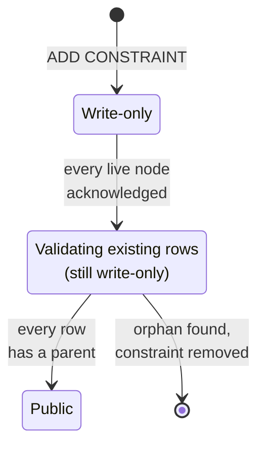

# Foreign keys

A foreign key ties a value in a child table to an existing key in a parent
table. It prevents orphan rows, such as an order with no customer or a comment
on a deleted post. With a foreign key, the database rejects these writes from
all clients. An application bug or a manual `DELETE` can't create the orphan, and
you don't find it later in a report or a page that fails to load.

CamusDB checks foreign keys on `INSERT`, `INSERT ... SELECT`, `UPDATE`, and
`DELETE`, in single statements and in explicit transactions. A child row
must have a parent, and a parent that has children can't be deleted.

The check has a cost. A write to the child table reads the parent table, and a
delete from the parent table reads the child table. An index on the child table
makes the check fast. See
[Indexes on the child table](#indexes-on-the-child-table).

CamusDB supports these forms:

- column-level and table-level `REFERENCES`
- composite keys
- self-references
- `ALTER TABLE ... ADD CONSTRAINT ... FOREIGN KEY`
- `ALTER TABLE ... DROP CONSTRAINT ...`
- `ON DELETE RESTRICT` and `ON UPDATE RESTRICT`
- the default `NO ACTION` behavior

## Declare a foreign key

Use an inline reference when one column points at the parent:

```camussql
CREATE TABLE cities (
  name STRING(80) PRIMARY KEY NOT NULL,
  population INT64
);

CREATE TABLE weather (
  id OID PRIMARY KEY NOT NULL DEFAULT (gen_id()),
  city STRING(80) REFERENCES cities (name),
  temp_lo INT64,
  day DATE
);
```

`weather.city` must contain a `cities.name`, or be `NULL`:

```camussql
INSERT INTO cities (name, population)
VALUES ('San Francisco', 808000);

INSERT INTO weather (city, temp_lo, day)
VALUES ('San Francisco', 46, '1994-11-27');

INSERT INTO weather (city, temp_lo, day)
VALUES (NULL, 50, '1994-11-29');

INSERT INTO weather (city, temp_lo, day)
VALUES ('Berkeley', 45, '1994-11-28'); -- CADB0304
```

```text
CamusException (CADB0304): Insert or update on table 'weather' violates foreign key constraint 'weather_city_fkey': key (city)=(Berkeley) is not present in table 'cities'
```

Use a table constraint for a composite key, or to give the constraint a name:

```camussql
CREATE TABLE regions (
  country STRING(2) NOT NULL,
  code INT64 NOT NULL,
  name STRING(80),
  PRIMARY KEY (country, code)
);

CREATE TABLE stores (
  id OID PRIMARY KEY NOT NULL DEFAULT (gen_id()),
  country STRING(2),
  region INT64,
  CONSTRAINT stores_region_fk FOREIGN KEY (country, region)
    REFERENCES regions (country, code)
    ON DELETE RESTRICT
    ON UPDATE NO ACTION
);
```

For a self-reference, omit the parent column list to reference the primary
key:

```camussql
CREATE TABLE employees (
  id INT64 PRIMARY KEY NOT NULL,
  manager_id INT64 REFERENCES employees
);

INSERT INTO employees (id, manager_id)
VALUES (2, 1), (1, NULL);
```

```text
Query OK, 2 rows affected (00:00:00.0321826)
```

The order of rows in one statement doesn't matter. CamusDB checks the
statement after its last write.

## Add or drop a foreign key

Add a foreign key to an existing table with `ALTER TABLE`:

```camussql
ALTER TABLE weather
ADD CONSTRAINT weather_city_fk
FOREIGN KEY (city) REFERENCES cities (name);
```

`ADD CONSTRAINT` checks the existing child rows before the constraint becomes
public. If a row has no parent, the statement returns `CADB0304` with the first
missing key, and the constraint is removed.

In a cluster, the new constraint goes through these states:



In the write-only state, new writes check the constraint, but the constraint
isn't in the visible schema yet. When all live nodes have acknowledged that
state, CamusDB checks the existing child rows. A public constraint appears in
`SHOW CREATE TABLE`.

If the [leader](/docs/concepts#leader), the node that coordinates schema
changes, changes during this process, the new leader finishes the check. Until
then, the constraint is enforced but not public, and you can't create a branch.

Drop a foreign key by name:

```camussql
ALTER TABLE weather DROP CONSTRAINT weather_city_fk;
```

An unnamed constraint gets a generated name in the PostgreSQL style, such
as `weather_city_fkey`. In a table, `CHECK`, named `NOT NULL`, and
`FOREIGN KEY` constraints share one namespace.

## What is enforced

A write to the child table must find the parent key:

```camussql
INSERT INTO weather (city) VALUES ('missing-city'); -- CADB0304
```

A write to the parent table can't remove a key that a child row references:

```camussql
DELETE FROM cities WHERE name = 'San Francisco'; -- CADB0305
```

```text
CamusException (CADB0305): Delete on table 'cities' violates foreign key constraint 'weather_city_fkey' on table 'weather': key (name)=(San Francisco) is still referenced from table 'weather'
```

```camussql
UPDATE cities
SET name = 'SF'
WHERE name = 'San Francisco';
```

```text
CamusException (CADB0400): Cannot update primary key column 'name': delete the row and insert it with the new key
```

Here the parent key is the primary key, and CamusDB doesn't allow updates of a
primary key column. When the foreign key references a unique index, an update
of a key that a child row references returns `CADB0306`.

An update that doesn't change the referenced key does no foreign-key work:

```camussql
UPDATE cities
SET population = 815000
WHERE name = 'San Francisco';
```

CamusDB uses `MATCH SIMPLE`. If a referencing column of a composite key is
`NULL`, the row satisfies the constraint, and CamusDB doesn't read the parent.

`NO ACTION` and `RESTRICT` differ for an update that removes and recreates the
same parent key in one statement. `NO ACTION` checks the final state of the
statement, and the update succeeds if the key exists again at the end.
`RESTRICT` rejects the change when the referenced key is removed. For a
`DELETE`, the two behave the same.

## Supported and unsupported forms

| Form | Result |
| --- | --- |
| Inline `REFERENCES parent [(col)]` | Accepted. |
| Table-level `FOREIGN KEY (...) REFERENCES parent (...)` | Accepted. |
| Composite keys | Accepted. |
| Self-reference | Accepted. |
| `ON DELETE NO ACTION`, `ON UPDATE NO ACTION` | Accepted. This is the default. |
| `ON DELETE RESTRICT`, `ON UPDATE RESTRICT` | Accepted. |
| `CASCADE`, `SET NULL`, `SET DEFAULT` | Returns `CADB0533`. |
| `MATCH SIMPLE` | Accepted. It is the default. |
| `MATCH FULL`, `MATCH PARTIAL` | Returns `CADB0533`. |
| `DEFERRABLE`, `INITIALLY DEFERRED` | Returns `CADB0533`. |
| Cycles across two or more tables | Returns `CADB0416`. A self-reference is accepted. |
| A parent in another database or in a source branch | Returns `CADB0415`. |
| A view or materialized view as parent or child | Returns `CADB0415`. |
| A parent table with row-level TTL | Returns `CADB0533`. |

The referenced columns must be exactly the columns of the parent's primary key
or of a public unique index, in any order. Paired columns must have the same
type. `STRING(N)` lengths can differ.

## Indexes on the child table

A check on the parent side must find child rows quickly, and CamusDB needs an
index on the referencing columns for this. If a suitable public index exists on
the child table, CamusDB uses it. If not, it creates a non-unique index that
belongs to the foreign key. Its name starts with `~fk_`.

```camussql
SHOW INDEXES FROM weather;
```

```text
┌─────────┬────────────┬───────────────────────┬─────────┬─────────┬────────────┬────────────┬─────────┐
│ Table   │ Non_unique │ Key_name              │ Columns │ Include │ Index_type │ Directions │ Comment │
├─────────┼────────────┼───────────────────────┼─────────┼─────────┼────────────┼────────────┼─────────┤
│ weather │ 0          │ ~pk                   │ id      │         │ ORDERED    │ ASC        │ null    │
│ weather │ 1          │ ~fk_weather_city_fkey │ city    │         │ ORDERED    │ ASC        │ null    │
└─────────┴────────────┴───────────────────────┴─────────┴─────────┴────────────┴────────────┴─────────┘
2 rows in set (00:00:00.0245986)
```

A `~fk_` index appears in `SHOW INDEXES` but not in `SHOW CREATE TABLE`,
because the foreign key creates it again. You can't drop it directly. Drop the
foreign key.

If a foreign key uses an index that you created, `DROP CONSTRAINT` leaves that
index in place. While the foreign key exists, `DROP INDEX` on that index returns
an error.

A `DELETE` of a parent row, or an `UPDATE` of a parent key, looks up the removed
key in this index. CamusDB doesn't scan the child table.

## Introspection

`SHOW CREATE TABLE` renders public foreign keys as table constraints:

```camussql
SHOW CREATE TABLE weather;
```

```text
┌─────────┬────────────────────────────────────────────────────────────────────────────────────────────────────────────────────────────────────────────────────────────────────────────────────────────┐
│ Table   │ Create Table                                                                                                                                                                               │
├─────────┼────────────────────────────────────────────────────────────────────────────────────────────────────────────────────────────────────────────────────────────────────────────────────────────┤
│ weather │ CREATE TABLE `weather` ( `id` OID NOT NULL DEFAULT(gen_id()), `city` STRING(80) NULL, `temp_lo` INT64 NULL, `day` DATE NULL, PRIMARY KEY (`id`), CONSTRAINT `weather_city_fkey` FOREIGN    │
│         │ KEY (`city`) REFERENCES `cities` (`name`));                                                                                                                                                │
└─────────┴────────────────────────────────────────────────────────────────────────────────────────────────────────────────────────────────────────────────────────────────────────────────────────────┘
1 rows in set (00:00:00.0257172)
```

The output includes `ON DELETE` and `ON UPDATE` only for an action other than
`NO ACTION`:

```camussql
CONSTRAINT `weather_city_fkey` FOREIGN KEY (`city`) REFERENCES `cities` (`name`)
```

`SHOW CREATE TABLE ... WITHOUT INDEXES` includes the foreign keys, and you can
run its output as SQL.

## Transactions and concurrency

A foreign-key check is part of the transaction of the statement. In an explicit
transaction, the check sees the earlier writes of that transaction:

```camussql
BEGIN;
INSERT INTO cities (name) VALUES ('Bogota');
INSERT INTO weather (city) VALUES ('Bogota');
COMMIT;
```

A child write takes a shared lock on the parent key until its transaction
ends. A parent delete or key update on the same key waits for that lock, or it
is asked to retry. If you get `CADB0504` or `CADB0502` in this case, retry the
full transaction from `BEGIN`. See [Retries and conflicts](/docs/serializable-retries).

After a foreign-key violation in an explicit transaction, roll back the
transaction. The server rolls back an explicit transaction when one of its
statements fails. A failed autocommit statement is also rolled back.

### Adding a constraint while writers are active

Don't run `ALTER TABLE ... ADD CONSTRAINT ... FOREIGN KEY` while long-running
transactions write to the child table. A transaction can write an orphan row
before the constraint exists and commit after the check is complete. The new
constraint didn't check that write, and the orphan is committed.

For a migration, stop the writers on the child table while you add the
constraint, or check for orphans after the migration:

```camussql
SELECT id
FROM weather
WHERE city IS NOT NULL
  AND city NOT IN (SELECT name FROM cities);
```

```text
0 rows in set (00:00:00.0167777)
```

## Branches

A database branch inherits the foreign keys of its source. The checks apply in
the branch only:

- A branch checks its rows merged with the rows of its ancestors as of the
  fork.
- Writes in the source after the fork don't affect checks in the branch.
- Writes in the branch don't affect checks in the source.
- A branch can't reference a table in its source database.

While a foreign key is being added, you can't create a branch. Wait for
`ALTER TABLE ... ADD CONSTRAINT` to finish.

See [Database Branching](/docs/database-branching).

## Schema changes blocked by foreign keys

A schema change that would remove an object that a constraint uses returns
`CADB0530` `DependentObjectsExist`.

| Operation | Result |
| --- | --- |
| `DROP TABLE` of a referenced parent | Not allowed. Drop the child table or the constraint first. |
| `DROP TABLE` of a child | Accepted. Its foreign keys go with it. |
| `DROP TABLE` of a table that references only itself | Accepted. |
| `TRUNCATE` of a referenced parent | Not allowed. |
| `TRUNCATE` of a child | Accepted. |
| `DROP COLUMN` of a referencing or referenced column | Not allowed. |
| `DROP INDEX` of the referenced index or a reused backing index | Not allowed. |
| `RENAME` of a table, column, or index | Accepted. The constraint tracks ids. |
| `CREATE TABLE ... AS SELECT` | The new table gets no foreign key constraints. |
| `CREATE TABLE ... RELINK TO` for a dropped child table | The recovered table doesn't get its foreign keys back. Add them again with `ALTER TABLE ... ADD CONSTRAINT`. |

## Privileges

To create a foreign key with `CREATE TABLE` or `ALTER TABLE ... ADD CONSTRAINT`,
you need `SELECT` on the parent table. A self-reference doesn't need an extra
grant.

There is no separate `REFERENCES` privilege.

## Cost and diagnostics

Foreign-key checks use point lookups:

- If no table in the database has a foreign key, writes don't do any
  foreign-key work.
- A child write takes one lock for each distinct parent key in the
  transaction. Then it reads the parent keys in a batch.
- A parent delete or parent key update looks up each removed key in the child
  index.
- `ADD CONSTRAINT` checks the distinct child keys in batches.

With server diagnostics enabled, `SHOW ENGINE STATS` includes
`camus.foreign_key.operations`, with a tag for each kind of work, such as lock
acquisition, parent and child lookups, and violations.

## Error codes

| Code | Name | When it is generated |
| --- | --- | --- |
| `CADB0304` | `ForeignKeyViolation` | A child `INSERT` or `UPDATE` has no parent, or `ADD CONSTRAINT` finds an existing row that has no parent. |
| `CADB0305` | `ForeignKeyRestrictDelete` | A `DELETE` removes a parent key that a child row references. |
| `CADB0306` | `ForeignKeyRestrictUpdate` | An `UPDATE` changes a parent key that a child row references. |
| `CADB0415` | `InvalidForeignKeyDefinition` | The foreign key references an invalid target: wrong count or type, no matching primary key or unique index, a view, a materialized view, or another database. |
| `CADB0416` | `ForeignKeyCycle` | The new constraint would create a cycle across two or more tables. |
| `CADB0517` | `InsufficientPrivilege` | The caller lacks `SELECT` on the parent table. |
| `CADB0530` | `DependentObjectsExist` | A schema change would remove something a foreign key depends on. |
| `CADB0533` | `FeatureNotSupported` | The statement uses a foreign-key form that CamusDB doesn't support yet. |
