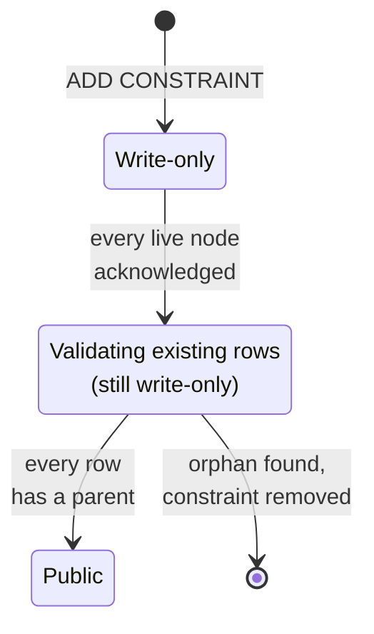

# Foreign keys

A foreign key keeps a value in a child table tied to an existing key in a
parent table. CamusDB enforces foreign keys on `INSERT`, `INSERT ... SELECT`,
`UPDATE`, and `DELETE`, both in single statements and inside explicit
transactions.

## Why use foreign keys

A foreign key prevents orphan rows: rows that point at a parent that does not
exist. Without one, an application bug, a failed script, or a manual `DELETE`
can leave an order with no customer, or a comment on a post that is gone. The
database accepts these rows, and the error shows up later, in a report or a
page that fails to load.

With a foreign key, CamusDB checks every write. It refuses a child row whose
parent does not exist, and it refuses to delete a parent that still has
children. The rule holds for every client, not only for code that remembers to
check it.

The check has a cost: a write to the child table reads the parent table, and a
delete from the parent table reads the child table. CamusDB keeps that cost
small with an index on the child table. See
[Indexes on the child table](#indexes-on-the-child-table).

CamusDB supports these forms:

- column-level and table-level `REFERENCES`
- composite keys
- self-references
- `ALTER TABLE ... ADD CONSTRAINT ... FOREIGN KEY`
- `ALTER TABLE ... DROP CONSTRAINT ...`
- `ON DELETE RESTRICT` and `ON UPDATE RESTRICT`
- the default `NO ACTION` behavior

## Declare a foreign key

Use an inline reference when one column points at the parent:

```camussql
CREATE TABLE cities (
  name STRING(80) PRIMARY KEY NOT NULL,
  population INT64
);

CREATE TABLE weather (
  id OID PRIMARY KEY NOT NULL DEFAULT (gen_id()),
  city STRING(80) REFERENCES cities (name),
  temp_lo INT64,
  day DATE
);
```

`weather.city` can hold a `cities.name`, or it can be `NULL`:

```camussql
INSERT INTO cities (name, population)
VALUES ('San Francisco', 808000);

INSERT INTO weather (city, temp_lo, day)
VALUES ('San Francisco', 46, '1994-11-27');

INSERT INTO weather (city, temp_lo, day)
VALUES (NULL, 50, '1994-11-29');

INSERT INTO weather (city, temp_lo, day)
VALUES ('Berkeley', 45, '1994-11-28'); -- CADB0304
```

Use a table constraint when the key is composite, or when you want an explicit
name:

```camussql
CREATE TABLE regions (
  country STRING(2) NOT NULL,
  code INT64 NOT NULL,
  name STRING(80),
  PRIMARY KEY (country, code)
);

CREATE TABLE stores (
  id OID PRIMARY KEY NOT NULL DEFAULT (gen_id()),
  country STRING(2),
  region INT64,
  CONSTRAINT stores_region_fk FOREIGN KEY (country, region)
    REFERENCES regions (country, code)
    ON DELETE RESTRICT
    ON UPDATE NO ACTION
);
```

For a self-reference, omit the parent column list to reference the primary key:

```camussql
CREATE TABLE employees (
  id INT64 PRIMARY KEY NOT NULL,
  manager_id INT64 REFERENCES employees
);

INSERT INTO employees (id, manager_id)
VALUES (2, 1), (1, NULL);
```

The order of rows inside one statement does not matter, because CamusDB checks
the statement after its last write.

## Add or drop a foreign key

Add a foreign key to an existing table with `ALTER TABLE`:

```camussql
ALTER TABLE weather
ADD CONSTRAINT weather_city_fk
FOREIGN KEY (city) REFERENCES cities (name);
```

`ADD CONSTRAINT` validates the existing child rows before the constraint becomes
public. If a row has no parent, the statement fails with `CADB0304`, reports
the first missing key, and leaves no partial constraint behind.

In a cluster, the new constraint moves through these states:



In the write-only state, new `INSERT`, `UPDATE`, and `DELETE` statements enforce
the constraint, but it is not yet part of the visible schema. Only after every
live node acknowledges that state does CamusDB scan the existing child rows and
check them against the parent. A public constraint appears in
`SHOW CREATE TABLE`.

If the [leader](/docs/concepts#leader) (the node that coordinates schema
changes) changes after the write-only state is published, the constraint
can remain enforced but not yet public while the new leader finishes the
validation. Creating a branch is refused during that window.

Drop a foreign key by name:

```camussql
ALTER TABLE weather DROP CONSTRAINT weather_city_fk;
```

A constraint without an explicit name gets a PostgreSQL-style generated name
such as `weather_city_fkey`. `CHECK`, named `NOT NULL`, and `FOREIGN KEY`
constraints share one namespace per table because `DROP CONSTRAINT` resolves a
name across all three kinds.

## What is enforced

Child-side writes must find the parent key:

```camussql
INSERT INTO weather (city) VALUES ('missing-city'); -- CADB0304
```

Parent-side writes cannot remove a key that a child still references:

```camussql
DELETE FROM cities WHERE name = 'San Francisco'; -- CADB0305

UPDATE cities
SET name = 'SF'
WHERE name = 'San Francisco'; -- CADB0306
```

An update that does not change the referenced key does no foreign-key work:

```camussql
UPDATE cities
SET population = 815000
WHERE name = 'San Francisco';
```

CamusDB uses `MATCH SIMPLE`: if any referencing column of a composite key is
`NULL`, the row satisfies the constraint and no parent is read.

`NO ACTION` and `RESTRICT` differ for an update that removes and recreates the
same parent key within one statement. `NO ACTION` checks the statement's final
state, so the update can pass if the key exists again when the statement ends.
`RESTRICT` refuses the change as soon as the referenced key is removed. For a
`DELETE`, both behave the same, because the key cannot come back within that
delete.

## Supported and refused forms

| Form | Result |
| --- | --- |
| Inline `REFERENCES parent [(col)]` | Accepted. |
| Table-level `FOREIGN KEY (...) REFERENCES parent (...)` | Accepted. |
| Composite keys | Accepted. |
| Self-reference | Accepted. |
| `ON DELETE NO ACTION`, `ON UPDATE NO ACTION` | Accepted. This is the default. |
| `ON DELETE RESTRICT`, `ON UPDATE RESTRICT` | Accepted. |
| `CASCADE`, `SET NULL`, `SET DEFAULT` | Refused with `CADB0533`. |
| `MATCH SIMPLE` | Accepted. It is the default. |
| `MATCH FULL`, `MATCH PARTIAL` | Refused with `CADB0533`. |
| `DEFERRABLE`, `INITIALLY DEFERRED` | Refused with `CADB0533`. |
| Cycles across two or more tables | Refused with `CADB0416`. A self-reference is accepted. |
| A parent in another database or in a source branch | Refused with `CADB0415`. |
| A view or materialized view as parent or child | Refused with `CADB0415`. |
| A parent table with row-level TTL | Refused with `CADB0533`. |

The referenced columns must be exactly the columns of the parent's primary key
or of a public unique index, in any order. Paired columns must have the same
type, although `STRING(N)` lengths can differ.

## Indexes on the child table

Parent-side checks must find child rows without scanning the child table, so
CamusDB needs an index on the referencing columns.

If a suitable public index already exists on the child table, CamusDB reuses it.
Otherwise it creates an owned non-unique index whose name starts with `~fk_`.

```camussql
SHOW INDEXES FROM weather;
```

Owned foreign-key indexes appear in `SHOW INDEXES`. They do not appear in
`SHOW CREATE TABLE`, because the foreign key recreates them. You cannot drop an
owned index directly. Drop the foreign key instead.

If a foreign key reuses an index you created, `DROP CONSTRAINT` keeps that
index. CamusDB refuses `DROP INDEX` on a reused backing index while the foreign
key exists.

The backing index also sets the cost of parent-side checks. A parent `DELETE`
or parent-key `UPDATE` probes the child index for the removed key instead of
scanning the child table.

## Introspection

`SHOW CREATE TABLE` renders public foreign keys as table constraints:

```camussql
SHOW CREATE TABLE weather;
```

The output includes `ON DELETE` and `ON UPDATE` only when the action is not
`NO ACTION`:

```camussql
CONSTRAINT `weather_city_fkey` FOREIGN KEY (`city`) REFERENCES `cities` (`name`)
```

`SHOW CREATE TABLE ... WITHOUT INDEXES` keeps foreign keys, and its output can
be run again as SQL.

An owned backing index (name starting with `~fk_`) appears in `SHOW INDEXES`
but not in `SHOW CREATE TABLE`. See
[Indexes on the child table](#indexes-on-the-child-table).

## Transactions and concurrency

Foreign-key checks run inside the statement's transaction, so a statement in an
explicit transaction sees that transaction's earlier writes:

```camussql
BEGIN;
INSERT INTO cities (name) VALUES ('Bogota');
INSERT INTO weather (city) VALUES ('Bogota');
COMMIT;
```

When a child writer and a parent writer meet on the same key, CamusDB uses the
parent's unique-index entry as the rendezvous point. A child writer takes a
shared lock on the parent key until the transaction ends. A parent delete or key
update waits for that lock or asks the transaction to retry.

If you see `CADB0504` or `CADB0502` from this path, retry the whole transaction
from `BEGIN`. See [Retries And Conflicts](/docs/serializable-retries).

After a foreign-key violation in an explicit transaction, roll back the
transaction. HTTP and gRPC roll back the transaction when a statement fails,
and autocommit statements always roll back.

### Adding a constraint while writers are active

Avoid `ALTER TABLE ... ADD CONSTRAINT ... FOREIGN KEY` while long-running
transactions are already writing the child table. A transaction that wrote an
orphan before the constraint existed and commits after validation finishes can
still commit that orphan, because the new constraint never checked its write.

For a migration, quiesce child-table writers while adding the constraint, or run
an orphan check after the migration:

```camussql
SELECT id
FROM weather
WHERE city IS NOT NULL
  AND city NOT IN (SELECT name FROM cities);
```

## Branches

A database branch inherits foreign keys from its source, and the checks stay
inside the branch:

- a branch reads its own rows merged with its ancestors as of the fork point;
- writes in the source after the fork do not affect checks in the branch;
- writes in the branch do not affect checks in the source;
- a branch cannot reference a table in its source database.

Creating a branch while a foreign key is still being added is refused. Wait for
`ALTER TABLE ... ADD CONSTRAINT` to finish first.

See [Database Branching](/docs/database-branching).

## Schema changes blocked by foreign keys

Some schema changes would leave a constraint pointing at an object that no
longer exists. CamusDB refuses them with `CADB0530`
`DependentObjectsExist`.

| Operation | Result |
| --- | --- |
| `DROP TABLE` of a referenced parent | Refused. Drop the child table or the constraint first. |
| `DROP TABLE` of a child | Accepted. Its foreign keys go with it. |
| `DROP TABLE` of a table that references only itself | Accepted. |
| `TRUNCATE` of a referenced parent | Refused. |
| `TRUNCATE` of a child | Accepted. |
| `DROP COLUMN` of a referencing or referenced column | Refused. |
| `DROP INDEX` of the referenced index or a reused backing index | Refused. |
| `RENAME` of a table, column, or index | Accepted. The constraint tracks ids. |
| `CREATE TABLE ... AS SELECT` | The new table gets no foreign key constraints. |
| `CREATE TABLE ... RELINK TO` for a dropped child table | The recovered table comes back without its foreign keys. Add them again with `ALTER TABLE ... ADD CONSTRAINT`. |

## Privileges

Creating a foreign key requires `SELECT` on the parent table, with both
`CREATE TABLE` and `ALTER TABLE ... ADD CONSTRAINT`. Because a child write can
reveal whether a parent key exists, CamusDB requires the parent read privilege
when the constraint is created. A self-reference needs no extra grant.

There is no separate `REFERENCES` privilege.

## HTTP and gRPC

SQL is the recommended path for schema changes. The HTTP table-creation endpoint
also accepts foreign keys:

```json
{
  "databaseName": "app",
  "tableName": "weather",
  "columns": [
    { "name": "id", "type": "id", "primary": true, "notNull": true },
    { "name": "city", "type": "string", "notNull": false }
  ],
  "foreignKeys": [
    {
      "name": "weather_city_fk",
      "columns": ["city"],
      "referencedTable": "cities",
      "referencedColumns": ["name"],
      "onDelete": "restrict",
      "onUpdate": "no action"
    }
  ]
}
```

An unsupported action such as `cascade`, `set null`, or `set default` returns
`CADB0533`. See [Error codes](#error-codes) for the HTTP status and gRPC status
of each failure.

## Cost and diagnostics

Foreign-key enforcement is designed around point operations:

- when no table in the database has a foreign key, DML takes the normal path;
- a child write does one lock per distinct parent key in the transaction, then
  reads the parent keys in a batch;
- a parent delete or parent-key update probes the child index for each removed
  key;
- `ADD CONSTRAINT` validates distinct child keys in batches.

With server diagnostics enabled, `SHOW ENGINE STATS` includes
`camus.foreign_key.operations`, tagged by the kind of work. The tags include
lock acquisition, parent and child probes, validation keys, and violations.

## Error codes

| Code | Name | When it is generated |
| --- | --- | --- |
| `CADB0304` | `ForeignKeyViolation` | A child `INSERT` or `UPDATE` has no parent, or `ADD CONSTRAINT` finds an existing row without a parent. |
| `CADB0305` | `ForeignKeyRestrictDelete` | A `DELETE` removes a parent key that a child still holds. |
| `CADB0306` | `ForeignKeyRestrictUpdate` | An `UPDATE` changes a parent key that a child still holds. |
| `CADB0415` | `InvalidForeignKeyDefinition` | The foreign key references an invalid target: wrong count or type, no matching primary key or unique index, a view, a materialized view, or another database. |
| `CADB0416` | `ForeignKeyCycle` | The new constraint would create a cycle across two or more tables. |
| `CADB0517` | `InsufficientPrivilege` | The caller lacks `SELECT` on the parent table. |
| `CADB0530` | `DependentObjectsExist` | A schema change would remove something a foreign key depends on. |
| `CADB0533` | `FeatureNotSupported` | The statement uses a foreign-key form CamusDB does not implement yet. |

Foreign-key violations map to HTTP 409. Invalid definitions map to HTTP 400.
On gRPC, violations use `FailedPrecondition`, invalid definitions use
`InvalidArgument`, and the CamusDB code is carried in `camus-error-code`.
