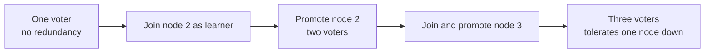

# Grow a one-node cluster

Start with one machine and add replicas later without moving your application
to a new database. To do this, choose **cluster mode from the first boot**.
A standalone node has a fixed single-node quorum and refuses joins; moving
standalone data to a cluster requires a
[logical dump and reimport](/docs/logical-dump-and-reimport).

A one-node cluster accepts joins, but has no redundancy until other nodes
have caught up. Grow to three voters: with two voters, either node's failure
prevents a majority from committing.

## Choose the initial layout

Set these before creating the cluster:

- `initial_partitions` fixes the initial hash-pool partition count. Later boots
  ignore a different value and log a warning. Key-range splitting can add
  partitions separately. Cluster mode defaults to 3; the server repository's
  sample config explicitly sets 1, so check copied configuration.
- `key_range_sharding` fixes the routing mode. Changing modes on existing data
  requires a new cluster and reimport. See
  [routing mode](/docs/key-range-sharding#the-mode-is-fixed-when-the-cluster-is-created).

Use the same HTTP port on every node, with reachable advertised Raft addresses.
Each node needs a unique `node_name`, `raft_node_id`, and its own data directory.

## Start the first node

```yaml
mode: cluster
node_name: camus-node-1
raft_node_id: 1
raft_host: 10.0.0.1
raft_port: 7070
http_port: 5095
initial_partitions: 3
peers: []
```

Leave `join_existing` off on this founding node: there is no cluster to join.

## Join the second and third nodes

On the second machine, use an existing cluster member as a seed:

```yaml
mode: cluster
node_name: camus-node-2
raft_node_id: 2
raft_host: 10.0.0.2
raft_port: 7070
http_port: 5095
peers: [10.0.0.1:7070]
join_existing: true
```

The node joins as a **learner**: it receives partition snapshots without voting
in consensus. The leader promotes it to a voter after it catches up. Wait for
that promotion before starting the next join; membership changes proceed one
server at a time.

Repeat for node 3 with its own identity and address. Its seeds can include node
1, node 2, or both. Never include a node's own Raft address in its `peers` list.
The command-line equivalent of the join flag is `--join-existing true`.



## Keep node-to-node HTTP reachable

Schema changes, cluster settings, and query fragments use HTTP between nodes.
When `http_peers` has one address per configured `peers` entry, CamusDB uses
that mapping. For other roster members it derives the address from the peer's
Raft host and the current node's own `http_port`.

The founding node has no seeds and joiners may know only their seed, so use
the same `http_port` everywhere. Then derived addresses work for later joiners
without a complete `http_peers` list. A seed-only HTTP mapping can also produce
warnings when looking up other members.

See [cluster mode](/docs/cluster) for replication, networking, and TLS settings.
