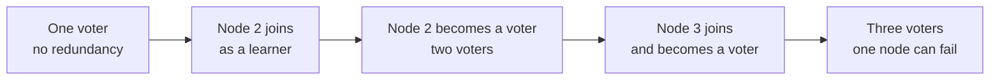

# Grow a one-node cluster

You can start with one machine and add replicas later, and your application
continues to use the same database. To do this, start the first node in
**cluster mode**. A standalone node doesn't listen for Raft connections (the
protocol that replicates data between nodes). Other nodes can't join it. To
move data from a standalone node to a cluster, use a
[logical dump and reimport](/docs/logical-dump-and-reimport).

Other nodes can join a one-node cluster. However, it has no redundancy until
the other nodes have copied the data. You should grow to three voters. With two
voters, a majority is two. This means that the failure of one node stops all
commits.

## Choose the initial layout

Set these keys before you create the cluster:

- `initial_partitions` sets the initial number of partitions. A later start with
  a different value ignores it and logs a warning. In cluster mode, the default
  is 3. Note that the sample `config.yml` in the server repository sets it to 1.
  Check copied configuration files.
- `key_range_sharding` sets the routing mode. To change the mode for existing
  data, you need a new cluster and a reimport. For more information, see
  [routing mode](/docs/key-range-sharding#the-mode-is-fixed-when-the-cluster-is-created).

Each node needs a unique `node_name` and `raft_node_id`, and a separate data
directory. You should use the same HTTP port on all nodes (see
[Keep node-to-node HTTP reachable](#keep-node-to-node-http-reachable)).

## Start the first node

```yaml
mode: cluster
node_name: camus-node-1
raft_node_id: 1
raft_host: 10.0.0.1
raft_port: 7070
http_port: 5095
initial_partitions: 3
peers: []
```

Don't set `join_existing` on the first node. There is no cluster to join yet.

## Join the second and third nodes

On the second machine, use a node of the cluster as a seed:

```yaml
mode: cluster
node_name: camus-node-2
raft_node_id: 2
raft_host: 10.0.0.2
raft_port: 7070
http_port: 5095
peers: [10.0.0.1:7070]
join_existing: true
```

The command-line form of the join setting is `--join-existing true`.

The node joins as a **learner**. It receives a copy of each partition, but it
doesn't vote. When it has caught up, it becomes a voter. You can see the role
of each node with `GET /v1/cluster/membership`:

```json
{
  "membershipVersion": 3,
  "members": [
    { "endpoint": "10.0.0.1:7070", "nodeId": 1, "role": "Voter", "joinedVersion": 1 },
    { "endpoint": "10.0.0.2:7070", "nodeId": 2, "role": "Voter", "joinedVersion": 2 }
  ],
  "localRole": "Voter",
  "initialized": true
}
```

With authentication enabled, this route requires a superuser.

Wait until the new node is a voter before you start the next join. Membership
changes are applied one node at a time. In a local test with a small data set,
the promotion took about ten seconds.

Do the same for node 3, with a different identity and address. Its `peers` list can
contain node 1, node 2, or both. A node must not list itself in `peers`. If it
does, the startup fails.



## Keep node-to-node HTTP reachable

Nodes use HTTP to forward schema changes and cluster settings, and to run query
fragments on other nodes. A node finds the HTTP address of a peer in one of two
ways:

- If `http_peers` has one address for each entry in `peers`, the node uses
  these addresses.
- For other nodes, it uses the Raft host of the peer and the local `http_port`.

The first node has no seeds, and a joining node knows only its seeds. This
means that their `http_peers` lists are incomplete. If you use the same
`http_port` on all nodes, the second method gives the correct address for all
nodes, also for nodes that join later. A node with a partial `http_peers` list
logs a warning when it looks up a node that isn't in the list.

For replication, networking, and TLS settings, see [Cluster mode](/docs/cluster).
