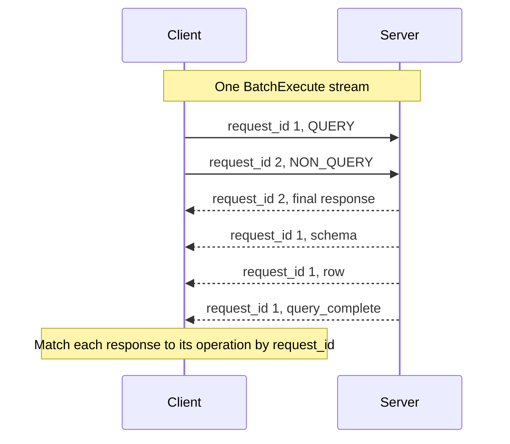
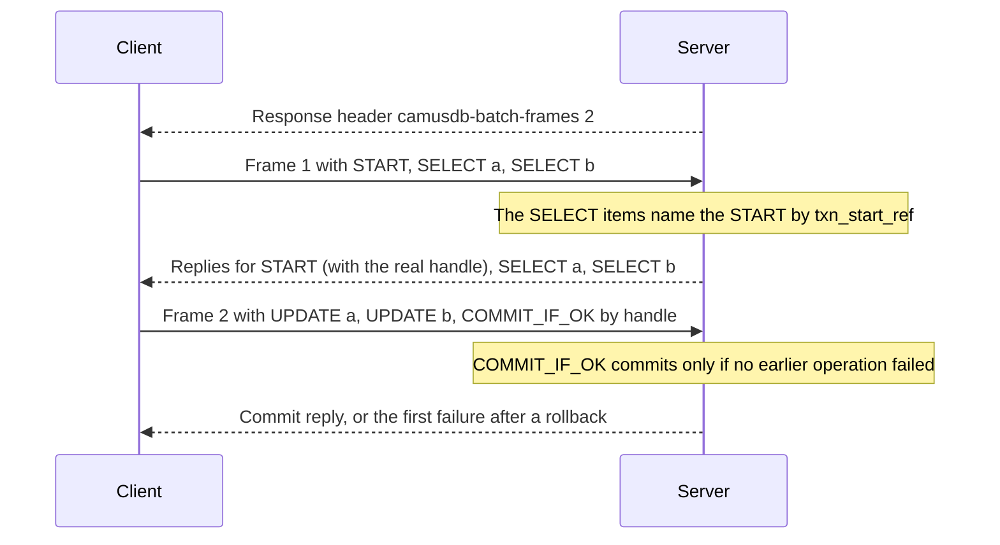

# gRPC protocol reference

For application code, use a driver: [.NET](/docs/dotnet-driver),
[TypeScript](/docs/typescript-connector), or [Python](/docs/python-driver). The
libraries handle the connections and the transactions for you. You don't need to
generate Protobuf bindings or manage stream messages.

The .NET and TypeScript drivers can use gRPC as their transport. The Python
driver uses REST. When you select gRPC in a driver, the library handles the
wire protocol. For retryable work,
use the [retry helpers](/docs/serializable-retries).

## When to use the gRPC API

This page describes the public protocol, for authors of drivers and custom
clients. The client endpoint uses HTTP/2 on port 5096 by
default. It reaches the same SQL engine as the [HTTP API](/docs/http-api).

## Enable and configure the endpoint

The endpoint is on by default. To configure it or turn it off, edit
`config.yml`:

```yaml
grpc_enabled: true
grpc_port: 5096
grpc_certificate:
```

Set `grpc_certificate` to a PFX certificate for the client gRPC listener. If it
is empty, the listener uses the `raft_certificate` of the node, if there is
one. If there is no certificate, the listener uses plaintext HTTP/2. Plaintext
is for local development and private test networks.

A driver takes credentials in its connection settings. A custom client uses the
`CamusAuth` service to exchange a user name and password for a bearer token.
Then it sends the token in the request metadata:

```text
authorization: Bearer camus_<id>.<secret>
```

Authentication failures return `UNAUTHENTICATED`, and privilege failures return
`PERMISSION_DENIED`. See
[Authentication and authorization](/docs/sql-authentication).

The Protobuf contract is in the CamusDB source tree, at
`CamusDB.Grpc.Contracts/Protos/camus_sql.proto`. Generate your client bindings
from that file with the standard gRPC tools for your language.

## Services

| Service | Use it for |
| --- | --- |
| `CamusSql` | SQL statements and explicit transactions, in unary calls or on a batch stream. |
| `CamusRows` | Typed row operations from column values. |
| `CamusAuth` | Sign-in and sign-out for authenticated clients. |

A driver or ORM integration normally uses `CamusSql`. Use `CamusRows` when the
client already has structured row values and filters, and it shouldn't build
SQL text.

## Auth service

| RPC | Purpose |
| --- | --- |
| `Login` | Takes `LoginRequest { user, password }` and returns `LoginReply { token, expires_at_unix_ms, expires_in_seconds }`. |
| `Logout` | Revokes the token in the `authorization` metadata. A missing or already-revoked token also gives a successful result. |

`expires_at_unix_ms` and `expires_in_seconds` describe the same deadline. Renew
the token before the deadline, and don't assume a fixed token lifetime. A
`BatchExecute` stream that authenticated while its token was valid can continue
after the token expires. See [gRPC batch streams and token
expiry](/docs/sql-authentication#grpc-batch-streams-and-token-expiry).

## SQL service

| RPC | Shape | Purpose |
| --- | --- | --- |
| `ExecuteQuery` | server stream | Executes `SELECT` and `SHOW`. Sends the schema before the rows. |
| `ExecuteNonQuery` | unary | Executes DML and account statements. Returns the affected rows, and `returning_schema` and `returning_rows` for a write with `RETURNING`. |
| `ExecuteDdl` | unary | Executes DDL statements. |
| `StartTransaction` | unary | Starts an explicit transaction and returns a `TxnHandle`. |
| `CommitTransaction` | unary | Commits an explicit transaction by handle. |
| `RollbackTransaction` | unary | Rolls back an explicit transaction by handle. |
| `BatchExecute` | bidirectional stream | Pipelines many operations on one stream. See [Duplex batching](#duplex-batching). |
| `Ping` | unary | Checks liveness and round-trip connectivity. |
| `GetNodeStats` | unary | Returns the resource use and identity of the node that receives the call. With authentication on, it needs a superuser or `MONITOR`. |

Clients send SQL parameters as a `map<string, Value>`. You should use
parameters, and not values in the SQL text. This means that typed values, such
as `DATETIME` and `UUID`, keep their exact value on the wire.

Account statements, such as `CREATE USER` and `GRANT`, name their target in the
SQL, and they don't need an open database. You can send them through unary
calls or through `BatchExecute`. Bind passwords as parameters. Then the SQL
text doesn't contain secrets.

To get advisory routing metadata, set `routing_accept_version` to `1` on the
request. The default, `0`, gives responses that don't have routing metadata. See
[SQL routing advice](/docs/sql-routing-advice).

A write with a `RETURNING` list works through `ExecuteQuery` and
`ExecuteNonQuery`:

- Through `ExecuteQuery`, the rows arrive as a normal query stream. The schema
  is sent after the autocommit write commits.
- Through `ExecuteNonQuery`, the reply has the count in `affected_rows`. The
  rows and their schema are in `returning_rows` and `returning_schema`. If you
  need the count only, set `discard_returning_rows`.

For more information, see [RETURNING](/docs/sql-writes#returning).

`DdlReply` and `NonQueryReply` have `affected_rows` and `warning`. A time-travel
copy that reads no rows, with `CREATE TABLE ... AS SELECT` or `INSERT ...
SELECT`, sets `warning`. As proto3 requires, an absent warning is an empty
string. See [Copying query
results](/docs/insert-select-and-ctas#row-counts-and-empty-copy-warnings).

## Cancellation and backpressure

If a client cancels a call or reaches its deadline, CamusDB cancels the query. A
closed stream has the same effect. The operators stop at their next storage read
or operator boundary. `BatchExecute` also applies backpressure on the server.
See [Duplex batching](#duplex-batching).

## Row service

| RPC | Purpose |
| --- | --- |
| `InsertRow` | Inserts one row from a column-value map. |
| `Query` | Queries the rows of a table. Filters and an order are optional. You can name the index to use. |
| `QueryById` | Fetches one row by its primary-key value. |
| `UpdateRows` | Updates the matching rows. Needs at least one filter. |
| `UpdateById` | Updates one row by its primary-key value. |
| `DeleteRows` | Deletes the matching rows. Needs at least one filter. |
| `DeleteById` | Deletes one row by its primary-key value. |

A filter is a `QueryFilter { column_name, op, value }`. The `op` is a string,
such as `">="` or `"LIKE"`. An order is an
`OrderBy { column_name, direction }`, with ascending or descending direction.

An `UpdateRows` or `DeleteRows` request must have a filter. Otherwise, it
returns `INVALID_ARGUMENT` and `CADB0400`. This prevents changes to a full table
by mistake. To change all the rows, use SQL with `WHERE TRUE`. A refused request
also aborts its explicit transaction. See [Failed
statements](/docs/sql-transactions#failed-statements).

The `ById` RPCs take the key value as a string. The
server finds the primary-key column from the table schema. This means that the
primary key doesn't need the name `id`.

A row value map with column names that differ only in case returns `CADB0403`.
The Protobuf map decoder merges identical keys before the engine sees them.
This means that a client must send each map key once.

## Value encoding

All the values on the wire use the Protobuf `Value` message, for example the
parameters and the result cells. It is a typed `oneof` that follows the CamusDB
column types.

| Column type | Wire field | Encoding |
| --- | --- | --- |
| `NULL` | `null_value` | An explicit typed NULL. |
| `ID` / `OID` | `id_value` | 24 lowercase hex characters. |
| `INT64` | `int64_value` | A signed 64-bit integer. |
| `STRING` | `string_value` | A UTF-8 string. A Protobuf client can replace invalid surrogate halves with U+FFFD before it sends a value. Validate text before you encode it. See [Unicode validation](/docs/data-types#characters-and-valid-unicode). |
| `BOOL` | `bool_value` | A boolean. |
| `FLOAT64` | `float64_value` | An IEEE 754 double, including infinity and NaN. |
| `FLOAT32` | `float32_value` | An IEEE 754 float, including infinity and NaN. |
| `BYTES` | `bytes_value` | Raw bytes. |
| `DATE` | `date_value` | UTC .NET ticks, at midnight. |
| `DATETIME` | `datetime_value` | UTC .NET ticks. |
| `ARRAY` | `array_value` | The element type, and the items as `Value` messages. |
| `UUID` / `GUID` | `uuid_value` | Exactly 16 bytes, in big-endian order. |
| `NUMERIC` | `numeric_value` | Canonical decimal text with at most 9 fractional digits, such as `"-12.5"`. |
| `JSONB` | `json_value` | The document text in the PostgreSQL form, such as `{"a": [1, 2.50]}`. Numbers are exact. A client built before this field existed reads a `JSONB` cell as NULL. See [JSON documents](/docs/json#client-apis). |

If you write a client:

- Send an ObjectId in `id_value`, and not in `string_value`.
- Send a UUID as 16 bytes, and not as a string.
- Send a vector as its packed float32 bytes in `bytes_value`. For the layout,
  see [Vector search](/docs/vector-search#how-a-vector-is-stored).
- Send `DATE` and `DATETIME` values as ticks.
- Keep `FLOAT32` and `FLOAT64` in their separate wire fields.
- Include the element type of an array, also when the array is empty.
- When you decode, treat an unset `Value` and an explicit `null_value` as NULL.

To convert Unix milliseconds to ticks:

```text
ticks = 621355968000000000 + unix_millis * 10000
```

## Query streams

The query RPCs of both services are server streams. They send the schema
first:

```text
QueryStreamMessage(schema)
QueryStreamMessage(row)
QueryStreamMessage(row)
...
[QueryStreamMessage(cache_metadata)]
[QueryStreamMessage(routing_advice)]
```

The schema message is first, and it appears exactly once, also for an empty
result. Rows are positional: `row.values[i]` belongs to `schema.columns[i]`. A
client must take the type of each column from the schema, and not from the
first value that isn't `NULL`.

A query with a `{cache=...}` hint can add one `cache_metadata` message after
the last row. A query that asked for routing metadata can add one
`routing_advice` message after the rows, and after the cache metadata if both
are present.

## Transactions

Each SQL and row operation executes in autocommit mode or in an explicit
transaction. An autocommit request omits `txn_handle`. The server executes
the operation in a short transaction, and commits it.

Explicit transactions use `CamusSql.StartTransaction`:

```text
StartTransaction -> TxnHandle
ExecuteQuery / ExecuteNonQuery / ExecuteDdl with txn_handle
CommitTransaction(txn_handle)
```

`StartTxnRequest` and an autocommit `SqlRequest` can set the following fields:

| Field | Values |
| --- | --- |
| `isolation_level` | `READ_COMMITTED` or `SERIALIZABLE` |
| `transaction_mode` | `READ_WRITE` or `READ_ONLY` |
| `locking` | `PESSIMISTIC` or `OPTIMISTIC` |
| `priority` | From `BACKGROUND` to `CRITICAL`. `TRANSACTION_PRIORITY_UNSPECIFIED` means the server default, and not background. |

When a request continues an existing `txn_handle`, the server ignores these
fields. The properties of a transaction are fixed when it starts. Row requests
also accept `priority` when they start an autocommit transaction. See
[Transaction priority](/docs/transaction-priority).

`SELECT ... FOR UPDATE` is a query that takes write locks. In autocommit mode,
it uses a writable transaction and releases the locks before it returns the
rows. In an explicit transaction, the locks are released when the transaction
ends. For `SKIP LOCKED`, set
`READ_COMMITTED`. Read-only and optimistic transactions return an error. See
[Row-locking SELECT](/docs/sql-queries#for-update).

## Causal tokens

Replies that advance the transaction state have a causal token. It is a
[hybrid logical clock (HLC)](/docs/concepts#hlc) timestamp in the
`causal_token_*` fields. Send all three fields on the next request of the same
client session. The `N` part is part of the HLC order. Don't drop it. With the
token, a client sees its earlier writes on any node of a cluster.

Send the token of the last commit on `StartTxnRequest`, or on the `SqlRequest`
of a batch `START`. The statement snapshots of a Read Committed transaction are
then at least that token. This means that a node with a slower clock doesn't
miss the earlier commit.

A transaction takes its causal floor once, when it starts. `TxnHandle` has
causal-token fields, but the server doesn't read them, and `StartTransaction`
doesn't fill them. Statements that continue an explicit transaction ignore the
top-level tokens too.

An autocommit query reads a snapshot that is at least as recent as the token in
its `SqlRequest`. Autocommit writes and DDL ignore that token. Writes lock
rows and read the latest values. The replies of reads and writes have
tokens for the next operation.

### Commit timestamp

`CommitReply` also has the commit timestamp of the transaction, in the
`commit_timestamp_*` fields. It is the
HLC timestamp of all the writes of the transaction. Compare two values by `l`,
then `c`, then `n`. The fields are all zero when the transaction didn't write.
A batched `COMMIT` or `COMMIT_IF_OK` reply has the same fields. Autocommit
replies don't have them. A retry of the commit after `CADB0509` returns the same
value.

Two transactions that write the same row are in commit-timestamp order. If a
transaction reads a value that another transaction wrote, the order is certain
only with optimistic locking or read validation. With the default pessimistic
locking, the later commit can have a lower timestamp. The causal token is a
later reading of the server clock, and it doesn't give the position of the
commit.

## Duplex batching

`CamusSql.BatchExecute` lets a client send many operations on one bidirectional
stream. It helps drivers and ORMs that would otherwise wait for one round trip
for each statement. Each request has the following fields:

| Field | Meaning |
| --- | --- |
| `request_id` | An id that the client assigns. Each response for that operation has it. |
| `kind` | `QUERY`, `NON_QUERY`, `START`, `COMMIT`, `ROLLBACK`, `PREPARE`, or `CLOSE`. Negotiated clients can also use `FRAME`, and with frame version 2, `COMMIT_IF_OK`. |
| `request` | The `SqlRequest` of the unary calls. Absent on a frame. |
| `items` | On a frame, the list of complete `BatchExecuteRequest` items. |
| `txn_start_ref` | On an item in a version 2 frame, the `request_id` of an earlier `START` item in the same frame. |

Responses for different `request_id` values can interleave, and they can
arrive out of order. A client must separate them by `request_id`.



A batched query sends the following messages:

```text
schema
row...
query_complete
```

`query_complete` is the final message of the request. It has the row count and
the causal token. It also has the cache result for a query with a cache hint,
and the routing metadata when the request asked for it.

The other operations each send one final success response. A non-query
response can also have the routing metadata, or the returning schema and rows
of a write with `RETURNING`. A failed operation sends one final
`BatchError { code, message }`.

In one batch stream, operations that share a transaction handle keep their
order. A client can use several batch streams, but all the operations of a
transaction must be on the same stream. Autocommit operations can use any
stream.

`grpc_batch_max_in_flight` sets how many operations one batch stream executes
at the same time. At that limit, the server stops reading requests from the
stream until work finishes.

## Batch stream frames

A frame lets one `BatchExecute` message carry several complete operations, or
several complete responses. A frame is a transport optimization only. It
doesn't make the operations atomic, and it doesn't add ordering beyond the order
of the stream.

A request frame uses `kind = FRAME`, with the operations in `items`. The
`request_id` of the frame isn't used. Each item has a `request_id`, and the
server handles it as a separate message. A failed item doesn't
affect the other items.

Frames are negotiated for each stream:

- The server sends the response header `camusdb-batch-frames: 2` when the
  stream can read request frames. Version 1 means ordinary frames. Version 2
  adds `txn_start_ref` and `COMMIT_IF_OK`.
- A client must not send a request frame until it receives that header on the
  same stream. An older server can treat an unknown kind as a non-query. Don't
  probe with a frame.
- The server sends response frames after the client shows that it can read
  them. The client can send the request header `camusdb-batch-frames-accept: 1`
  when it opens the stream, or it can send a request frame on that stream.

A frame can have at most 256 items and 1 MiB of serialized item payload. The
sender must stay within those limits. Items after the 256th aren't executed.
Each of them gets `CADB0504` by `request_id`, and you can send it again.
A message larger than the byte limit is sent as an ordinary single message.

Clients that don't negotiate frames work with one operation in each message. A
rotated or rebuilt stream negotiates again.

### Pipelined transactions

With frame version 2, a custom client can pipeline a short transaction, and it
doesn't wait for the `START` reply. An item in a frame can set `txn_start_ref`
to the `request_id` of an earlier `START` item in the same frame, in place of a
transaction handle that doesn't exist yet. The server chains those items after
the `START`, in frame order. The `START` reply returns the real handle for
later frames.

`txn_start_ref` must point back to a `START` in the same frame, and it can't be
used with `request.txn_handle`. It also isn't allowed on `START` items, or on
prepared-statement items. A violation returns `CADB0400`, and the item isn't
executed. If the referenced `START` fails, each item that names it gets the same
error and isn't executed.

`COMMIT_IF_OK` commits a transaction only if no earlier operation of that
transaction on the same stream failed. Otherwise, it rolls back the transaction
and returns the code and message of the first failure. For example, a client
can send a bank transfer in two frames: `[START, SELECT a, SELECT b]` with
`txn_start_ref`, then `[UPDATE a, UPDATE b, COMMIT_IF_OK]` with the handle.
When the full transaction fits in one frame, `COMMIT_IF_OK` can also use
`txn_start_ref`.



Send `txn_start_ref` or `COMMIT_IF_OK` only on a stream whose header announced
version `2` or higher. With a version 1 server, a client must wait for the
`START` reply, send the statements with the handle, and then send `COMMIT`.

The server counts each item of a frame as a request. To see the effect on the
transport, use the frame metrics: `camus_batch_request_frames_total` counts
request frames, and `camus_batch_request_frame_items` records the operations in
each frame.

## Prepared statements

Prepared statements are available on the `CamusSql.BatchExecute` stream only. A
unary call returns an error for a prepared handle. It doesn't have a stream to
hold the handle.

```text
PREPARE (database, sql)  -> PrepareReply { statement_id, parameter_names[] }
QUERY | NON_QUERY (statement_id, positional_parameters[])
CLOSE (statement_id)     -> CloseReply
```

`PrepareReply` returns:

- `statement_id`: an `int32` handle for that batch stream.
- `parameter_names`: the distinct placeholder names in binding order, in the
  order of their first occurrence, each with its leading `@`.

The value at index i of `positional_parameters` binds to the name at index i. A
name that appears more than once uses one slot. The list includes placeholders
in subqueries. The number of values must equal the number of names. The names
aren't sent. This means that a client that binds by name maps its arguments to
the positions itself.

When you send a `statement_id`, the request must not have SQL text or named
parameters. It also must not have a database name. Otherwise, it returns an
error.

Wait for the `PrepareReply` before you send anything that uses its id. `START`
works in the same way. Operations on a stream execute concurrently. This means
that an execution sent before its registration is confirmed can reach the
server first.

To release an id, send `CLOSE`. A repeated `CLOSE` is harmless, and a close of
an unknown id succeeds. You can skip the close: the stream frees its handles
when it ends, also by cancellation or by a fault. However, a long stream that
prepares many different statements must close the handles that it doesn't
need, to stay under `grpc_max_prepared_statements_per_stream`.

A handle belongs to one stream on one node, and it isn't replicated. It is lost
when the stream closes or the client rebuilds it. If an execution returns
`CADB0520` `UnknownPreparedStatement`, prepare the statement again on the
current stream, and execute the operation again once.

A stream has 2^31 registration ids. After it uses them all, the server tells the
client to open a new stream. It doesn't reuse an id.

For the statements that you can prepare and the limits, see
[Prepared statements](/docs/prepared-statements).

## Errors and retries

Unary and server-streaming RPCs return domain errors as gRPC status errors,
with the details in trailer metadata:

| Trailer | Meaning |
| --- | --- |
| `camus-error-code` | The CamusDB `CADBxxxx` error code. |
| `camus-error-message` | The error message. |

Batch operations use a `BatchError` message in the stream. A trailer belongs
to a full call, and one stream carries many operations.

The drivers expose these errors and provide retry helpers. A custom client
bases its retries on `camus-error-code`:

| Code | Retry rule |
| --- | --- |
| `CADB0502` `TransactionConflict` | Execute the full transaction again from a new `BEGIN`. |
| `CADB0504` `TransactionMustRetry` | Execute the full transaction again from a new `BEGIN`. |
| `CADB0505` `TransactionLifetimeExceeded` | Execute the full transaction again from a new `BEGIN`. |
| `CADB0509` `TransactionFinalizeUnresolved` | Send the same `COMMIT` or `ROLLBACK` again, with the same transaction handle. |
| `CADB0520` `UnknownPreparedStatement` | Prepare again on the current node or stream, then execute the operation again once. |

The gRPC status depends on the error code:

| Error | gRPC status |
| --- | --- |
| Bad client input, such as a syntax error or `CADB0413` `StatementTooDeeplyNested` | `INVALID_ARGUMENT` |
| An invalid foreign-key definition | `INVALID_ARGUMENT` |
| A statement over the [relation limit](/docs/settings-reference#schema-limits), `CADB0564` | `INVALID_ARGUMENT` |
| A statement over the [execution timeout](/docs/settings-reference#statement-timeout), `CADB0562` | `RESOURCE_EXHAUSTED` |
| A table function over its row limit, `CADB0561`, or a view over a complexity limit, `CADB0563` | `RESOURCE_EXHAUSTED` |
| A missing object, such as a table or an index | `NOT_FOUND` |
| A duplicate key | `ALREADY_EXISTS` |
| A foreign-key violation | `FAILED_PRECONDITION` |
| A write or DDL in a read-only transaction, `CADB0849` `ReadOnlyTransaction` | `FAILED_PRECONDITION` |
| An error that isn't mapped to a specific status | `INTERNAL` |

For a streaming query, retry automatically only while the caller hasn't seen
rows. After the first row reaches the caller, return the error to the caller.

## Related pages

- [HTTP API](/docs/http-api)
- [Configuration](/docs/configuration)
- [Transactions and isolation](/docs/serializable-transactions)
- [Retries and conflicts](/docs/serializable-retries)
- [Error codes](/docs/error-codes)
