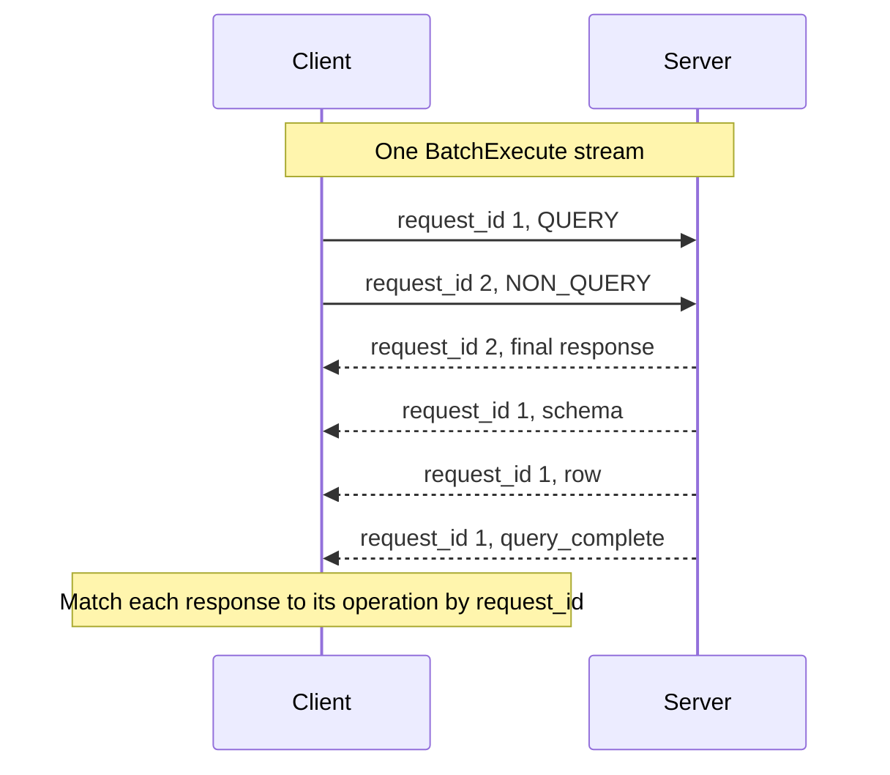
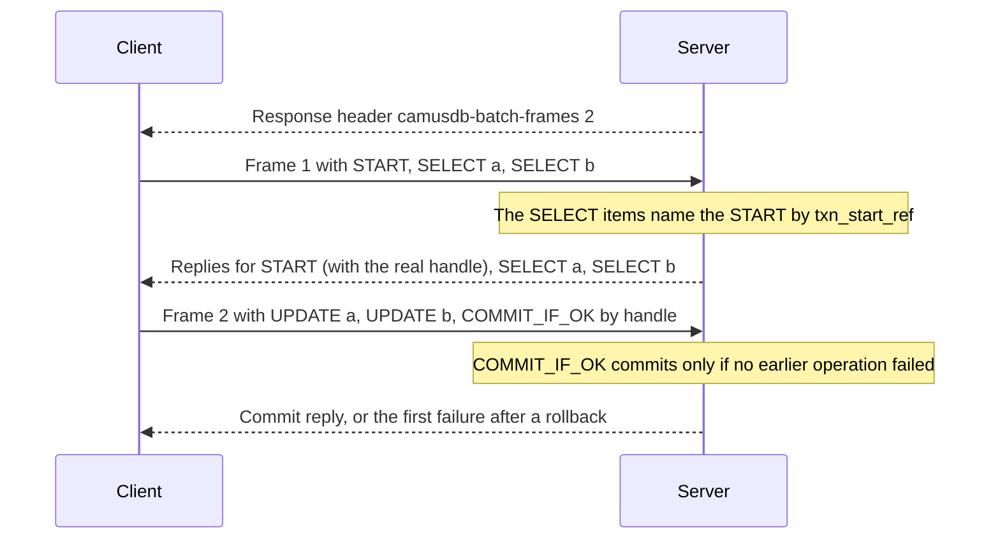

# gRPC API

CamusDB exposes a gRPC API for a client, beside the API of REST with JSON. The
endpoint of gRPC uses HTTP/2, on its own port. It reaches the same engine as the
endpoints of HTTP. That engine covers the SQL, the transactions, and the
operations on a row.

[gRPC](https://grpc.io/) is a protocol for calls between programs. A client
calls typed methods that a `.proto` file defines. The messages travel in a
compact binary format over HTTP/2, so each call costs less than the same call
with JSON.

## When to use the gRPC API

Most applications do not call this API directly. The
[.NET driver](/docs/dotnet-driver) and the
[TypeScript connector](/docs/typescript-connector) already speak gRPC. Set
their protocol option to `grpc`. Use this page when you write a client in a
language without a CamusDB driver, or when you want to know what a driver does.

| | [HTTP API](/docs/http-api) | [gRPC API](/docs/grpc-api) |
| --- | --- | --- |
| Format | JSON text | Protobuf, a compact binary format |
| What a client needs | Any HTTP client, such as `curl` | Bindings that you generate from the `.proto` file |
| Good for | Scripts, automation, health checks, quick tests, and languages without a CamusDB driver | High request rates, long result streams, and many statements over one duplex stream |
| Default port | `5095` | `5096` |

Both APIs reach the same engine, with the same SQL, the same transactions, and
the same errors.

## Enable and configure the endpoint

The endpoint is enabled by default. Configure it in `config.yml`. You can also
disable it there:

```yaml
grpc_enabled: true
grpc_port: 5096
grpc_certificate:
```

Set `grpc_certificate` to a PFX certificate for the client-facing gRPC
listener. If it is empty, CamusDB reuses a configured `raft_certificate`, the
certificate of the node's internal cluster port.
Without either certificate, the listener uses HTTP/2 over plaintext. That form
suits local development and a private test network.

While authentication is enabled, use the service `CamusAuth`. It exchanges a
name of a user and a password for a bearer token. A client of gRPC then sends
that token in the metadata of a request:

```text
authorization: Bearer camus_<id>.<secret>
```

A failure of the authentication returns an `UNAUTHENTICATED`. A failure of a
privilege returns a `PERMISSION_DENIED`. See
[Authentication And Authorization](/docs/sql-authentication).

The contract of Protobuf lives in the source tree of CamusDB, at
`CamusDB.Grpc.Contracts/Protos/camus_sql.proto`. Generate the bindings of your
client from that file. Use the standard tools of gRPC for your language.

## Services

The protocol defines three services:

| Service | Use it for |
| --- | --- |
| `CamusSql` | SQL queries, DML, DDL, explicit transactions, ping, and duplex batching. |
| `CamusRows` | Typed row CRUD without building SQL text. |
| `CamusAuth` | Login and logout for authenticated gRPC clients. |

Use `CamusSql` for most work of an application, and of an ORM. Use `CamusRows`
in one case: the client holds structured values of a row, filters, and an order
already, and it must build no string of SQL.

## Auth service

`CamusAuth` provides the credential exchange used by gRPC-only deployments:

| RPC | Purpose |
| --- | --- |
| `Login` | Accepts `LoginRequest { user, password }` and returns `LoginReply { token, expires_at_unix_ms, expires_in_seconds }`. |
| `Logout` | Revokes the token supplied in `authorization` metadata. Missing or already-revoked tokens still produce the desired end state. |

`expires_at_unix_ms` and `expires_in_seconds` describe the same deadline. Renew
the token before that deadline. Do not assume a fixed lifetime of a token.
An already-open `BatchExecute` stream can outlive ordinary token expiry when it
authenticated while the token was valid; see
[gRPC batch streams and token expiry](/docs/sql-authentication#grpc-batch-streams-and-token-expiry).

## SQL service

`CamusSql` provides:

| RPC | Shape | Purpose |
| --- | --- | --- |
| `ExecuteQuery` | server stream | Execute `SELECT` and `SHOW`; emits schema first, then rows. |
| `ExecuteNonQuery` | unary | Execute `INSERT`, `UPDATE`, `DELETE`, and server-level account statements; returns affected rows, plus `returning_schema` and `returning_rows` for writes with `RETURNING`. |
| `ExecuteDdl` | unary | Execute database, table, index, and schema statements. |
| `StartTransaction` | unary | Start an explicit transaction and receive a `TxnHandle`. |
| `CommitTransaction` | unary | Commit an explicit transaction by handle. |
| `RollbackTransaction` | unary | Roll back an explicit transaction by handle. |
| `BatchExecute` | bidirectional stream | Pipeline SQL operations, transaction lifecycle messages, and prepared-statement lifecycle messages on one stream. |
| `Ping` | unary | Check liveness and round-trip connectivity. |
| `GetNodeStats` | unary | Read disk, CPU, memory, identity, and uptime for the node that receives the call. Requires superuser or `MONITOR` when authentication is enabled. |

A client sends the parameters of the SQL as a `map<string, Value>`. Prefer a
parameter to a value inside the string of the SQL. A typed value then crosses
the wire without a loss. Four such types are `DATE`, `DATETIME`, `BYTES`, and
`UUID`.

Account statements such as `CREATE USER`, `ALTER USER`, `DROP USER`, `GRANT`,
and `REVOKE` name their target in the SQL and do not need an open database.
They can run through unary SQL calls or through `BatchExecute`; bind passwords
as parameters so secrets do not appear in SQL text.

SQL requests can also set `routing_accept_version` to opt in to advisory routing
metadata. Set it to `1` when the client understands `RoutingAdvice`; leave it at
`0` for the historical response shape. See
[SQL Routing Advice](/docs/sql-routing-advice).

`INSERT`, `UPDATE`, and `DELETE` with a `RETURNING` list work through
`ExecuteQuery` and `ExecuteNonQuery`. Through `ExecuteQuery`, the returned rows
arrive as a normal query stream and the schema is sent only after the autocommit
write commits. Through `ExecuteNonQuery`, the reply carries `affected_rows`,
`returning_schema`, and `returning_rows`. Set `discard_returning_rows` on a
no-rows call when the client only needs the count. See
[RETURNING](/docs/sql-writes#returning).

## Cancellation and backpressure

Cancelling a gRPC call, closing a stream, or letting the deadline expire
propagates cancellation into the query pipeline. CamusDB stops scans, joins,
grouping, sorting, distinct, and subqueries at their next storage read or
operator boundary instead of continuing work for a caller that has gone away.

`BatchExecute` also applies server-side backpressure; see
[Duplex batching](#duplex-batching).

## Row service

`CamusRows` provides typed CRUD operations:

| RPC | Purpose |
| --- | --- |
| `InsertRow` | Insert one row from a column-value map. |
| `Query` | Query rows by table, optional index name, filters, and ordering. |
| `QueryById` | Fetch one row by primary-key value. |
| `UpdateRows` | Update matching rows. |
| `UpdateById` | Update one row by primary-key value. |
| `DeleteRows` | Delete matching rows. |
| `DeleteById` | Delete one row by primary-key value. |

A filter uses a `QueryFilter { column_name, op, value }`. The `op` is a string,
such as `"="`, `">"`, `">="`, `"<"`, `"<="`, or `"LIKE"`.

An order uses an `OrderBy { column_name, direction }`. The direction is
ascending, or descending.

`QueryById`, `UpdateById`, and `DeleteById` each take the value of a key, as a
string. The server resolves the true column of the primary key from the schema
of the table. The primary key therefore needs no name `id`.

## Value encoding

Every parameter, every value of a row, every filter, and every cell of a result
uses the `Value` message of Protobuf. It is a typed `oneof`. It follows the
types of a column of CamusDB:

| Column type | Wire field | Encoding |
| --- | --- | --- |
| `NULL` | `null_value` | Explicit typed NULL sentinel. |
| `ID` / `OID` | `id_value` | 24 lowercase ObjectId hex characters. |
| `INT64` | `int64_value` | Signed 64-bit integer. |
| `STRING` | `string_value` | UTF-8 string. |
| `BOOL` | `bool_value` | Boolean. |
| `FLOAT64` | `float64_value` | IEEE-754 double. |
| `FLOAT32` | `float32_value` | IEEE-754 float. |
| `BYTES` | `bytes_value` | Raw bytes. |
| `DATE` | `date_value` | UTC .NET ticks, truncated to midnight. |
| `DATETIME` | `datetime_value` | UTC .NET ticks. |
| `ARRAY` | `array_value` | Element type plus nested `Value` items. |
| `UUID` / `GUID` | `uuid_value` | Exactly 16 bytes in canonical big-endian order. |
| `NUMERIC` | `numeric_value` | Canonical decimal text with at most 9 fractional digits, such as `"-12.5"`. |

These rules matter to a person who writes a client:

- Send ObjectIds in `id_value`, not `string_value`.
- Send UUIDs as 16 bytes, not as strings.
- Send `DATE` and `DATETIME` as ticks, not ISO strings or Unix timestamps.
- Preserve `FLOAT32` and `FLOAT64` as separate wire fields.
- Include the array element type even when the array is empty.
- Treat an unset `Value` and explicit `null_value` as NULL when decoding.

Convert milliseconds of Unix to ticks:

```text
ticks = 621355968000000000 + unix_millis * 10000
```

## Query streams

`ExecuteQuery`, `CamusRows.Query`, and `CamusRows.QueryById` each stream from
the server. Each one uses a contract that sends the schema first:

```text
QueryStreamMessage(schema)
QueryStreamMessage(row)
QueryStreamMessage(row)
...
[QueryStreamMessage(cache_metadata)]
[QueryStreamMessage(routing_advice)]
```

The message of the schema always comes first. It appears exactly one time, even
for an empty result set.

A row is positional. `row.values[i]` belongs to `schema.columns[i]`.

A client must take the type of a column from the schema. It must not take that
type from the first value of a row that is not `NULL`.

A query with a `{cache=...}` hint can add one message `cache_metadata`, after
the last row. An absent message means that the statement carried no hint of the
cache.

A query that negotiated routing metadata can add one `routing_advice` message
after the rows, and after cache metadata when both are present.

## Transactions

Every operation of SQL, and every operation on a row, runs in autocommit mode,
or inside an explicit transaction.

A request in autocommit mode omits the `txn_handle`. The server starts a short
transaction. It runs the operation. It then commits that transaction.

Explicit transactions use `CamusSql.StartTransaction`:

```text
StartTransaction -> TxnHandle
ExecuteQuery / ExecuteNonQuery / ExecuteDdl with txn_handle
CommitTransaction(txn_handle)
```

`StartTxnRequest` and autocommit `SqlRequest` can set:

- `isolation_level`: `READ_COMMITTED` or `SERIALIZABLE`
- `transaction_mode`: `READ_WRITE` or `READ_ONLY`
- `locking`: `PESSIMISTIC` or `OPTIMISTIC`
- `priority`: `BACKGROUND`, `LOW`, `NORMAL`, `HIGH`, or `CRITICAL`

A request can resume an existing `txn_handle`. The server then ignores these
fields. It fixed the properties of the transaction at the start of that
transaction.

For the priority, a `TRANSACTION_PRIORITY_UNSPECIFIED` means the default of the
server. It never means the background.

A CRUD request at the level of a row also accepts a `priority`, when that
request starts a transaction in autocommit mode. See
[Transaction Priority](/docs/transaction-priority) for the semantics of the
admission, and for the configuration.

## Causal tokens

Replies that advance transaction state include a causal token: a cluster
timestamp with the three parts of a [hybrid logical clock (HLC)](/docs/concepts#hlc)
value:

- `causal_token_n`
- `causal_token_l`
- `causal_token_c`

Carry all three values into the next request of the same session of the client.
The component `N` is part of the order of the HLC. Do not drop it.

A token that travels between the requests preserves one behavior: a client reads
its own writes, while it talks to a cluster.

For an explicit transaction, keep the latest causal token in the `TxnHandle`.
That rule applies to a resume of the transaction, to a commit, and to a
rollback.

## Duplex batching

`CamusSql.BatchExecute` lets a client send many operations over one stream in
two directions. That method helps a driver and an ORM. Each one would otherwise
pay one unary round trip for each statement.

Each request contains:

- `request_id`: client-assigned id echoed by every response for that operation
- `kind`: `QUERY`, `NON_QUERY`, `START`, `COMMIT`, `ROLLBACK`, `PREPARE`, or
  `CLOSE`; negotiated clients can also use `FRAME`, and frame contract version 2
  clients can use `COMMIT_IF_OK`
- `request`: the same `SqlRequest` shape used by unary SQL calls, absent on a
  frame
- `items`: on a frame, a list of complete `BatchExecuteRequest` items
- `txn_start_ref`: on an item inside a version 2 frame, the `request_id` of an
  earlier `START` item in that same frame

The responses of two different values of a `request_id` can mix. They can also
arrive out of their order. A client must separate them by the `request_id`.



A batched query emits:

```text
schema
row...
query_complete
```

`query_complete` is the last message of that request. It carries the count of
the rows, and the causal token. For a query with a `{cache=...}` hint, it also
carries the verdict of the cache. For a request that negotiated routing
metadata, it can also carry advisory routing metadata.

Four operations each emit one last response of a success: an operation without a
query, a start, a commit, and a rollback. A non-query response can also carry
advisory routing metadata when the request negotiated it. A non-query response
for a write with `RETURNING` can carry the returning schema and rows. A failed
operation emits one last `BatchError { code, message }`.

Two operations that share a handle of a transaction keep their order, inside one
stream of a batch. A client can use several streams of a batch. It must then put
every operation of one transaction on the same stream. An operation in autocommit
mode can use any stream.

`grpc_batch_max_in_flight` controls how many operations one batch stream
executes at the same time. Once a stream reaches that many in-flight operations,
the server stops pulling more requests from the stream until work finishes.

## Batch stream frames

Batch stream frames let one `BatchExecute` stream message carry several complete
operations, or several complete response messages. A frame is only a transport
optimization. It does not make the operations atomic, and it does not add
ordering beyond the order already provided by the stream.

A request frame uses `kind = FRAME` and puts the operations in `items`. The
frame's own `request_id` is unused. Each item keeps its own `request_id` and is
handled as if it arrived as a separate stream message. One item that fails does
not affect its neighbors.

Frames are negotiated per stream:

- The server sends response header `camusdb-batch-frames: 2` when that stream
  can read request frames. Version 1 means ordinary frames. Version 2 also means
  the stream accepts `txn_start_ref` and `COMMIT_IF_OK`.
- A client must not send a request frame until it has seen that header on the
  same stream. Older servers can treat an unknown kind as a non-query, so do not
  probe with a frame.
- The server sends response frames only after the client proves it can read
  them. The client can send request header `camusdb-batch-frames-accept: 1` when
  opening the stream, or it can send a request frame on that stream.

A frame can contain at most 256 items and at most 1 MiB of serialized item
payload. The sender is responsible for staying inside those limits. A message
larger than the frame byte budget travels as an ordinary single message.

Clients that do not negotiate frames continue to work with one operation per
stream message and ordinary responses. A rotated or rebuilt stream negotiates
again.

Frame contract version 2 lets a custom gRPC client pipeline a short transaction
without waiting for the `START` reply before it sends the next statements. An
item inside a frame can set `txn_start_ref` to the `request_id` of an earlier
`START` item in that same frame instead of using a transaction handle that does
not exist yet. The server chains those items behind the `START` in frame order,
then the `START` reply returns the real handle for later frames.

The rules are strict: `txn_start_ref` must point backward to a `START` in the
same frame, must not be combined with `request.txn_handle`, and must not appear
on `START`, `PREPARE`, or `CLOSE`. A violation is rejected with `CADB0400`
without running the item. If the referenced `START` fails, every item that names
it receives the same code and message and does not run.

`COMMIT_IF_OK` commits a transaction only when no earlier operation in that
transaction on the same batch stream failed. If an earlier operation failed, it
rolls the transaction back idempotently and returns the first failure's code and
message. This lets a client send a bank-style transaction in two frames, such as
`[START, SELECT a, SELECT b]` by `txn_start_ref`, followed by
`[UPDATE a, UPDATE b, COMMIT_IF_OK]` by handle. A client may use
`txn_start_ref` on `COMMIT_IF_OK` too when the whole transaction fits in one
frame.



Only send `txn_start_ref` or `COMMIT_IF_OK` on a stream whose
`camusdb-batch-frames` header announced version `2` or higher. A version 1
server does not understand the contract, so clients must fall back to awaiting
`START`, sending statements by handle, and then sending `COMMIT`.

The server still counts each item in a frame as a request. Use the batch-frame
metrics to see the transport-level effect: `camus_batch_request_frames_total`
counts request frames, and `camus_batch_request_frame_items` records the number
of operations carried by each frame.

## Prepared statements

Prepared statements are supported on `CamusSql.BatchExecute`.

Send a `PREPARE` operation. Give it the target database, and the text of the
SQL. The last message, a `PrepareReply`, returns these values:

- `statement_id`: an integer handle scoped to that batch stream
- `parameter_names`: the positional binding order for placeholders

Then send a `QUERY` or a `NON_QUERY` operation. Give it a `statement_id`, and
the `positional_parameters`. With a `statement_id` present, do not also send the
text of the SQL, the name of the database, or a map of the named parameters.

Use a `CLOSE` to release the id of a prepared statement, on the stream. A second
`CLOSE` is harmless.

A handle belongs to one stream. It disappears when the `BatchExecute` stream
closes, and when a client rebuilds that stream.

An execution can fail with `CADB0520` `UnknownPreparedStatement`. Prepare the
statement again, on the current stream. Then replay the operation one time.

Wait for the `PrepareReply` before you execute with its id. The requests of a
batch can otherwise run at the same time. The execution can then reach the
server before the registration.

A unary call of gRPC accepts no prepared handle. Such a call has no scope of a
stream. See [Prepared Statements](/docs/prepared-statements) for the supported
types of a statement, for the rules of a binding, and for the limits of the
configuration.

## Errors and retries

A unary RPC, and an RPC that streams from the server, both report an error of
the domain as a status error of gRPC. The metadata of the trailer holds the
detail:

| Trailer | Meaning |
| --- | --- |
| `camus-error-code` | CamusDB `CADBxxxx` error code. |
| `camus-error-message` | Human-readable error message. |

An operation of a batch uses a `BatchError` message inside the stream. A trailer
belongs to one call. It does not belong to one operation.

Retry by the `camus-error-code`. Do not retry by the text of a message:

| Code | Retry rule |
| --- | --- |
| `CADB0502` `TransactionConflict` | Replay the whole transaction from a fresh `BEGIN`. |
| `CADB0504` `TransactionMustRetry` | Replay the whole transaction from a fresh `BEGIN`. |
| `CADB0505` `TransactionLifetimeExceeded` | Replay the whole transaction from a fresh `BEGIN`. |
| `CADB0509` `TransactionFinalizeUnresolved` | Retry the same `COMMIT` or `ROLLBACK` on the same transaction handle. |
| `CADB0520` `UnknownPreparedStatement` | Prepare again on the current node or stream, then replay the execution once. |

Bad client input, including SQL syntax errors and `CADB0413`
`StatementTooDeeplyNested`, maps to gRPC `INVALID_ARGUMENT`.

For a query that streams, replay automatically only while the caller has seen no
row. After the first row reaches the caller, report the error to that caller. Do
not replay the query in silence.

## Related pages

- [HTTP API](/docs/http-api)
- [Configuration](/docs/configuration)
- [Transactions And Isolation](/docs/serializable-transactions)
- [Retries And Conflicts](/docs/serializable-retries)
- [Error Codes](/docs/error-codes)
