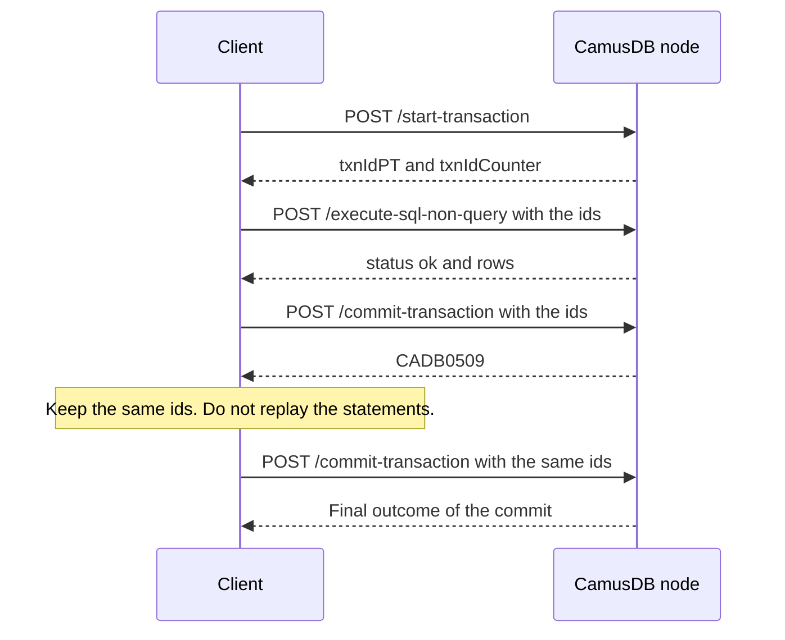

# HTTP API

The HTTP API lets any program run SQL on CamusDB with a plain HTTP request and
a JSON body. You need no driver and no special library. A shell script with
`curl` is enough.

The endpoints speak JSON and suit automation and application integrations.
All request and response properties use camel case.

## When to use the HTTP API

Use the HTTP API when:

- A script, CI job, or automation tool needs to run SQL or check a node's
  health.
- Your language has no CamusDB driver.
- You want to test a request quickly from a terminal.
- A load balancer or monitoring system needs to call a node.

For application code, use the [.NET driver](/docs/dotnet-driver),
[TypeScript connector](/docs/typescript-connector), or
[Python driver](/docs/python-driver) for typed parameters, transactions, and
retry helpers. Python provides DB-API and asyncio interfaces over REST;
.NET and TypeScript also support gRPC and learned routing. For an interactive
session, use [camus-cli](/docs/camus-cli).

| | [HTTP API](/docs/http-api) | [gRPC API](/docs/grpc-api) |
| --- | --- | --- |
| Format | JSON text | Protobuf, a compact binary format |
| What a client needs | Any HTTP client, such as `curl` | Bindings that you generate from the `.proto` file |
| Good for | Scripts, automation, health checks, quick tests, and languages without a CamusDB driver | High request rates, long result streams, and many statements over one duplex stream |
| Default port | `5095` | `5096` |

Both APIs reach the same engine, with the same SQL, the same transactions, and
the same errors.

## Transport

The HTTP API serves JSON over HTTP/1.1 and HTTP/2. The HTTPS port can also serve
HTTP/3 over QUIC when `http3_enabled: true` is set and the node has an HTTPS
certificate.

HTTP/3 uses the same endpoints, request bodies, responses, authentication
headers, and error format as the HTTP/1.1 and HTTP/2 API. It changes only the
transport used between the client and the node.

See [Configuration](/docs/configuration#http3-on-the-https-port) for the
certificate, UDP, and platform QUIC library requirements.

## Status and errors

Successful responses use:

```json
{
  "status": "ok"
}
```

A failed response includes a CamusDB error code when one is available.

Many domain errors map to HTTP 500. Authentication, authorization, validation,
not-found, conflict, and rate-limit errors use their matching status:

```json
{
  "status": "failed",
  "code": "CADB0400",
  "message": "error message"
}
```

See [Error Codes](/docs/error-codes) for the full list and the cause of each
code.

## Request limits

Inline SQL defaults to an 8 MiB UTF-8 limit (`max_statement_bytes`); larger
text fails before parsing with `CADB0557` and HTTP 413. Bound parameter values
do not count toward that text limit. Buffered `/execute-sql-query` and `/query`
responses default to 1,000,000 rows or 256 MiB of estimated memory. Exceeding
either returns `CADB0556` before commit and rolls back the statement.

For large ordinary reads, use `/execute-sql-query-stream` or pagination.
Writes with RETURNING and other writable reads can still buffer before commit,
so changing transport does not always remove the result cap. These limits,
client-connection caps, and transaction caps are described in
[configuration](/docs/configuration#request-resource-limits). They are node
resource bounds, not per-client rate limits or statement timeouts.

## Cancellation

If an HTTP client cancels a request or disconnects while a query is still
running, CamusDB propagates that cancellation into the query pipeline. Scans,
joins, grouping, sorting, distinct, and subquery execution stop at their next
storage read or operator boundary instead of continuing to consume work after
the caller is gone.

For long reads, prefer the streaming query endpoint when your client can consume
rows incrementally. If the client stops reading early, the server treats the
remaining work as abandoned and cleans up the query.

## Authentication

When authentication is enabled, call `/login` to get a bearer token:

```http
POST /login
Content-Type: application/json

{ "user": "admin", "password": "secret" }
```

Successful response:

```json
{
  "status": "ok",
  "token": "camus_<id>.<secret>",
  "expiresAtUnixMs": 1785270000000,
  "expiresInSeconds": 900
}
```

Send the token on later requests:

```http
Authorization: Bearer camus_<id>.<secret>
```

Call `/logout` with the same header to revoke the current token.

`expiresAtUnixMs` is the token's absolute deadline, in UTC.

`expiresInSeconds` is the same deadline as a duration the server measured. It
helps clients that renew on a timer without trusting their own wall clock.

See [Authentication And Authorization](/docs/sql-authentication) for the
environment variables, the SQL statements for users and grants, TLS
requirements, and privilege enforcement.

## Column values

Request bodies send values as `ColumnValue` objects: SQL parameters, filters,
inserted and updated values, and column defaults. Result rows use a more compact
form, with plain JSON values in column order; see
[`POST /execute-sql-query`](#post-execute-sql-query).

CamusDB serializes a `ColumnType` as the numeric value of its enum:

| Value | Type |
| --- | --- |
| `0` | null |
| `1` | id / object id |
| `2` | int64 |
| `3` | string |
| `4` | bool |
| `5` | float64 |
| `6` | float32 |
| `7` | bytes |
| `8` | date |
| `9` | datetime |
| `10` | array |
| `11` | uuid |
| `12` | numeric |

```json
{ "type": 3, "strValue": "R2-D2", "longValue": 0, "floatValue": 0, "boolValue": false }
{ "type": 2, "strValue": null, "longValue": 1977, "floatValue": 0, "boolValue": false }
{ "type": 5, "strValue": null, "longValue": 0, "floatValue": 12.5, "boolValue": false }
{ "type": 6, "strValue": null, "longValue": 0, "floatValue": 12.5, "boolValue": false }
{ "type": 4, "strValue": null, "longValue": 0, "floatValue": 0, "boolValue": true }
{ "type": 1, "strValue": "507f1f77bcf86cd799439011", "longValue": 0, "floatValue": 0, "boolValue": false }
{ "type": 7, "bytesValue": "3q2+7w==", "longValue": 0, "floatValue": 0, "boolValue": false }
{ "type": 8, "longValue": 639039456000000000, "isoValue": "2026-03-15" }
{ "type": 9, "longValue": 639039888000000000, "isoValue": "2026-03-15T12:00:00.0000000Z" }
{ "type": 10, "arrayElementType": 2, "arrayValues": [{ "type": 2, "longValue": 42 }] }
{ "type": 11, "strValue": "550e8400-e29b-41d4-a716-446655440000", "longValue": 0, "uuidHigh": 0 }
{ "type": 12, "strValue": "12345678901234567890.123456789" }
```

SQL literals write bytes in hexadecimal form, `X'...'`. JSON uses base64
instead, in `bytesValue`.

For dates and datetimes, responses include an `isoValue`, and `longValue`
carries the stored value as UTC ticks.

For a UUID in a request, pass the canonical hyphenated text or a 32-character
hexadecimal string in `strValue`. Responses also include a `uuidValue` for
human readers.

For a numeric value in a request, pass decimal text in `strValue`. CamusDB parses
it as `NUMERIC`, rounds to nine fractional digits when necessary, and rejects a
value outside the supported range. A response exposes the canonical decimal text
as `numericValue`.

## Health

### `GET /ping`

Returns server status and UTC time. `GET /health` is an alias that returns the
same response. Both answer without a credential.

```json
{
  "status": "ok",
  "dateTime": "2026-05-28T18:30:00.0000000Z"
}
```

## Databases

Create a database explicitly before table DDL, DML, or queries can use its
name.

### `POST /create-db`

```json
{
  "databaseName": "app",
  "ifNotExists": true
}
```

### `POST /drop-db`

```json
{
  "databaseName": "app"
}
```

This endpoint drops an existing database. For a drop you can safely repeat,
use SQL:

```json
{
  "sql": "DROP DATABASE IF EXISTS app"
}
```

SQL can also rename a database:

```json
{
  "sql": "RENAME DATABASE app TO app_prod"
}
```

CamusDB also accepts the equivalent form, `ALTER DATABASE ... RENAME TO`:

```json
{
  "sql": "ALTER DATABASE app RENAME TO app_prod"
}
```

### `POST /close-db`

```json
{
  "databaseName": "app"
}
```

## Tables

### `POST /create-table`

```json
{
  "databaseName": "app",
  "tableName": "robots",
  "ifNotExists": true,
  "columns": [
    { "name": "id", "type": "id", "primary": true, "notNull": true, "defaultValue": null },
    { "name": "parent_id", "type": "id", "notNull": false, "defaultValue": null },
    { "name": "name", "type": "string", "maxLength": 64, "notNull": true, "defaultValue": null },
    { "name": "payload", "type": "bytes", "notNull": false, "defaultValue": null },
    { "name": "tags", "type": "array", "arrayElementType": "string", "notNull": false, "defaultValue": null },
    {
      "name": "year",
      "type": "int64",
      "notNull": false,
      "defaultValue": {
        "type": 2,
        "strValue": null,
        "longValue": 2024,
        "floatValue": 0,
        "boolValue": false
      }
    }
  ],
  "foreignKeys": [
    {
      "name": "robots_parent_fk",
      "columns": ["parent_id"],
      "referencedTable": "robots",
      "referencedColumns": ["id"],
      "onDelete": "restrict",
      "onUpdate": "no action"
    }
  ]
}
```

The HTTP create-table model accepts these types: `id`,
`int64`, `float64`, `float32`, `bool`, `string`, `date`, `datetime`, `bytes`,
`uuid`, `numeric`, and `array`. It also accepts the aliases `int`, `integer`,
`char`, `varchar`, `text`, `real`, `timestamp`, `blob`, `guid`, and `decimal`.
Type names are not case sensitive.

Use `maxLength` to limit `string` and `bytes` values, and `arrayElementType`
for array columns.

Use `foreignKeys` to declare table-level foreign keys. Each entry needs a
`name`, the child `columns`, and a `referencedTable`. `referencedColumns` can be
empty to reference the parent primary key. `onDelete` and `onUpdate` accept
`"no action"` and `"restrict"` today. See
[Foreign Keys](/docs/foreign-keys).

See [Data Types](/docs/data-types) for SQL type names, aliases, literal
formats, and JSON value rules.

## SQL execution

Prefer the SQL endpoints when you can. They use the same parser and executor
as the engine's tests.

Autocommit SQL requests use Serializable isolation by default.

An autocommit request that starts a transaction accepts `isolationLevel`
(`"Serializable"` or `"ReadCommitted"`) and `transactionMode` (`"ReadWrite"` or
`"ReadOnly"`).

An autocommit request that writes can also set `locking` to `"Pessimistic"` or
`"Optimistic"`.

A request that starts a transaction can set `priority` to `"Background"`,
`"Low"`, `"Normal"`, `"High"`, or `"Critical"`.

CamusDB ignores these fields when the request resumes an existing transaction
through `txnIdPT` and `txnIdCounter`.

A read-only request to `/execute-sql-query` also ignores `locking`. It runs no
write transaction, so it neither acquires nor validates write conflicts.

### `POST /execute-sql-ddl`

For schema-changing SQL:

```json
{
  "databaseName": "app",
  "sql": "CREATE TABLE IF NOT EXISTS robots (id OID PRIMARY KEY NOT NULL, name STRING NOT NULL, year INT64)",
  "parameters": null
}
```

Server-level database statements can omit `databaseName`:

```json
{
  "sql": "CREATE DATABASE IF NOT EXISTS app",
  "parameters": null
}
```

Server-level operational queries, such as `SHOW ENGINE STATS`, can also omit
`databaseName`.

### `POST /execute-sql-query`

For `SELECT` and `SHOW` statements:

```json
{
  "databaseName": "app",
  "sql": "SELECT id, name FROM robots WHERE year >= @year ORDER BY name ASC",
  "isolationLevel": "Serializable",
  "transactionMode": "ReadOnly",
  "parameters": {
    "@year": {
      "type": 2,
      "strValue": null,
      "longValue": 1970,
      "floatValue": 0,
      "boolValue": false
    }
  }
}
```

Response:

```json
{
  "status": "ok",
  "total": 1,
  "columns": [
    { "name": "id", "type": 1 },
    { "name": "name", "type": 3 }
  ],
  "rows": [
    ["507f1f77bcf86cd799439011", "R2-D2"]
  ],
  "code": null,
  "message": null,
  "causalToken": { "n": 1, "l": 1792500000000, "c": 0 },
  "serverTimeMs": 2.4,
  "cacheStatus": null,
  "cacheBypassReason": null,
  "cachedAtHlc": null,
  "ageMs": null,
  "cacheName": null
}
```

`columns` lists the output columns in order, with the numeric `ColumnType` of
each one. It is present even when `rows` is empty. Each entry in `rows` is an
array by position: `rows[r][c]` is the value of `columns[c]`. Values use plain
JSON, not `ColumnValue` objects:

| Column type | JSON value |
| --- | --- |
| id, string | string |
| int64, float64, float32 | number |
| bool | `true` or `false` |
| bytes | base64 string |
| date, datetime | number of UTC ticks |
| uuid | array of two int64 numbers, `[high, low]` |
| numeric | decimal text, such as `"19.99"` |
| array | JSON array of element values. The column also has an `elementType` |

A SQL `NULL` is JSON `null`. The cache fields are `null` unless the query
carries a cache hint. See [Query Result Cache](/docs/query-result-cache).

`causalToken` is a cluster timestamp: the `n`, `l`, and `c` parts of a
[hybrid logical clock (HLC)](/docs/concepts#hlc) value. Send it back as
`causalToken` on the next autocommit query or `/start-transaction` request
so the read observes your earlier writes on another node. An explicit
transaction's floor is fixed at its start; tokens on later statements do not
advance it.

This endpoint also accepts `INSERT`, `UPDATE`, and `DELETE` statements with a
`RETURNING` list. The response is the same query result shape: `columns`, then
`rows`.

Set `routingAcceptVersion: 1` on the request to opt in to advisory routing
metadata. An eligible response then includes an optional `routing` object. See
[SQL Routing Advice](/docs/sql-routing-advice).

This endpoint supports time-travel reads with `AS OF SYSTEM TIME`. The
statement must be a read-only `SELECT` in autocommit mode:

```json
{
  "databaseName": "app",
  "sql": "SELECT id, name FROM robots AS OF SYSTEM TIME '-10s' WHERE year >= @year",
  "transactionMode": "ReadOnly",
  "parameters": {
    "@year": {
      "type": 2,
      "longValue": 1970
    }
  }
}
```

The SQL restrictions also apply over HTTP: the clause cannot run inside an
explicit transaction, and an invalid time-travel value returns `CADB0409`
`InvalidAsOfSystemTime`. See [Time-Travel Reads](/docs/time-travel-reads).

### `POST /execute-sql-query-stream`

For large `SELECT` or `SHOW` results, use the streaming endpoint:

```json
{
  "databaseName": "app",
  "sql": "SELECT id, name FROM robots ORDER BY name",
  "isolationLevel": "Serializable",
  "transactionMode": "ReadOnly",
  "parameters": null
}
```

The request body has the same shape as for `/execute-sql-query`. The response
is one JSON value per line, with content type `application/x-ndjson`:

```json
{"status":"ok","columns":[{"name":"id","type":1},{"name":"name","type":3}]}
["507f1f77bcf86cd799439011","R2-D2"]
["507f1f77bcf86cd799439012","C-3PO"]
{"status":"ok","total":2,"serverTimeMs":3.1}
```

The first line is the schema header. Each row is a compact positional array in
the header's column order.

The last line is a trailer with the final status, the total number of streamed
rows, an optional causal token, and the server time.

If an error happens before the first line, CamusDB returns an ordinary JSON
error body with the matching HTTP status.

If an error happens after the stream starts, the HTTP status may already be
`200`, so CamusDB reports the failure in the final trailer:

```json
{"status":"failed","total":128,"code":"CADB0502","message":"transaction conflict","serverTimeMs":12.4}
```

An autocommit stream runs a single attempt. Rows can already be on the wire
before the commit, so the server cannot silently replay a late Serializable
conflict. The buffered endpoint can.

Use `/execute-sql-query` when automatic autocommit retries matter more than
incremental delivery, or use an explicit transaction and retry from the client.

### `POST /execute-sql-non-query`

For `INSERT`, `UPDATE`, and `DELETE` statements:

```json
{
  "databaseName": "app",
  "sql": "UPDATE robots SET name = @name WHERE id = @id",
  "parameters": {
    "@name": { "type": 3, "strValue": "Artoo", "longValue": 0, "floatValue": 0, "boolValue": false },
    "@id": { "type": 1, "strValue": "507f1f77bcf86cd799439011", "longValue": 0, "floatValue": 0, "boolValue": false }
  }
}
```

Response:

```json
{
  "status": "ok",
  "rows": 1
}
```

A write statement with a `RETURNING` list can also run through this endpoint.
The response keeps `rows` as the affected-row count and adds `columns` and
`returningRows`:

```json
{
  "status": "ok",
  "rows": 1,
  "columns": [{ "name": "id", "type": 1 }],
  "returningRows": [["507f1f77bcf86cd799439011"]]
}
```

Set `discardReturningRows: true` in the request body when the caller needs only
the affected-row count. CamusDB still validates the `RETURNING` list and checks
the required privileges.

Set `routingAcceptVersion: 1` on the request to opt in to advisory routing
metadata. An eligible response then includes an optional `routing` object. See
[SQL Routing Advice](/docs/sql-routing-advice).

### Locking reads

`SELECT ... FOR UPDATE` uses the query endpoints but needs a writable
transaction. Autocommit locking reads commit and release their locks before
sending rows; use an explicit transaction if a later UPDATE depends on the
lock. Pass `"isolationLevel": "ReadCommitted"` for autocommit SKIP LOCKED.
See [locking reads](/docs/sql-queries#for-update) for restrictions and error codes.

## Prepared statements

A prepared statement lets a client register SQL once and then execute it many
times by handle, with different positional values. It helps with hot
parameterized statements and covers `SELECT`, `INSERT`, `UPDATE`, `DELETE`, and
`SHOW`.

Register a statement:

```http
POST /prepare-sql-statement
Content-Type: application/json

{
  "databaseName": "app",
  "sql": "SELECT id, name FROM robots WHERE year >= @year"
}
```

Response:

```json
{
  "status": "ok",
  "statementId": "opaque-node-local-handle",
  "parameterNames": ["@year"]
}
```

Execute it through `/execute-sql-query`, `/execute-sql-query-stream`, or
`/execute-sql-non-query`:

```json
{
  "statementId": "opaque-node-local-handle",
  "positionalParameters": [
    { "type": 2, "longValue": 1980 }
  ],
  "transactionMode": "ReadOnly"
}
```

When you send `statementId`, omit `sql`, `databaseName`, and the named
`parameters`.

`positionalParameters[i]` binds to `parameterNames[i]` from the prepare
response.

Close a handle:

```http
POST /close-sql-statement
Content-Type: application/json

{ "statementId": "opaque-node-local-handle" }
```

A REST handle belongs to the node and the principal that prepared it.

If an execution returns `CADB0520` `UnknownPreparedStatement`, prepare the
statement again and replay the execution once.

See [Prepared Statements](/docs/prepared-statements) for handle scope,
authorization behavior, and limits.

## Direct row operations

Direct endpoints take filters instead of a SQL string. A filter has a column
name, an operator, and a `ColumnValue`.

`OrderType` is also numeric: `0` is ascending and `1` is descending.

```json
{
  "columnName": "year",
  "op": ">=",
  "value": {
    "type": 2,
    "strValue": null,
    "longValue": 1970,
    "floatValue": 0,
    "boolValue": false
  }
}
```

### `POST /insert`

```json
{
  "databaseName": "app",
  "tableName": "robots",
  "values": {
    "id": { "type": 1, "strValue": "507f1f77bcf86cd799439011", "longValue": 0, "floatValue": 0, "boolValue": false },
    "name": { "type": 3, "strValue": "R2-D2", "longValue": 0, "floatValue": 0, "boolValue": false },
    "year": { "type": 2, "strValue": null, "longValue": 1977, "floatValue": 0, "boolValue": false }
  }
}
```

### `POST /query`

```json
{
  "databaseName": "app",
  "tableName": "robots",
  "filters": [
    {
      "columnName": "year",
      "op": ">=",
      "value": { "type": 2, "strValue": null, "longValue": 1970, "floatValue": 0, "boolValue": false }
    }
  ],
  "orderBy": [
    { "columnName": "year", "type": 1 }
  ]
}
```

### `POST /query-by-id`

```json
{
  "databaseName": "app",
  "tableName": "robots",
  "id": "507f1f77bcf86cd799439011"
}
```

### `POST /update`

```json
{
  "databaseName": "app",
  "tableName": "robots",
  "values": {
    "name": { "type": 3, "strValue": "Artoo", "longValue": 0, "floatValue": 0, "boolValue": false }
  },
  "filters": [
    {
      "columnName": "id",
      "op": "=",
      "value": { "type": 1, "strValue": "507f1f77bcf86cd799439011", "longValue": 0, "floatValue": 0, "boolValue": false }
    }
  ]
}
```

### `POST /delete`

```json
{
  "databaseName": "app",
  "tableName": "robots",
  "filters": [
    {
      "columnName": "year",
      "op": "<",
      "value": { "type": 2, "strValue": null, "longValue": 1970, "floatValue": 0, "boolValue": false }
    }
  ]
}
```

## Explicit transactions

Start a transaction:

### `POST /start-transaction`

```json
{
  "databaseName": "app",
  "isolationLevel": "Serializable",
  "transactionMode": "ReadWrite",
  "locking": "Pessimistic",
  "priority": "Normal"
}
```

`isolationLevel`, `transactionMode`, `locking`, and `priority` are all
optional. Without them, the transaction starts with the server defaults:

- Isolation level: Serializable.
- Transaction mode: read-write.
- Locking: pessimistic.
- Priority: normal.

The optional `causalToken` carries the last commit's timestamp into `BEGIN`:

```json
{
  "databaseName": "app",
  "isolationLevel": "ReadCommitted",
  "causalToken": { "n": 1, "l": 1792500000000, "c": 0 }
}
```

Use the actual token returned by your last commit, including all three fields.
Read Committed statement snapshots are at least that timestamp, preventing a
read on a node with a slower clock from missing the earlier commit.

Use `"ReadCommitted"` only when you intend to step down from the default
Serializable behavior.

Use `"ReadOnly"` with `"Serializable"` for a stable snapshot transaction.

Use `"Optimistic"` when CamusDB should detect conflicts at commit instead of
taking explicit locks during the transaction.

Use priority only to order admission under a configured concurrency gate.

CamusDB rejects unknown locking or priority values with `InvalidInput`.

See [Transaction Priority](/docs/transaction-priority) for the priority levels
and gate configuration.

Response:

```json
{
  "status": "ok",
  "txnIdPT": 123,
  "txnIdCounter": 1
}
```

Pass `txnIdPT` and `txnIdCounter` on later SQL or direct row requests to reuse
the transaction:

```json
{
  "databaseName": "app",
  "txnIdPT": 123,
  "txnIdCounter": 1,
  "sql": "INSERT INTO robots (id, name) VALUES (GEN_ID(), 'K-2SO')"
}
```

Commit or roll back:

### `POST /commit-transaction`

```json
{
  "databaseName": "app",
  "txnIdPT": 123,
  "txnIdCounter": 1
}
```

A successful commit returns its causal token when it has a commit timestamp:

```json
{
  "status": "ok",
  "causalToken": { "n": 1, "l": 1792500000000, "c": 0 }
}
```

The token can be null for a transaction that never opened a session. Carry the
returned token into the next `/start-transaction` or autocommit
`/execute-sql-query` request to observe the commit across nodes. An existing
transaction's causal floor is fixed at its start.

### `POST /rollback-transaction`

```json
{
  "databaseName": "app",
  "txnIdPT": 123,
  "txnIdCounter": 1
}
```

If a `COMMIT` or `ROLLBACK` returns `CADB0509` `TransactionFinalizeUnresolved`,
retry the same request with the same transaction id.

Do not start a fresh transaction or replay the statements. The original commit
may already have succeeded on the server.



`ROLLBACK` is idempotent by transaction id. If the transaction was already
rolled back and the server no longer tracks it, the rollback request succeeds as
a no-op. If a commit or rollback is still in progress for the same id, CamusDB
returns `CADB0501` `TransactionAlreadyCompleted` instead of guessing the
outcome.
